# Bun RAD Studio: the applications

**66 desktop applications** in one toolbox: databases, developer tools, file tools, system monitors, productivity and games. Each one is a real window, runs on your own computer, has no accounts and no cloud, shares one set of 60+ themes, and explains every button when you hover over it.

> Install once, then open any of them from the **Launcher** (`bun run app:launcher`), or run its command below.

## Contents

- [Featured: the File Manager](#featured-the-file-manager)
- [File & Directory Tools](#file-and-directory-tools) (4)
- [Developer Tools](#developer-tools) (15)
- [Database & Storage](#database-and-storage) (4)
- [Network & Cloud](#network-and-cloud) (3)
- [Security & Crypto](#security-and-crypto) (2)
- [System & Hardware](#system-and-hardware) (5)
- [Productivity & Text](#productivity-and-text) (5)
- [Design & Media](#design-and-media) (1)
- [Design & UX](#design-and-ux) (1)
- [RAD Studio](#rad-studio) (2)
- [Games & Entertainment](#games-and-entertainment) (24)

## Featured: the File Manager

An all-in-one, safe desktop file manager and workstation for macOS, Windows and Linux. Features **folder tabs**, an **expandable sidebar folder tree**, **7 color tags**, **Quick Look (`Space`)**, **Dual-Pane Commander view (`Alt+5`)**, an undoable Recycle Bin, **batch conversion of pictures, video, sound and documents**, a **built-in Image & Media Studio**, **AmpDeck 10-band EQ & 108-visualizer player**, **Databases Hub with cross-engine cloning & Bun JS macros**, **Split-view Code Editor**, **24 built-in arcade games**, **180 themes with glass & glow**, and a **two-way synced terminal**.

| Browse, Folder Tabs, Color Tags & Preview | Dual-Pane Commander (`F5` Copy / `F6` Move) |
| :--- | :--- |
|  | 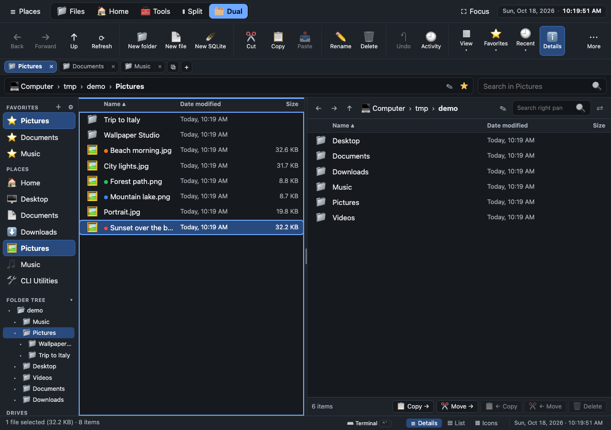 |
| **Batch Convert & Process** | **Two-Way Synced Terminal in Current Folder** |
|  |  |
| **Built-in Image & Media Studio** | **AmpDeck Media Player (10-Band EQ & 108 Visualizers)** |
| 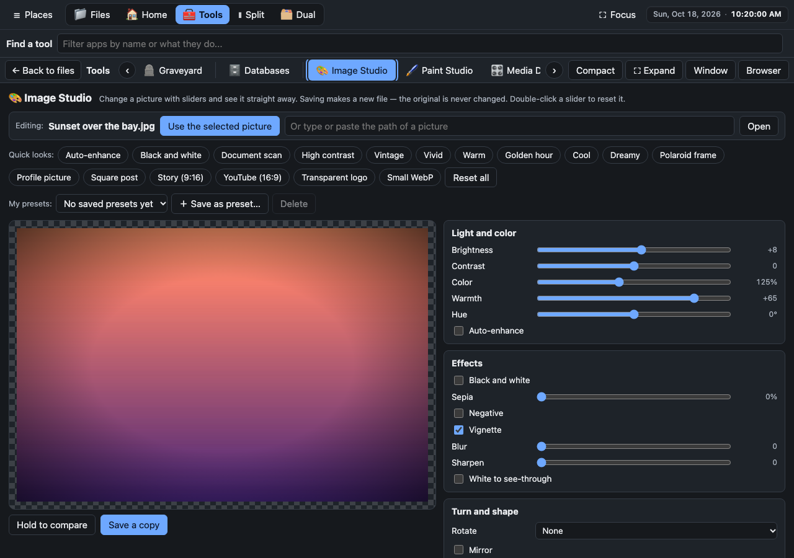 | 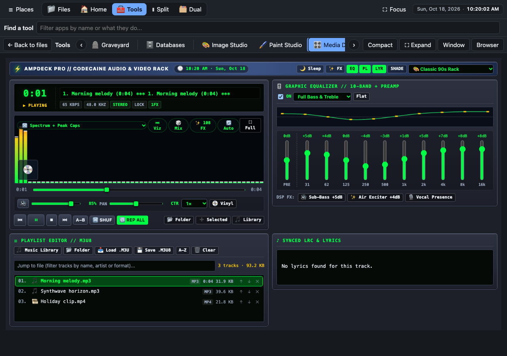 |
| **Databases Hub, Cross-Engine Cloning & Bun JS Macros** | **Split View + Built-in Code Editor & Live Preview** |
|  | 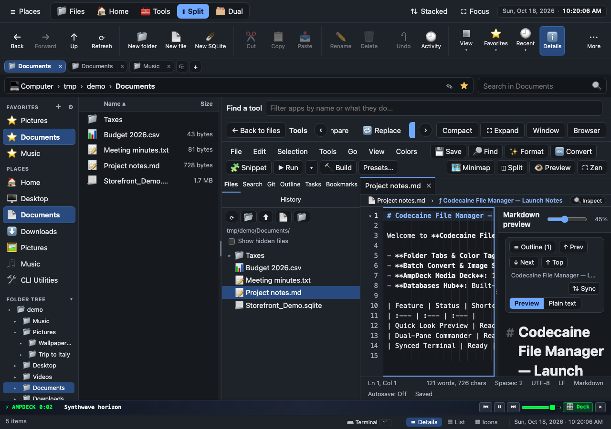 |
| **24 Built-in Retro Arcade, Card & Puzzle Games** | **180 Themes: Frosted Glass, Neon Glow & Motion FX** |
| 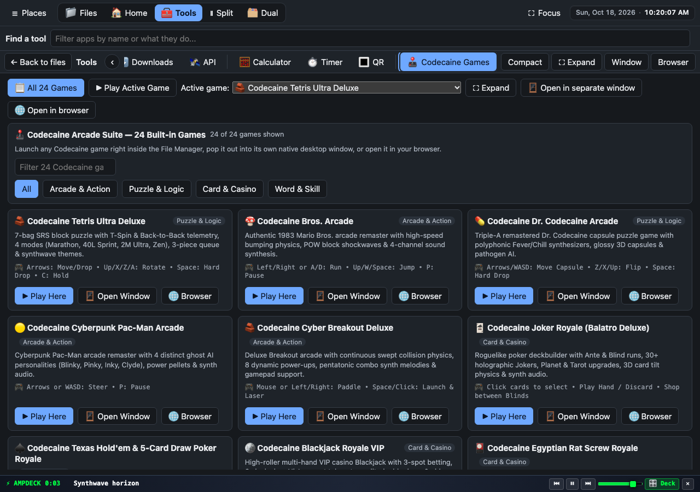 | 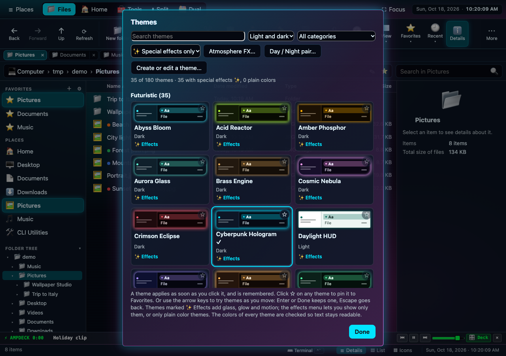 |
| **Fits a smaller window (Responsive Layout)** | **Edit Redis keys in place** |
|  | 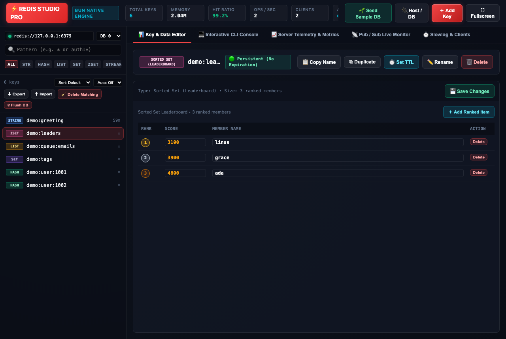 |

`bun run app:files`  ·  [User guide](docs/userguides/43_file_manager.md)

## File & Directory Tools

_Find, clean, move and understand the files on your computer._

### 🔍 Fd Studio Pro

Ultra-fast native Bun filesystem traversal, globbing & quarantine manager.

`bun run app:fd`  ·  [User guide](docs/userguides/17_fd_studio.md)

### 📁 Codecaine File Manager

Easy, safe file manager for Windows, macOS & Linux: browse, search, copy, move, rename, zip, Recycle Bin with Undo.

`bun run app:files`  ·  [User guide](docs/userguides/43_file_manager.md)

### 💾 Disk Usage Studio (GDU)

Fast disk usage analyzer with interactive directory space allocation.

`bun run app:gdu`  ·  [User guide](docs/userguides/23_gdu_studio.md)

### 🪦 Rip Studio Pro

Safe file quarantine, seance recovery & graveyard deletion workbench.

`bun run app:rip`  ·  [User guide](docs/userguides/18_rip_studio.md)

## Developer Tools

_Everything a developer reaches for, in one window each._

### 📡 API Testing Studio Pro

REST & HTTP client with benchmark metrics, headers editor & response inspector.

`bun run app:api`  ·  [User guide](docs/userguides/07_api_studio.md)

### 📦 App Bundler Studio Pro

Single-executable compiler & macOS .app bundle packager with icons.

`bun run app:bundler`  ·  [User guide](docs/userguides/11_app_bundler_studio.md)

### ⚡ NovaCode Studio Pro

Advanced developer-focused code editor & workstation with multi-file tabs, lexical syntax highlighting, interactive minimap, terminal runner, and split preview.

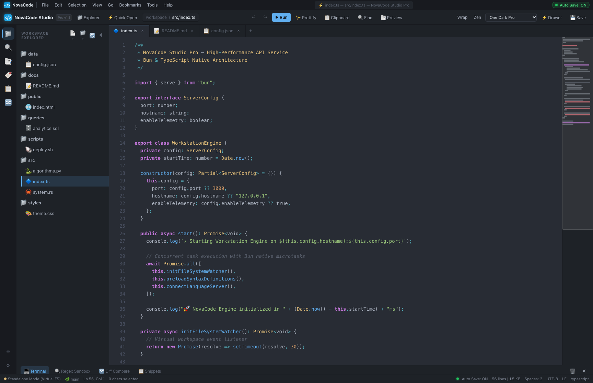

`bun run app:code`  ·  [User guide](docs/userguides/35_codecaine_bros_arcade.md)

### 🔄 Data Format Converter Studio

Instant converter between JSON, YAML, TOML, CSV, XML & TS interfaces.

`bun run app:convert`  ·  [User guide](docs/userguides/08_data_converter_studio.md)

### 🛠️ DevTools & OmniTool Studio

Unified developer CLI toolkit with 6 developer engines powered natively.

`bun run app:devtools`  ·  [User guide](docs/userguides/05_devtools_studio.md)

### 🔐 Environment Variable Studio

Secure .env configuration manager, secret vault & encryption workbench.

`bun run app:env`  ·  [User guide](docs/userguides/16_environment_vault_studio.md)

### 🌿 Git Version Control Studio

Visual diff inspector, working tree controller & commit audit trail.

`bun run app:git`  ·  [User guide](docs/userguides/13_git_workbench_studio.md)

### 📋 JQ JSON Query Studio

Interactive JSON query & transformation workstation powered by native JQ filters.

`bun run app:jq`  ·  [User guide](docs/userguides/04_json_query_studio.md)

### 🧰 OmniTool Studio Pro

Swiss-army knife for encoding, decoding, hash generation & text processing.

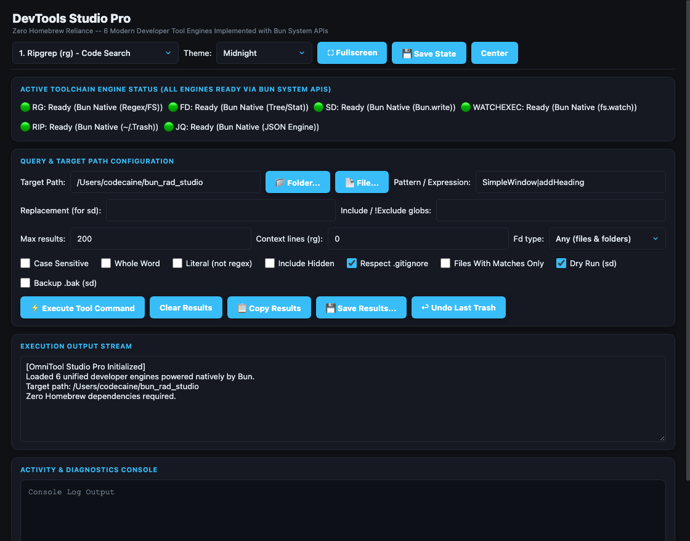

`bun run app:devtools`  ·  [User guide](docs/userguides/05_devtools_studio.md)

### ⚡ RAD Utilities Studio Pro

44 high-velocity development modules for Rapid Application Development with live recipes & testing.

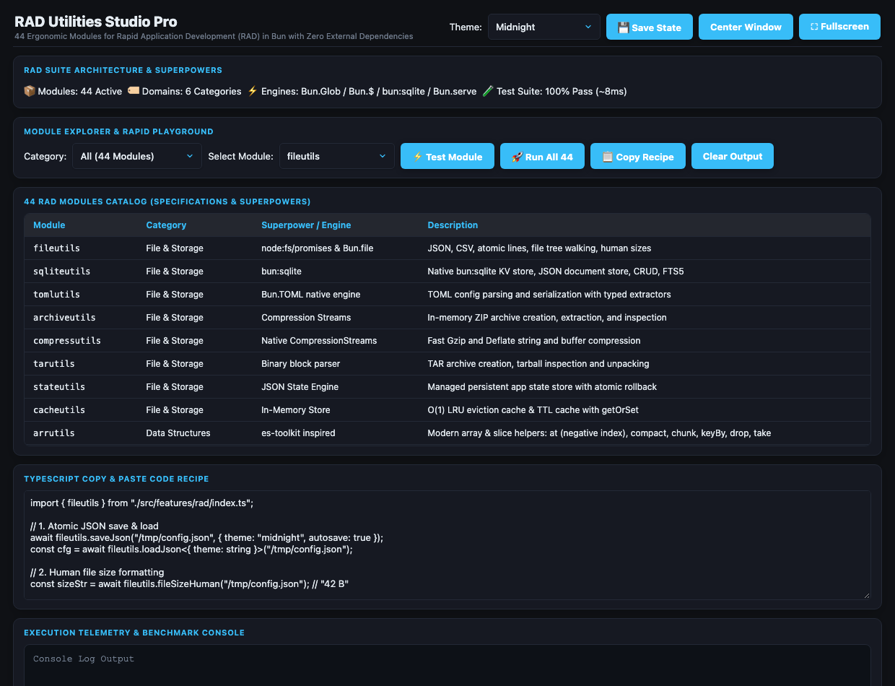

`bun run app:rad`

### 🎯 Regex Pattern Testing Studio

Interactive regex validator with match highlight, group capture & cheat-sheet.

`bun run app:regex`  ·  [User guide](docs/userguides/10_regex_studio.md)

### ✏️ Stream Editor Studio (SD)

Intuitive find & replace utility with string, regex & dry-run diff preview.

`bun run app:sd`  ·  [User guide](docs/userguides/19_sd_studio.md)

### 🔀 Subprocess Pipe Pro

Multi-stage subprocess orchestrator, stream pipelining (stdout ➔ stdin), privilege elevation & shell master.

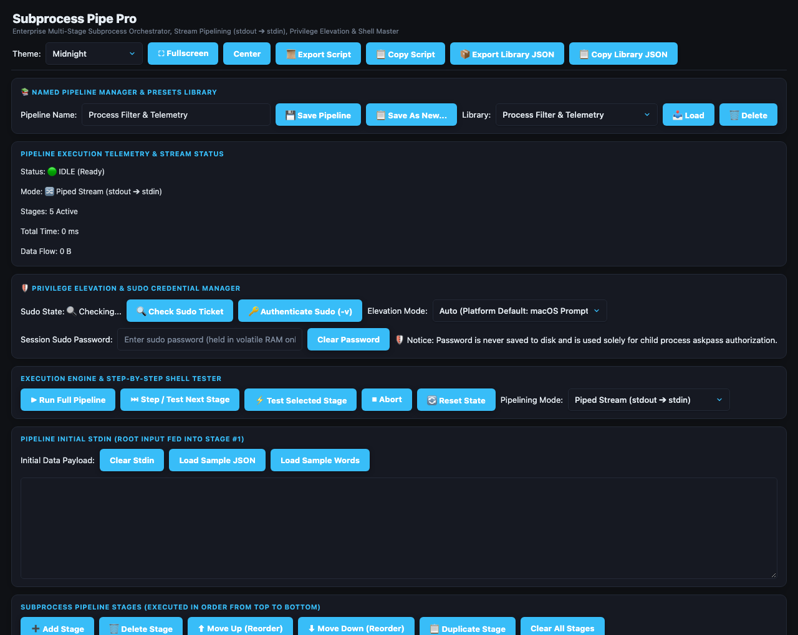

`bun run app:pipe`

### 📊 Code Statistics Studio (Tokei)

Lines of code counter, comment-to-code ratio & language breakdown.

`bun run app:tokei`  ·  [User guide](docs/userguides/22_tokei_studio.md)

### ⏱️ WatchExec Studio Pro

Automated command execution engine reacting to directory updates.

`bun run app:watch`  ·  [User guide](docs/userguides/21_watchexec_studio.md)

## Database & Storage

_Look inside and work with SQLite, MySQL, PostgreSQL and Redis._

### 🐬 MySQL Studio Pro

Enterprise MySQL database workstation, query IDE, schema visualizer & InnoDB performance suite.

`bun run app:mysql`  ·  [User guide](docs/userguides/41_mysql_studio.md)

### 🐘 Postgres Studio Pro

Enterprise PostgreSQL database workstation, schemas, materialized views, extensions & process diagnostics.

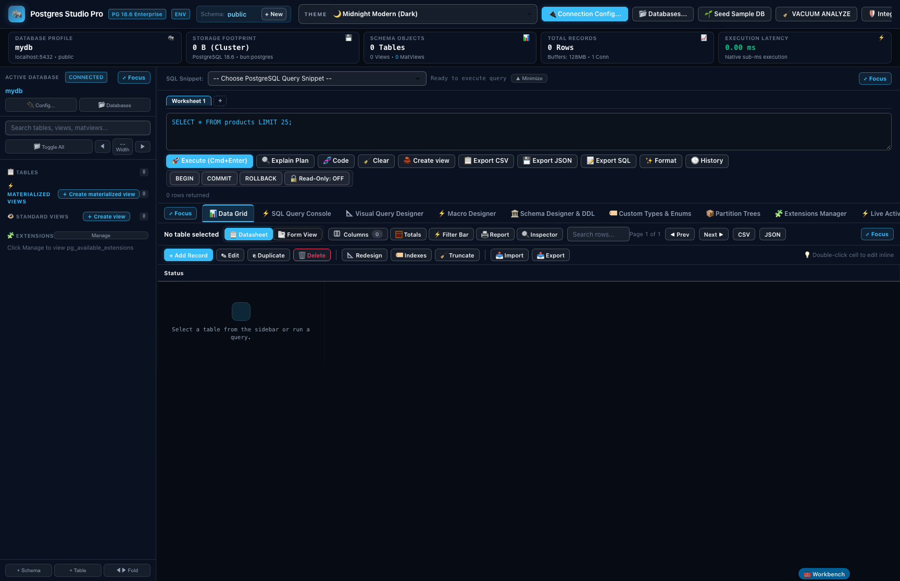

`bun run app:pg`  ·  [User guide](docs/userguides/42_postgres_studio.md)

### ⚡ Redis Studio Pro

Real-time Redis telemetry, live key-value inspector & memory diagnostics.

`bun run app:redis`  ·  [User guide](docs/userguides/40_redis_studio.md)

### 🗄️ SQLite Studio Pro

Enterprise embedded database workstation & query IDE with zero-latency execution.

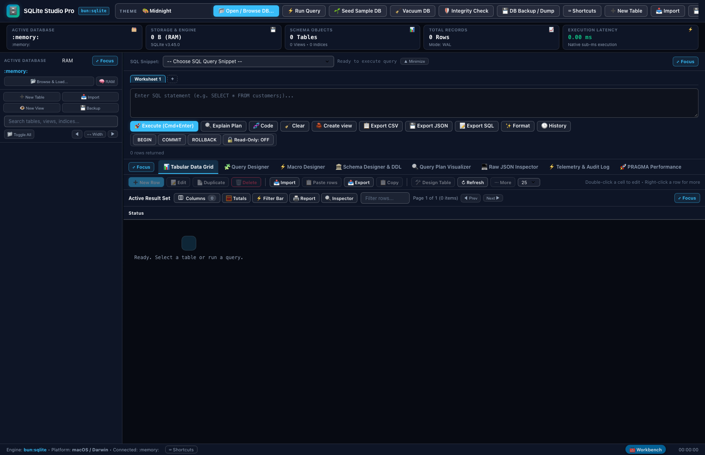

`bun run app:sqlite`  ·  [User guide](docs/userguides/01_sqlite_studio.md)

## Network & Cloud

_See what the network is doing and where it leads._

### 🐕 DNS Query Studio (Doggo)

Modern DNS lookup client with DoH, DoT, trace recursion & record browser.

`bun run app:doggo`  ·  [User guide](docs/userguides/26_doggo_studio.md)

### 🌍 IP Geolocation Studio

Public IP resolver, ASN lookup, geo-coordinates & WHOIS inspector.

`bun run app:ipinfo`  ·  [User guide](docs/userguides/24_ipinfo_studio.md)

### 🌐 Network Diagnostics Studio

Comprehensive socket inspector, port scanner, DNS testing & HTTP client.

`bun run app:network`  ·  [User guide](docs/userguides/12_network_forensics_studio.md)

## Security & Crypto

_Hashes, keys, secrets and encryption without the command line._

### 🔒 Cryptography & Hashing Studio

SHA-256, HMAC, AES-GCM cipher workbench with password entropy testing.

`bun run app:crypto`  ·  [User guide](docs/userguides/09_crypto_studio.md)

### 🕵️ Subdomain Finder Studio

Passive DNS and Certificate Transparency subdomain discovery engine.

`bun run app:subfinder`  ·  [User guide](docs/userguides/25_subfinder_studio.md)

## System & Hardware

_Know what your machine is running and keep it tidy._

### 🍺 Homebrew Package Studio

Package dependency manager & Bun ecosystem workstation.

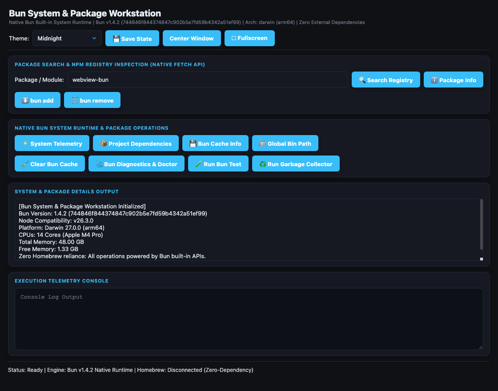

`bun run app:brew`  ·  [User guide](docs/userguides/02_system_package_studio.md)

### 📈 Process Monitor Studio

Real-time process telemetry, signal dispatcher & TCP connection inspector.

`bun run app:task`  ·  [User guide](docs/userguides/06_process_monitor_studio.md)

### ⚙️ Procs Process Workstation

Modern top/ps replacement with Docker container detection and tree view.

`bun run app:procs`  ·  [User guide](docs/userguides/20_procs_studio.md)

### 🖥️ System Information Studio Pro

Hardware intelligence & telemetry workstation covering all 10 domain areas.

`bun run app:brew`  ·  [User guide](docs/userguides/02_system_package_studio.md)

### 📊 Task Manager & Process Studio

Live CPU/Memory monitor, process tree visualizer & port listener.

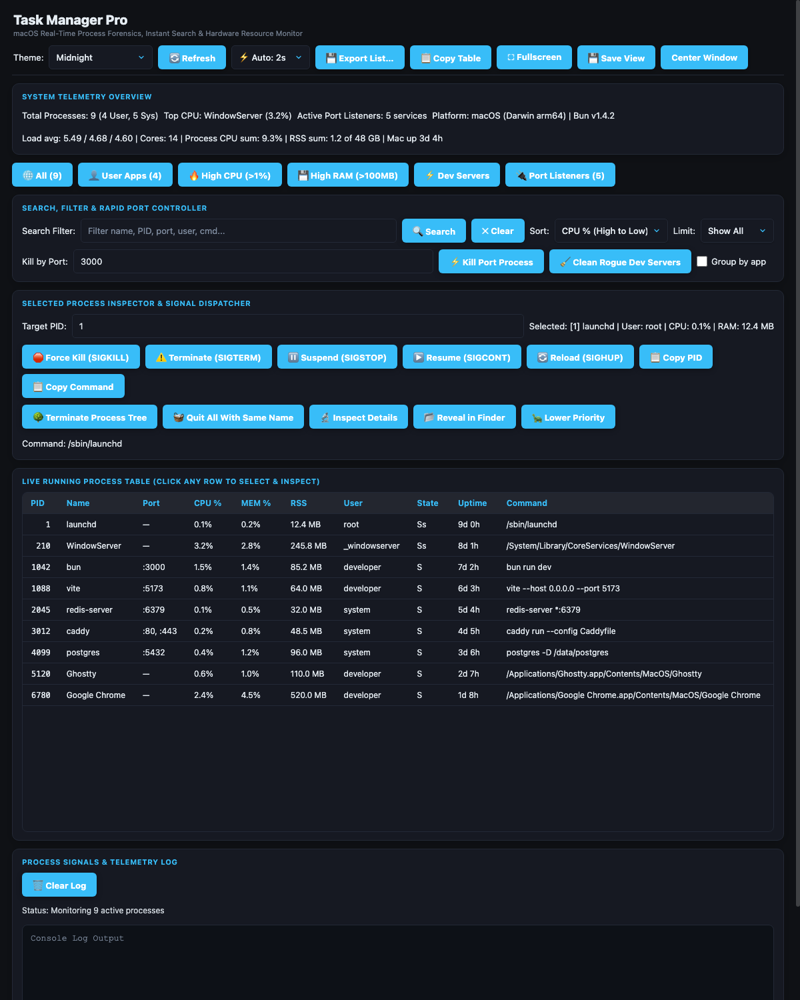

`bun run app:task`  ·  [User guide](docs/userguides/06_process_monitor_studio.md)

## Productivity & Text

_Write, convert, calculate and keep time._

### 🧮 Universal Calculator & IntuitionLab Studio

Apple-grade scientific calculator, unit converter, time-series charts, 64-bit programmer lab, calculus studio & IntuitionLab visual STEM simulations.

`bun run app:calc`  ·  [User guide](docs/userguides/27_calculator_studio.md)

### ⏱️ Interval Timer & Workout Suite

High-performance interval timer with Keith Baar isometric tendon training protocols & audio engine.

`bun run app:interval_timer`  ·  [User guide](docs/userguides/29_interval_timer_suite.md)

### 📝 Markdown Live Editor Studio

Real-time dual-pane WYSIWYG Markdown editor with live HTML preview & exports.

`bun run app:markdown`  ·  [User guide](docs/userguides/14_markdown_studio.md)

### 🎛️ Media Player Studio Pro

Modular rack media player with 10-band graphic EQ, preamp, spectrum & radial visualizers, M3U8 playlists & karaoke LRC lyrics.

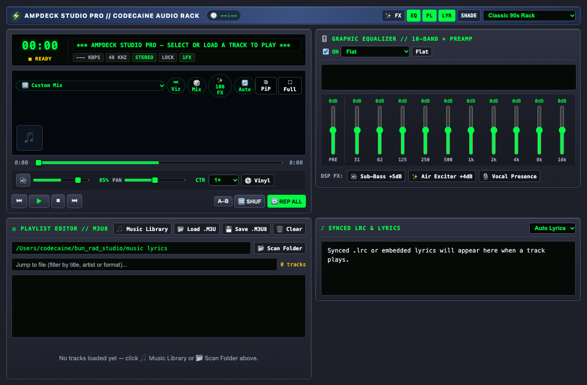

`bun run app:player`

### 🌐 World Time Zones Studio Pro

Real-time global time zones workstation with interactive search, UTC offsets & local clock synchronization.

`bun run app:world_time_zones`  ·  [User guide](docs/userguides/33_world_time_zones_studio.md)

## Design & Media

_Color, drawing and design tokens._

### 🎨 Chroma Studio Pro

Advanced paint & drawing workstation featuring 106+ vector coloring book graphics, multi-layer canvas, airbrush, flood fill & curated palettes.

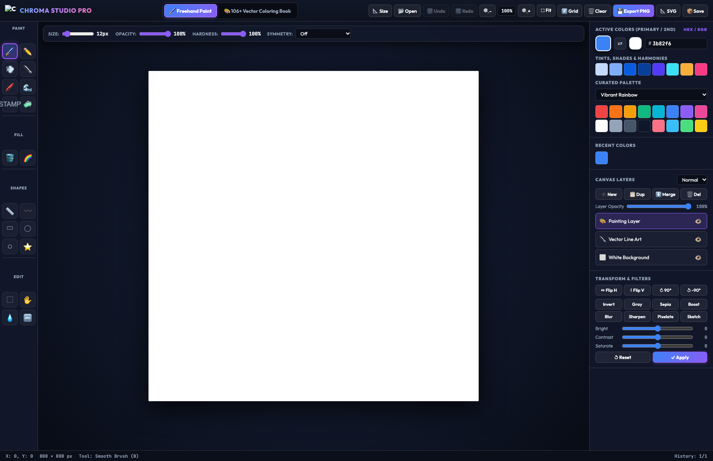

`bun run app:paint`

## Design & UX

_Build the interface itself._

### 🎨 Color Palette Studio Pro

Color token generator, WCAG contrast analyzer & palette harmonizer.

`bun run app:color`  ·  [User guide](docs/userguides/15_color_token_studio.md)

## RAD Studio

_The visual designer and the tools around it._

### 🚀 Launcher Studio Pro

The home screen of the toolbox: search, favorite and open any application with one click, with history and categories.

`bun run app:launcher`  ·  [User guide](docs/userguides/00_launcher_studio.md)

### 🖌️ Visual Form Designer

Drag and drop a form together like Delphi or Visual Basic, set every property, and export a ready-to-run Bun project.

`bun run start`  ·  [User guide](docs/visual-designer/index.md)

## Games & Entertainment

_Quick, polished games for a break._

### 🃏 Codecaine Joker Royale (Balatro Deluxe)

Roguelike poker deckbuilder with Ante & Blind runs, 30+ Jokers, 3D card tilt physics & synth audio.

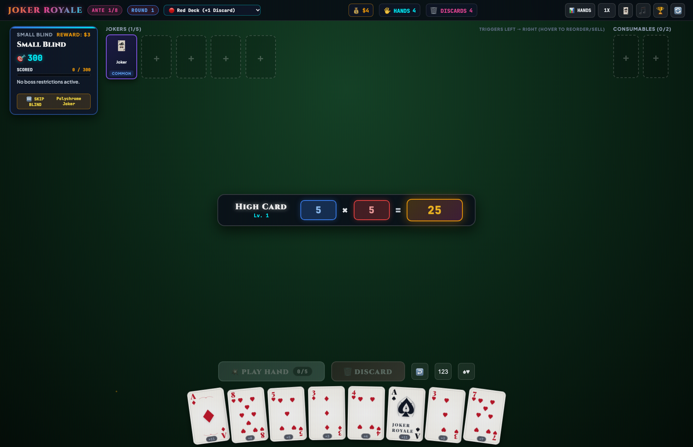

`bun run app:joker`

### 🪙 Codecaine Blackjack Royale VIP

High-roller multi-hand VIP casino Blackjack with 3-spot betting, Bicycle vector cards, 6-deck shoe Hi-Lo telemetry, split/double, & side bets.

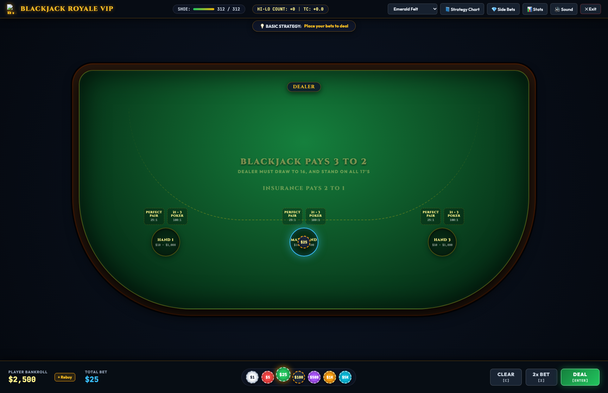

`bun run app:21`

### 🧱 Codecaine Cyber Breakout Deluxe

Deluxe Breakout arcade with continuous swept physics, 8 powerups, combo synth melodies & gamepad support.

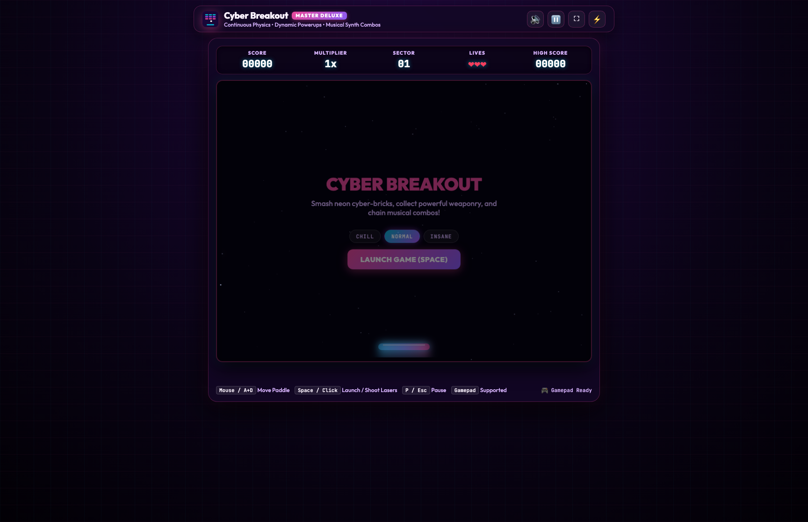

`bun run app:arkanoid`

### 🍄 Codecaine Bros. Arcade

Authentic 1983 Mario Bros. arcade remaster with high-speed bumping physics, POW block & 4-channel sound.

`bun run app:codecaine_bros`  ·  [User guide](docs/userguides/35_codecaine_bros_arcade.md)

### 🔴 Codecaine Cyberpunk Connect 4

Neon Connect 4 arcade with minimax AI heuristics, 2-player local battle & particle drop physics.

`bun run app:connect4`  ·  [User guide](docs/userguides/36_connect4_studio.md)

### 💊 Codecaine Dr. Codecaine Arcade

Triple-A remastered Dr. Codecaine capsule puzzle game with polyphonic synthesizers & pathogen AI.

`bun run app:dr_codecaine`  ·  [User guide](docs/userguides/28_dr_codecaine_arcade.md)

### 🐦 Codecaine Flappy Bird Deluxe

Cyberpunk kinetic Flappy Bird arcade with energy conduits, medal achievements, parallax sky & WebAudio synth.

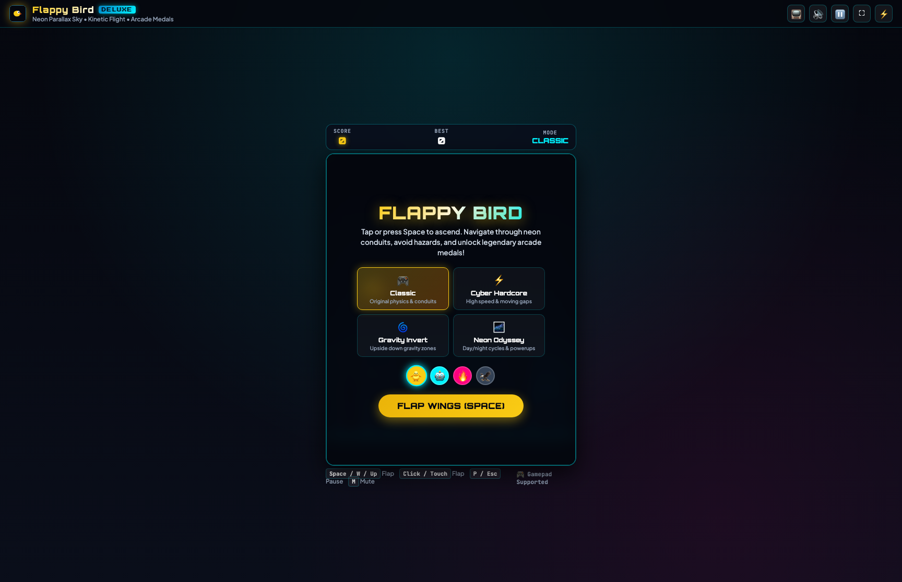

`bun run app:bird`

### 🐸 Codecaine CyberFrog Deluxe

Navigate a cyberpunk highway and acid river with fluid interpolation physics.

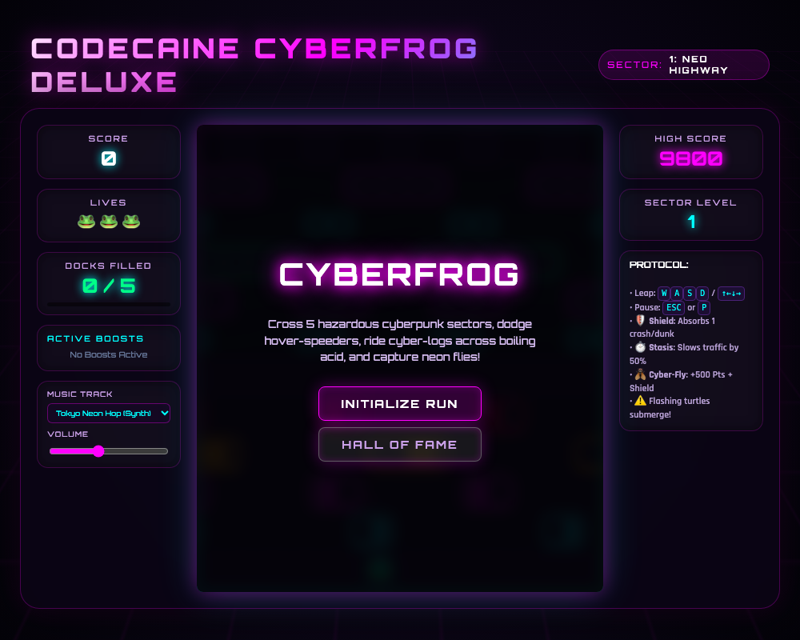

`bun run app:frogger`

### 👾 Codecaine Adventures of Lolo Remaster

Cyberpunk remastered Adventures of Lolo with procedural puzzles, sound engine & visual manual.

`bun run app:lolo`  ·  [User guide](docs/userguides/30_lolo_remaster.md)

### 👾 Codecaine Math Munchers Deluxe

Cyberpunk Math Munchers classic with Troggles AI, CRT shaders, pentatonic synth & multiple game modes.

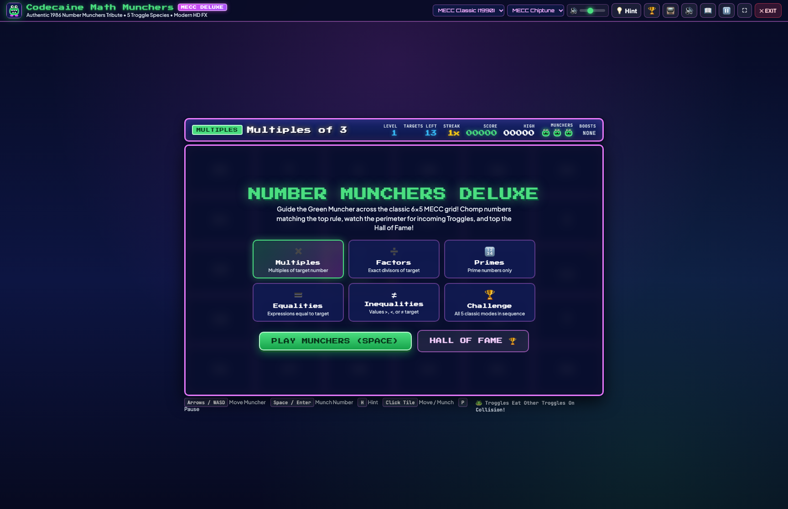

`bun run app:munch`

### 🌀 Codecaine Cyberpunk Maze Runner

Procedural neon labyrinth with Recursive Backtracking, Prim's, Wilson's, fog of war & A* AI solver.

`bun run app:maze`  ·  [User guide](docs/userguides/37_maze_generator_studio.md)

### 💣 Codecaine Minesweeper Pro Championship

Championship Minesweeper with safe first-click, chord clearing, 3BV benchmark & multi-theme engine.

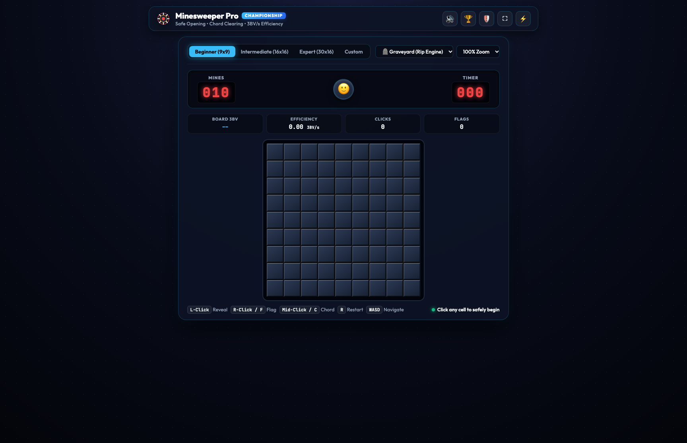

`bun run app:mines`

### 🟡 Codecaine Cyberpunk Pac-Man Arcade

Authentic Cyberpunk Pac-Man arcade remaster with 4-ghost AI personalities, sound synthesis & particle effects.

`bun run app:pacman`  ·  [User guide](docs/userguides/34_pacman_arcade.md)

### ♠️ Codecaine Texas Hold'em & 5-Card Draw Poker Royale

Deluxe casino poker table featuring No-Limit Texas Hold'em and 5-Card Draw, 6-max AI personalities, Bicycle cards & hand evaluation.

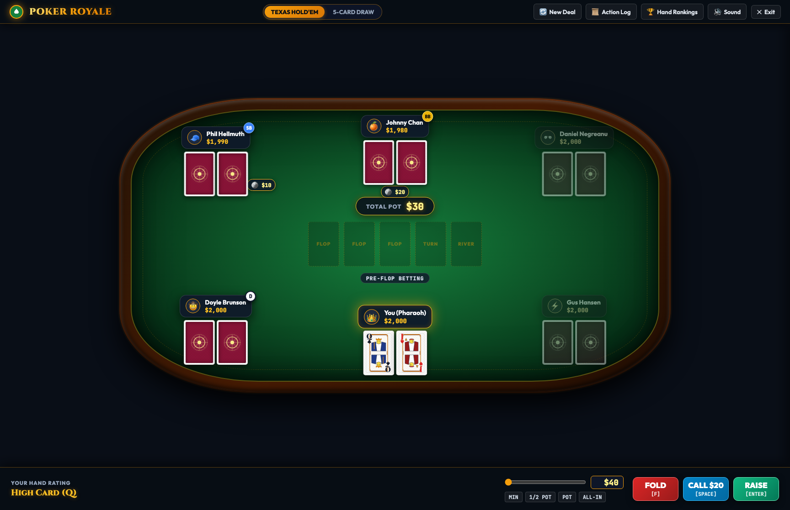

`bun run app:draw`

### 🏓 Codecaine Neon Cyber Pong

High-speed kinetic Pong with fluid spin physics, multi-tier AI opponents & local 2-player battle.

`bun run app:pong`  ·  [User guide](docs/userguides/38_pong_arcade.md)

### 🎴 Codecaine Egyptian Rat Screw Royale

High-speed reflex card slapper with authentic Bicycle vector cards, face card challenges, customizable slap rules & multi-CPU AI.

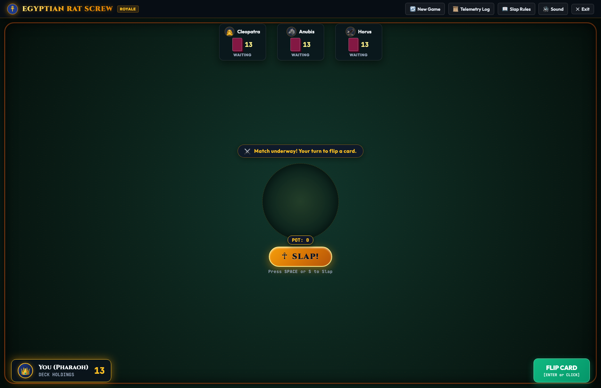

`bun run app:ers`

### 🧀 Codecaine Rodent's Revenge Deluxe

Deluxe arcade revival of Rodent's Revenge with neon retro maze, cat trapping & high scores.

`bun run app:rodents_revenge`  ·  [User guide](docs/userguides/31_rodents_revenge_deluxe.md)

### ⛷️ Codecaine SkiFree Deluxe

Authentic downhill alpine skiing with freestyle tricks, slalom gates & the ravenous Yeti chase.

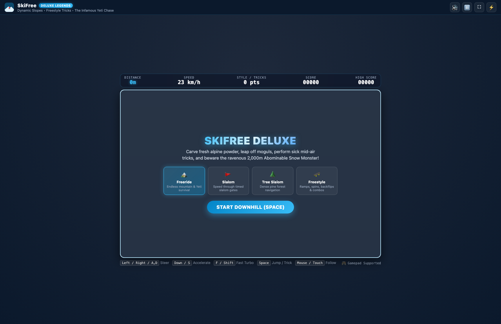

`bun run app:ski`

### 🐍 Codecaine Neon Snake Deluxe

High-speed glowing cyber snake with looping walls and combo multipliers.

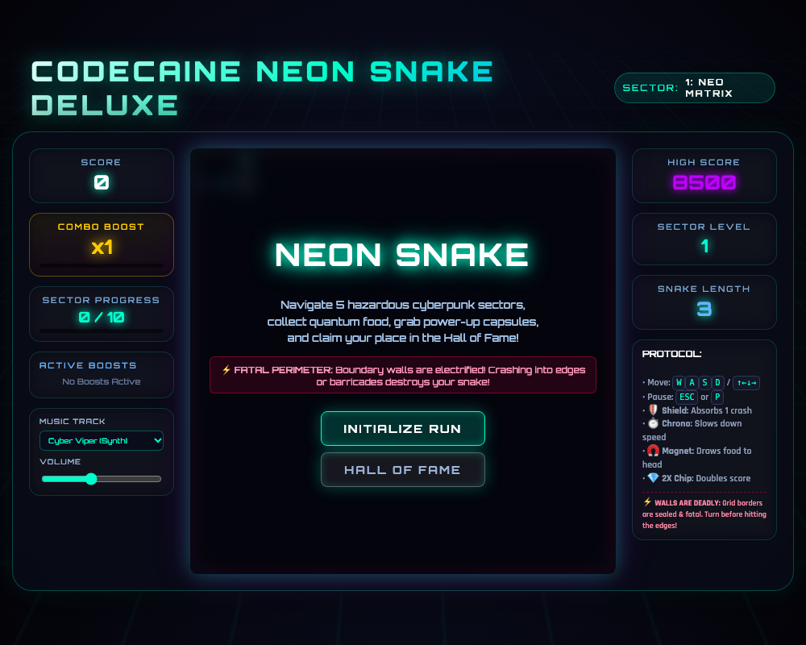

`bun run app:snake`

### 🧱 Codecaine Tetris Ultra Deluxe

Modern 7-bag SRS block puzzle with T-Spin/B2B telemetry, 4 modes, 3-next queue & synthwave themes.

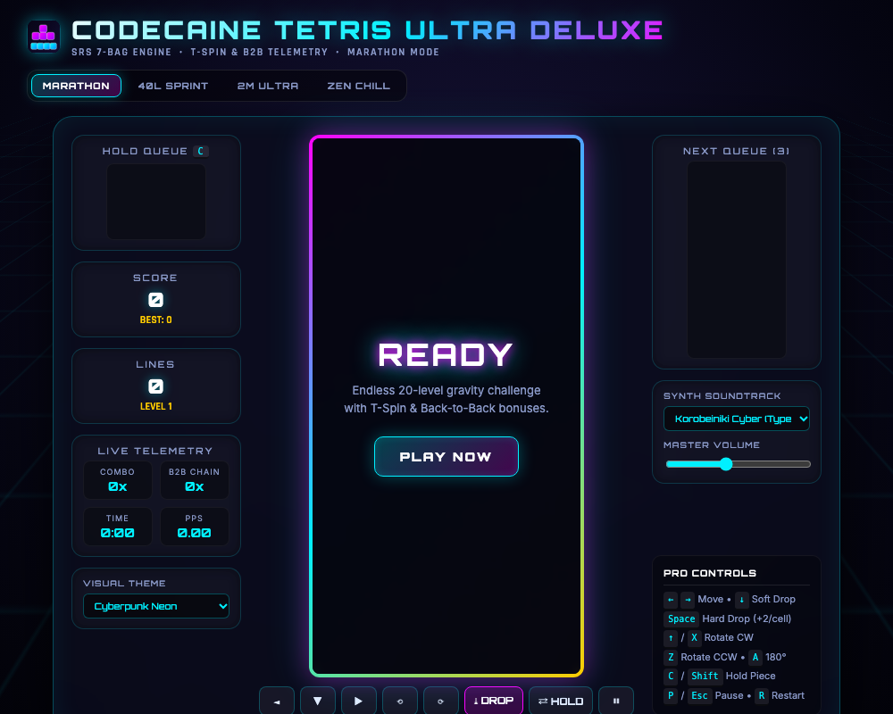

`bun run app:tetris`

### ❌ Codecaine Neon Tic-Tac-Toe Arcade

Unbeatable Minimax AI and 2-player local versus battle with glowing neon canvas & audio synthesis.

`bun run app:tictactoe`  ·  [User guide](docs/userguides/39_tictactoe_studio.md)

### ⌨️ Codecaine CyberType Deluxe

Modern touch-typing academy with 10-step guided tutorial, 18-lesson curriculum, Keybr adaptive AI, multi-layout keyboard, and WebAudio switches.

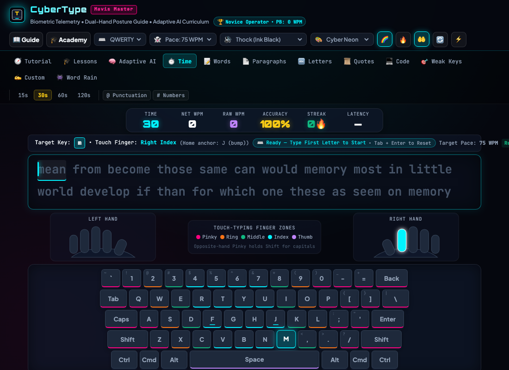

`bun run app:type`

### 🔤 Codecaine Neon Word Search Labyrinth

AAA cyber word search with Web Audio synthesizer, neon particle visual effects & procedural dictionaries.

`bun run app:word_search`  ·  [User guide](docs/userguides/32_word_search_labyrinth.md)

### 🎲 Codecaine Yahtzee Royale Deluxe

Deluxe classic Yahtzee dice board studio with 3D tactile dice, authentic Milton Bradley scorecard, +35 upper bonus, Yahtzee Jokers & AI opponent.

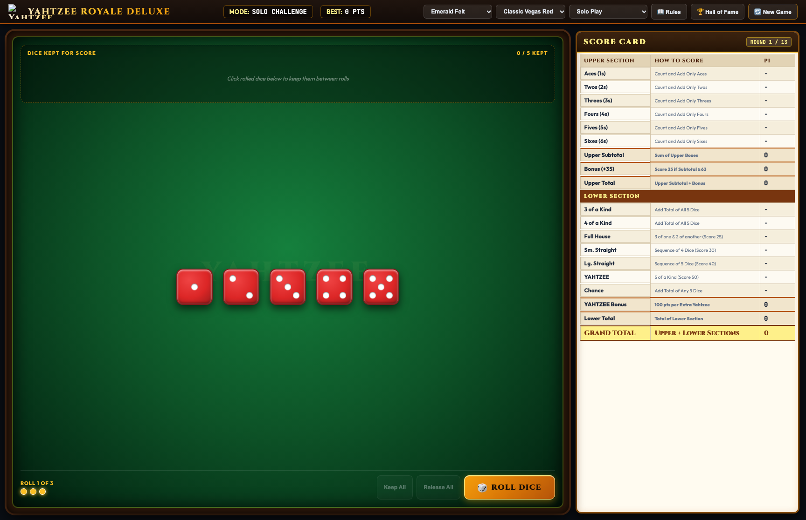

`bun run app:dice`

---

_This page is generated by `bun run showcase` from the screenshots in `screenshots/apps/`. To refresh the pictures, see `scripts/capture_app_screenshots.ts` and `scripts/capture_extra_screenshots.ts`._
