# Bun RAD Studio: the applications

**102 desktop applications** in one toolbox: databases, developer tools, file tools, system monitors, productivity and games. Each one is a real window, runs on your own computer, has no accounts and no cloud, shares one set of 60+ themes, and explains every button when you hover over it.

> Install once, then open any of them from the **Launcher** (`bun run app:launcher`), or run its command below.

## Contents

- [Featured: the File Manager](#featured-the-file-manager)
- [File & Directory Tools](#file--directory-tools) (4)
- [Developer Tools](#developer-tools) (15)
- [Database & Storage](#database--storage) (4)
- [Network & Cloud](#network--cloud) (3)
- [Security & Crypto](#security--crypto) (2)
- [System & Hardware](#system--hardware) (5)
- [Productivity & Text](#productivity--text) (5)
- [Design & Media](#design--media) (1)
- [Design & UX](#design--ux) (1)
- [RAD Studio](#rad-studio) (2)
- [Games & Entertainment](#games--entertainment) (60)

## Featured: the File Manager

An all-in-one, safe desktop file manager and workstation for macOS, Windows and Linux. Features **folder tabs**, an **expandable sidebar folder tree**, **7 color tags**, **Quick Look (`Space`)**, **Dual-Pane Commander view (`Alt+5`)**, an undoable Recycle Bin, **batch conversion of pictures, video, sound and documents**, a **built-in Image & Media Studio**, **AmpDeck 10-band EQ & 108-visualizer player**, **Databases Hub with cross-engine cloning & Bun JS macros**, **Split-view Code Editor**, **24 built-in arcade games**, **180 themes with glass & glow**, and a **two-way synced terminal**.

| Browse, Folder Tabs, Color Tags & Preview | Dual-Pane Commander (`F5` Copy / `F6` Move) |
| :--- | :--- |
|  |  |
| **Batch Convert & Process** | **Two-Way Synced Terminal in Current Folder** |
|  |  |
| **Built-in Image & Media Studio** | **AmpDeck Media Player (10-Band EQ & 108 Visualizers)** |
|  |  |
| **Databases Hub, Cross-Engine Cloning & Bun JS Macros** | **Split View + Built-in Code Editor & Live Preview** |
|  |  |
| **24 Built-in Retro Arcade, Card & Puzzle Games** | **180 Themes: Frosted Glass, Neon Glow & Motion FX** |
|  |  |
| **Fits a smaller window (Responsive Layout)** | **Edit Redis keys in place** |
|  |  |

`bun run app:files`  ·  [User guide](docs/userguides/43_file_manager.md)

## File & Directory Tools

_Find, clean, move and understand the files on your computer._

### 🔍 Fd Studio Pro

Ultra-fast native Bun filesystem traversal, globbing & quarantine manager.

`bun run app:fd`  ·  [User guide](docs/userguides/17_fd_studio.md)

### 📁 Codecaine File Manager

Easy, safe file manager for Windows, macOS & Linux: browse, search, copy, move, rename, zip, Recycle Bin with Undo.

`bun run app:files`  ·  [User guide](docs/userguides/43_file_manager.md)

### 💾 Disk Usage Studio (GDU)

Fast disk usage analyzer with interactive directory space allocation.

`bun run app:gdu`  ·  [User guide](docs/userguides/23_gdu_studio.md)

### 🪦 Rip Studio Pro

Safe file quarantine, seance recovery & graveyard deletion workbench.

`bun run app:rip`  ·  [User guide](docs/userguides/18_rip_studio.md)

## Developer Tools

_Everything a developer reaches for, in one window each._

### 📡 API Testing Studio Pro

REST & HTTP client with benchmark metrics, headers editor & response inspector.

`bun run app:api`  ·  [User guide](docs/userguides/07_api_studio.md)

### 📦 App Bundler Studio Pro

Single-executable compiler & macOS .app bundle packager with icons.

`bun run app:bundler`  ·  [User guide](docs/userguides/11_app_bundler_studio.md)

### ⚡ NovaCode Studio Pro

Advanced developer-focused code editor & workstation with multi-file tabs, lexical syntax highlighting, interactive minimap, terminal runner, and split preview.

`bun run app:code`

### 🔄 Data Format Converter Studio

Instant converter between JSON, YAML, TOML, CSV, XML & TS interfaces.

`bun run app:convert`  ·  [User guide](docs/userguides/08_data_converter_studio.md)

### 🛠️ DevTools & OmniTool Studio

Unified developer CLI toolkit with 6 developer engines powered natively.

`bun run app:devtools`  ·  [User guide](docs/userguides/05_devtools_studio.md)

### 🔐 Environment Variable Studio

Secure .env configuration manager, secret vault & encryption workbench.

`bun run app:env`  ·  [User guide](docs/userguides/16_environment_vault_studio.md)

### 🌿 Git Version Control Studio

Visual diff inspector, working tree controller & commit audit trail.

`bun run app:git`  ·  [User guide](docs/userguides/13_git_workbench_studio.md)

### 📋 JQ JSON Query Studio

Interactive JSON query & transformation workstation powered by native JQ filters.

`bun run app:jq`  ·  [User guide](docs/userguides/04_json_query_studio.md)

### 🧰 OmniTool Studio Pro

Swiss-army knife for encoding, decoding, hash generation & text processing.

`bun run app:devtools`  ·  [User guide](docs/userguides/05_devtools_studio.md)

### ⚡ RAD Utilities Studio Pro

44 high-velocity development modules for Rapid Application Development with live recipes & testing.

`bun run app:rad`

### 🎯 Regex Pattern Testing Studio

Interactive regex validator with match highlight, group capture & cheat-sheet.

`bun run app:regex`  ·  [User guide](docs/userguides/10_regex_studio.md)

### ✏️ Stream Editor Studio (SD)

Intuitive find & replace utility with string, regex & dry-run diff preview.

`bun run app:sd`  ·  [User guide](docs/userguides/19_sd_studio.md)

### 🔀 Subprocess Pipe Pro

Multi-stage subprocess orchestrator, stream pipelining (stdout ➔ stdin), privilege elevation & shell master.

`bun run app:pipe`

### 📊 Code Statistics Studio (Tokei)

Lines of code counter, comment-to-code ratio & language breakdown.

`bun run app:tokei`  ·  [User guide](docs/userguides/22_tokei_studio.md)

### ⏱️ WatchExec Studio Pro

Automated command execution engine reacting to directory updates.

`bun run app:watch`  ·  [User guide](docs/userguides/21_watchexec_studio.md)

## Database & Storage

_Look inside and work with SQLite, MySQL, PostgreSQL and Redis._

### 🐬 MySQL Studio Pro

Enterprise MySQL database workstation, query IDE, schema visualizer & InnoDB performance suite.

`bun run app:mysql`  ·  [User guide](docs/userguides/41_mysql_studio.md)

### 🐘 Postgres Studio Pro

Enterprise PostgreSQL database workstation, schemas, materialized views, extensions & process diagnostics.

`bun run app:pg`  ·  [User guide](docs/userguides/42_postgres_studio.md)

### ⚡ Redis Studio Pro

Real-time Redis telemetry, live key-value inspector & memory diagnostics.

`bun run app:redis`  ·  [User guide](docs/userguides/40_redis_studio.md)

### 🗄️ SQLite Studio Pro

Enterprise embedded database workstation & query IDE with zero-latency execution.

`bun run app:sqlite`  ·  [User guide](docs/userguides/01_sqlite_studio.md)

## Network & Cloud

_See what the network is doing and where it leads._

### 🐕 DNS Query Studio (Doggo)

Modern DNS lookup client with DoH, DoT, trace recursion & record browser.

`bun run app:doggo`  ·  [User guide](docs/userguides/26_doggo_studio.md)

### 🌍 IP Geolocation Studio

Public IP resolver, ASN lookup, geo-coordinates & WHOIS inspector.

`bun run app:ipinfo`  ·  [User guide](docs/userguides/24_ipinfo_studio.md)

### 🌐 Network Diagnostics Studio

Comprehensive socket inspector, port scanner, DNS testing & HTTP client.

`bun run app:network`  ·  [User guide](docs/userguides/12_network_forensics_studio.md)

## Security & Crypto

_Hashes, keys, secrets and encryption without the command line._

### 🔒 Cryptography & Hashing Studio

SHA-256, HMAC, AES-GCM cipher workbench with password entropy testing.

`bun run app:crypto`  ·  [User guide](docs/userguides/09_crypto_studio.md)

### 🕵️ Subdomain Finder Studio

Passive DNS and Certificate Transparency subdomain discovery engine.

`bun run app:subfinder`  ·  [User guide](docs/userguides/25_subfinder_studio.md)

## System & Hardware

_Know what your machine is running and keep it tidy._

### 🍺 Homebrew Package Studio

Package dependency manager & Bun ecosystem workstation.

`bun run app:brew`  ·  [User guide](docs/userguides/02_system_package_studio.md)

### 📈 Process Monitor Studio

Real-time process telemetry, signal dispatcher & TCP connection inspector.

`bun run app:task`  ·  [User guide](docs/userguides/06_process_monitor_studio.md)

### ⚙️ Procs Process Workstation

Modern top/ps replacement with Docker container detection and tree view.

`bun run app:procs`  ·  [User guide](docs/userguides/20_procs_studio.md)

### 🖥️ System Information Studio Pro

Hardware intelligence & telemetry workstation covering all 10 domain areas.

`bun run app:brew`  ·  [User guide](docs/userguides/02_system_package_studio.md)

### 📊 Task Manager & Process Studio

Live CPU/Memory monitor, process tree visualizer & port listener.

`bun run app:task`  ·  [User guide](docs/userguides/06_process_monitor_studio.md)

## Productivity & Text

_Write, convert, calculate and keep time._

### 🧮 Universal Calculator & IntuitionLab Studio

Apple-grade scientific calculator, unit converter, time-series charts, 64-bit programmer lab, calculus studio & IntuitionLab visual STEM simulations.

`bun run app:calc`  ·  [User guide](docs/userguides/27_calculator_studio.md)

### ⏱️ Interval Timer & Workout Suite

High-performance interval timer with Keith Baar isometric tendon training protocols & audio engine.

`bun run app:interval_timer`  ·  [User guide](docs/userguides/29_interval_timer_suite.md)

### 📝 Markdown Live Editor Studio

Real-time dual-pane WYSIWYG Markdown editor with live HTML preview & exports.

`bun run app:markdown`  ·  [User guide](docs/userguides/14_markdown_studio.md)

### 🎛️ Media Player Studio Pro

Modular rack media player with 10-band graphic EQ, preamp, spectrum & radial visualizers, M3U8 playlists & karaoke LRC lyrics.

`bun run app:player`

### 🌐 World Time Zones Studio Pro

Real-time global time zones workstation with interactive search, UTC offsets & local clock synchronization.

`bun run app:world_time_zones`  ·  [User guide](docs/userguides/33_world_time_zones_studio.md)

## Design & Media

_Color, drawing and design tokens._

### 🎨 Chroma Studio Pro

Advanced paint & drawing workstation featuring 106+ vector coloring book graphics, multi-layer canvas, airbrush, flood fill & curated palettes.

`bun run app:paint`

## Design & UX

_Build the interface itself._

### 🎨 Color Palette Studio Pro

Color token generator, WCAG contrast analyzer & palette harmonizer.

`bun run app:color`  ·  [User guide](docs/userguides/15_color_token_studio.md)

## RAD Studio

_The visual designer and the tools around it._

### 🚀 Launcher Studio Pro

The home screen of the toolbox: search, favorite and open any application with one click, with history and categories.

`bun run app:launcher`  ·  [User guide](docs/userguides/00_launcher_studio.md)

### 🖌️ Visual Form Designer

Drag and drop a form together like Delphi or Visual Basic, set every property, and export a ready-to-run Bun project.

`bun run start`  ·  [User guide](docs/visual-designer/index.md)

## Games & Entertainment

_Quick, polished games for a break._

### 🎯 Codecaine CyberArtillery: Scorched Skyline

Turn-based wind & gravity trajectory artillery across destructible city skylines with MIRVs, Funky Bombs & AI/2P modes.

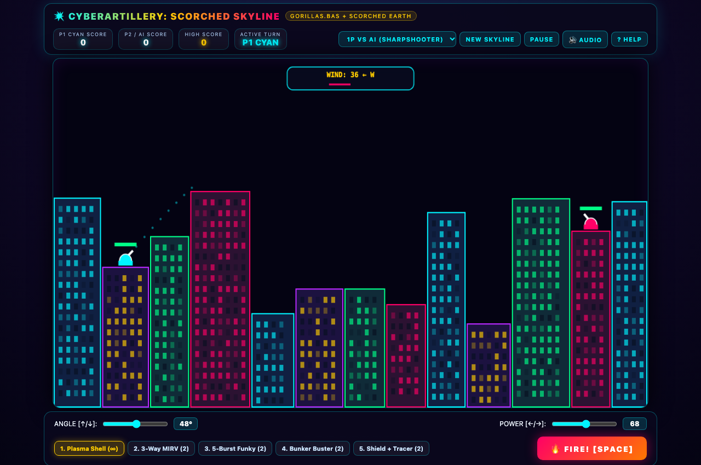

`bun run app:artillery`  ·  [User guide](docs/userguides/69_codecaine_cyberartillery_scorched_skyline.md)

### ☄️ Codecaine VoidVector Asteroids Deluxe

360° Newtonian vector shooter with splitting asteroids, hunter-seeker UFOs, shields, hyperspace warp & weapon power-ups.

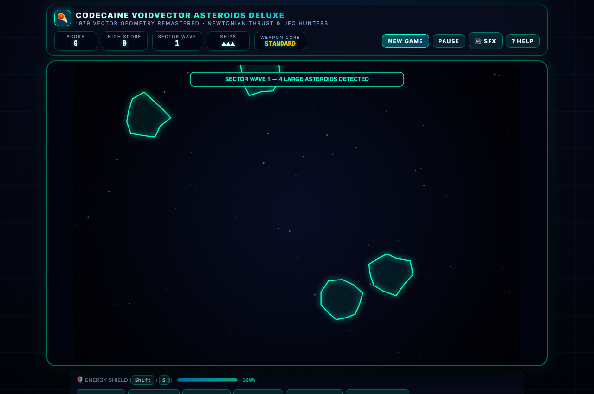

`bun run app:asteroids`  ·  [User guide](docs/userguides/63_codecaine_voidvector_asteroids_deluxe.md)

### 🃏 Codecaine Joker Royale Deluxe

Roguelike poker deckbuilder with Ante & Blind runs, 30+ Jokers, 3D card tilt physics & synth audio.

`bun run app:joker`  ·  [User guide](docs/userguides/53_codecaine_joker_royale_deluxe.md)

### 🎈 Codecaine CyberBalloon Fight: Sky Joust & Storm Trip

6-mode NES Balloon Fight & Balloon Trip remaster: Sky Arena, Endless Lightning Trip, Roguelike Perks, Boss Storm, 2P Co-Op & 2P Dogfight.

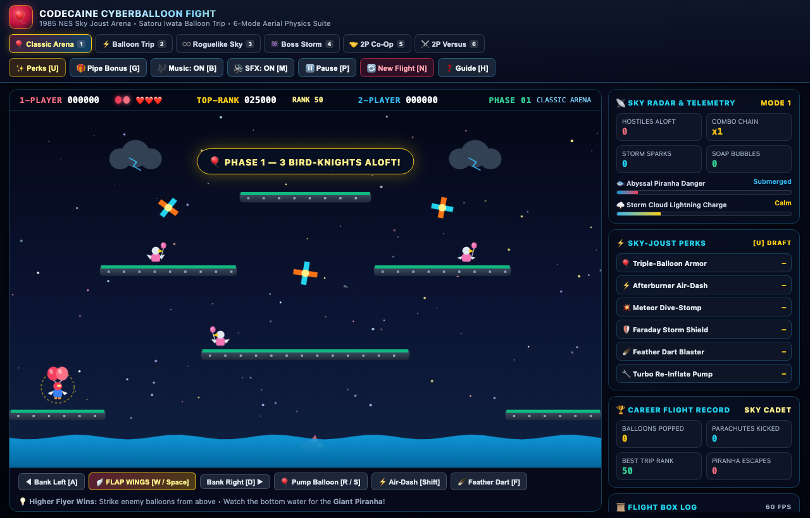

`bun run app:balloon_fight`  ·  [User guide](docs/userguides/79_codecaine_cyberballoon_fight.md)

### 💎 Codecaine CyberJewel 12-Mode Blitz: Diamond Mine & Prism Royale

12-mode Match-3 gem symphony with 3D ray-traced jewelry shaders, interactive Mini-Game Stage Canvas & active [SPACE] gadgets.

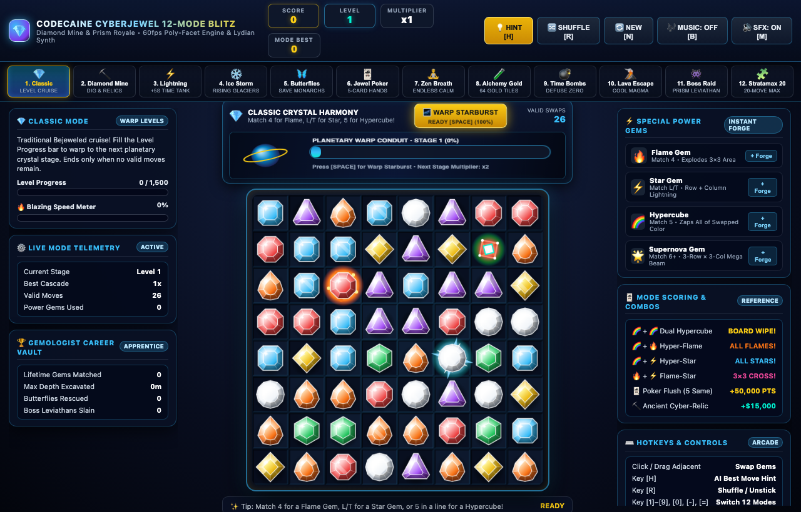

`bun run app:bejeweled`  ·  [User guide](docs/userguides/78_codecaine_cyberjewel_blitz.md)

### 🪙 Codecaine Blackjack Royale VIP

High-roller multi-hand VIP casino Blackjack with 3-spot betting, Codecaine Royale vector cards, 6-deck shoe Hi-Lo telemetry, split/double, & side bets.

`bun run app:21`  ·  [User guide](docs/userguides/55_codecaine_blackjack_royale_vip.md)

### 🧨 Codecaine CyberBomber Grid Arena

Destructible grid arena with chain-reaction plasma bombs, kick boots, Campaign, AI Battle Royale & 2-Player Versus.

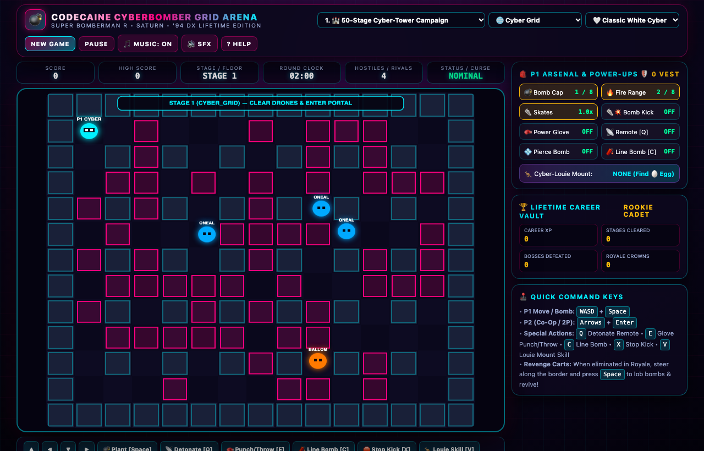

`bun run app:bomberman`  ·  [User guide](docs/userguides/65_codecaine_cyberbomber_grid_arena.md)

### 🎳 Codecaine CyberStrike Bowling: 300 Perfect Club

AAA 3D-perspective 10-frame PBA bowling with lane oil hook physics, 10-pin domino scatter, split clinic & 300 Perfect Club.

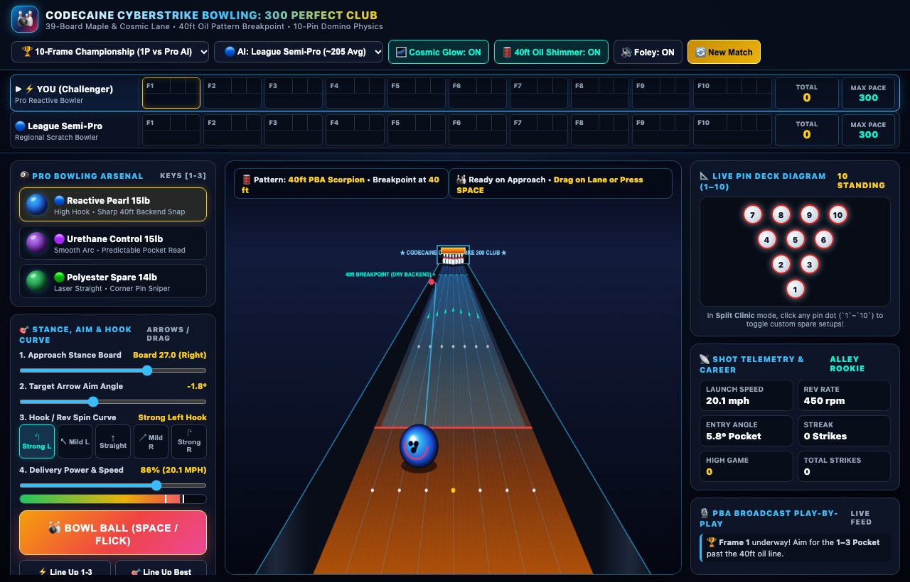

`bun run app:bowling`  ·  [User guide](docs/userguides/76_codecaine_cyberstrike_bowling.md)

### 🧱 Codecaine CyberBrick Breaker Deluxe

Deluxe CyberBrick Breaker arcade with continuous swept physics, 8 powerups, combo synth melodies & gamepad support.

`bun run app:arkanoid`  ·  [User guide](docs/userguides/46_codecaine_cyberbrick_breaker_deluxe.md)

### 🐛 Codecaine CyberCentipede Blaster

High-speed spore-field shooter with splitting centipede chains, bouncing spiders, fleas & poison scorpions.

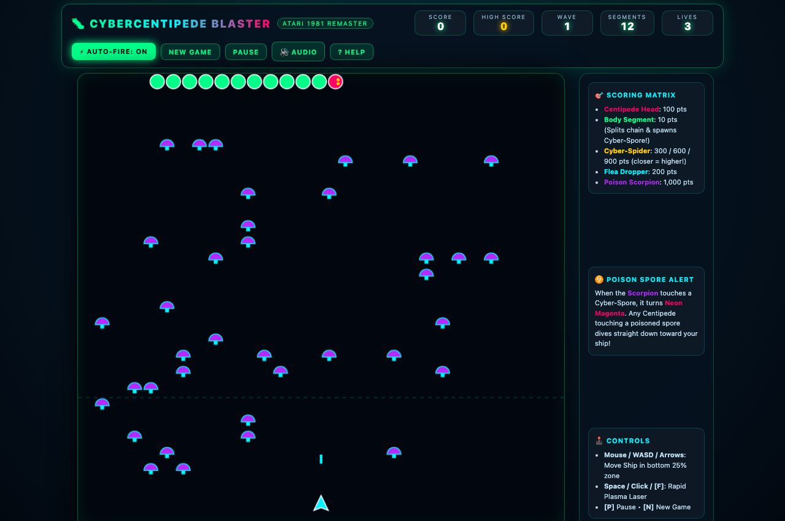

`bun run app:centipede`  ·  [User guide](docs/userguides/68_codecaine_cybercentipede_blaster.md)

### 💾 Codecaine CyberChip's Labyrinth

Tile-based puzzle gauntlet with microchips, elemental boots (fire, flippers, cleats, suction), keys, blocks & undo.

`bun run app:chips_challenge`  ·  [User guide](docs/userguides/59_codecaine_cyberchips_labyrinth.md)

### 🚀 Codecaine CyberRocket: Arrow Tile Panic

8-mode Dreamcast ChuChu Rocket! action puzzle: place directional arrows to herd mice into your rocket while routing cats into AI rivals.

`bun run app:chuchu_rocket`

### 🍄 Codecaine Bros. Arcade

Authentic 1983 Codecaine Bros. arcade remaster with high-speed bumping physics, POW block & 4-channel sound.

`bun run app:codecaine_bros`  ·  [User guide](docs/userguides/35_codecaine_bros_arcade.md)

### 🔴 Codecaine Cyberpunk QuadLink 4

Neon QuadLink 4 arcade with minimax AI heuristics, 2-player local battle & particle drop physics.

`bun run app:connect4`  ·  [User guide](docs/userguides/36_codecaine_cyberpunk_quadlink_4.md)

### 🔢 Codecaine Cyber2048 Quantum Merge

Power-of-2 sliding neon tile synthesizer with 3x3/4x4/5x5 grids, temporal undo, tile zap & AI expectimax hints.

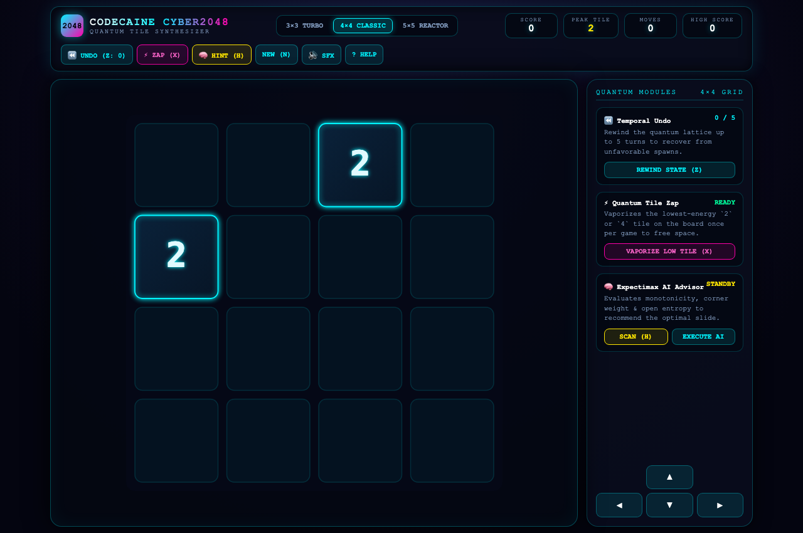

`bun run app:2048`  ·  [User guide](docs/userguides/72_codecaine_cyber2048_quantum_merge.md)

### 🏗️ Codecaine CyberMaker Studio: OS Kernel World Architect

Super Mario Maker-style level architect & platformer with Linux Tux, macOS Dock/Beachball, FreeBSD Beastie & Windows BSOD/Clippy objects.

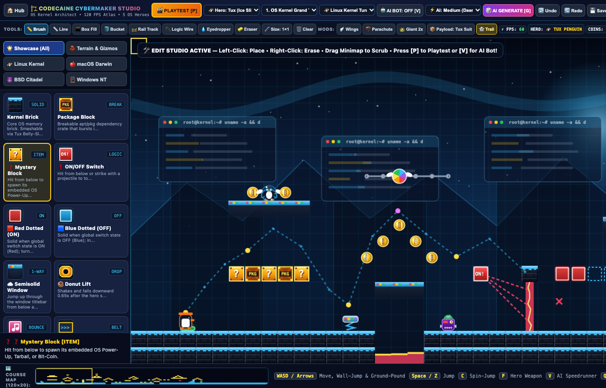

`bun run app:cyber_maker`  ·  [User guide](docs/userguides/82_codecaine_cybermaker_studio.md)

### 🎯 Codecaine Pro Darts Royale: 501 & Cricket Arena

14-game Pro Darts Arena (501, 301, 701, Cricket, Cut-Throat, Tactics, Shanghai, Killer, Bob's 27, Halve-It, Baseball & Golf) with 4-tier Ballistics.

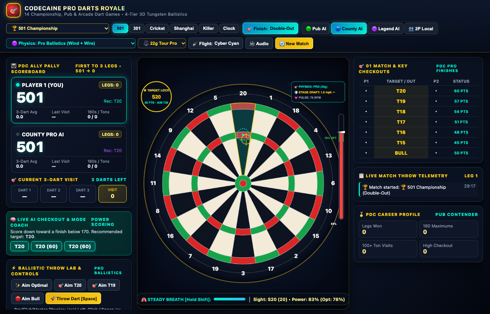

`bun run app:darts`  ·  [User guide](docs/userguides/77_codecaine_pro_darts_royale.md)

### 💊 Codecaine Dr. Codecaine Arcade

Triple-A remastered Dr. Codecaine capsule puzzle game with polyphonic synthesizers & pathogen AI.

`bun run app:dr_codecaine`  ·  [User guide](docs/userguides/28_codecaine_dr_codecaine_arcade.md)

### 🐦 Codecaine CyberWing Deluxe

Cyberpunk kinetic CyberWing arcade with energy conduits, medal achievements, parallax sky & WebAudio synth.

`bun run app:bird`  ·  [User guide](docs/userguides/48_codecaine_cyberwing_deluxe.md)

### 🐸 Codecaine CyberFrog Deluxe

Navigate a cyberpunk highway and acid river with fluid interpolation physics.

`bun run app:frogger`  ·  [User guide](docs/userguides/47_codecaine_cyberfrog_deluxe.md)

### 🎩 Codecaine Mr. Game Show Royale: TV Studio Mega-Pack

8-in-1 TV Game Show Mega-Studio: Wheel of Fortune, Press Your Luck No Whammies, Survey Feud, Cyber-Jeopardy, Plinko, Deal Cases & Millionaire.

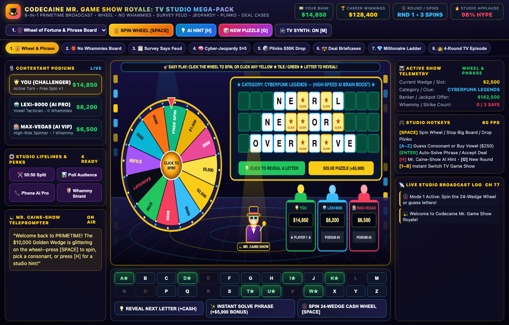

`bun run app:game_show`

### ⚡ Codecaine CyberJezz Containment Deluxe

1992 JezzBall remaster: capture 75%+ of the cyber-grid with laser containment walls, cryo slow-mo & shielded beams.

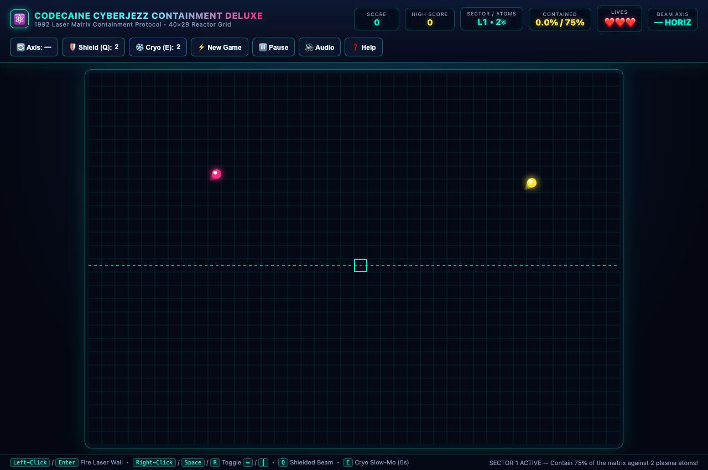

`bun run app:jezzball`  ·  [User guide](docs/userguides/58_codecaine_cyberjezz_containment_deluxe.md)

### 🧵 Codecaine CyberLemmings: Kernel Thread Rescue

8-mode destructible terrain puzzle with 8 assignable daemon thread roles (Climber, Floater, Bomber, Blocker, Builder, Basher, Miner, Digger).

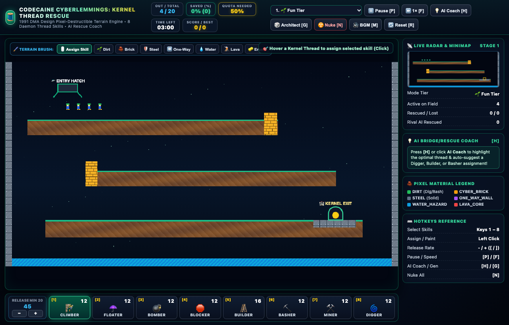

`bun run app:lemmings`

### ⛏️ Codecaine CyberLode: Gold Cache Heist

8-mode Lode Runner remaster with brick floor drilling, AI guard trapping, monkey-bar zip-lines, escape ladders & built-in level editor.

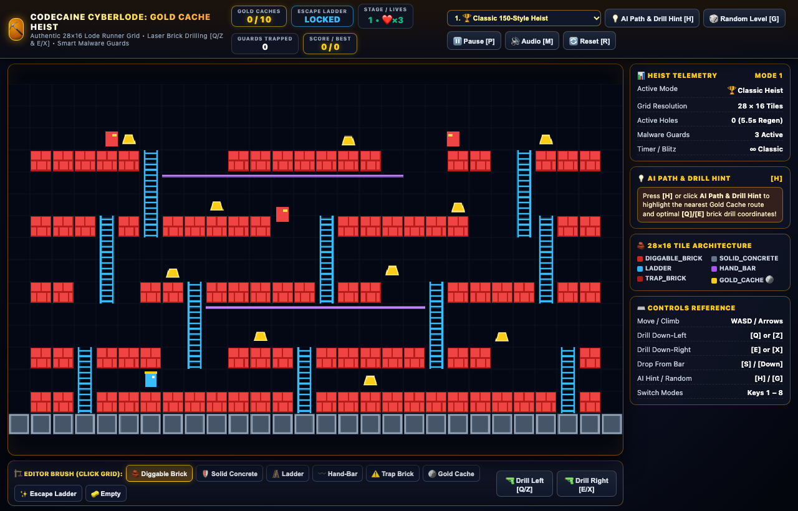

`bun run app:lode_runner`

### 👾 Codecaine Adventures of Caine Remaster

Cyberpunk remastered Adventures of Caine with procedural puzzles, sound engine & visual manual.

`bun run app:lolo`  ·  [User guide](docs/userguides/30_codecaine_adventures_of_caine_remaster.md)

### 🌕 Codecaine CyberLander: Vector Descent

Precision vector thruster & fuel simulator across Moon, Mars & Titan craters with multiplier landing pads.

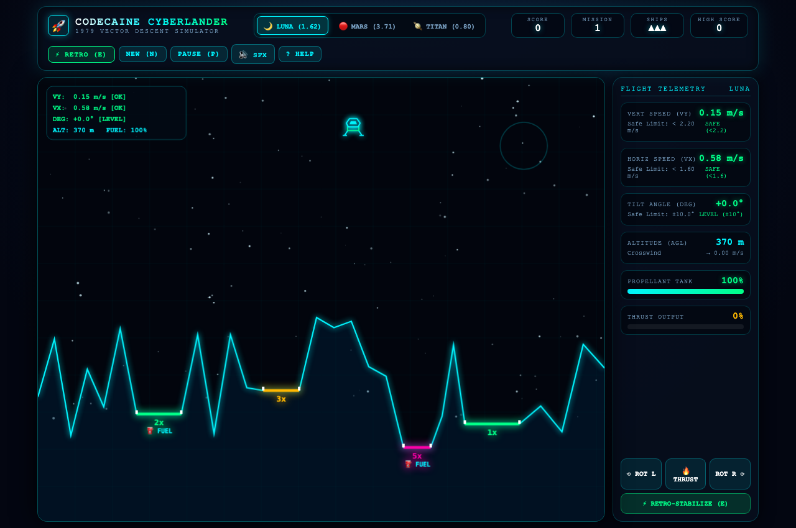

`bun run app:lunar_lander`  ·  [User guide](docs/userguides/71_codecaine_cyberlander_vector_descent.md)

### 🃏 Codecaine CyberDrop: Grab & Throw Chain Blitz

8-mode Neo-Geo Magical Drop III & Money Idol Exchanger action puzzle with 6 Tarot Arcana fighters, Ice/Rainbow orbs & cascade chains.

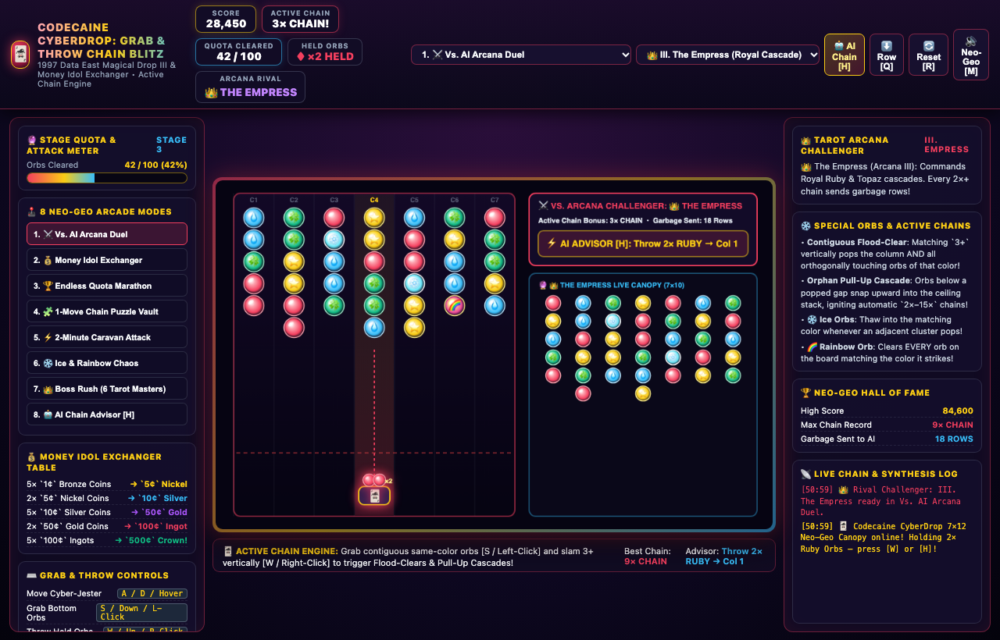

`bun run app:magical_drop`

### 🐭 Codecaine CyberMappy: Mansion Heist & Trampoline Police

8-mode Namco Mappy mansion remaster with color-changing trampolines, Microwave Shockwave Doors, Goro loot multipliers & Roof Balloon Bonus.

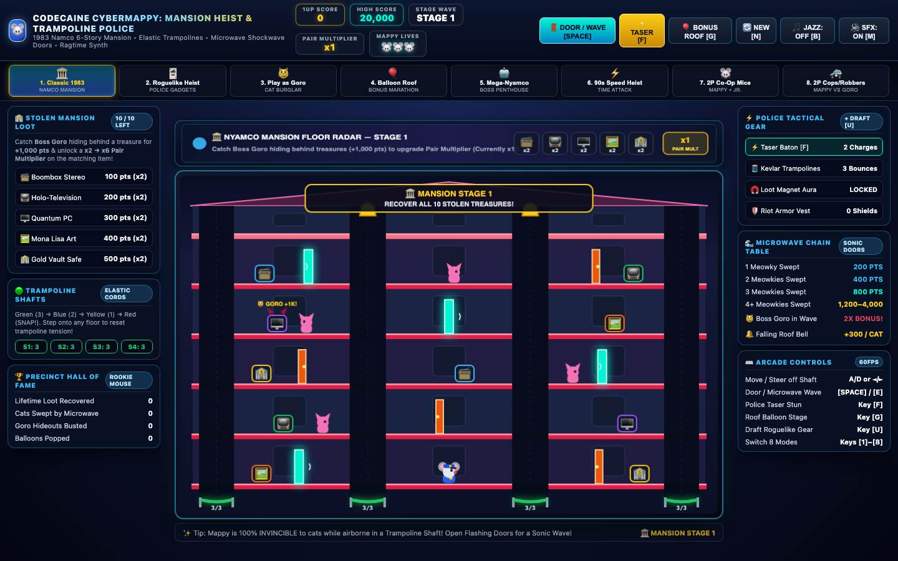

`bun run app:mappy`  ·  [User guide](docs/userguides/81_codecaine_cybermappy_mansion.md)

### 🔮 Codecaine CyberMarble Madness: Isometric Gravity Odyssey

8-mode 3D isometric Marble Madness & Marble Blast suite with slope gravity, Black Steel Knockers, Gem Hunt, Tilt Labyrinth & 2P Race.

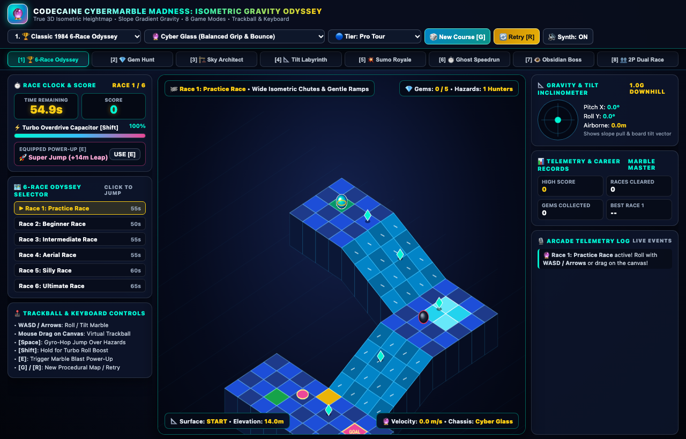

`bun run app:marble_madness`  ·  [User guide](docs/userguides/80_codecaine_cybermarble_madness.md)

### 👾 Codecaine CyberMunch Math Deluxe

Cyberpunk CyberMunch Math classic with Glitchers AI, CRT shaders, pentatonic synth & multiple game modes.

`bun run app:munch`  ·  [User guide](docs/userguides/50_codecaine_cybermunch_math_deluxe.md)

### 🌀 Codecaine Cyberpunk Maze Runner

Procedural neon labyrinth with Recursive Backtracking, Prim's, Wilson's, fog of war & A* AI solver.

`bun run app:maze`  ·  [User guide](docs/userguides/37_codecaine_cyberpunk_maze_runner.md)

### 🧠 Codecaine CyberRecall Royale: Holo-Vault Memory Match

8-mode 3D Hologram Card-Flip & Memory Match Casino Royale with 5 Deck Themes, Triad Match-3, 60s Blitz, Minefield & VS Neural AI Duel.

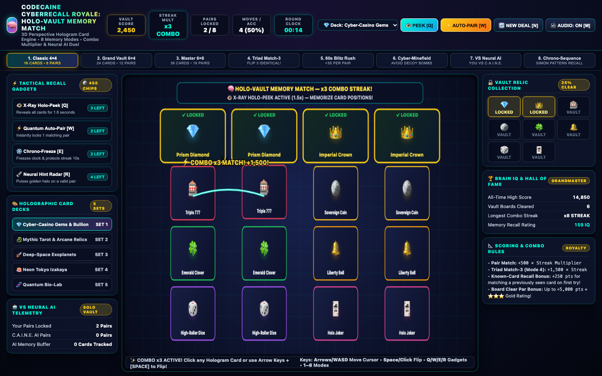

`bun run app:memory_match`

### 💣 Codecaine Minesweeper Pro Championship

Championship Minesweeper with safe first-click, chord clearing, 3BV benchmark & multi-theme engine.

`bun run app:mines`  ·  [User guide](docs/userguides/51_codecaine_minesweeper_pro_championship.md)

### 🚀 Codecaine CyberDefense: ICBM Interceptor

Defend 6 neon megacities with 3 counter-missile batteries and chain-reaction shockwaves against MIRV warheads.

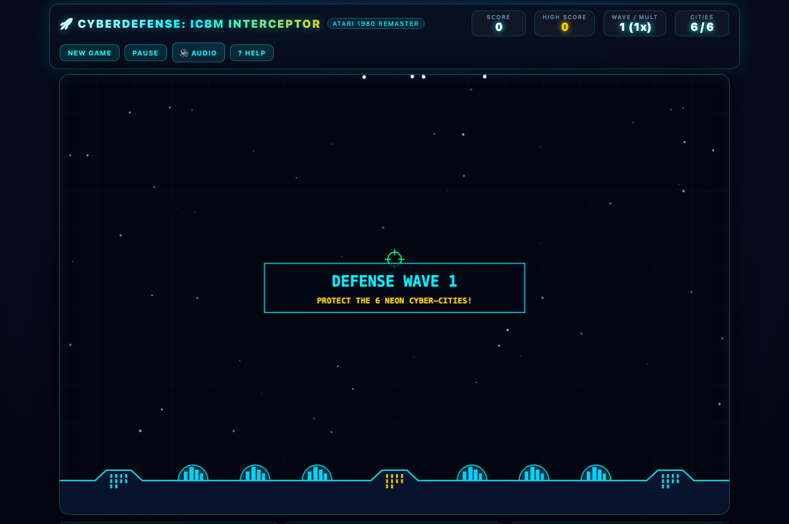

`bun run app:missile_command`  ·  [User guide](docs/userguides/66_codecaine_cyberdefense_icbm_interceptor.md)

### 🟡 Codecaine CyberChomp Arcade

Authentic CyberChomp arcade remaster with 4-ghost AI personalities, sound synthesis & particle effects.

`bun run app:pacman`  ·  [User guide](docs/userguides/34_codecaine_cyberchomp_arcade.md)

### 🌈 Codecaine CyberPeggle: Extreme Pachinko Odyssey

8-mode Peggle pachinko spectacle with 25 Orange Pegs, 8 Zen Master power-ups, slow-motion zoom & Ode to Joy Extreme Fever fanfare.

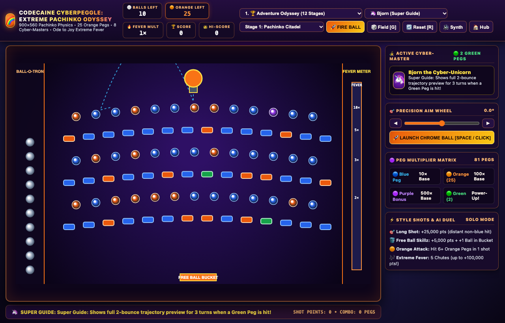

`bun run app:peggle`

### 🛸 Codecaine CyberCadet Pinball 2099

Space Cadet pinball table with 60fps flipper physics, pop bumpers, hyperspace ramp, wormhole multiball & fleet ranks.

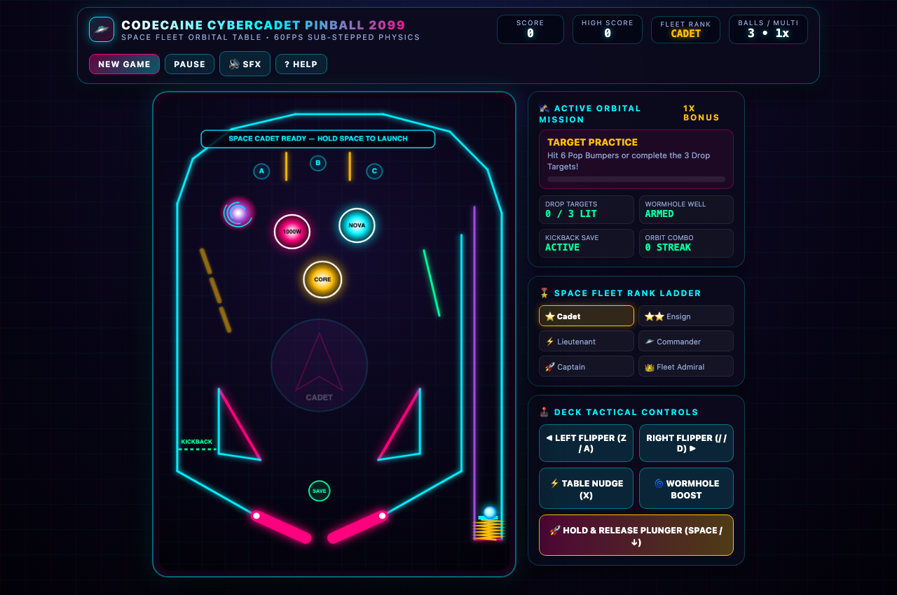

`bun run app:pinball`  ·  [User guide](docs/userguides/62_codecaine_cybercadet_pinball_2099.md)

### 🔧 Codecaine CyberPipe Flow Deluxe

High-pressure pipe-routing puzzle with cross-junction loop bonuses, reservoir tanks, 5-piece queue & neon coolant flow.

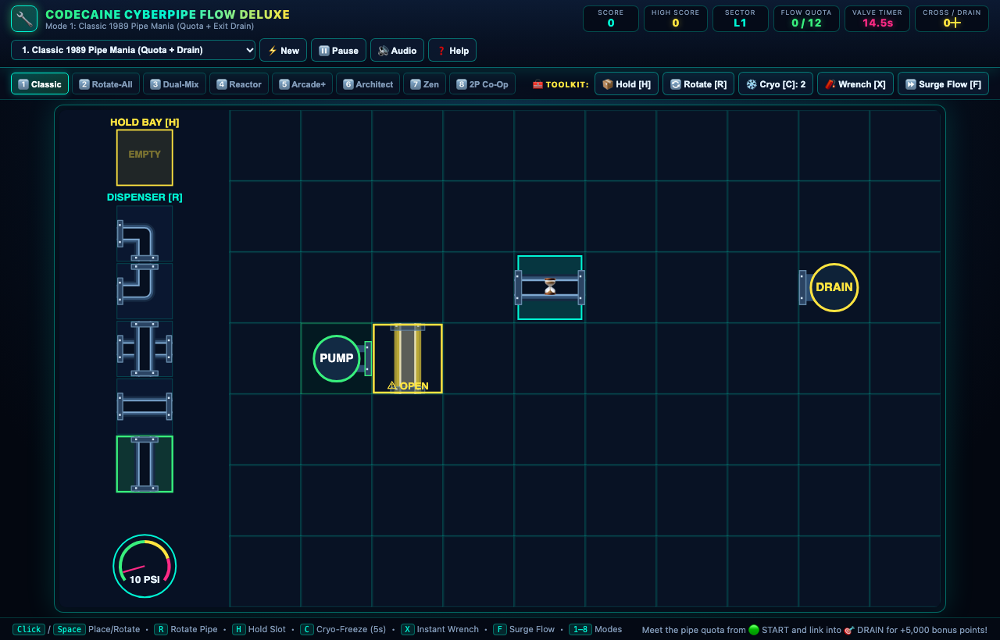

`bun run app:pipe_dream`  ·  [User guide](docs/userguides/60_codecaine_cyberpipe_flow_deluxe.md)

### ♠️ Codecaine Texas Hold'em & 5-Card Draw Poker Royale

Deluxe casino poker table featuring No-Limit Texas Hold'em and 5-Card Draw, 6-max AI personalities, Codecaine Royale cards & hand evaluation.

`bun run app:draw`  ·  [User guide](docs/userguides/54_codecaine_poker_royale.md)

### 🏓 Codecaine Neon Cyber Paddle

High-speed kinetic Cyber Paddle with fluid spin physics, multi-tier AI opponents & local 2-player battle.

`bun run app:pong`  ·  [User guide](docs/userguides/38_codecaine_neon_cyber_paddle.md)

### 🎱 Codecaine 8-Ball Pool Royale: Cyber Billiards Suite

10-mode Billiards & Snooker suite (8-Ball, 9-Ball, 10-Ball, 14.1, One-Pocket, Snooker, Bank Pool & 12 Trick Shots) with Masse & Jump physics.

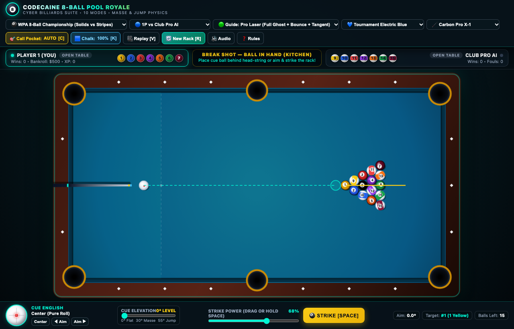

`bun run app:pool`  ·  [User guide](docs/userguides/70_codecaine_8ball_pool_royale.md)

### 🟧 Codecaine CyberCube Hopper

Isometric 28-cube 3D pyramid color-flipper with Coily the cyber-snake, spinning escape discs & chrono-freeze orbs.

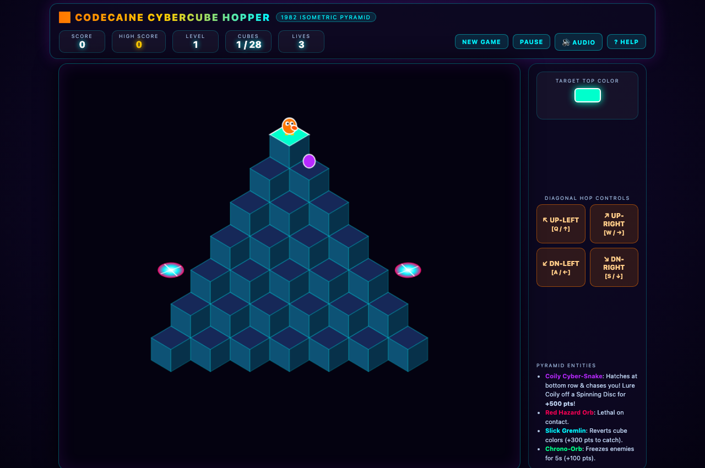

`bun run app:qbert`  ·  [User guide](docs/userguides/67_codecaine_cybercube_hopper.md)

### ⚡ Codecaine CyberQix: Laser Territory Claim

8-mode Qix & Volfied laser territory slicer with harmonic plasma Qix, Split-Qix multipliers, Sparx patrols & Volfied power cubes.

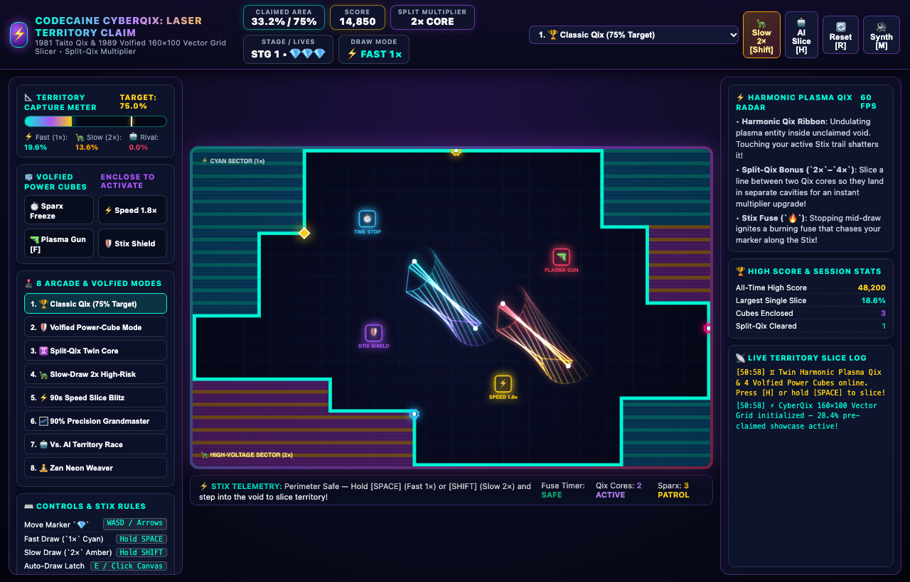

`bun run app:qix`

### 🏰 Codecaine CyberRampart: Fortress Build & Cannon Siege

8-mode 3-phase Rampart strategy arcade: deploy cannons, bombard invading warships, and patch castle walls with Tetris polyominoes.

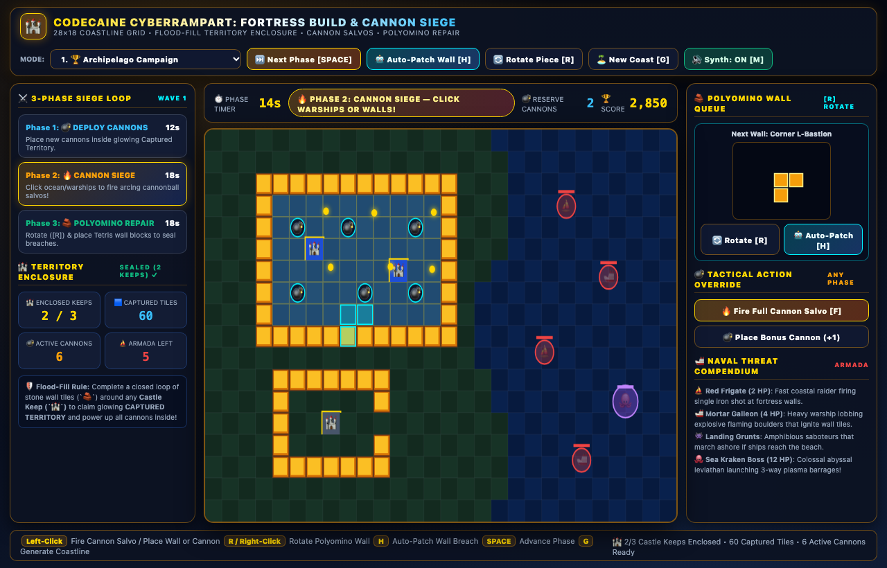

`bun run app:rampart`

### 🎴 Codecaine Egyptian Rat Screw Royale

High-speed reflex card slapper with authentic Codecaine Royale vector cards, face card challenges, customizable slap rules & multi-CPU AI.

`bun run app:ers`  ·  [User guide](docs/userguides/56_codecaine_egyptian_rat_screw_royale.md)

### ⚫ Codecaine CyberReversi & Checkers AI

Dual 8x8 strategy suite: Reversi (Othello) & Championship Checkers with 3-tier Minimax AI, flip previews & 2P local.

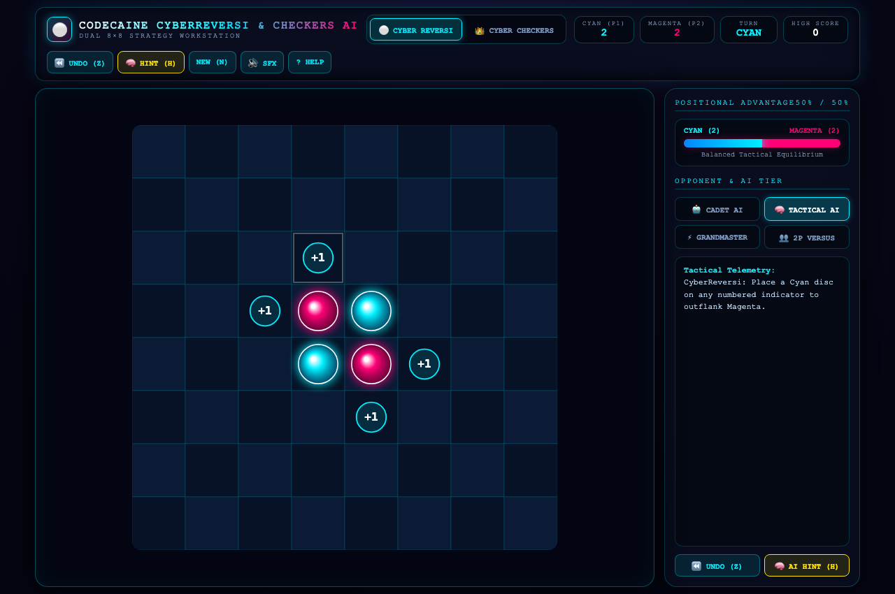

`bun run app:reversi_checkers`  ·  [User guide](docs/userguides/74_codecaine_cyberreversi_checkers_ai.md)

### 🧀 Codecaine CyberMouse Trap Deluxe

Deluxe arcade revival of CyberMouse Trap with neon retro maze, cat trapping & high scores.

`bun run app:rodents_revenge`  ·  [User guide](docs/userguides/31_codecaine_cybermouse_trap_deluxe.md)

### ⛷️ Codecaine CyberSki Deluxe

Authentic downhill alpine skiing with freestyle tricks, slalom gates & the ravenous Yeti chase.

`bun run app:ski`  ·  [User guide](docs/userguides/49_codecaine_cyberski_deluxe.md)

### 🎰 Codecaine Vegas Jackpot Slots Royale: Hold & Spin

8-machine Vegas High-Limit Casino Slots suite with Lightning Link Hold & Spin, 4 Progressive Jackpots, Buffalo Stampede, Cascading Gems & Free Spins.

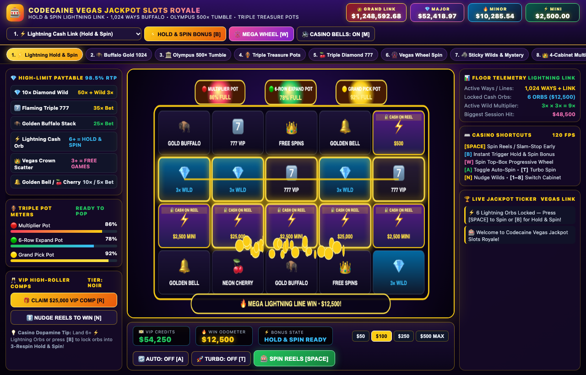

`bun run app:slots`

### 🐍 Codecaine Neon Snake Deluxe

High-speed glowing cyber snake with looping walls and combo multipliers.

`bun run app:snake`  ·  [User guide](docs/userguides/45_codecaine_neon_snake_deluxe.md)

### 📦 Codecaine CyberCrate Sokoban

100 verified warehouse puzzle chambers + multi-difficulty winnable random generator, AI BFS solver & deadlock warnings.

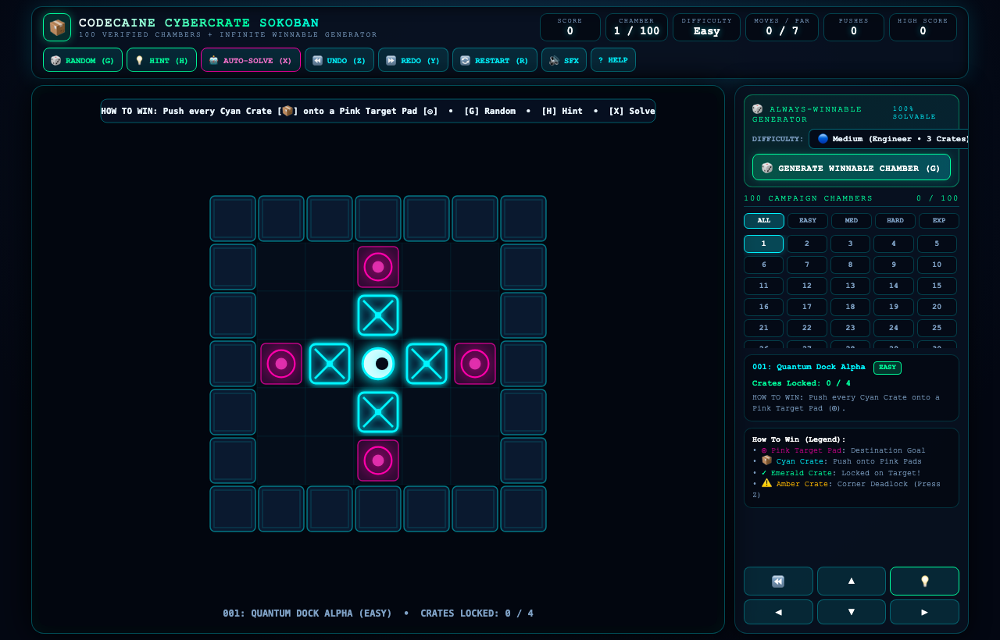

`bun run app:sokoban`  ·  [User guide](docs/userguides/73_codecaine_cybercrate_sokoban.md)

### 🃏 Codecaine Solitaire Royale: Klondike, Spider & FreeCell

3-in-1 Championship Solitaire (Klondike, Spider, FreeCell) with auto-foundation, hints, undo & bouncing cards waterfall.

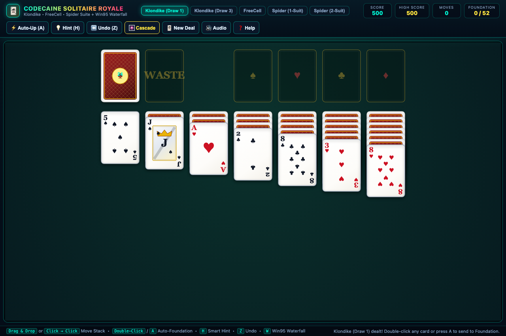

`bun run app:solitaire`  ·  [User guide](docs/userguides/61_codecaine_solitaire_royale.md)

### 👾 Codecaine CyberInvaders: StarSwarm

Galactic alien formation & dive-bomber shooter with destructible plasma bunkers, mystery UFOs & overcharge wave beam.

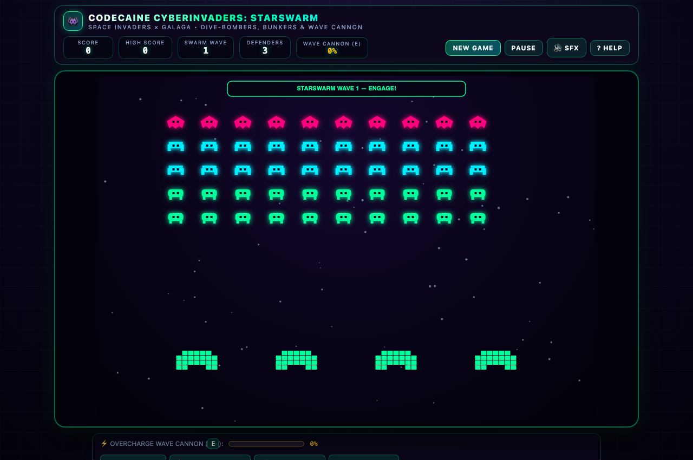

`bun run app:space_invaders`  ·  [User guide](docs/userguides/64_codecaine_cyberinvaders_starswarm.md)

### 🧱 Codecaine TetroGrid Ultra Deluxe

Modern 7-bag SRS block puzzle with T-Spin/B2B telemetry, 4 modes, 3-next queue & synthwave themes.

`bun run app:tetris`  ·  [User guide](docs/userguides/44_codecaine_tetrogrid_ultra_deluxe.md)

### ❌ Codecaine Neon Tic-Tac-Toe Arcade

Unbeatable Minimax AI and 2-player local versus battle with glowing neon canvas & audio synthesis.

`bun run app:tictactoe`  ·  [User guide](docs/userguides/39_codecaine_neon_tic_tac_toe_arcade.md)

### ⌨️ Codecaine CyberType Deluxe

Modern touch-typing academy with 10-step guided tutorial, 18-lesson curriculum, Codecaine Adaptive AI, multi-layout keyboard, and WebAudio switches.

`bun run app:type`  ·  [User guide](docs/userguides/52_codecaine_cybertype_deluxe.md)

### 🎴 Codecaine UNO Royale: Wild Cascade Edition

Realistic 4-player tabletop UNO with authentic vector cards, +2/+4 Stacking, 7-0 Hand Swap, UNO Catch & 500-Pt Cup.

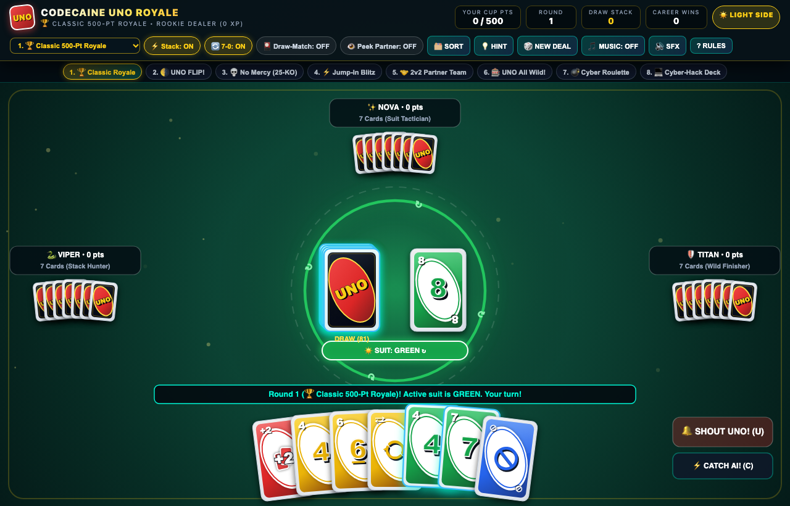

`bun run app:uno`  ·  [User guide](docs/userguides/75_codecaine_uno_royale.md)

### 🧛 Codecaine NightSavior: Vampire Survivors & Dark Force

8-mode Gothic Bullet-Heaven & Vampire Savior Dark Force Odyssey with 6 Night-Lords, 10 Weapon Evolutions, Chest Jackpots & 1v1 Darkstalker Duel.

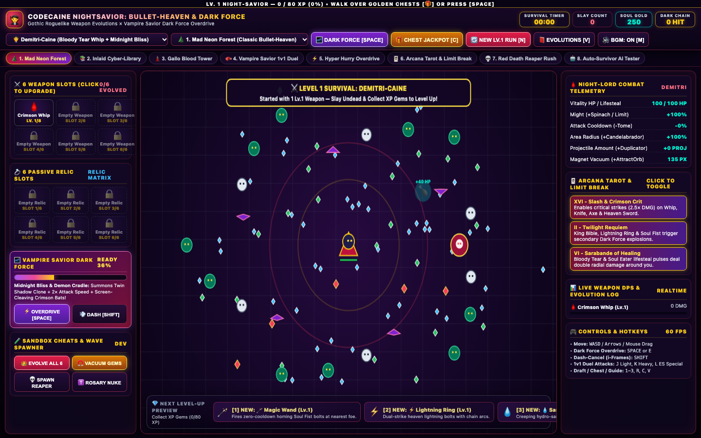

`bun run app:vampire_survivors`

### 🔤 Codecaine Neon Word Search Labyrinth

AAA cyber word search with Web Audio synthesizer, neon particle visual effects & procedural dictionaries.

`bun run app:word_search`  ·  [User guide](docs/userguides/32_codecaine_neon_word_search_labyrinth.md)

### 🎲 Codecaine Yacht Dice Royale Deluxe

Deluxe classic Yacht Dice board studio with 3D tactile dice, authentic Codecaine championship scorecard, +35 upper bonus, Yacht Jokers & AI opponent.

`bun run app:dice`  ·  [User guide](docs/userguides/57_codecaine_yacht_dice_royale_deluxe.md)

---

_This page is generated by `bun run showcase` from the screenshots in `screenshots/apps/`. To refresh the pictures, see `scripts/capture_app_screenshots.ts` and `scripts/capture_extra_screenshots.ts`._
