# 🎨 Codecaine File Manager — Master Custom Themes Vault (Low · Medium · High · Ultra) + Professional Style Guide

> **Showcase Workstation Benchmark:** `🍎 Apple Mac Studio M4 Ultra · 32-Core CPU · 80-Core GPU · 32-Core Neural Engine · 192GB Unified Memory · Apple Pro Display XDR 6K @ 120Hz ProMotion`  
> **Universal Hardware Coverage:** Includes dedicated custom themes and 1-click packs for **🟢 Low-End (`low`)**, **🟡 Medium (`medium`)**, **🟠 High-Spec (`high`)**, and **🔴 Ultra Flagship (`ultra`)** computers — plus **live Icons View screenshots** of every single theme!

## 📑 Quick Navigation
- [⚡ How to Import in 2 Seconds (Copy Codeblock & Press `⌘V`)](#-how-to-import-in-2-seconds-copy-codeblock--press-v)
- [📦 1-Click Master Packs by System Tier (`low` · `medium` · `high` · `ultra` · `all`)](#-1-click-master-packs-by-system-tier-low--medium--high--ultra--all)
- [🟢 Tier 1: Low-End / Featherweight Custom Themes (4 Themes + Screenshots)](#tier-1-low-end--featherweight-systems-low--0-gpu--zero-blur--battery-saver)
- [🟡 Tier 2: Medium Balanced 60fps Custom Themes (4 Themes + Screenshots)](#tier-2-medium-balanced-systems-medium--smooth-60fps--moderate-glass--1-layer-fx)
- [🟠 Tier 3: High-Spec 60–120Hz Custom Themes (4 Themes + Screenshots)](#tier-3-high-spec-systems-high--60120hz--dual-layer-shaders--sculpted-3d-folders)
- [🔴 Tier 4: Ultra Flagship 6K XDR 120Hz Custom Themes (8 Themes + Screenshots)](#tier-4-ultra-flagship-systems-ultra--uncapped-120hz-promotion-6k-xdr--3-layer-shaders--3d-turntable-icons)
- [❄️ Polar Night & Cryo-Glacier Collection (3 Themes + Screenshots)](#-polar-night--cryo-glacier-6k-ultra-collection)
- [🎃🎆🎄 All 18 US Holiday Celebration Ultra Themes (18 Themes + Screenshots)](#-all-18-us-holiday-celebration-6k-ultra-themes-holiday_)
- [📐 Professional Theme Design & Architecture Style Guide](#-professional-theme-design--architecture-style-guide)

---

## ⚡ How to Import in 2 Seconds (Copy Codeblock & Press `⌘V`)

1. **Click the Copy icon** in the top-right corner of **any `CCFM-PACK-v1:` or `CCFM-THEME-v1:` codeblock** below.
2. In the **Codecaine File Manager**, click **🎨 Theme** in the top toolbar and click **Paste theme (`⌘V`)** (or press **`⌘V` / `Ctrl+V`** anywhere inside the Theme Picker / Theme Editor).
3. Prefer `.json` files? Click **Import…** in the Theme Picker and select any `.json` file from this [`custom_themes/`](./) directory.

---

## 📦 1-Click Master Packs by System Tier (`low` · `medium` · `high` · `ultra` · `all`)

| System Tier | Themes Included | Target Computers | JSON Pack File |
| :--- | :-: | :--- | :--- |
| **🌐 Complete All-Systems Pack** | **20** | All 4 tiers (`low` + `medium` + `high` + `ultra`) | [`master_all_systems_20_themes_pack.json`](./master_all_systems_20_themes_pack.json) |
| **🟢 Tier 1: Low-End / Featherweight** | **4** | Raspberry Pi, Chromebook, Intel N100, VNC/SSH, Battery Saver (0% GPU) | [`pack_tier_1_low_featherweight.json`](./pack_tier_1_low_featherweight.json) |
| **🟡 Tier 2: Medium Balanced (60fps)** | **4** | MacBook Air M1/M2/M3, Surface Pro, ThinkPad, Steam Deck | [`pack_tier_2_medium_balanced_60fps.json`](./pack_tier_2_medium_balanced_60fps.json) |
| **🟠 Tier 3: High-Spec (60–120Hz)** | **4** | MacBook Pro M3/M4 Pro, iMac 24", Desktop RTX/Radeon Workstations | [`pack_tier_3_high_spec_120hz.json`](./pack_tier_3_high_spec_120hz.json) |
| **🔴 Tier 4: Ultra Flagship (120Hz 6K XDR)** | **8** | **Mac Studio M4 Ultra (32c CPU · 80c GPU · 192GB)**, RTX 4090/5090 | [`pack_tier_4_ultra_6k_xdr_120hz.json`](./pack_tier_4_ultra_6k_xdr_120hz.json) |
| **🎃🎆🎄 All 18 US Holidays Ultra Pack** | **18** | All 18 US Holiday Celebration themes with 3D folder crests & bursts | [`us_holidays_18_ultra_pack.json`](./us_holidays_18_ultra_pack.json) |

### 🌐 Copy All 20 Custom Themes (Low + Medium + High + Ultra) in One Paste (`CCFM-PACK-v1`)

```text
CCFM-PACK-v1:
```

---

## Tier 1: Low-End & Featherweight Systems (`low` — 0% GPU · Zero Blur · Battery Saver)

Engineered for **Raspberry Pi, Chromebooks, Intel Celeron/N100, older laptops, remote VNC/SSH sessions, and OLED Battery-Saver mode**. Uses `blur: 0`, `glass: 0`, `atmosphere: "none"`, and `motion: "zero"` for instant 60fps response with custom 3D SVG iconography and WCAG AAA contrast.

### 📦 1-Click 🟢 LOW-END / FEATHERWEIGHT TIER Pack (4 Themes — [`pack_tier_1_low_featherweight.json`](./pack_tier_1_low_featherweight.json))

```text
CCFM-PACK-v1:eyJmb3JtYXQiOiJidW4tcmFkLXN0dWRpby1maWxlLW1hbmFnZXItdGhlbWUtcGFjayIsInZlcnNpb24iOjEsInRoZW1lcyI6W3sibmFtZSI6IkZlYXRoZXJ3ZWlnaHQgRS1JbmsgUGFwZXIgRGF5bGlnaHQiLCJkYXJrIjpmYWxzZSwiYmFzZSI6Ikt5b3RvIFdhc2hpICYgU3VtaSBJbmsiLCJjb2xvcnMiOnsiYmFja2dyb3VuZCI6IiNmYWY3ZjAiLCJ0ZXh0IjoiIzExMTgyNyIsImFjY2VudCI6IiMwZjUyYmEiLCJzZWNvbmRhcnkiOiIjMDQ3ODU3IiwiY2FyZCI6IiNmZmZmZmYiLCJib3JkZXIiOiIjY2JkNWUxIiwiZGFuZ2VyIjoiI2I5MWMxYyIsIndhcm5pbmciOiIjYjQ1MzA5Iiwic3VjY2VzcyI6IiMwNDc4NTciLCJpbmZvIjoiIzAzNjlhMSJ9LCJmeCI6eyJnbG93Ijoibm9uZSIsImdsb3dDb2xvciI6IiMwZjUyYmEiLCJnbG93Q29sb3IyIjoiIzA0Nzg1NyIsImJsdXIiOjAsImdsYXNzIjowLCJnbG93SW50ZW5zaXR5IjowLCJib3JkZXJPcGFjaXR5IjowLjQ1LCJncmFpbiI6Im5vbmUiLCJzY2FubGluZXMiOiJub25lIiwicmFkaXVzIjoic29mdCIsImJvcmRlciI6ImZsYXQiLCJtb3Rpb24iOiJ6ZXJvIiwic2hlZW4iOmZhbHNlLCJub2lzZSI6ZmFsc2UsImNocm9tYXRpYyI6ZmFsc2UsImFtYmllbnQiOmZhbHNlLCJiYWNrZHJvcFN0eWxlIjoibWF0dGUiLCJjdXJzb3JFZmZlY3QiOiJub25lIiwidmlnbmV0dGUiOiJub25lIiwic2F0dXJhdGlvbiI6MS4wNSwidWlFbGVtZW50RngiOiJreW90b193YXNoaV9zdW1pIiwiaWNvblBhY2tTdHlsZSI6Imt5b3RvX3plbl9pbmsiLCJmb250UHJvZmlsZSI6ImVkaXRvcmlhbCIsImNvcm5lclByb2ZpbGUiOiJyb3VuZGVkIn19LHsibmFtZSI6IkZlYXRoZXJ3ZWlnaHQgT0xFRCBQaXRjaC1CbGFjayIsImRhcmsiOnRydWUsImJhc2UiOiJDYXJib24gS2V2bGFyIFRlbGVtZXRyeSIsImNvbG9ycyI6eyJiYWNrZ3JvdW5kIjoiIzAwMDAwMCIsInRleHQiOiIjZTZmNGZmIiwiYWNjZW50IjoiIzAwZTY3NiIsInNlY29uZGFyeSI6IiMzOGJkZjgiLCJjYXJkIjoiIzA4MGMxMCIsImJvcmRlciI6IiMxZTI5M2IiLCJkYW5nZXIiOiIjZmY1MjUyIiwid2FybmluZyI6IiNmYmJmMjQiLCJzdWNjZXNzIjoiIzAwZTY3NiIsImluZm8iOiIjMzhiZGY4In0sImZ4Ijp7Imdsb3ciOiJub25lIiwiZ2xvd0NvbG9yIjoiIzAwZTY3NiIsImdsb3dDb2xvcjIiOiIjMzhiZGY4IiwiYmx1ciI6MCwiZ2xhc3MiOjAsImdsb3dJbnRlbnNpdHkiOjAsImJvcmRlck9wYWNpdHkiOjAuNCwiZ3JhaW4iOiJub25lIiwic2NhbmxpbmVzIjoibm9uZSIsInJhZGl1cyI6InNoYXJwIiwiYm9yZGVyIjoiZmxhdCIsIm1vdGlvbiI6Inplcm8iLCJzaGVlbiI6ZmFsc2UsIm5vaXNlIjpmYWxzZSwiY2hyb21hdGljIjpmYWxzZSwiYW1iaWVudCI6ZmFsc2UsImJhY2tkcm9wU3R5bGUiOiJvbGVkIiwiY3Vyc29yRWZmZWN0Ijoibm9uZSIsInZpZ25ldHRlIjoibm9uZSIsInNhdHVyYXRpb24iOjEuMSwidWlFbGVtZW50RngiOiJjYXJib25fa2V2bGFyX3dlYXZlIiwiaWNvblBhY2tTdHlsZSI6ImRldl9wb2x5Z2xvdF9wcm8iLCJmb250UHJvZmlsZSI6InRlcm1pbmFsIiwiY29ybmVyUHJvZmlsZSI6InNoYXJwIn19LHsibmFtZSI6IkZlYXRoZXJ3ZWlnaHQgSGFsbG93ZWVuIFB1bXBraW4gTGl0ZSIsImRhcmsiOnRydWUsImJhc2UiOiJIYWxsb3dlZW4gQ2FydmVkIEphY2stTyctTGFudGVybiIsImNvbG9ycyI6eyJiYWNrZ3JvdW5kIjoiIzBmMDcxOCIsInRleHQiOiIjZmZmM2UwIiwiYWNjZW50IjoiI2ZmNzcwMCIsInNlY29uZGFyeSI6IiNiMzg4ZmYiLCJjYXJkIjoiIzE5MGQyNiIsImJvcmRlciI6IiMzZDIyNTkiLCJkYW5nZXIiOiIjZmYzZDAwIiwid2FybmluZyI6IiNmZmFiMDAiLCJzdWNjZXNzIjoiIzAwZTY3NiIsImluZm8iOiIjYjM4OGZmIn0sImZ4Ijp7Imdsb3ciOiJzb2Z0IiwiZ2xvd0NvbG9yIjoiI2ZmNzcwMCIsImdsb3dDb2xvcjIiOiIjYjM4OGZmIiwiYmx1ciI6MCwiZ2xhc3MiOjAsImdsb3dJbnRlbnNpdHkiOjAuMzUsImJvcmRlck9wYWNpdHkiOjAuMzgsImdyYWluIjoibm9uZSIsInNjYW5saW5lcyI6Im5vbmUiLCJyYWRpdXMiOiJzb2Z0IiwiYm9yZGVyIjoiZmxhdCIsIm1vdGlvbiI6ImNhbG0iLCJzaGVlbiI6ZmFsc2UsIm5vaXNlIjpmYWxzZSwiY2hyb21hdGljIjpmYWxzZSwiYW1iaWVudCI6ZmFsc2UsImJhY2tkcm9wU3R5bGUiOiJtYXR0ZSIsImN1cnNvckVmZmVjdCI6Im5vbmUiLCJ2aWduZXR0ZSI6Im5vbmUiLCJzYXR1cmF0aW9uIjoxLjIsInVpRWxlbWVudEZ4IjoiaG9saWRheV9mZXN0aXZlX2dsb3ciLCJpY29uUGFja1N0eWxlIjoidXNfaG9saWRheXNfZmVzdGl2ZSIsImZvbnRQcm9maWxlIjoiZWRpdG9yaWFsIiwiY29ybmVyUHJvZmlsZSI6InJvdW5kZWQiLCJpY29uR2xvdyI6InN1YnRsZSJ9fSx7Im5hbWUiOiJGZWF0aGVyd2VpZ2h0IFBvbGFyIEljZSBMaXRlIiwiZGFyayI6dHJ1ZSwiYmFzZSI6IlBvbGFyIE5pZ2h0IiwiY29sb3JzIjp7ImJhY2tncm91bmQiOiIjMDcxMDFhIiwidGV4dCI6IiNlOGY2ZmYiLCJhY2NlbnQiOiIjN2RkM2ZjIiwic2Vjb25kYXJ5IjoiIzY0ZmZkYSIsImNhcmQiOiIjMGQxYjJhIiwiYm9yZGVyIjoiIzFlM2E1ZiIsImRhbmdlciI6IiNmYjcxODUiLCJ3YXJuaW5nIjoiI2ZjZDM0ZCIsInN1Y2Nlc3MiOiIjMzRkMzk5IiwiaW5mbyI6IiM3ZGQzZmMifSwiZngiOnsiZ2xvdyI6InNvZnQiLCJnbG93Q29sb3IiOiIjN2RkM2ZjIiwiZ2xvd0NvbG9yMiI6IiM2NGZmZGEiLCJibHVyIjowLCJnbGFzcyI6MCwiZ2xvd0ludGVuc2l0eSI6MC4zLCJib3JkZXJPcGFjaXR5IjowLjM1LCJncmFpbiI6Im5vbmUiLCJzY2FubGluZXMiOiJub25lIiwicmFkaXVzIjoic29mdCIsImJvcmRlciI6ImZsYXQiLCJtb3Rpb24iOiJjYWxtIiwic2hlZW4iOmZhbHNlLCJub2lzZSI6ZmFsc2UsImNocm9tYXRpYyI6ZmFsc2UsImFtYmllbnQiOmZhbHNlLCJiYWNrZHJvcFN0eWxlIjoibWF0dGUiLCJjdXJzb3JFZmZlY3QiOiJub25lIiwidmlnbmV0dGUiOiJub25lIiwic2F0dXJhdGlvbiI6MS4xNSwidWlFbGVtZW50RngiOiJjcnlvX2Zyb3N0IiwiaWNvblBhY2tTdHlsZSI6ImF1cm9yYV9ub3JkaWNfaWNlIiwiZm9udFByb2ZpbGUiOiJodW1hbmlzdF9oaWciLCJjb3JuZXJQcm9maWxlIjoicm91bmRlZCIsImljb25HbG93Ijoic3VidGxlIn19XX0
```

| Theme | Blur / Glass | 3D Folder Shader (`uiElementFx`) | 3D Icon Pack (`iconPackStyle`) | 3D Icon Motion (`iconAnimation`) | Atmosphere (`atmosphere`) | JSON |
| :--- | :-: | :--- | :--- | :--- | :--- | :--- |
| **Featherweight E-Ink Paper Daylight** | `0px` / `0` | `kyoto_washi_sumi` | `kyoto_zen_ink` | `off` | `none` | [`01_low_featherweight_eink_paper_daylight.json`](./01_low_featherweight_eink_paper_daylight.json) |
| **Featherweight OLED Pitch-Black** | `0px` / `0` | `carbon_kevlar_weave` | `dev_polyglot_pro` | `off` | `none` | [`02_low_featherweight_oled_pitch_black.json`](./02_low_featherweight_oled_pitch_black.json) |
| **Featherweight Halloween Pumpkin Lite** | `0px` / `0` | `holiday_festive_glow` | `us_holidays_festive` | `off` | `none` | [`03_low_featherweight_halloween_pumpkin_lite.json`](./03_low_featherweight_halloween_pumpkin_lite.json) |
| **Featherweight Polar Ice Lite** | `0px` / `0` | `cryo_frost` | `aurora_nordic_ice` | `off` | `none` | [`04_low_featherweight_polar_ice_lite.json`](./04_low_featherweight_polar_ice_lite.json) |

### Featherweight E-Ink Paper Daylight (`custom_00000001` · `LOW`)

> **Target System:** Raspberry Pi, Chromebook, Intel Celeron/N100, Remote VNC/SSH, Laptop Battery Saver  
> **Design Notes:** Archival warm Washi daylight paper with zero blur, zero particle shaders, and WCAG AAA 15:1 ink contrast.

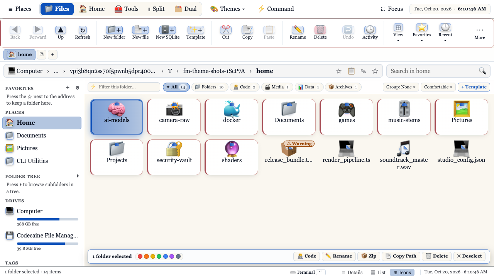

- **Palette:** Background `#faf7f0` · Text `#111827` · Accent `#0f52ba` · Secondary `#047857` · Card `#ffffff` · Border `#cbd5e1`
- **GPU Profile:** Blur `0px` · Glass `0` · Folder Shader `kyoto_washi_sumi` · 3D Icons `kyoto_zen_ink` · Animation `off` · Atmosphere `none`
- **Download JSON:** [`custom_themes/01_low_featherweight_eink_paper_daylight.json`](./01_low_featherweight_eink_paper_daylight.json)

```text
CCFM-THEME-v1:eyJmb3JtYXQiOiJidW4tcmFkLXN0dWRpby1maWxlLW1hbmFnZXItdGhlbWUiLCJ2ZXJzaW9uIjoxLCJuYW1lIjoiRmVhdGhlcndlaWdodCBFLUluayBQYXBlciBEYXlsaWdodCIsImRhcmsiOmZhbHNlLCJiYXNlIjoiS3lvdG8gV2FzaGkgJiBTdW1pIEluayIsImNvbG9ycyI6eyJiYWNrZ3JvdW5kIjoiI2ZhZjdmMCIsInRleHQiOiIjMTExODI3IiwiYWNjZW50IjoiIzBmNTJiYSIsInNlY29uZGFyeSI6IiMwNDc4NTciLCJjYXJkIjoiI2ZmZmZmZiIsImJvcmRlciI6IiNjYmQ1ZTEiLCJkYW5nZXIiOiIjYjkxYzFjIiwid2FybmluZyI6IiNiNDUzMDkiLCJzdWNjZXNzIjoiIzA0Nzg1NyIsImluZm8iOiIjMDM2OWExIn0sImZ4Ijp7Imdsb3ciOiJub25lIiwiZ2xvd0NvbG9yIjoiIzBmNTJiYSIsImdsb3dDb2xvcjIiOiIjMDQ3ODU3IiwiYmx1ciI6MCwiZ2xhc3MiOjAsImdsb3dJbnRlbnNpdHkiOjAsImJvcmRlck9wYWNpdHkiOjAuNDUsImdyYWluIjoibm9uZSIsInNjYW5saW5lcyI6Im5vbmUiLCJyYWRpdXMiOiJzb2Z0IiwiYm9yZGVyIjoiZmxhdCIsIm1vdGlvbiI6Inplcm8iLCJzaGVlbiI6ZmFsc2UsIm5vaXNlIjpmYWxzZSwiY2hyb21hdGljIjpmYWxzZSwiYW1iaWVudCI6ZmFsc2UsImJhY2tkcm9wU3R5bGUiOiJtYXR0ZSIsImN1cnNvckVmZmVjdCI6Im5vbmUiLCJ2aWduZXR0ZSI6Im5vbmUiLCJzYXR1cmF0aW9uIjoxLjA1LCJ1aUVsZW1lbnRGeCI6Imt5b3RvX3dhc2hpX3N1bWkiLCJpY29uUGFja1N0eWxlIjoia3lvdG9femVuX2luayIsImZvbnRQcm9maWxlIjoiZWRpdG9yaWFsIiwiY29ybmVyUHJvZmlsZSI6InJvdW5kZWQifX0
```

### Featherweight OLED Pitch-Black (`custom_00000002` · `LOW`)

> **Target System:** OLED Laptops on Battery Saver, Ultrabooks, ThinkPad, Low-Power ARM Linux  
> **Design Notes:** True #000000 pitch-black OLED pixel-off surfaces with zero blur and crisp emerald terminal telemetry.

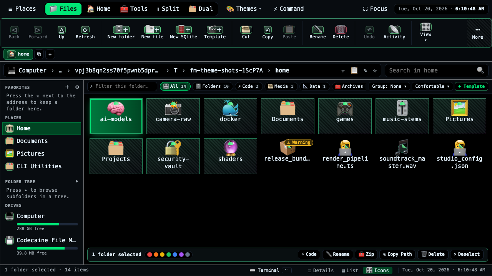

- **Palette:** Background `#000000` · Text `#e6f4ff` · Accent `#00e676` · Secondary `#38bdf8` · Card `#080c10` · Border `#1e293b`
- **GPU Profile:** Blur `0px` · Glass `0` · Folder Shader `carbon_kevlar_weave` · 3D Icons `dev_polyglot_pro` · Animation `off` · Atmosphere `none`
- **Download JSON:** [`custom_themes/02_low_featherweight_oled_pitch_black.json`](./02_low_featherweight_oled_pitch_black.json)

```text
CCFM-THEME-v1:eyJmb3JtYXQiOiJidW4tcmFkLXN0dWRpby1maWxlLW1hbmFnZXItdGhlbWUiLCJ2ZXJzaW9uIjoxLCJuYW1lIjoiRmVhdGhlcndlaWdodCBPTEVEIFBpdGNoLUJsYWNrIiwiZGFyayI6dHJ1ZSwiYmFzZSI6IkNhcmJvbiBLZXZsYXIgVGVsZW1ldHJ5IiwiY29sb3JzIjp7ImJhY2tncm91bmQiOiIjMDAwMDAwIiwidGV4dCI6IiNlNmY0ZmYiLCJhY2NlbnQiOiIjMDBlNjc2Iiwic2Vjb25kYXJ5IjoiIzM4YmRmOCIsImNhcmQiOiIjMDgwYzEwIiwiYm9yZGVyIjoiIzFlMjkzYiIsImRhbmdlciI6IiNmZjUyNTIiLCJ3YXJuaW5nIjoiI2ZiYmYyNCIsInN1Y2Nlc3MiOiIjMDBlNjc2IiwiaW5mbyI6IiMzOGJkZjgifSwiZngiOnsiZ2xvdyI6Im5vbmUiLCJnbG93Q29sb3IiOiIjMDBlNjc2IiwiZ2xvd0NvbG9yMiI6IiMzOGJkZjgiLCJibHVyIjowLCJnbGFzcyI6MCwiZ2xvd0ludGVuc2l0eSI6MCwiYm9yZGVyT3BhY2l0eSI6MC40LCJncmFpbiI6Im5vbmUiLCJzY2FubGluZXMiOiJub25lIiwicmFkaXVzIjoic2hhcnAiLCJib3JkZXIiOiJmbGF0IiwibW90aW9uIjoiemVybyIsInNoZWVuIjpmYWxzZSwibm9pc2UiOmZhbHNlLCJjaHJvbWF0aWMiOmZhbHNlLCJhbWJpZW50IjpmYWxzZSwiYmFja2Ryb3BTdHlsZSI6Im9sZWQiLCJjdXJzb3JFZmZlY3QiOiJub25lIiwidmlnbmV0dGUiOiJub25lIiwic2F0dXJhdGlvbiI6MS4xLCJ1aUVsZW1lbnRGeCI6ImNhcmJvbl9rZXZsYXJfd2VhdmUiLCJpY29uUGFja1N0eWxlIjoiZGV2X3BvbHlnbG90X3BybyIsImZvbnRQcm9maWxlIjoidGVybWluYWwiLCJjb3JuZXJQcm9maWxlIjoic2hhcnAifX0
```

### Featherweight Halloween Pumpkin Lite (`custom_00000003` · `LOW`)

> **Target System:** Any Low-Spec PC/Mac wanting Halloween Jack-O'-Lantern aesthetics at 0% GPU usage  
> **Design Notes:** Crisp Halloween pumpkin orange and witching-hour violet with festive 3D icons and zero GPU blur/particles.

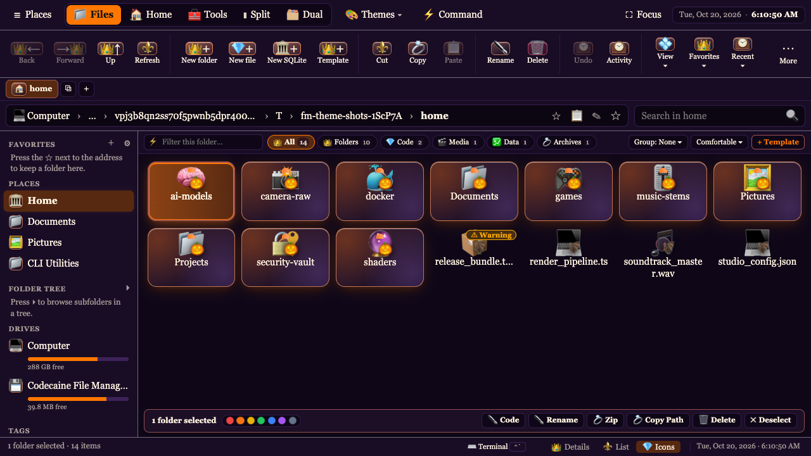

- **Palette:** Background `#0f0718` · Text `#fff3e0` · Accent `#ff7700` · Secondary `#b388ff` · Card `#190d26` · Border `#3d2259`
- **GPU Profile:** Blur `0px` · Glass `0` · Folder Shader `holiday_festive_glow` · 3D Icons `us_holidays_festive` · Animation `off` · Atmosphere `none`
- **Download JSON:** [`custom_themes/03_low_featherweight_halloween_pumpkin_lite.json`](./03_low_featherweight_halloween_pumpkin_lite.json)

```text
CCFM-THEME-v1:eyJmb3JtYXQiOiJidW4tcmFkLXN0dWRpby1maWxlLW1hbmFnZXItdGhlbWUiLCJ2ZXJzaW9uIjoxLCJuYW1lIjoiRmVhdGhlcndlaWdodCBIYWxsb3dlZW4gUHVtcGtpbiBMaXRlIiwiZGFyayI6dHJ1ZSwiYmFzZSI6IkhhbGxvd2VlbiBDYXJ2ZWQgSmFjay1PJy1MYW50ZXJuIiwiY29sb3JzIjp7ImJhY2tncm91bmQiOiIjMGYwNzE4IiwidGV4dCI6IiNmZmYzZTAiLCJhY2NlbnQiOiIjZmY3NzAwIiwic2Vjb25kYXJ5IjoiI2IzODhmZiIsImNhcmQiOiIjMTkwZDI2IiwiYm9yZGVyIjoiIzNkMjI1OSIsImRhbmdlciI6IiNmZjNkMDAiLCJ3YXJuaW5nIjoiI2ZmYWIwMCIsInN1Y2Nlc3MiOiIjMDBlNjc2IiwiaW5mbyI6IiNiMzg4ZmYifSwiZngiOnsiZ2xvdyI6InNvZnQiLCJnbG93Q29sb3IiOiIjZmY3NzAwIiwiZ2xvd0NvbG9yMiI6IiNiMzg4ZmYiLCJibHVyIjowLCJnbGFzcyI6MCwiZ2xvd0ludGVuc2l0eSI6MC4zNSwiYm9yZGVyT3BhY2l0eSI6MC4zOCwiZ3JhaW4iOiJub25lIiwic2NhbmxpbmVzIjoibm9uZSIsInJhZGl1cyI6InNvZnQiLCJib3JkZXIiOiJmbGF0IiwibW90aW9uIjoiY2FsbSIsInNoZWVuIjpmYWxzZSwibm9pc2UiOmZhbHNlLCJjaHJvbWF0aWMiOmZhbHNlLCJhbWJpZW50IjpmYWxzZSwiYmFja2Ryb3BTdHlsZSI6Im1hdHRlIiwiY3Vyc29yRWZmZWN0Ijoibm9uZSIsInZpZ25ldHRlIjoibm9uZSIsInNhdHVyYXRpb24iOjEuMiwidWlFbGVtZW50RngiOiJob2xpZGF5X2Zlc3RpdmVfZ2xvdyIsImljb25QYWNrU3R5bGUiOiJ1c19ob2xpZGF5c19mZXN0aXZlIiwiZm9udFByb2ZpbGUiOiJlZGl0b3JpYWwiLCJjb3JuZXJQcm9maWxlIjoicm91bmRlZCIsImljb25HbG93Ijoic3VidGxlIn19
```

### Featherweight Polar Ice Lite (`custom_00000004` · `LOW`)

> **Target System:** Any Low-Spec PC/Mac wanting Polar Night icy aesthetics with zero GPU load  
> **Design Notes:** Deep Arctic slate and glacier cyan with Nordic ice 3D icons and zero backdrop blur or particle load.

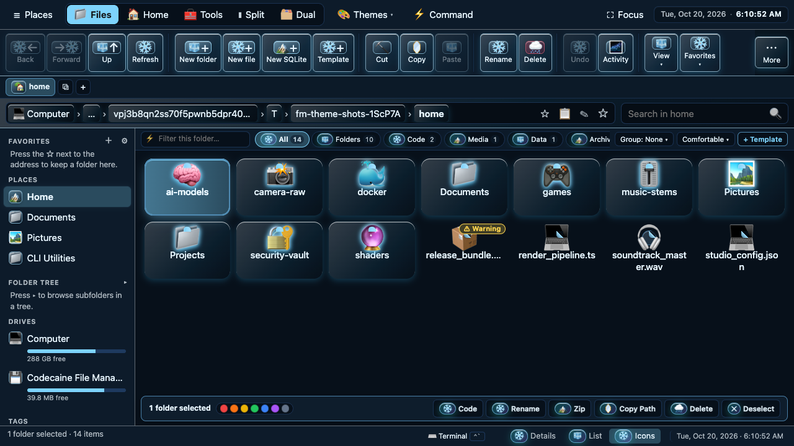

- **Palette:** Background `#07101a` · Text `#e8f6ff` · Accent `#7dd3fc` · Secondary `#64ffda` · Card `#0d1b2a` · Border `#1e3a5f`
- **GPU Profile:** Blur `0px` · Glass `0` · Folder Shader `cryo_frost` · 3D Icons `aurora_nordic_ice` · Animation `off` · Atmosphere `none`
- **Download JSON:** [`custom_themes/04_low_featherweight_polar_ice_lite.json`](./04_low_featherweight_polar_ice_lite.json)

```text
CCFM-THEME-v1:eyJmb3JtYXQiOiJidW4tcmFkLXN0dWRpby1maWxlLW1hbmFnZXItdGhlbWUiLCJ2ZXJzaW9uIjoxLCJuYW1lIjoiRmVhdGhlcndlaWdodCBQb2xhciBJY2UgTGl0ZSIsImRhcmsiOnRydWUsImJhc2UiOiJQb2xhciBOaWdodCIsImNvbG9ycyI6eyJiYWNrZ3JvdW5kIjoiIzA3MTAxYSIsInRleHQiOiIjZThmNmZmIiwiYWNjZW50IjoiIzdkZDNmYyIsInNlY29uZGFyeSI6IiM2NGZmZGEiLCJjYXJkIjoiIzBkMWIyYSIsImJvcmRlciI6IiMxZTNhNWYiLCJkYW5nZXIiOiIjZmI3MTg1Iiwid2FybmluZyI6IiNmY2QzNGQiLCJzdWNjZXNzIjoiIzM0ZDM5OSIsImluZm8iOiIjN2RkM2ZjIn0sImZ4Ijp7Imdsb3ciOiJzb2Z0IiwiZ2xvd0NvbG9yIjoiIzdkZDNmYyIsImdsb3dDb2xvcjIiOiIjNjRmZmRhIiwiYmx1ciI6MCwiZ2xhc3MiOjAsImdsb3dJbnRlbnNpdHkiOjAuMywiYm9yZGVyT3BhY2l0eSI6MC4zNSwiZ3JhaW4iOiJub25lIiwic2NhbmxpbmVzIjoibm9uZSIsInJhZGl1cyI6InNvZnQiLCJib3JkZXIiOiJmbGF0IiwibW90aW9uIjoiY2FsbSIsInNoZWVuIjpmYWxzZSwibm9pc2UiOmZhbHNlLCJjaHJvbWF0aWMiOmZhbHNlLCJhbWJpZW50IjpmYWxzZSwiYmFja2Ryb3BTdHlsZSI6Im1hdHRlIiwiY3Vyc29yRWZmZWN0Ijoibm9uZSIsInZpZ25ldHRlIjoibm9uZSIsInNhdHVyYXRpb24iOjEuMTUsInVpRWxlbWVudEZ4IjoiY3J5b19mcm9zdCIsImljb25QYWNrU3R5bGUiOiJhdXJvcmFfbm9yZGljX2ljZSIsImZvbnRQcm9maWxlIjoiaHVtYW5pc3RfaGlnIiwiY29ybmVyUHJvZmlsZSI6InJvdW5kZWQiLCJpY29uR2xvdyI6InN1YnRsZSJ9fQ
```

---

## Tier 2: Medium Balanced Systems (`medium` — Smooth 60fps · Moderate Glass & 1-Layer FX)

Engineered for **MacBook Air (M1/M2/M3), Surface Pro, ThinkPad X1 Carbon, Steam Deck, and everyday integrated-GPU laptops**. Uses `blur: 12–14px`, `glass: 0.50–0.55`, a single lightweight particle layer (`bokeh`, `snow`, `autumn_leaves`, `fireflies`), and gentle spring icon motion.

### 📦 1-Click 🟡 MEDIUM BALANCED TIER Pack (4 Themes — [`pack_tier_2_medium_balanced_60fps.json`](./pack_tier_2_medium_balanced_60fps.json))

```text
CCFM-PACK-v1:eyJmb3JtYXQiOiJidW4tcmFkLXN0dWRpby1maWxlLW1hbmFnZXItdGhlbWUtcGFjayIsInZlcnNpb24iOjEsInRoZW1lcyI6W3sibmFtZSI6IkJhbGFuY2VkIEN1cGVydGlubyBTZXF1b2lhIFN0dWRpbyIsImRhcmsiOnRydWUsImJhc2UiOiJtYWNPUyBTZXF1b2lhIERhcmsiLCJjb2xvcnMiOnsiYmFja2dyb3VuZCI6IiMwZDExMWEiLCJ0ZXh0IjoiI2YxZjVmOSIsImFjY2VudCI6IiMzYjgyZjYiLCJzZWNvbmRhcnkiOiIjOGI1Y2Y2IiwiY2FyZCI6IiMxNTFjMmMiLCJib3JkZXIiOiIjMmEzNjRmIiwiZGFuZ2VyIjoiI2VmNDQ0NCIsIndhcm5pbmciOiIjZjU5ZTBiIiwic3VjY2VzcyI6IiMxMGI5ODEiLCJpbmZvIjoiIzNiODJmNiJ9LCJmeCI6eyJnbG93Ijoic29mdCIsImdsb3dDb2xvciI6IiMzYjgyZjYiLCJnbG93Q29sb3IyIjoiIzhiNWNmNiIsImJsdXIiOjEyLCJnbGFzcyI6MC41LCJnbG93SW50ZW5zaXR5IjowLjU1LCJib3JkZXJPcGFjaXR5IjowLjI4LCJncmFpbiI6Im5vbmUiLCJzY2FubGluZXMiOiJub25lIiwicmFkaXVzIjoic3F1aXJjbGUiLCJib3JkZXIiOiJiZXZlbCIsIm1vdGlvbiI6InNwcmluZyIsInNoZWVuIjp0cnVlLCJub2lzZSI6ZmFsc2UsImNocm9tYXRpYyI6ZmFsc2UsImFtYmllbnQiOnRydWUsImF0bW9zcGhlcmUiOiJjaW5lbWFfYm9rZWgiLCJiYWNrZHJvcFN0eWxlIjoiZ2xhc3MiLCJjdXJzb3JFZmZlY3QiOiJzcG90bGlnaHQiLCJ2aWduZXR0ZSI6InN1YnRsZSIsInNhdHVyYXRpb24iOjEuMjUsInVpRWxlbWVudEZ4IjoiY3VwZXJ0aW5vX2NlcmFtaWNfYmV2ZWwiLCJpY29uUGFja1N0eWxlIjoibWFjb3Nfc2VxdW9pYV9oaWciLCJmb250UHJvZmlsZSI6Imh1bWFuaXN0X2hpZyIsImNvcm5lclByb2ZpbGUiOiJzcXVpcmNsZV9oaWciLCJpY29uR2xvdyI6ImFtYmllbnRfcDMiLCJpY29uQW5pbWF0aW9uIjoic3ByaW5nX3BvcF8zZCJ9fSx7Im5hbWUiOiJCYWxhbmNlZCBQb2xhciBOb3JkaWMgRnJvc3QgNjBmcHMiLCJkYXJrIjp0cnVlLCJiYXNlIjoiUG9sYXIgTmlnaHQiLCJjb2xvcnMiOnsiYmFja2dyb3VuZCI6IiMwNjEwMWMiLCJ0ZXh0IjoiI2VjZjhmZiIsImFjY2VudCI6IiMzOGJkZjgiLCJzZWNvbmRhcnkiOiIjNjRmZmRhIiwiY2FyZCI6IiMwYzFjMmUiLCJib3JkZXIiOiIjMWQzYjVjIiwiZGFuZ2VyIjoiI2ZiNzE4NSIsIndhcm5pbmciOiIjZmJiZjI0Iiwic3VjY2VzcyI6IiMzNGQzOTkiLCJpbmZvIjoiIzM4YmRmOCJ9LCJmeCI6eyJnbG93IjoiYXVyb3JhIiwiZ2xvd0NvbG9yIjoiIzM4YmRmOCIsImdsb3dDb2xvcjIiOiIjNjRmZmRhIiwiYmx1ciI6MTQsImdsYXNzIjowLjUyLCJnbG93SW50ZW5zaXR5IjowLjY1LCJib3JkZXJPcGFjaXR5IjowLjMsImdyYWluIjoibm9uZSIsInNjYW5saW5lcyI6Im5vbmUiLCJyYWRpdXMiOiJzcXVpcmNsZSIsImJvcmRlciI6ImdyYWRpZW50IiwibW90aW9uIjoiY2FsbSIsInNoZWVuIjp0cnVlLCJub2lzZSI6ZmFsc2UsImNocm9tYXRpYyI6ZmFsc2UsImFtYmllbnQiOnRydWUsImF0bW9zcGhlcmUiOiJzbm93IiwiYmFja2Ryb3BTdHlsZSI6ImZyb3N0ZWQiLCJjdXJzb3JFZmZlY3QiOiJzcG90bGlnaHQiLCJ2aWduZXR0ZSI6InN1YnRsZSIsInNhdHVyYXRpb24iOjEuMywidWlFbGVtZW50RngiOiJjcnlvX2Zyb3N0IiwiaWNvblBhY2tTdHlsZSI6ImNyeW9fY3J5c3RhbCIsImZvbnRQcm9maWxlIjoiaHVtYW5pc3RfaGlnIiwiY29ybmVyUHJvZmlsZSI6InNxdWlyY2xlX2hpZyIsImljb25HbG93IjoiYW1iaWVudF9wMyIsImljb25BbmltYXRpb24iOiJsZXZpdGF0ZV9mbG9hdCJ9fSx7Im5hbWUiOiJCYWxhbmNlZCBBdXR1bW4gSGFsbG93ZWVuIExhbnRlcm4iLCJkYXJrIjp0cnVlLCJiYXNlIjoiSGFsbG93ZWVuIENhcnZlZCBKYWNrLU8nLUxhbnRlcm4iLCJjb2xvcnMiOnsiYmFja2dyb3VuZCI6IiMxMTA4MWEiLCJ0ZXh0IjoiI2ZmZjRlNiIsImFjY2VudCI6IiNmZjc3MDAiLCJzZWNvbmRhcnkiOiIjYjM4OGZmIiwiY2FyZCI6IiMxYjBkMjkiLCJib3JkZXIiOiIjNDIyMTYzIiwiZGFuZ2VyIjoiI2ZmM2QwMCIsIndhcm5pbmciOiIjZmZhYjAwIiwic3VjY2VzcyI6IiMwMGU2NzYiLCJpbmZvIjoiI2IzODhmZiJ9LCJmeCI6eyJnbG93IjoiZW1iZXIiLCJnbG93Q29sb3IiOiIjZmY3NzAwIiwiZ2xvd0NvbG9yMiI6IiNiMzg4ZmYiLCJibHVyIjoxMiwiZ2xhc3MiOjAuNSwiZ2xvd0ludGVuc2l0eSI6MC42OCwiYm9yZGVyT3BhY2l0eSI6MC4zLCJncmFpbiI6Im5vbmUiLCJzY2FubGluZXMiOiJub25lIiwicmFkaXVzIjoic3F1aXJjbGUiLCJib3JkZXIiOiJncmFkaWVudCIsIm1vdGlvbiI6InNwcmluZyIsInNoZWVuIjp0cnVlLCJub2lzZSI6ZmFsc2UsImNocm9tYXRpYyI6ZmFsc2UsImFtYmllbnQiOnRydWUsImF0bW9zcGhlcmUiOiJhdXR1bW5fbGVhdmVzIiwiYmFja2Ryb3BTdHlsZSI6ImdsYXNzIiwiY3Vyc29yRWZmZWN0Ijoic3BvdGxpZ2h0IiwidmlnbmV0dGUiOiJzdWJ0bGUiLCJzYXR1cmF0aW9uIjoxLjMyLCJ1aUVsZW1lbnRGeCI6ImhvbGlkYXlfZmVzdGl2ZV9nbG93IiwiaWNvblBhY2tTdHlsZSI6InVzX2hvbGlkYXlzX2Zlc3RpdmUiLCJmb250UHJvZmlsZSI6ImVkaXRvcmlhbCIsImNvcm5lclByb2ZpbGUiOiJzcXVpcmNsZV9oaWciLCJpY29uR2xvdyI6ImFtYmllbnRfcDMiLCJpY29uQW5pbWF0aW9uIjoic3ByaW5nX3BvcF8zZCJ9fSx7Im5hbWUiOiJCYWxhbmNlZCBLeW90byBNYXRjaGEgQm90YW5pY2FsIiwiZGFyayI6ZmFsc2UsImJhc2UiOiJNb3RoZXIncyBEYXkgQm90YW5pY2FsIFRlYSBHYXJkZW4iLCJjb2xvcnMiOnsiYmFja2dyb3VuZCI6IiNmM2Y4ZjQiLCJ0ZXh0IjoiIzBmMjkxZSIsImFjY2VudCI6IiMwNTk2NjkiLCJzZWNvbmRhcnkiOiIjMDI4NGM3IiwiY2FyZCI6IiNmZmZmZmYiLCJib3JkZXIiOiIjYmJmN2QwIiwiZGFuZ2VyIjoiI2RjMjYyNiIsIndhcm5pbmciOiIjZDk3NzA2Iiwic3VjY2VzcyI6IiMwNTk2NjkiLCJpbmZvIjoiIzAyODRjNyJ9LCJmeCI6eyJnbG93Ijoic29mdCIsImdsb3dDb2xvciI6IiMxMGI5ODEiLCJnbG93Q29sb3IyIjoiIzM4YmRmOCIsImJsdXIiOjEyLCJnbGFzcyI6MC41NSwiZ2xvd0ludGVuc2l0eSI6MC41LCJib3JkZXJPcGFjaXR5IjowLjM0LCJncmFpbiI6Im5vbmUiLCJzY2FubGluZXMiOiJub25lIiwicmFkaXVzIjoic3F1aXJjbGUiLCJib3JkZXIiOiJiZXZlbCIsIm1vdGlvbiI6ImNhbG0iLCJzaGVlbiI6dHJ1ZSwibm9pc2UiOmZhbHNlLCJjaHJvbWF0aWMiOmZhbHNlLCJhbWJpZW50Ijp0cnVlLCJhdG1vc3BoZXJlIjoiZmlyZWZsaWVzIiwiYmFja2Ryb3BTdHlsZSI6ImZyb3N0ZWQiLCJjdXJzb3JFZmZlY3QiOiJzcG90bGlnaHQiLCJ2aWduZXR0ZSI6Im5vbmUiLCJzYXR1cmF0aW9uIjoxLjIyLCJ1aUVsZW1lbnRGeCI6Imt5b3RvX3dhc2hpX3N1bWkiLCJpY29uUGFja1N0eWxlIjoiYmlvbHVtaW5lc2NlbnRfZWRlbiIsImZvbnRQcm9maWxlIjoiaHVtYW5pc3RfaGlnIiwiY29ybmVyUHJvZmlsZSI6InNxdWlyY2xlX2hpZyIsImljb25HbG93Ijoic3VidGxlIiwiaWNvbkFuaW1hdGlvbiI6Imxldml0YXRlX2Zsb2F0In19XX0
```

| Theme | Blur / Glass | 3D Folder Shader (`uiElementFx`) | 3D Icon Pack (`iconPackStyle`) | 3D Icon Motion (`iconAnimation`) | Atmosphere (`atmosphere`) | JSON |
| :--- | :-: | :--- | :--- | :--- | :--- | :--- |
| **Balanced Cupertino Sequoia Studio** | `12px` / `0.5` | `cupertino_ceramic_bevel` | `macos_sequoia_hig` | `spring_pop_3d` | `cinema_bokeh` | [`05_medium_balanced_cupertino_sequoia_studio.json`](./05_medium_balanced_cupertino_sequoia_studio.json) |
| **Balanced Polar Nordic Frost 60fps** | `14px` / `0.52` | `cryo_frost` | `cryo_crystal` | `levitate_float` | `snow` | [`06_medium_balanced_polar_nordic_frost_60fps.json`](./06_medium_balanced_polar_nordic_frost_60fps.json) |
| **Balanced Autumn Halloween Lantern** | `12px` / `0.5` | `holiday_festive_glow` | `us_holidays_festive` | `spring_pop_3d` | `autumn_leaves` | [`07_medium_balanced_autumn_halloween_lantern.json`](./07_medium_balanced_autumn_halloween_lantern.json) |
| **Balanced Kyoto Matcha Botanical** | `12px` / `0.55` | `kyoto_washi_sumi` | `bioluminescent_eden` | `levitate_float` | `fireflies` | [`08_medium_balanced_kyoto_matcha_botanical.json`](./08_medium_balanced_kyoto_matcha_botanical.json) |

### Balanced Cupertino Sequoia Studio (`custom_00000005` · `MEDIUM`)

> **Target System:** MacBook Air M1/M2/M3, Surface Pro, ThinkPad X1 Carbon, Steam Deck, Mini PCs  
> **Design Notes:** Refined macOS Sequoia ceramic bevel folders, moderate 12px glass blur, and gentle floating bokeh.

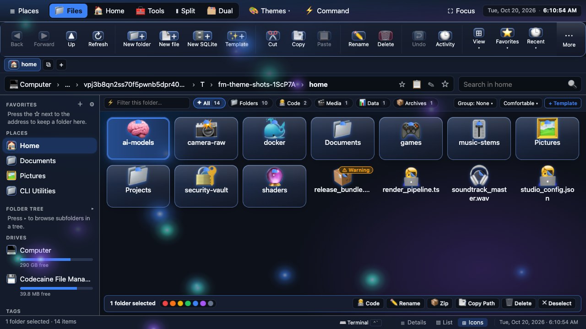

- **Palette:** Background `#0d111a` · Text `#f1f5f9` · Accent `#3b82f6` · Secondary `#8b5cf6` · Card `#151c2c` · Border `#2a364f`
- **GPU Profile:** Blur `12px` · Glass `0.5` · Folder Shader `cupertino_ceramic_bevel` · 3D Icons `macos_sequoia_hig` · Animation `spring_pop_3d` · Atmosphere `cinema_bokeh`
- **Download JSON:** [`custom_themes/05_medium_balanced_cupertino_sequoia_studio.json`](./05_medium_balanced_cupertino_sequoia_studio.json)

```text
CCFM-THEME-v1:eyJmb3JtYXQiOiJidW4tcmFkLXN0dWRpby1maWxlLW1hbmFnZXItdGhlbWUiLCJ2ZXJzaW9uIjoxLCJuYW1lIjoiQmFsYW5jZWQgQ3VwZXJ0aW5vIFNlcXVvaWEgU3R1ZGlvIiwiZGFyayI6dHJ1ZSwiYmFzZSI6Im1hY09TIFNlcXVvaWEgRGFyayIsImNvbG9ycyI6eyJiYWNrZ3JvdW5kIjoiIzBkMTExYSIsInRleHQiOiIjZjFmNWY5IiwiYWNjZW50IjoiIzNiODJmNiIsInNlY29uZGFyeSI6IiM4YjVjZjYiLCJjYXJkIjoiIzE1MWMyYyIsImJvcmRlciI6IiMyYTM2NGYiLCJkYW5nZXIiOiIjZWY0NDQ0Iiwid2FybmluZyI6IiNmNTllMGIiLCJzdWNjZXNzIjoiIzEwYjk4MSIsImluZm8iOiIjM2I4MmY2In0sImZ4Ijp7Imdsb3ciOiJzb2Z0IiwiZ2xvd0NvbG9yIjoiIzNiODJmNiIsImdsb3dDb2xvcjIiOiIjOGI1Y2Y2IiwiYmx1ciI6MTIsImdsYXNzIjowLjUsImdsb3dJbnRlbnNpdHkiOjAuNTUsImJvcmRlck9wYWNpdHkiOjAuMjgsImdyYWluIjoibm9uZSIsInNjYW5saW5lcyI6Im5vbmUiLCJyYWRpdXMiOiJzcXVpcmNsZSIsImJvcmRlciI6ImJldmVsIiwibW90aW9uIjoic3ByaW5nIiwic2hlZW4iOnRydWUsIm5vaXNlIjpmYWxzZSwiY2hyb21hdGljIjpmYWxzZSwiYW1iaWVudCI6dHJ1ZSwiYXRtb3NwaGVyZSI6ImNpbmVtYV9ib2tlaCIsImJhY2tkcm9wU3R5bGUiOiJnbGFzcyIsImN1cnNvckVmZmVjdCI6InNwb3RsaWdodCIsInZpZ25ldHRlIjoic3VidGxlIiwic2F0dXJhdGlvbiI6MS4yNSwidWlFbGVtZW50RngiOiJjdXBlcnRpbm9fY2VyYW1pY19iZXZlbCIsImljb25QYWNrU3R5bGUiOiJtYWNvc19zZXF1b2lhX2hpZyIsImZvbnRQcm9maWxlIjoiaHVtYW5pc3RfaGlnIiwiY29ybmVyUHJvZmlsZSI6InNxdWlyY2xlX2hpZyIsImljb25HbG93IjoiYW1iaWVudF9wMyIsImljb25BbmltYXRpb24iOiJzcHJpbmdfcG9wXzNkIn19
```

### Balanced Polar Nordic Frost 60fps (`custom_00000006` · `MEDIUM`)

> **Target System:** MacBook Air, Ultrabooks, Integrated Graphics Laptops running at 60Hz  
> **Design Notes:** Polar Night frosted glass with hanging crystal icicles, gentle snowfall, and floating cryo-crystal icons.

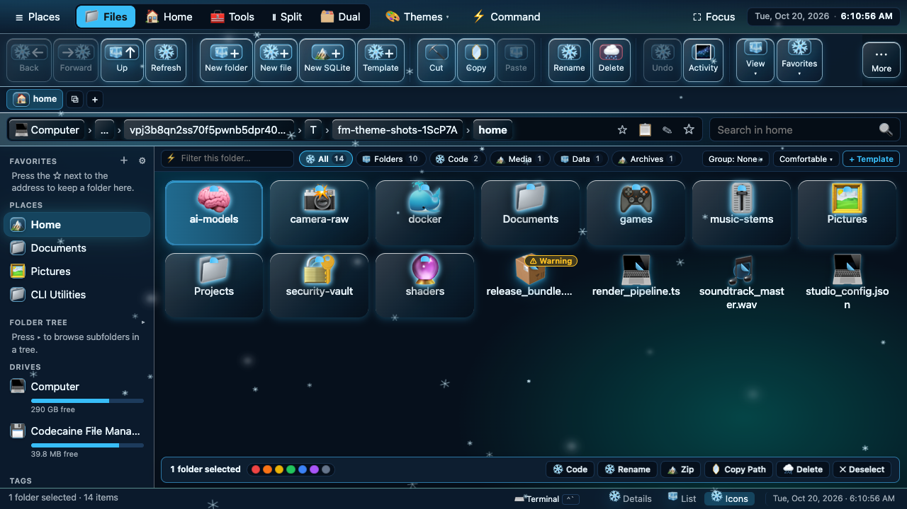

- **Palette:** Background `#06101c` · Text `#ecf8ff` · Accent `#38bdf8` · Secondary `#64ffda` · Card `#0c1c2e` · Border `#1d3b5c`
- **GPU Profile:** Blur `14px` · Glass `0.52` · Folder Shader `cryo_frost` · 3D Icons `cryo_crystal` · Animation `levitate_float` · Atmosphere `snow`
- **Download JSON:** [`custom_themes/06_medium_balanced_polar_nordic_frost_60fps.json`](./06_medium_balanced_polar_nordic_frost_60fps.json)

```text
CCFM-THEME-v1:eyJmb3JtYXQiOiJidW4tcmFkLXN0dWRpby1maWxlLW1hbmFnZXItdGhlbWUiLCJ2ZXJzaW9uIjoxLCJuYW1lIjoiQmFsYW5jZWQgUG9sYXIgTm9yZGljIEZyb3N0IDYwZnBzIiwiZGFyayI6dHJ1ZSwiYmFzZSI6IlBvbGFyIE5pZ2h0IiwiY29sb3JzIjp7ImJhY2tncm91bmQiOiIjMDYxMDFjIiwidGV4dCI6IiNlY2Y4ZmYiLCJhY2NlbnQiOiIjMzhiZGY4Iiwic2Vjb25kYXJ5IjoiIzY0ZmZkYSIsImNhcmQiOiIjMGMxYzJlIiwiYm9yZGVyIjoiIzFkM2I1YyIsImRhbmdlciI6IiNmYjcxODUiLCJ3YXJuaW5nIjoiI2ZiYmYyNCIsInN1Y2Nlc3MiOiIjMzRkMzk5IiwiaW5mbyI6IiMzOGJkZjgifSwiZngiOnsiZ2xvdyI6ImF1cm9yYSIsImdsb3dDb2xvciI6IiMzOGJkZjgiLCJnbG93Q29sb3IyIjoiIzY0ZmZkYSIsImJsdXIiOjE0LCJnbGFzcyI6MC41MiwiZ2xvd0ludGVuc2l0eSI6MC42NSwiYm9yZGVyT3BhY2l0eSI6MC4zLCJncmFpbiI6Im5vbmUiLCJzY2FubGluZXMiOiJub25lIiwicmFkaXVzIjoic3F1aXJjbGUiLCJib3JkZXIiOiJncmFkaWVudCIsIm1vdGlvbiI6ImNhbG0iLCJzaGVlbiI6dHJ1ZSwibm9pc2UiOmZhbHNlLCJjaHJvbWF0aWMiOmZhbHNlLCJhbWJpZW50Ijp0cnVlLCJhdG1vc3BoZXJlIjoic25vdyIsImJhY2tkcm9wU3R5bGUiOiJmcm9zdGVkIiwiY3Vyc29yRWZmZWN0Ijoic3BvdGxpZ2h0IiwidmlnbmV0dGUiOiJzdWJ0bGUiLCJzYXR1cmF0aW9uIjoxLjMsInVpRWxlbWVudEZ4IjoiY3J5b19mcm9zdCIsImljb25QYWNrU3R5bGUiOiJjcnlvX2NyeXN0YWwiLCJmb250UHJvZmlsZSI6Imh1bWFuaXN0X2hpZyIsImNvcm5lclByb2ZpbGUiOiJzcXVpcmNsZV9oaWciLCJpY29uR2xvdyI6ImFtYmllbnRfcDMiLCJpY29uQW5pbWF0aW9uIjoibGV2aXRhdGVfZmxvYXQifX0
```

### Balanced Autumn Halloween Lantern (`custom_00000007` · `MEDIUM`)

> **Target System:** Everyday Laptops & Desktops wanting animated Halloween 3D icons at smooth 60fps  
> **Design Notes:** Warm Jack-O'-Lantern amber glow with drifting autumn leaves, festive 3D icons, and spring-pop motion.

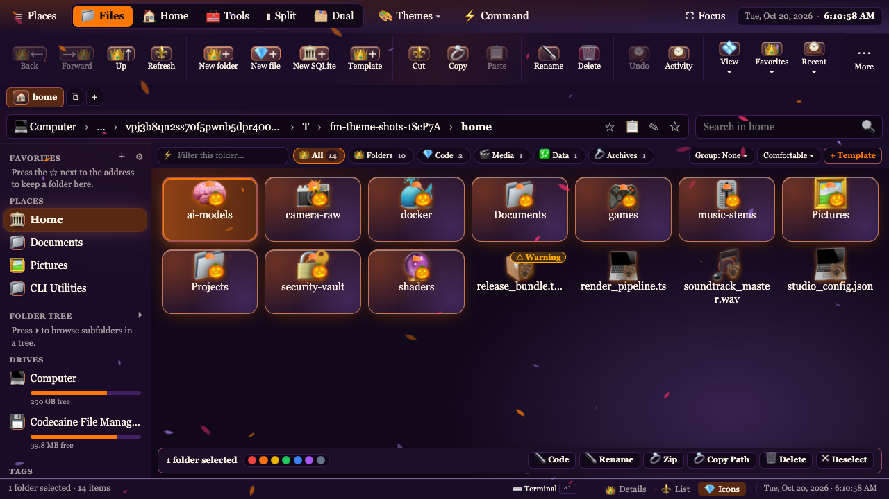

- **Palette:** Background `#11081a` · Text `#fff4e6` · Accent `#ff7700` · Secondary `#b388ff` · Card `#1b0d29` · Border `#422163`
- **GPU Profile:** Blur `12px` · Glass `0.5` · Folder Shader `holiday_festive_glow` · 3D Icons `us_holidays_festive` · Animation `spring_pop_3d` · Atmosphere `autumn_leaves`
- **Download JSON:** [`custom_themes/07_medium_balanced_autumn_halloween_lantern.json`](./07_medium_balanced_autumn_halloween_lantern.json)

```text
CCFM-THEME-v1:eyJmb3JtYXQiOiJidW4tcmFkLXN0dWRpby1maWxlLW1hbmFnZXItdGhlbWUiLCJ2ZXJzaW9uIjoxLCJuYW1lIjoiQmFsYW5jZWQgQXV0dW1uIEhhbGxvd2VlbiBMYW50ZXJuIiwiZGFyayI6dHJ1ZSwiYmFzZSI6IkhhbGxvd2VlbiBDYXJ2ZWQgSmFjay1PJy1MYW50ZXJuIiwiY29sb3JzIjp7ImJhY2tncm91bmQiOiIjMTEwODFhIiwidGV4dCI6IiNmZmY0ZTYiLCJhY2NlbnQiOiIjZmY3NzAwIiwic2Vjb25kYXJ5IjoiI2IzODhmZiIsImNhcmQiOiIjMWIwZDI5IiwiYm9yZGVyIjoiIzQyMjE2MyIsImRhbmdlciI6IiNmZjNkMDAiLCJ3YXJuaW5nIjoiI2ZmYWIwMCIsInN1Y2Nlc3MiOiIjMDBlNjc2IiwiaW5mbyI6IiNiMzg4ZmYifSwiZngiOnsiZ2xvdyI6ImVtYmVyIiwiZ2xvd0NvbG9yIjoiI2ZmNzcwMCIsImdsb3dDb2xvcjIiOiIjYjM4OGZmIiwiYmx1ciI6MTIsImdsYXNzIjowLjUsImdsb3dJbnRlbnNpdHkiOjAuNjgsImJvcmRlck9wYWNpdHkiOjAuMywiZ3JhaW4iOiJub25lIiwic2NhbmxpbmVzIjoibm9uZSIsInJhZGl1cyI6InNxdWlyY2xlIiwiYm9yZGVyIjoiZ3JhZGllbnQiLCJtb3Rpb24iOiJzcHJpbmciLCJzaGVlbiI6dHJ1ZSwibm9pc2UiOmZhbHNlLCJjaHJvbWF0aWMiOmZhbHNlLCJhbWJpZW50Ijp0cnVlLCJhdG1vc3BoZXJlIjoiYXV0dW1uX2xlYXZlcyIsImJhY2tkcm9wU3R5bGUiOiJnbGFzcyIsImN1cnNvckVmZmVjdCI6InNwb3RsaWdodCIsInZpZ25ldHRlIjoic3VidGxlIiwic2F0dXJhdGlvbiI6MS4zMiwidWlFbGVtZW50RngiOiJob2xpZGF5X2Zlc3RpdmVfZ2xvdyIsImljb25QYWNrU3R5bGUiOiJ1c19ob2xpZGF5c19mZXN0aXZlIiwiZm9udFByb2ZpbGUiOiJlZGl0b3JpYWwiLCJjb3JuZXJQcm9maWxlIjoic3F1aXJjbGVfaGlnIiwiaWNvbkdsb3ciOiJhbWJpZW50X3AzIiwiaWNvbkFuaW1hdGlvbiI6InNwcmluZ19wb3BfM2QifX0
```

### Balanced Kyoto Matcha Botanical (`custom_00000008` · `MEDIUM`)

> **Target System:** Daylight Studio Laptops, MacBook Air, iPad/Surface Displays  
> **Design Notes:** Soothing Kyoto botanical daylight theme with bioluminescent Eden 3D icons and gentle fireflies.

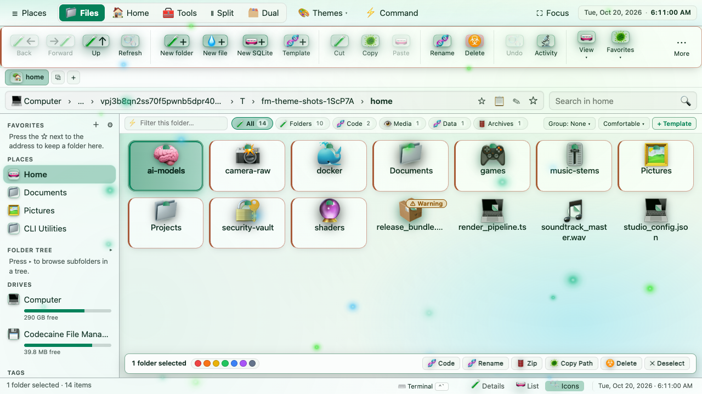

- **Palette:** Background `#f3f8f4` · Text `#0f291e` · Accent `#059669` · Secondary `#0284c7` · Card `#ffffff` · Border `#bbf7d0`
- **GPU Profile:** Blur `12px` · Glass `0.55` · Folder Shader `kyoto_washi_sumi` · 3D Icons `bioluminescent_eden` · Animation `levitate_float` · Atmosphere `fireflies`
- **Download JSON:** [`custom_themes/08_medium_balanced_kyoto_matcha_botanical.json`](./08_medium_balanced_kyoto_matcha_botanical.json)

```text
CCFM-THEME-v1:eyJmb3JtYXQiOiJidW4tcmFkLXN0dWRpby1maWxlLW1hbmFnZXItdGhlbWUiLCJ2ZXJzaW9uIjoxLCJuYW1lIjoiQmFsYW5jZWQgS3lvdG8gTWF0Y2hhIEJvdGFuaWNhbCIsImRhcmsiOmZhbHNlLCJiYXNlIjoiTW90aGVyJ3MgRGF5IEJvdGFuaWNhbCBUZWEgR2FyZGVuIiwiY29sb3JzIjp7ImJhY2tncm91bmQiOiIjZjNmOGY0IiwidGV4dCI6IiMwZjI5MWUiLCJhY2NlbnQiOiIjMDU5NjY5Iiwic2Vjb25kYXJ5IjoiIzAyODRjNyIsImNhcmQiOiIjZmZmZmZmIiwiYm9yZGVyIjoiI2JiZjdkMCIsImRhbmdlciI6IiNkYzI2MjYiLCJ3YXJuaW5nIjoiI2Q5NzcwNiIsInN1Y2Nlc3MiOiIjMDU5NjY5IiwiaW5mbyI6IiMwMjg0YzcifSwiZngiOnsiZ2xvdyI6InNvZnQiLCJnbG93Q29sb3IiOiIjMTBiOTgxIiwiZ2xvd0NvbG9yMiI6IiMzOGJkZjgiLCJibHVyIjoxMiwiZ2xhc3MiOjAuNTUsImdsb3dJbnRlbnNpdHkiOjAuNSwiYm9yZGVyT3BhY2l0eSI6MC4zNCwiZ3JhaW4iOiJub25lIiwic2NhbmxpbmVzIjoibm9uZSIsInJhZGl1cyI6InNxdWlyY2xlIiwiYm9yZGVyIjoiYmV2ZWwiLCJtb3Rpb24iOiJjYWxtIiwic2hlZW4iOnRydWUsIm5vaXNlIjpmYWxzZSwiY2hyb21hdGljIjpmYWxzZSwiYW1iaWVudCI6dHJ1ZSwiYXRtb3NwaGVyZSI6ImZpcmVmbGllcyIsImJhY2tkcm9wU3R5bGUiOiJmcm9zdGVkIiwiY3Vyc29yRWZmZWN0Ijoic3BvdGxpZ2h0IiwidmlnbmV0dGUiOiJub25lIiwic2F0dXJhdGlvbiI6MS4yMiwidWlFbGVtZW50RngiOiJreW90b193YXNoaV9zdW1pIiwiaWNvblBhY2tTdHlsZSI6ImJpb2x1bWluZXNjZW50X2VkZW4iLCJmb250UHJvZmlsZSI6Imh1bWFuaXN0X2hpZyIsImNvcm5lclByb2ZpbGUiOiJzcXVpcmNsZV9oaWciLCJpY29uR2xvdyI6InN1YnRsZSIsImljb25BbmltYXRpb24iOiJsZXZpdGF0ZV9mbG9hdCJ9fQ
```

---

## Tier 3: High-Spec Systems (`high` — 60–120Hz · Dual-Layer Shaders & Sculpted 3D Folders)

Engineered for **MacBook Pro (M3/M4 Pro), iMac 24", and desktop RTX 3060–4070 / Radeon RX workstations**. Uses `blur: 20–24px`, `glass: 0.64–0.68`, dual-layer atmospheres (`aurora_ribbons+bokeh`, `snow+aurora_ribbons`, `data_rain+hud_reticle`, `gold_dust+bokeh`), and active 3D icon animations.

### 📦 1-Click 🟠 HIGH-SPEC TIER Pack (4 Themes — [`pack_tier_3_high_spec_120hz.json`](./pack_tier_3_high_spec_120hz.json))

```text
CCFM-PACK-v1:eyJmb3JtYXQiOiJidW4tcmFkLXN0dWRpby1maWxlLW1hbmFnZXItdGhlbWUtcGFjayIsInZlcnNpb24iOjEsInRoZW1lcyI6W3sibmFtZSI6IkhpZ2gtU3BlYyBUYWhvZSBMaXF1aWQgR2xhc3MgUHJvIiwiZGFyayI6dHJ1ZSwiYmFzZSI6Im1hY09TIFRhaG9lIExpcXVpZCBHbGFzcyIsImNvbG9ycyI6eyJiYWNrZ3JvdW5kIjoiIzA4MGQxOCIsInRleHQiOiIjZjBmN2ZmIiwiYWNjZW50IjoiIzM4YmRmOCIsInNlY29uZGFyeSI6IiNjMDg0ZmMiLCJjYXJkIjoiIzEwMWEyZSIsImJvcmRlciI6IiMyOTQwNmIiLCJkYW5nZXIiOiIjZjQzZjVlIiwid2FybmluZyI6IiNmYmJmMjQiLCJzdWNjZXNzIjoiIzM0ZDM5OSIsImluZm8iOiIjMzhiZGY4In0sImZ4Ijp7Imdsb3ciOiJibG9vbSIsImdsb3dDb2xvciI6IiMzOGJkZjgiLCJnbG93Q29sb3IyIjoiI2MwODRmYyIsImJsdXIiOjIyLCJnbGFzcyI6MC42NSwiZ2xvd0ludGVuc2l0eSI6MC44MiwiYm9yZGVyT3BhY2l0eSI6MC4zMiwiZ3JhaW4iOiJzdWJ0bGUiLCJzY2FubGluZXMiOiJub25lIiwicmFkaXVzIjoic3F1aXJjbGUiLCJib3JkZXIiOiJpcmlkZXNjZW50IiwibW90aW9uIjoic3ByaW5nIiwic2hlZW4iOnRydWUsIm5vaXNlIjpmYWxzZSwiY2hyb21hdGljIjpmYWxzZSwiYW1iaWVudCI6dHJ1ZSwiYXRtb3NwaGVyZSI6ImF1cm9yYStjaW5lbWFfYm9rZWgiLCJiYWNrZHJvcFN0eWxlIjoibGlxdWlkIiwiY3Vyc29yRWZmZWN0IjoicHJpc20iLCJ2aWduZXR0ZSI6InN1YnRsZSIsInNhdHVyYXRpb24iOjEuMzgsInVpRWxlbWVudEZ4IjoidGFob2VfZ2xhc3NfZm9sZGVycyIsImljb25QYWNrU3R5bGUiOiJhcHBsZV92aXNpb25fZ2xhc3NfM2QiLCJmb250UHJvZmlsZSI6Imh1bWFuaXN0X2hpZyIsImNvcm5lclByb2ZpbGUiOiJzcXVpcmNsZV9oaWciLCJpY29uR2xvdyI6Inhkcl9zcGVjdWxhciIsImljb25BbmltYXRpb24iOiJob2xvX2ZvaWxfc2hpbW1lciIsInByaXNtRWRnZSI6dHJ1ZSwiaW5uZXJHbG93Ijp0cnVlLCJmcm9zdGVkUmltIjp0cnVlfX0seyJuYW1lIjoiSGlnaC1TcGVjIFBvbGFyIEdsYWNpZXIgU3ViLVplcm8iLCJkYXJrIjp0cnVlLCJiYXNlIjoiUG9sYXIgTmlnaHQiLCJjb2xvcnMiOnsiYmFja2dyb3VuZCI6IiMwNTBlMTkiLCJ0ZXh0IjoiI2VlZjlmZiIsImFjY2VudCI6IiMwMGU1ZmYiLCJzZWNvbmRhcnkiOiIjNjRmZmRhIiwiY2FyZCI6IiMwYjFhMmQiLCJib3JkZXIiOiIjMWQ0MDY4IiwiZGFuZ2VyIjoiI2ZmNmU3ZiIsIndhcm5pbmciOiIjZmZkNzQwIiwic3VjY2VzcyI6IiM2NGZmZGEiLCJpbmZvIjoiIzAwZTVmZiJ9LCJmeCI6eyJnbG93IjoiYXVyb3JhIiwiZ2xvd0NvbG9yIjoiIzAwZTVmZiIsImdsb3dDb2xvcjIiOiIjNjRmZmRhIiwiYmx1ciI6MjIsImdsYXNzIjowLjY2LCJnbG93SW50ZW5zaXR5IjowLjg1LCJib3JkZXJPcGFjaXR5IjowLjMyLCJncmFpbiI6InN1YnRsZSIsInNjYW5saW5lcyI6Im5vbmUiLCJyYWRpdXMiOiJzcXVpcmNsZSIsImJvcmRlciI6ImlyaWRlc2NlbnQiLCJtb3Rpb24iOiJjaW5lbWF0aWMiLCJzaGVlbiI6dHJ1ZSwibm9pc2UiOmZhbHNlLCJjaHJvbWF0aWMiOmZhbHNlLCJhbWJpZW50Ijp0cnVlLCJhdG1vc3BoZXJlIjoic25vdythdXJvcmEiLCJiYWNrZHJvcFN0eWxlIjoiZnJvc3RlZCIsImN1cnNvckVmZmVjdCI6InByaXNtIiwidmlnbmV0dGUiOiJhbWJpZW50Iiwic2F0dXJhdGlvbiI6MS40MiwidWlFbGVtZW50RngiOiJjcnlvX2Zyb3N0IiwiaWNvblBhY2tTdHlsZSI6ImF1cm9yYV9ub3JkaWNfaWNlIiwiZm9udFByb2ZpbGUiOiJodW1hbmlzdF9oaWciLCJjb3JuZXJQcm9maWxlIjoic3F1aXJjbGVfaGlnIiwiaWNvbkdsb3ciOiJ4ZHJfc3BlY3VsYXIiLCJpY29uQW5pbWF0aW9uIjoib3JiaXRhbF9oYWxvX3NwaW4iLCJwcmlzbUVkZ2UiOnRydWUsImlubmVyR2xvdyI6dHJ1ZSwiZnJvc3RlZFJpbSI6dHJ1ZX19LHsibmFtZSI6IkhpZ2gtU3BlYyBDeWJlcmRlY2sgTWF0cml4IEhVRCIsImRhcmsiOnRydWUsImJhc2UiOiIyQWR2YW5jZWQgdjMgRmxhc2gtMzAwMCBWZWN0b3IgU3R1ZGlvIiwiY29sb3JzIjp7ImJhY2tncm91bmQiOiIjMDQwYjBlIiwidGV4dCI6IiNlNmZmZjkiLCJhY2NlbnQiOiIjMDBlNjc2Iiwic2Vjb25kYXJ5IjoiIzAwYjBmZiIsImNhcmQiOiIjMDkxNjFjIiwiYm9yZGVyIjoiIzE4NDI0ZCIsImRhbmdlciI6IiNmZjE3NDQiLCJ3YXJuaW5nIjoiI2ZmYWIwMCIsInN1Y2Nlc3MiOiIjMDBlNjc2IiwiaW5mbyI6IiMwMGIwZmYifSwiZngiOnsiZ2xvdyI6Im5lb24iLCJnbG93Q29sb3IiOiIjMDBlNjc2IiwiZ2xvd0NvbG9yMiI6IiMwMGIwZmYiLCJibHVyIjoyMCwiZ2xhc3MiOjAuNjQsImdsb3dJbnRlbnNpdHkiOjAuODUsImJvcmRlck9wYWNpdHkiOjAuMzYsImdyYWluIjoic3VidGxlIiwic2NhbmxpbmVzIjoic3VidGxlIiwicmFkaXVzIjoic2hhcnAiLCJib3JkZXIiOiJob2xvZ3JhbSIsIm1vdGlvbiI6InNuYXBweSIsInNoZWVuIjp0cnVlLCJub2lzZSI6ZmFsc2UsImNocm9tYXRpYyI6dHJ1ZSwiYW1iaWVudCI6dHJ1ZSwiYXRtb3NwaGVyZSI6Im1hdHJpeCt0YWN0aWNhbF9odWQiLCJiYWNrZHJvcFN0eWxlIjoiZ2xhc3MiLCJjdXJzb3JFZmZlY3QiOiJtYWduZXRpYyIsInZpZ25ldHRlIjoic3VidGxlIiwic2F0dXJhdGlvbiI6MS40LCJ1aUVsZW1lbnRGeCI6Im5lcmRfbGNhcnNfaHVkIiwiaWNvblBhY2tTdHlsZSI6ImN5YmVyZGVja19tYXRyaXhfaHVkIiwiZm9udFByb2ZpbGUiOiJ0ZXJtaW5hbCIsImNvcm5lclByb2ZpbGUiOiJjaGFtZmVyZWQiLCJpY29uR2xvdyI6Im5lb24iLCJpY29uQW5pbWF0aW9uIjoiY3liZXJfZ2xpdGNoX3B1bHNlIiwicHJpc21FZGdlIjp0cnVlLCJpbm5lckdsb3ciOnRydWV9fSx7Im5hbWUiOiJIaWdoLVNwZWMgU292ZXJlaWduIDI0SyBHb2xkIiwiZGFyayI6dHJ1ZSwiYmFzZSI6IlN3aXNzIFNhcHBoaXJlIENocm9ub2dyYXBoIiwiY29sb3JzIjp7ImJhY2tncm91bmQiOiIjMDcwOTEyIiwidGV4dCI6IiNmZmZiZjAiLCJhY2NlbnQiOiIjZmZkNTRmIiwic2Vjb25kYXJ5IjoiIzY0YjVmNiIsImNhcmQiOiIjMGYxMzI0IiwiYm9yZGVyIjoiIzNkMzUxZSIsImRhbmdlciI6IiNmZjUyNTIiLCJ3YXJuaW5nIjoiI2ZmZDU0ZiIsInN1Y2Nlc3MiOiIjNjlmMGFlIiwiaW5mbyI6IiM2NGI1ZjYifSwiZngiOnsiZ2xvdyI6InNvZnQiLCJnbG93Q29sb3IiOiIjZmZkNTRmIiwiZ2xvd0NvbG9yMiI6IiM2NGI1ZjYiLCJibHVyIjoyNCwiZ2xhc3MiOjAuNjgsImdsb3dJbnRlbnNpdHkiOjAuODUsImJvcmRlck9wYWNpdHkiOjAuMzYsImdyYWluIjoic3VidGxlIiwic2NhbmxpbmVzIjoibm9uZSIsInJhZGl1cyI6InNxdWlyY2xlIiwiYm9yZGVyIjoibWV0YWwiLCJtb3Rpb24iOiJjaW5lbWF0aWMiLCJzaGVlbiI6dHJ1ZSwibm9pc2UiOmZhbHNlLCJjaHJvbWF0aWMiOmZhbHNlLCJhbWJpZW50Ijp0cnVlLCJhdG1vc3BoZXJlIjoia2F0YWthbmFfZ29sZCtjaW5lbWFfYm9rZWgiLCJiYWNrZHJvcFN0eWxlIjoiZ2xhc3MiLCJjdXJzb3JFZmZlY3QiOiJzcG90bGlnaHQiLCJ2aWduZXR0ZSI6InN1YnRsZSIsInNhdHVyYXRpb24iOjEuNCwidWlFbGVtZW50RngiOiJzd2lzc19zYXBwaGlyZV9jaHJvbm9ncmFwaCIsImljb25QYWNrU3R5bGUiOiJyb3lhbF8yNGtfZ29sZF9vYnNpZGlhbiIsImZvbnRQcm9maWxlIjoiZWRpdG9yaWFsIiwiY29ybmVyUHJvZmlsZSI6InNxdWlyY2xlX2hpZyIsImljb25HbG93IjoieGRyX3NwZWN1bGFyIiwiaWNvbkFuaW1hdGlvbiI6ImNsb2Nrd29ya19nZWFyX3RpY2siLCJwcmlzbUVkZ2UiOnRydWUsImlubmVyR2xvdyI6dHJ1ZSwiZnJvc3RlZFJpbSI6dHJ1ZX19XX0
```

| Theme | Blur / Glass | 3D Folder Shader (`uiElementFx`) | 3D Icon Pack (`iconPackStyle`) | 3D Icon Motion (`iconAnimation`) | Atmosphere (`atmosphere`) | JSON |
| :--- | :-: | :--- | :--- | :--- | :--- | :--- |
| **High-Spec Tahoe Liquid Glass Pro** | `22px` / `0.65` | `tahoe_glass_folders` | `apple_vision_glass_3d` | `holo_foil_shimmer` | `aurora+cinema_bokeh` | [`09_high_tahoe_liquid_glass_pro.json`](./09_high_tahoe_liquid_glass_pro.json) |
| **High-Spec Polar Glacier Sub-Zero** | `22px` / `0.66` | `cryo_frost` | `aurora_nordic_ice` | `orbital_halo_spin` | `snow+aurora` | [`10_high_polar_glacier_subzero.json`](./10_high_polar_glacier_subzero.json) |
| **High-Spec Cyberdeck Matrix HUD** | `20px` / `0.64` | `nerd_lcars_hud` | `cyberdeck_matrix_hud` | `cyber_glitch_pulse` | `matrix+tactical_hud` | [`11_high_cyberdeck_matrix_hud.json`](./11_high_cyberdeck_matrix_hud.json) |
| **High-Spec Sovereign 24K Gold** | `24px` / `0.68` | `swiss_sapphire_chronograph` | `royal_24k_gold_obsidian` | `clockwork_gear_tick` | `katakana_gold+cinema_bokeh` | [`12_high_sovereign_24k_gold_sapphire.json`](./12_high_sovereign_24k_gold_sapphire.json) |

### High-Spec Tahoe Liquid Glass Pro (`custom_00000009` · `HIGH`)

> **Target System:** MacBook Pro M3/M4 Pro, iMac 24", Desktop RTX 3060–4070 / Radeon RX Workstations  
> **Design Notes:** macOS Tahoe Liquid Glass 3D folders with Apple Vision spatial glass icons and dual aurora + bokeh layers.

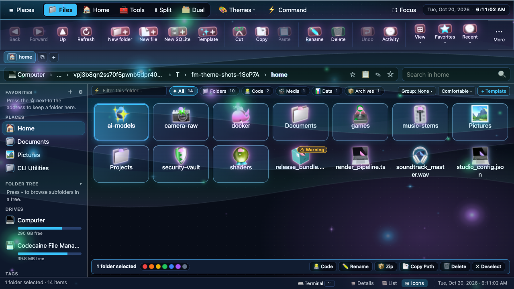

- **Palette:** Background `#080d18` · Text `#f0f7ff` · Accent `#38bdf8` · Secondary `#c084fc` · Card `#101a2e` · Border `#29406b`
- **GPU Profile:** Blur `22px` · Glass `0.65` · Folder Shader `tahoe_glass_folders` · 3D Icons `apple_vision_glass_3d` · Animation `holo_foil_shimmer` · Atmosphere `aurora+cinema_bokeh`
- **Download JSON:** [`custom_themes/09_high_tahoe_liquid_glass_pro.json`](./09_high_tahoe_liquid_glass_pro.json)

```text
CCFM-THEME-v1:eyJmb3JtYXQiOiJidW4tcmFkLXN0dWRpby1maWxlLW1hbmFnZXItdGhlbWUiLCJ2ZXJzaW9uIjoxLCJuYW1lIjoiSGlnaC1TcGVjIFRhaG9lIExpcXVpZCBHbGFzcyBQcm8iLCJkYXJrIjp0cnVlLCJiYXNlIjoibWFjT1MgVGFob2UgTGlxdWlkIEdsYXNzIiwiY29sb3JzIjp7ImJhY2tncm91bmQiOiIjMDgwZDE4IiwidGV4dCI6IiNmMGY3ZmYiLCJhY2NlbnQiOiIjMzhiZGY4Iiwic2Vjb25kYXJ5IjoiI2MwODRmYyIsImNhcmQiOiIjMTAxYTJlIiwiYm9yZGVyIjoiIzI5NDA2YiIsImRhbmdlciI6IiNmNDNmNWUiLCJ3YXJuaW5nIjoiI2ZiYmYyNCIsInN1Y2Nlc3MiOiIjMzRkMzk5IiwiaW5mbyI6IiMzOGJkZjgifSwiZngiOnsiZ2xvdyI6ImJsb29tIiwiZ2xvd0NvbG9yIjoiIzM4YmRmOCIsImdsb3dDb2xvcjIiOiIjYzA4NGZjIiwiYmx1ciI6MjIsImdsYXNzIjowLjY1LCJnbG93SW50ZW5zaXR5IjowLjgyLCJib3JkZXJPcGFjaXR5IjowLjMyLCJncmFpbiI6InN1YnRsZSIsInNjYW5saW5lcyI6Im5vbmUiLCJyYWRpdXMiOiJzcXVpcmNsZSIsImJvcmRlciI6ImlyaWRlc2NlbnQiLCJtb3Rpb24iOiJzcHJpbmciLCJzaGVlbiI6dHJ1ZSwibm9pc2UiOmZhbHNlLCJjaHJvbWF0aWMiOmZhbHNlLCJhbWJpZW50Ijp0cnVlLCJhdG1vc3BoZXJlIjoiYXVyb3JhK2NpbmVtYV9ib2tlaCIsImJhY2tkcm9wU3R5bGUiOiJsaXF1aWQiLCJjdXJzb3JFZmZlY3QiOiJwcmlzbSIsInZpZ25ldHRlIjoic3VidGxlIiwic2F0dXJhdGlvbiI6MS4zOCwidWlFbGVtZW50RngiOiJ0YWhvZV9nbGFzc19mb2xkZXJzIiwiaWNvblBhY2tTdHlsZSI6ImFwcGxlX3Zpc2lvbl9nbGFzc18zZCIsImZvbnRQcm9maWxlIjoiaHVtYW5pc3RfaGlnIiwiY29ybmVyUHJvZmlsZSI6InNxdWlyY2xlX2hpZyIsImljb25HbG93IjoieGRyX3NwZWN1bGFyIiwiaWNvbkFuaW1hdGlvbiI6ImhvbG9fZm9pbF9zaGltbWVyIiwicHJpc21FZGdlIjp0cnVlLCJpbm5lckdsb3ciOnRydWUsImZyb3N0ZWRSaW0iOnRydWV9fQ
```

### High-Spec Polar Glacier Sub-Zero (`custom_0000000a` · `HIGH`)

> **Target System:** MacBook Pro, High-Refresh Ultrabooks, Desktop Workstations  
> **Design Notes:** Sub-zero Polar Night glass with hanging crystal icicles, orbital halo spin icons, and snow + aurora ribbons.

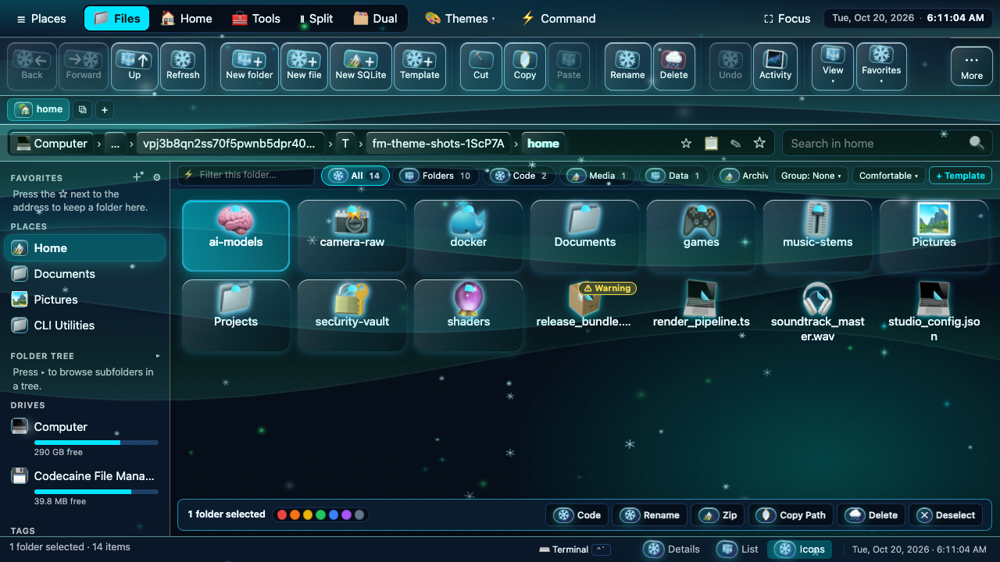

- **Palette:** Background `#050e19` · Text `#eef9ff` · Accent `#00e5ff` · Secondary `#64ffda` · Card `#0b1a2d` · Border `#1d4068`
- **GPU Profile:** Blur `22px` · Glass `0.66` · Folder Shader `cryo_frost` · 3D Icons `aurora_nordic_ice` · Animation `orbital_halo_spin` · Atmosphere `snow+aurora`
- **Download JSON:** [`custom_themes/10_high_polar_glacier_subzero.json`](./10_high_polar_glacier_subzero.json)

```text
CCFM-THEME-v1:eyJmb3JtYXQiOiJidW4tcmFkLXN0dWRpby1maWxlLW1hbmFnZXItdGhlbWUiLCJ2ZXJzaW9uIjoxLCJuYW1lIjoiSGlnaC1TcGVjIFBvbGFyIEdsYWNpZXIgU3ViLVplcm8iLCJkYXJrIjp0cnVlLCJiYXNlIjoiUG9sYXIgTmlnaHQiLCJjb2xvcnMiOnsiYmFja2dyb3VuZCI6IiMwNTBlMTkiLCJ0ZXh0IjoiI2VlZjlmZiIsImFjY2VudCI6IiMwMGU1ZmYiLCJzZWNvbmRhcnkiOiIjNjRmZmRhIiwiY2FyZCI6IiMwYjFhMmQiLCJib3JkZXIiOiIjMWQ0MDY4IiwiZGFuZ2VyIjoiI2ZmNmU3ZiIsIndhcm5pbmciOiIjZmZkNzQwIiwic3VjY2VzcyI6IiM2NGZmZGEiLCJpbmZvIjoiIzAwZTVmZiJ9LCJmeCI6eyJnbG93IjoiYXVyb3JhIiwiZ2xvd0NvbG9yIjoiIzAwZTVmZiIsImdsb3dDb2xvcjIiOiIjNjRmZmRhIiwiYmx1ciI6MjIsImdsYXNzIjowLjY2LCJnbG93SW50ZW5zaXR5IjowLjg1LCJib3JkZXJPcGFjaXR5IjowLjMyLCJncmFpbiI6InN1YnRsZSIsInNjYW5saW5lcyI6Im5vbmUiLCJyYWRpdXMiOiJzcXVpcmNsZSIsImJvcmRlciI6ImlyaWRlc2NlbnQiLCJtb3Rpb24iOiJjaW5lbWF0aWMiLCJzaGVlbiI6dHJ1ZSwibm9pc2UiOmZhbHNlLCJjaHJvbWF0aWMiOmZhbHNlLCJhbWJpZW50Ijp0cnVlLCJhdG1vc3BoZXJlIjoic25vdythdXJvcmEiLCJiYWNrZHJvcFN0eWxlIjoiZnJvc3RlZCIsImN1cnNvckVmZmVjdCI6InByaXNtIiwidmlnbmV0dGUiOiJhbWJpZW50Iiwic2F0dXJhdGlvbiI6MS40MiwidWlFbGVtZW50RngiOiJjcnlvX2Zyb3N0IiwiaWNvblBhY2tTdHlsZSI6ImF1cm9yYV9ub3JkaWNfaWNlIiwiZm9udFByb2ZpbGUiOiJodW1hbmlzdF9oaWciLCJjb3JuZXJQcm9maWxlIjoic3F1aXJjbGVfaGlnIiwiaWNvbkdsb3ciOiJ4ZHJfc3BlY3VsYXIiLCJpY29uQW5pbWF0aW9uIjoib3JiaXRhbF9oYWxvX3NwaW4iLCJwcmlzbUVkZ2UiOnRydWUsImlubmVyR2xvdyI6dHJ1ZSwiZnJvc3RlZFJpbSI6dHJ1ZX19
```

### High-Spec Cyberdeck Matrix HUD (`custom_0000000b` · `HIGH`)

> **Target System:** Developer Workstations, Linux/macOS Cyberdecks, Dual-Monitor Coding Rigs  
> **Design Notes:** Tactical LCARS & Cyberdeck HUD folders with Matrix digital rain, targeting reticles, and glitch-pulse 3D icons.

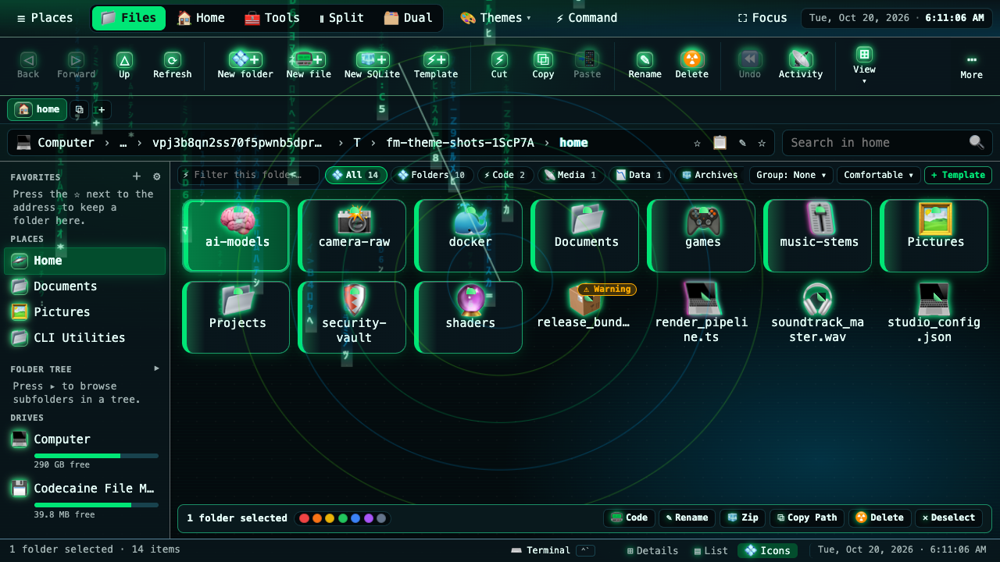

- **Palette:** Background `#040b0e` · Text `#e6fff9` · Accent `#00e676` · Secondary `#00b0ff` · Card `#09161c` · Border `#18424d`
- **GPU Profile:** Blur `20px` · Glass `0.64` · Folder Shader `nerd_lcars_hud` · 3D Icons `cyberdeck_matrix_hud` · Animation `cyber_glitch_pulse` · Atmosphere `matrix+tactical_hud`
- **Download JSON:** [`custom_themes/11_high_cyberdeck_matrix_hud.json`](./11_high_cyberdeck_matrix_hud.json)

```text
CCFM-THEME-v1:eyJmb3JtYXQiOiJidW4tcmFkLXN0dWRpby1maWxlLW1hbmFnZXItdGhlbWUiLCJ2ZXJzaW9uIjoxLCJuYW1lIjoiSGlnaC1TcGVjIEN5YmVyZGVjayBNYXRyaXggSFVEIiwiZGFyayI6dHJ1ZSwiYmFzZSI6IjJBZHZhbmNlZCB2MyBGbGFzaC0zMDAwIFZlY3RvciBTdHVkaW8iLCJjb2xvcnMiOnsiYmFja2dyb3VuZCI6IiMwNDBiMGUiLCJ0ZXh0IjoiI2U2ZmZmOSIsImFjY2VudCI6IiMwMGU2NzYiLCJzZWNvbmRhcnkiOiIjMDBiMGZmIiwiY2FyZCI6IiMwOTE2MWMiLCJib3JkZXIiOiIjMTg0MjRkIiwiZGFuZ2VyIjoiI2ZmMTc0NCIsIndhcm5pbmciOiIjZmZhYjAwIiwic3VjY2VzcyI6IiMwMGU2NzYiLCJpbmZvIjoiIzAwYjBmZiJ9LCJmeCI6eyJnbG93IjoibmVvbiIsImdsb3dDb2xvciI6IiMwMGU2NzYiLCJnbG93Q29sb3IyIjoiIzAwYjBmZiIsImJsdXIiOjIwLCJnbGFzcyI6MC42NCwiZ2xvd0ludGVuc2l0eSI6MC44NSwiYm9yZGVyT3BhY2l0eSI6MC4zNiwiZ3JhaW4iOiJzdWJ0bGUiLCJzY2FubGluZXMiOiJzdWJ0bGUiLCJyYWRpdXMiOiJzaGFycCIsImJvcmRlciI6ImhvbG9ncmFtIiwibW90aW9uIjoic25hcHB5Iiwic2hlZW4iOnRydWUsIm5vaXNlIjpmYWxzZSwiY2hyb21hdGljIjp0cnVlLCJhbWJpZW50Ijp0cnVlLCJhdG1vc3BoZXJlIjoibWF0cml4K3RhY3RpY2FsX2h1ZCIsImJhY2tkcm9wU3R5bGUiOiJnbGFzcyIsImN1cnNvckVmZmVjdCI6Im1hZ25ldGljIiwidmlnbmV0dGUiOiJzdWJ0bGUiLCJzYXR1cmF0aW9uIjoxLjQsInVpRWxlbWVudEZ4IjoibmVyZF9sY2Fyc19odWQiLCJpY29uUGFja1N0eWxlIjoiY3liZXJkZWNrX21hdHJpeF9odWQiLCJmb250UHJvZmlsZSI6InRlcm1pbmFsIiwiY29ybmVyUHJvZmlsZSI6ImNoYW1mZXJlZCIsImljb25HbG93IjoibmVvbiIsImljb25BbmltYXRpb24iOiJjeWJlcl9nbGl0Y2hfcHVsc2UiLCJwcmlzbUVkZ2UiOnRydWUsImlubmVyR2xvdyI6dHJ1ZX19
```

### High-Spec Sovereign 24K Gold (`custom_0000000c` · `HIGH`)

> **Target System:** Executive Pro Displays, MacBook Pro XDR, High-Contrast Studio Monitors  
> **Design Notes:** Swiss Haute Horlogerie 24K brushed gold & sapphire crystal folders with mechanical tourbillon gear-tick icons.

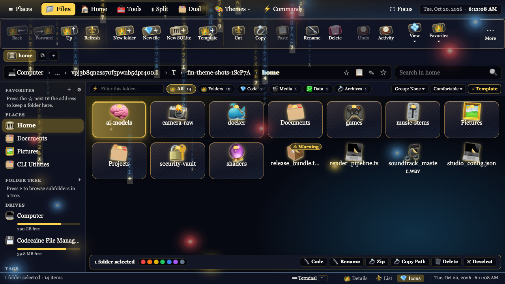

- **Palette:** Background `#070912` · Text `#fffbf0` · Accent `#ffd54f` · Secondary `#64b5f6` · Card `#0f1324` · Border `#3d351e`
- **GPU Profile:** Blur `24px` · Glass `0.68` · Folder Shader `swiss_sapphire_chronograph` · 3D Icons `royal_24k_gold_obsidian` · Animation `clockwork_gear_tick` · Atmosphere `katakana_gold+cinema_bokeh`
- **Download JSON:** [`custom_themes/12_high_sovereign_24k_gold_sapphire.json`](./12_high_sovereign_24k_gold_sapphire.json)

```text
CCFM-THEME-v1:eyJmb3JtYXQiOiJidW4tcmFkLXN0dWRpby1maWxlLW1hbmFnZXItdGhlbWUiLCJ2ZXJzaW9uIjoxLCJuYW1lIjoiSGlnaC1TcGVjIFNvdmVyZWlnbiAyNEsgR29sZCIsImRhcmsiOnRydWUsImJhc2UiOiJTd2lzcyBTYXBwaGlyZSBDaHJvbm9ncmFwaCIsImNvbG9ycyI6eyJiYWNrZ3JvdW5kIjoiIzA3MDkxMiIsInRleHQiOiIjZmZmYmYwIiwiYWNjZW50IjoiI2ZmZDU0ZiIsInNlY29uZGFyeSI6IiM2NGI1ZjYiLCJjYXJkIjoiIzBmMTMyNCIsImJvcmRlciI6IiMzZDM1MWUiLCJkYW5nZXIiOiIjZmY1MjUyIiwid2FybmluZyI6IiNmZmQ1NGYiLCJzdWNjZXNzIjoiIzY5ZjBhZSIsImluZm8iOiIjNjRiNWY2In0sImZ4Ijp7Imdsb3ciOiJzb2Z0IiwiZ2xvd0NvbG9yIjoiI2ZmZDU0ZiIsImdsb3dDb2xvcjIiOiIjNjRiNWY2IiwiYmx1ciI6MjQsImdsYXNzIjowLjY4LCJnbG93SW50ZW5zaXR5IjowLjg1LCJib3JkZXJPcGFjaXR5IjowLjM2LCJncmFpbiI6InN1YnRsZSIsInNjYW5saW5lcyI6Im5vbmUiLCJyYWRpdXMiOiJzcXVpcmNsZSIsImJvcmRlciI6Im1ldGFsIiwibW90aW9uIjoiY2luZW1hdGljIiwic2hlZW4iOnRydWUsIm5vaXNlIjpmYWxzZSwiY2hyb21hdGljIjpmYWxzZSwiYW1iaWVudCI6dHJ1ZSwiYXRtb3NwaGVyZSI6ImthdGFrYW5hX2dvbGQrY2luZW1hX2Jva2VoIiwiYmFja2Ryb3BTdHlsZSI6ImdsYXNzIiwiY3Vyc29yRWZmZWN0Ijoic3BvdGxpZ2h0IiwidmlnbmV0dGUiOiJzdWJ0bGUiLCJzYXR1cmF0aW9uIjoxLjQsInVpRWxlbWVudEZ4Ijoic3dpc3Nfc2FwcGhpcmVfY2hyb25vZ3JhcGgiLCJpY29uUGFja1N0eWxlIjoicm95YWxfMjRrX2dvbGRfb2JzaWRpYW4iLCJmb250UHJvZmlsZSI6ImVkaXRvcmlhbCIsImNvcm5lclByb2ZpbGUiOiJzcXVpcmNsZV9oaWciLCJpY29uR2xvdyI6Inhkcl9zcGVjdWxhciIsImljb25BbmltYXRpb24iOiJjbG9ja3dvcmtfZ2Vhcl90aWNrIiwicHJpc21FZGdlIjp0cnVlLCJpbm5lckdsb3ciOnRydWUsImZyb3N0ZWRSaW0iOnRydWV9fQ
```

---

## Tier 4: Ultra Flagship Systems (`ultra` — Uncapped 120Hz ProMotion 6K XDR · 3-Layer Shaders & 3D Turntable Icons)

Engineered for **🍎 Apple Mac Studio M4 Ultra (32-Core CPU · 80-Core GPU · 32-Core Neural Engine · 192GB Unified Memory · Pro Display XDR 6K @ 120Hz ProMotion)** and flagship desktop GPUs. Uses `blur: 26–32px`, `glass: 0.68–0.78`, 3-layer WebGL/Canvas atmospheres, visceral 3D folder shaders, and 120Hz 3D spinning turntable/origami/liquid-metal icon animations.

### 📦 1-Click 🔴 ULTRA FLAGSHIP TIER Pack (8 Themes — [`pack_tier_4_ultra_6k_xdr_120hz.json`](./pack_tier_4_ultra_6k_xdr_120hz.json))

```text
CCFM-PACK-v1:eyJmb3JtYXQiOiJidW4tcmFkLXN0dWRpby1maWxlLW1hbmFnZXItdGhlbWUtcGFjayIsInZlcnNpb24iOjEsInRoZW1lcyI6W3sibmFtZSI6IkFsbCBIYWxsb3dzIEV2ZSA2SyBYRFIgVWx0cmEiLCJkYXJrIjp0cnVlLCJiYXNlIjoiSGFsbG93ZWVuIENhcnZlZCBKYWNrLU8nLUxhbnRlcm4iLCJjb2xvcnMiOnsiYmFja2dyb3VuZCI6IiMwZDA2MTQiLCJ0ZXh0IjoiI2ZmZjRlNiIsImFjY2VudCI6IiNmZjZkMDAiLCJzZWNvbmRhcnkiOiIjYjM4OGZmIiwiY2FyZCI6IiMxNzBiMjQiLCJib3JkZXIiOiIjM2IxZDU0IiwiZGFuZ2VyIjoiI2ZmM2QwMCIsIndhcm5pbmciOiIjZmZhYjAwIiwic3VjY2VzcyI6IiMwMGU2NzYiLCJpbmZvIjoiI2IzODhmZiJ9LCJmeCI6eyJnbG93IjoiZW1iZXIiLCJnbG93Q29sb3IiOiIjZmY2ZDAwIiwiZ2xvd0NvbG9yMiI6IiNiMzg4ZmYiLCJibHVyIjoyOCwiZ2xhc3MiOjAuNzIsImdsb3dJbnRlbnNpdHkiOjEsImJvcmRlck9wYWNpdHkiOjAuMzQsImdyYWluIjoic3VidGxlIiwic2NhbmxpbmVzIjoibm9uZSIsInJhZGl1cyI6InNxdWlyY2xlIiwiYm9yZGVyIjoiaXJpZGVzY2VudCIsIm1vdGlvbiI6InNwcmluZyIsInNoZWVuIjp0cnVlLCJub2lzZSI6dHJ1ZSwiY2hyb21hdGljIjpmYWxzZSwiYW1iaWVudCI6dHJ1ZSwiYXRtb3NwaGVyZSI6ImF1dHVtbl9sZWF2ZXMrZW1iZXJzK2ZpcmVmbGllcyIsImJhY2tkcm9wU3R5bGUiOiJsaXF1aWQiLCJjdXJzb3JFZmZlY3QiOiJzcG90bGlnaHQiLCJ2aWduZXR0ZSI6ImNpbmVtYSIsInNhdHVyYXRpb24iOjEuNTUsInVpRWxlbWVudEZ4IjoiaG9saWRheV9mZXN0aXZlX2dsb3ciLCJpY29uUGFja1N0eWxlIjoidXNfaG9saWRheXNfZmVzdGl2ZSIsImZvbnRQcm9maWxlIjoiZWRpdG9yaWFsIiwiY29ybmVyUHJvZmlsZSI6InNxdWlyY2xlX2hpZyIsImljb25HbG93IjoieGRyX3NwZWN1bGFyIiwiaWNvbkFuaW1hdGlvbiI6ImZvbGRlcl8zZF9zcGluX3R1cm50YWJsZSIsImN1c3RvbVZhcnMiOnsicm93LWhvdmVyIjoicmdiYSgyNTUsIDEwOSwgMCwgMC4xNikiLCJmb2N1cy1yaW5nIjoiI2ZmOTEwMCJ9LCJjdXN0b21Dc3MiOiIjbGlzdC52aWV3LWljb25zIC5yb3dbZGF0YS1raW5kPVwiZGlyXCJdIHsgYm94LXNoYWRvdzogMCAxNHB4IDMycHggcmdiYSgyNTUsIDEwOSwgMCwgMC4yNCksIGluc2V0IDAgMXB4IDAgcmdiYSgyNTUsIDIxMywgNzksIDAuNDUpOyB9IiwicHJpc21FZGdlIjp0cnVlLCJpbm5lckdsb3ciOnRydWUsImZyb3N0ZWRSaW0iOnRydWUsIm5lb25QdWxzZSI6dHJ1ZSwicGFyYWxsYXgiOnRydWV9fSx7Im5hbWUiOiJQb2xhciBBdXJvcmEgQm9yZWFsaXMgNksgVWx0cmEiLCJkYXJrIjp0cnVlLCJiYXNlIjoiUG9sYXIgTmlnaHQiLCJjb2xvcnMiOnsiYmFja2dyb3VuZCI6IiMwNTBkMTciLCJ0ZXh0IjoiI2VlZjlmZiIsImFjY2VudCI6IiM2NGZmZGEiLCJzZWNvbmRhcnkiOiIjODBkOGZmIiwiY2FyZCI6IiMwYTE4MjkiLCJib3JkZXIiOiIjMWMzYjVlIiwiZGFuZ2VyIjoiI2ZmNmU3ZiIsIndhcm5pbmciOiIjZmZkNzQwIiwic3VjY2VzcyI6IiM2NGZmZGEiLCJpbmZvIjoiIzgwZDhmZiJ9LCJmeCI6eyJnbG93IjoiYXVyb3JhIiwiZ2xvd0NvbG9yIjoiIzY0ZmZkYSIsImdsb3dDb2xvcjIiOiIjODBkOGZmIiwiYmx1ciI6MzAsImdsYXNzIjowLjc0LCJnbG93SW50ZW5zaXR5IjowLjk1LCJib3JkZXJPcGFjaXR5IjowLjMyLCJncmFpbiI6InN1YnRsZSIsInNjYW5saW5lcyI6Im5vbmUiLCJyYWRpdXMiOiJzcXVpcmNsZSIsImJvcmRlciI6ImlyaWRlc2NlbnQiLCJtb3Rpb24iOiJjaW5lbWF0aWMiLCJzaGVlbiI6dHJ1ZSwibm9pc2UiOmZhbHNlLCJjaHJvbWF0aWMiOmZhbHNlLCJhbWJpZW50Ijp0cnVlLCJhdG1vc3BoZXJlIjoiYmxpenphcmQrYXVyb3JhX2F1c3RyYWxpcyIsImJhY2tkcm9wU3R5bGUiOiJmcm9zdGVkIiwiY3Vyc29yRWZmZWN0IjoicHJpc20iLCJ2aWduZXR0ZSI6ImFtYmllbnQiLCJzYXR1cmF0aW9uIjoxLjQ4LCJ1aUVsZW1lbnRGeCI6ImNyeW9fZnJvc3QiLCJpY29uUGFja1N0eWxlIjoiYXVyb3JhX25vcmRpY19pY2UiLCJmb250UHJvZmlsZSI6Imh1bWFuaXN0X2hpZyIsImNvcm5lclByb2ZpbGUiOiJzcXVpcmNsZV9oaWciLCJpY29uR2xvdyI6Inhkcl9zcGVjdWxhciIsImljb25BbmltYXRpb24iOiJyYXl0cmFjZWRfY2F1c3RpY19yZWZyYWN0aW9uIiwiY3VzdG9tVmFycyI6eyJyb3ctaG92ZXIiOiJyZ2JhKDEwMCwgMjU1LCAyMTgsIDAuMTQpIiwiZm9jdXMtcmluZyI6IiM2NGZmZGEifSwiY3VzdG9tQ3NzIjoiI2xpc3Qudmlldy1pY29ucyAucm93W2RhdGEta2luZD1cImRpclwiXSB7IGJveC1zaGFkb3c6IDAgMTRweCAzMnB4IHJnYmEoMTAwLCAyNTUsIDIxOCwgMC4yMiksIGluc2V0IDAgMXB4IDAgcmdiYSgyMjQsIDI0NywgMjUwLCAwLjU1KTsgfSIsInByaXNtRWRnZSI6dHJ1ZSwiaW5uZXJHbG93Ijp0cnVlLCJmcm9zdGVkUmltIjp0cnVlLCJwYXJhbGxheCI6dHJ1ZX19LHsibmFtZSI6IlBvbGFyIERheWxpZ2h0IEdsYWNpZXIgNksgVWx0cmEiLCJkYXJrIjpmYWxzZSwiYmFzZSI6Ik9yYml0YWwgSWNlIiwiY29sb3JzIjp7ImJhY2tncm91bmQiOiIjZjJmOGZmIiwidGV4dCI6IiMwNzFiMmYiLCJhY2NlbnQiOiIjMDA2NmNjIiwic2Vjb25kYXJ5IjoiIzAwOTdhNyIsImNhcmQiOiIjZmZmZmZmIiwiYm9yZGVyIjoiI2I4ZDhmOCIsImRhbmdlciI6IiNjNjI4MjgiLCJ3YXJuaW5nIjoiI2VmNmMwMCIsInN1Y2Nlc3MiOiIjMDA3OTZiIiwiaW5mbyI6IiMwMjc3YmQifSwiZngiOnsiZ2xvdyI6ImF1cm9yYSIsImdsb3dDb2xvciI6IiMwMDg4ZmYiLCJnbG93Q29sb3IyIjoiIzAwZTVmZiIsImJsdXIiOjI4LCJnbGFzcyI6MC43OCwiZ2xvd0ludGVuc2l0eSI6MC44MiwiYm9yZGVyT3BhY2l0eSI6MC4zNiwiZ3JhaW4iOiJub25lIiwic2NhbmxpbmVzIjoibm9uZSIsInJhZGl1cyI6InNxdWlyY2xlIiwiYm9yZGVyIjoiYmV2ZWwiLCJtb3Rpb24iOiJzcHJpbmciLCJzaGVlbiI6dHJ1ZSwibm9pc2UiOmZhbHNlLCJjaHJvbWF0aWMiOmZhbHNlLCJhbWJpZW50Ijp0cnVlLCJhdG1vc3BoZXJlIjoiZGlhbW9uZF9kdXN0K3Nub3ciLCJiYWNrZHJvcFN0eWxlIjoiZnJvc3RlZCIsImN1cnNvckVmZmVjdCI6InNwb3RsaWdodCIsInZpZ25ldHRlIjoic3VidGxlIiwic2F0dXJhdGlvbiI6MS4zNSwidWlFbGVtZW50RngiOiJjcnlvX2Zyb3N0IiwiaWNvblBhY2tTdHlsZSI6ImNyeW9fY3J5c3RhbCIsImZvbnRQcm9maWxlIjoiaHVtYW5pc3RfaGlnIiwiY29ybmVyUHJvZmlsZSI6InNxdWlyY2xlX2hpZyIsImljb25HbG93IjoieGRyX3NwZWN1bGFyIiwiaWNvbkFuaW1hdGlvbiI6ImZvbGRlcl8zZF9zcGluX3R1cm50YWJsZSIsImN1c3RvbVZhcnMiOnsicm93LWhvdmVyIjoicmdiYSgwLCAxMDIsIDIwNCwgMC4xMCkiLCJmb2N1cy1yaW5nIjoiIzAwNjZjYyJ9LCJjdXN0b21Dc3MiOiIjbGlzdC52aWV3LWljb25zIC5yb3dbZGF0YS1raW5kPVwiZGlyXCJdIHsgYm94LXNoYWRvdzogMCAxMnB4IDI4cHggcmdiYSgwLCAxMDIsIDIwNCwgMC4xNiksIGluc2V0IDAgMXB4IDAgcmdiYSgyNTUsIDI1NSwgMjU1LCAwLjkpOyB9IiwicHJpc21FZGdlIjp0cnVlLCJpbm5lckdsb3ciOnRydWUsImZyb3N0ZWRSaW0iOnRydWUsInBhcmFsbGF4Ijp0cnVlfX0seyJuYW1lIjoiTTQgVWx0cmEgTGlxdWlkIFRpdGFuaXVtIDZLIiwiZGFyayI6dHJ1ZSwiYmFzZSI6Ik1hYyBTdHVkaW8gTTQgVWx0cmEiLCJjb2xvcnMiOnsiYmFja2dyb3VuZCI6IiMwOTBkMTQiLCJ0ZXh0IjoiI2Y0ZjhmZiIsImFjY2VudCI6IiMzOGJkZjgiLCJzZWNvbmRhcnkiOiIjYTg1NWY3IiwiY2FyZCI6IiMxMTE4MjQiLCJib3JkZXIiOiIjMjgzNTRhIiwiZGFuZ2VyIjoiI2Y0M2Y1ZSIsIndhcm5pbmciOiIjZjU5ZTBiIiwic3VjY2VzcyI6IiMxMGI5ODEiLCJpbmZvIjoiIzM4YmRmOCJ9LCJmeCI6eyJnbG93IjoiYmxvb20iLCJnbG93Q29sb3IiOiIjMzhiZGY4IiwiZ2xvd0NvbG9yMiI6IiNhODU1ZjciLCJibHVyIjozMiwiZ2xhc3MiOjAuNzYsImdsb3dJbnRlbnNpdHkiOjAuOTIsImJvcmRlck9wYWNpdHkiOjAuMzQsImdyYWluIjoic3VidGxlIiwic2NhbmxpbmVzIjoibm9uZSIsInJhZGl1cyI6InNxdWlyY2xlIiwiYm9yZGVyIjoibWV0YWwiLCJtb3Rpb24iOiJzcHJpbmciLCJzaGVlbiI6dHJ1ZSwibm9pc2UiOnRydWUsImNocm9tYXRpYyI6ZmFsc2UsImFtYmllbnQiOnRydWUsImF0bW9zcGhlcmUiOiJtNF9yYXl0cmFjZV9wcmlzbStjaW5lbWFfYm9rZWgiLCJiYWNrZHJvcFN0eWxlIjoibGlxdWlkIiwiY3Vyc29yRWZmZWN0IjoibWFnbmV0aWMiLCJ2aWduZXR0ZSI6InN1YnRsZSIsInNhdHVyYXRpb24iOjEuNDUsInVpRWxlbWVudEZ4IjoieGRyX3RpdGFuaXVtX2ZvbGRlcnMiLCJpY29uUGFja1N0eWxlIjoicHJvX3N0dWRpb194ZHIiLCJmb250UHJvZmlsZSI6Imh1bWFuaXN0X2hpZyIsImNvcm5lclByb2ZpbGUiOiJzcXVpcmNsZV9oaWciLCJpY29uR2xvdyI6Inhkcl9zcGVjdWxhciIsImljb25BbmltYXRpb24iOiJtNF9saXF1aWRfbWV0YWxfbW9ycGgiLCJjdXN0b21WYXJzIjp7InJvdy1ob3ZlciI6InJnYmEoNTYsIDE4OSwgMjQ4LCAwLjE1KSIsImZvY3VzLXJpbmciOiIjMzhiZGY4In0sImN1c3RvbUNzcyI6IiNsaXN0LnZpZXctaWNvbnMgLnJvd1tkYXRhLWtpbmQ9XCJkaXJcIl0geyBib3gtc2hhZG93OiAwIDE0cHggMzRweCByZ2JhKDU2LCAxODksIDI0OCwgMC4yMiksIGluc2V0IDAgMXB4IDAgcmdiYSgyNTUsIDI1NSwgMjU1LCAwLjQ1KTsgfSIsInByaXNtRWRnZSI6dHJ1ZSwiaW5uZXJHbG93Ijp0cnVlLCJmcm9zdGVkUmltIjp0cnVlLCJwYXJhbGxheCI6dHJ1ZX19LHsibmFtZSI6IkNyaW1zb24gQmxvb2QtTW9vbiBDcnlwdCBVbHRyYSIsImRhcmsiOnRydWUsImJhc2UiOiJOb3NmZXJhdHUgQmxvb2QtTW9vbiBHb3RoaWMgQ3J5cHQiLCJjb2xvcnMiOnsiYmFja2dyb3VuZCI6IiMwYzA0MDciLCJ0ZXh0IjoiI2ZmZWVmMiIsImFjY2VudCI6IiNmZjE3NDQiLCJzZWNvbmRhcnkiOiIjZmY5MTAwIiwiY2FyZCI6IiMxNzA3MGQiLCJib3JkZXIiOiIjNGExMjIyIiwiZGFuZ2VyIjoiI2ZmMTc0NCIsIndhcm5pbmciOiIjZmY5MTAwIiwic3VjY2VzcyI6IiMwMGU2NzYiLCJpbmZvIjoiI2ZmNTI1MiJ9LCJmeCI6eyJnbG93IjoicGxhc21hIiwiZ2xvd0NvbG9yIjoiI2ZmMTc0NCIsImdsb3dDb2xvcjIiOiIjZmY5MTAwIiwiYmx1ciI6MjgsImdsYXNzIjowLjcsImdsb3dJbnRlbnNpdHkiOjEsImJvcmRlck9wYWNpdHkiOjAuMzYsImdyYWluIjoiZmlsbSIsInNjYW5saW5lcyI6Im5vbmUiLCJyYWRpdXMiOiJzaGFycCIsImJvcmRlciI6ImRvdWJsZSIsIm1vdGlvbiI6ImNpbmVtYXRpYyIsInNoZWVuIjp0cnVlLCJub2lzZSI6dHJ1ZSwiY2hyb21hdGljIjp0cnVlLCJhbWJpZW50Ijp0cnVlLCJhdG1vc3BoZXJlIjoiZW1iZXJzK2xvbmRvbl9mb2crdm9sY2FuaWNfbGlnaHRuaW5nIiwiYmFja2Ryb3BTdHlsZSI6Im9sZWQiLCJjdXJzb3JFZmZlY3QiOiJzcG90bGlnaHQiLCJ2aWduZXR0ZSI6ImNpbmVtYSIsInNhdHVyYXRpb24iOjEuNTUsInVpRWxlbWVudEZ4IjoiaG9ycm9yX2Jsb29kX21vb24iLCJpY29uUGFja1N0eWxlIjoiaG9ycm9yX2NyeXB0IiwiZm9udFByb2ZpbGUiOiJlZGl0b3JpYWwiLCJjb3JuZXJQcm9maWxlIjoiY2hhbWZlcmVkIiwiaWNvbkdsb3ciOiJoeXBlciIsImljb25BbmltYXRpb24iOiJmb2xkZXJfM2RfZmxpcF9vcmlnYW1pIiwiY3VzdG9tVmFycyI6eyJyb3ctaG92ZXIiOiJyZ2JhKDI1NSwgMjMsIDY4LCAwLjE4KSIsImZvY3VzLXJpbmciOiIjZmYxNzQ0In0sImN1c3RvbUNzcyI6IiNsaXN0LnZpZXctaWNvbnMgLnJvd1tkYXRhLWtpbmQ9XCJkaXJcIl0geyBib3gtc2hhZG93OiAwIDE0cHggMzJweCByZ2JhKDI1NSwgMjMsIDY4LCAwLjI4KSwgaW5zZXQgMCAxcHggMCByZ2JhKDI1NSwgMTM4LCAxMjgsIDAuNDUpOyB9IiwicHJpc21FZGdlIjp0cnVlLCJpbm5lckdsb3ciOnRydWUsIm5lb25QdWxzZSI6dHJ1ZSwicGFyYWxsYXgiOnRydWV9fSx7Im5hbWUiOiJDb21waXogSGVsbGZpcmUgRm9yZ2UgMTIwSHoiLCJkYXJrIjp0cnVlLCJiYXNlIjoiSW5mZXJubyBGaXJlIEZvbGRlcnMiLCJjb2xvcnMiOnsiYmFja2dyb3VuZCI6IiMxMjA2MDMiLCJ0ZXh0IjoiI2ZmZjVlYiIsImFjY2VudCI6IiNmZjU3MjIiLCJzZWNvbmRhcnkiOiIjZmZkNTRmIiwiY2FyZCI6IiMxZjBiMDUiLCJib3JkZXIiOiIjNWMyMjBlIiwiZGFuZ2VyIjoiI2ZmMTc0NCIsIndhcm5pbmciOiIjZmZkNTRmIiwic3VjY2VzcyI6IiM2OWYwYWUiLCJpbmZvIjoiI2ZmOTEwMCJ9LCJmeCI6eyJnbG93IjoiZW1iZXIiLCJnbG93Q29sb3IiOiIjZmY1NzIyIiwiZ2xvd0NvbG9yMiI6IiNmZmQ1NGYiLCJibHVyIjoyNiwiZ2xhc3MiOjAuNjgsImdsb3dJbnRlbnNpdHkiOjEsImJvcmRlck9wYWNpdHkiOjAuMzgsImdyYWluIjoic3VidGxlIiwic2NhbmxpbmVzIjoibm9uZSIsInJhZGl1cyI6InNvZnQiLCJib3JkZXIiOiJncmFkaWVudCIsIm1vdGlvbiI6InNuYXBweSIsInNoZWVuIjp0cnVlLCJub2lzZSI6dHJ1ZSwiY2hyb21hdGljIjpmYWxzZSwiYW1iaWVudCI6dHJ1ZSwiYXRtb3NwaGVyZSI6ImRyYWdvbl9mb3JnZStlbWJlcnMrc29sYXJfZmxhcmUiLCJiYWNrZHJvcFN0eWxlIjoibGlxdWlkIiwiY3Vyc29yRWZmZWN0IjoicmlwcGxlIiwidmlnbmV0dGUiOiJjaW5lbWEiLCJzYXR1cmF0aW9uIjoxLjYsInVpRWxlbWVudEZ4IjoiZmlyZV9mb2xkZXJzIiwiaWNvblBhY2tTdHlsZSI6ImluZmVybm9fYnVybiIsImZvbnRQcm9maWxlIjoic2NpZmkiLCJjb3JuZXJQcm9maWxlIjoiY2hhbWZlcmVkIiwiaWNvbkdsb3ciOiJoeXBlciIsImljb25BbmltYXRpb24iOiJmaXJlX2VtYmVyX2ZsaWNrZXIiLCJjdXN0b21WYXJzIjp7InJvdy1ob3ZlciI6InJnYmEoMjU1LCA4NywgMzQsIDAuMjApIiwiZm9jdXMtcmluZyI6IiNmZjkxMDAifSwiY3VzdG9tQ3NzIjoiI2xpc3Qudmlldy1pY29ucyAucm93W2RhdGEta2luZD1cImRpclwiXSB7IGJveC1zaGFkb3c6IDAgMTZweCAzNnB4IHJnYmEoMjU1LCA4NywgMzQsIDAuMzApLCBpbnNldCAwIDFweCAwIHJnYmEoMjU1LCAyMTMsIDc5LCAwLjU1KTsgfSIsInByaXNtRWRnZSI6dHJ1ZSwiaW5uZXJHbG93Ijp0cnVlLCJuZW9uUHVsc2UiOnRydWUsInBhcmFsbGF4Ijp0cnVlfX0seyJuYW1lIjoiQmlvLUhhemFyZCBEYWxpIFNjcmVlbi1NZWx0IiwiZGFyayI6dHJ1ZSwiYmFzZSI6IkJpby1IYXphcmQgTGV2ZWwtNCBDb250YWlubWVudCBMYWIiLCJjb2xvcnMiOnsiYmFja2dyb3VuZCI6IiMwNTExMDgiLCJ0ZXh0IjoiI2VjZmZlOCIsImFjY2VudCI6IiM3NmZmMDMiLCJzZWNvbmRhcnkiOiIjMDBlNWZmIiwiY2FyZCI6IiMwYTFmMGYiLCJib3JkZXIiOiIjMWY1NDI5IiwiZGFuZ2VyIjoiI2ZmNTI1MiIsIndhcm5pbmciOiIjZmZkNzQwIiwic3VjY2VzcyI6IiM3NmZmMDMiLCJpbmZvIjoiIzAwZTVmZiJ9LCJmeCI6eyJnbG93IjoibmVvbiIsImdsb3dDb2xvciI6IiM3NmZmMDMiLCJnbG93Q29sb3IyIjoiIzAwZTVmZiIsImJsdXIiOjI4LCJnbGFzcyI6MC43MiwiZ2xvd0ludGVuc2l0eSI6MC45NiwiYm9yZGVyT3BhY2l0eSI6MC4zNiwiZ3JhaW4iOiJzdWJ0bGUiLCJzY2FubGluZXMiOiJzdWJ0bGUiLCJyYWRpdXMiOiJyb3VuZCIsImJvcmRlciI6Im5lb24iLCJtb3Rpb24iOiJlbGFzdGljIiwic2hlZW4iOnRydWUsIm5vaXNlIjp0cnVlLCJjaHJvbWF0aWMiOnRydWUsImFtYmllbnQiOnRydWUsImF0bW9zcGhlcmUiOiJwb2xsZW5fZ2xvdytmaXJlZmxpZXMrcGxhc21hX3N0b3JtIiwiYmFja2Ryb3BTdHlsZSI6ImxpcXVpZCIsImN1cnNvckVmZmVjdCI6InJpcHBsZSIsInZpZ25ldHRlIjoiY2luZW1hIiwic2F0dXJhdGlvbiI6MS41NSwidWlFbGVtZW50RngiOiJzY3JlZW5fbWVsdF9vb3plIiwiaWNvblBhY2tTdHlsZSI6ImJpb19zbGltZSIsImZvbnRQcm9maWxlIjoidGVybWluYWwiLCJjb3JuZXJQcm9maWxlIjoicm91bmRlZCIsImljb25HbG93IjoibmVvbiIsImljb25BbmltYXRpb24iOiJsaXF1aWRfamVsbHlfbW9ycGgiLCJjdXN0b21WYXJzIjp7InJvdy1ob3ZlciI6InJnYmEoMTE4LCAyNTUsIDMsIDAuMTYpIiwiZm9jdXMtcmluZyI6IiM3NmZmMDMifSwiY3VzdG9tQ3NzIjoiI2xpc3Qudmlldy1pY29ucyAucm93W2RhdGEta2luZD1cImRpclwiXSB7IGJveC1zaGFkb3c6IDAgMTRweCAzMnB4IHJnYmEoMTE4LCAyNTUsIDMsIDAuMjUpLCBpbnNldCAwIDFweCAwIHJnYmEoMTc4LCAyNTUsIDg5LCAwLjUwKTsgfSIsInByaXNtRWRnZSI6dHJ1ZSwiaW5uZXJHbG93Ijp0cnVlLCJuZW9uUHVsc2UiOnRydWUsInBhcmFsbGF4Ijp0cnVlfX0seyJuYW1lIjoiT21lZ2EgUGFudGhlb24gMzA5OSBTaW5ndWxhcml0eSIsImRhcmsiOnRydWUsImJhc2UiOiJPbWVnYSBQb2ludCBTaW5ndWxhcml0eSAzMDk5IiwiY29sb3JzIjp7ImJhY2tncm91bmQiOiIjMDYwNDBmIiwidGV4dCI6IiNmYWY1ZmYiLCJhY2NlbnQiOiIjZTA0MGZiIiwic2Vjb25kYXJ5IjoiIzAwZTVmZiIsImNhcmQiOiIjMTEwYTI2IiwiYm9yZGVyIjoiIzM5MjA2YiIsImRhbmdlciI6IiNmZjE3NDQiLCJ3YXJuaW5nIjoiI2ZmZDc0MCIsInN1Y2Nlc3MiOiIjMDBlNjc2IiwiaW5mbyI6IiMwMGU1ZmYifSwiZngiOnsiZ2xvdyI6ImF1cm9yYSIsImdsb3dDb2xvciI6IiNlMDQwZmIiLCJnbG93Q29sb3IyIjoiIzAwZTVmZiIsImJsdXIiOjMyLCJnbGFzcyI6MC43OCwiZ2xvd0ludGVuc2l0eSI6MSwiYm9yZGVyT3BhY2l0eSI6MC4zOCwiZ3JhaW4iOiJzdWJ0bGUiLCJzY2FubGluZXMiOiJub25lIiwicmFkaXVzIjoic3F1aXJjbGUiLCJib3JkZXIiOiJpcmlkZXNjZW50IiwibW90aW9uIjoic3ByaW5nIiwic2hlZW4iOnRydWUsIm5vaXNlIjp0cnVlLCJjaHJvbWF0aWMiOnRydWUsImFtYmllbnQiOnRydWUsImF0bW9zcGhlcmUiOiJzdXBlcm5vdmErdGVzc2VyYWN0XzRkK2F1cm9yYV9hdXN0cmFsaXMiLCJiYWNrZHJvcFN0eWxlIjoibGlxdWlkIiwiY3Vyc29yRWZmZWN0IjoicHJpc20iLCJ2aWduZXR0ZSI6ImFtYmllbnQiLCJzYXR1cmF0aW9uIjoxLjYsInVpRWxlbWVudEZ4IjoiZ29kbW9kZV9vbWVnYV9oYWxvIiwiaWNvblBhY2tTdHlsZSI6ImdvZG1vZGVfb21uaV9wYW50aGVvbiIsImZvbnRQcm9maWxlIjoic2NpZmkiLCJjb3JuZXJQcm9maWxlIjoic3F1aXJjbGVfaGlnIiwiaWNvbkdsb3ciOiJoeXBlciIsImljb25BbmltYXRpb24iOiJnb2Rtb2RlX3BhbnRoZW9uX2FzY2VuZCIsImN1c3RvbVZhcnMiOnsicm93LWhvdmVyIjoicmdiYSgyMjQsIDY0LCAyNTEsIDAuMTYpIiwiZm9jdXMtcmluZyI6IiNlMDQwZmIifSwiY3VzdG9tQ3NzIjoiI2xpc3Qudmlldy1pY29ucyAucm93W2RhdGEta2luZD1cImRpclwiXSB7IGJveC1zaGFkb3c6IDAgMTZweCAzNnB4IHJnYmEoMjI0LCA2NCwgMjUxLCAwLjI4KSwgaW5zZXQgMCAxcHggMCByZ2JhKDAsIDIyOSwgMjU1LCAwLjU1KTsgfSIsInByaXNtRWRnZSI6dHJ1ZSwiaW5uZXJHbG93Ijp0cnVlLCJmcm9zdGVkUmltIjp0cnVlLCJuZW9uUHVsc2UiOnRydWUsInBhcmFsbGF4Ijp0cnVlfX1dfQ
```

| Theme | Blur / Glass | 3D Folder Shader (`uiElementFx`) | 3D Icon Pack (`iconPackStyle`) | 3D Icon Motion (`iconAnimation`) | Atmosphere (`atmosphere`) | JSON |
| :--- | :-: | :--- | :--- | :--- | :--- | :--- |
| **All Hallows Eve 6K XDR Ultra** | `28px` / `0.72` | `holiday_festive_glow` | `us_holidays_festive` | `folder_3d_spin_turntable` | `autumn_leaves+embers+fireflies` | [`13_ultra_all_hallows_eve_6k_xdr.json`](./13_ultra_all_hallows_eve_6k_xdr.json) |
| **Polar Aurora Borealis 6K Ultra** | `30px` / `0.74` | `cryo_frost` | `aurora_nordic_ice` | `raytraced_caustic_refraction` | `blizzard+aurora_australis` | [`14_ultra_polar_aurora_borealis_6k.json`](./14_ultra_polar_aurora_borealis_6k.json) |
| **Polar Daylight Glacier 6K Ultra** | `28px` / `0.78` | `cryo_frost` | `cryo_crystal` | `folder_3d_spin_turntable` | `diamond_dust+snow` | [`15_ultra_polar_daylight_glacier_6k.json`](./15_ultra_polar_daylight_glacier_6k.json) |
| **M4 Ultra Liquid Titanium 6K** | `32px` / `0.76` | `xdr_titanium_folders` | `pro_studio_xdr` | `m4_liquid_metal_morph` | `m4_raytrace_prism+cinema_bokeh` | [`16_ultra_m4_liquid_titanium_6k.json`](./16_ultra_m4_liquid_titanium_6k.json) |
| **Crimson Blood-Moon Crypt Ultra** | `28px` / `0.7` | `horror_blood_moon` | `horror_crypt` | `folder_3d_flip_origami` | `embers+london_fog+volcanic_lightning` | [`17_ultra_crimson_blood_moon_crypt.json`](./17_ultra_crimson_blood_moon_crypt.json) |
| **Compiz Hellfire Forge 120Hz** | `26px` / `0.68` | `fire_folders` | `inferno_burn` | `fire_ember_flicker` | `dragon_forge+embers+solar_flare` | [`18_ultra_compiz_hellfire_forge_120hz.json`](./18_ultra_compiz_hellfire_forge_120hz.json) |
| **Bio-Hazard Dali Screen-Melt** | `28px` / `0.72` | `screen_melt_ooze` | `bio_slime` | `liquid_jelly_morph` | `pollen_glow+fireflies+plasma_storm` | [`19_ultra_bio_hazard_dali_screen_melt.json`](./19_ultra_bio_hazard_dali_screen_melt.json) |
| **Omega Pantheon 3099 Singularity** | `32px` / `0.78` | `godmode_omega_halo` | `godmode_omni_pantheon` | `godmode_pantheon_ascend` | `supernova+tesseract_4d+aurora_australis` | [`20_ultra_omega_pantheon_3099_singularity.json`](./20_ultra_omega_pantheon_3099_singularity.json) |

### All Hallows Eve 6K XDR Ultra (`custom_0000000d` · `ULTRA`)

> **Target System:** Apple Mac Studio M4 Ultra · 32c CPU · 80c GPU · 192GB Unified · Pro Display XDR 6K @ 120Hz  
> **Design Notes:** Flagship Halloween 6K XDR masterpiece with glowing Jack-O'-Lantern 3D folders, 120Hz 3D turntable spin, and autumn leaves + embers + fireflies.


- **Palette:** Background `#0d0614` · Text `#fff4e6` · Accent `#ff6d00` · Secondary `#b388ff` · Card `#170b24` · Border `#3b1d54`
- **GPU Profile:** Blur `28px` · Glass `0.72` · Folder Shader `holiday_festive_glow` · 3D Icons `us_holidays_festive` · Animation `folder_3d_spin_turntable` · Atmosphere `autumn_leaves+embers+fireflies`
- **Download JSON:** [`custom_themes/13_ultra_all_hallows_eve_6k_xdr.json`](./13_ultra_all_hallows_eve_6k_xdr.json)

```text
CCFM-THEME-v1:eyJmb3JtYXQiOiJidW4tcmFkLXN0dWRpby1maWxlLW1hbmFnZXItdGhlbWUiLCJ2ZXJzaW9uIjoxLCJuYW1lIjoiQWxsIEhhbGxvd3MgRXZlIDZLIFhEUiBVbHRyYSIsImRhcmsiOnRydWUsImJhc2UiOiJIYWxsb3dlZW4gQ2FydmVkIEphY2stTyctTGFudGVybiIsImNvbG9ycyI6eyJiYWNrZ3JvdW5kIjoiIzBkMDYxNCIsInRleHQiOiIjZmZmNGU2IiwiYWNjZW50IjoiI2ZmNmQwMCIsInNlY29uZGFyeSI6IiNiMzg4ZmYiLCJjYXJkIjoiIzE3MGIyNCIsImJvcmRlciI6IiMzYjFkNTQiLCJkYW5nZXIiOiIjZmYzZDAwIiwid2FybmluZyI6IiNmZmFiMDAiLCJzdWNjZXNzIjoiIzAwZTY3NiIsImluZm8iOiIjYjM4OGZmIn0sImZ4Ijp7Imdsb3ciOiJlbWJlciIsImdsb3dDb2xvciI6IiNmZjZkMDAiLCJnbG93Q29sb3IyIjoiI2IzODhmZiIsImJsdXIiOjI4LCJnbGFzcyI6MC43MiwiZ2xvd0ludGVuc2l0eSI6MSwiYm9yZGVyT3BhY2l0eSI6MC4zNCwiZ3JhaW4iOiJzdWJ0bGUiLCJzY2FubGluZXMiOiJub25lIiwicmFkaXVzIjoic3F1aXJjbGUiLCJib3JkZXIiOiJpcmlkZXNjZW50IiwibW90aW9uIjoic3ByaW5nIiwic2hlZW4iOnRydWUsIm5vaXNlIjp0cnVlLCJjaHJvbWF0aWMiOmZhbHNlLCJhbWJpZW50Ijp0cnVlLCJhdG1vc3BoZXJlIjoiYXV0dW1uX2xlYXZlcytlbWJlcnMrZmlyZWZsaWVzIiwiYmFja2Ryb3BTdHlsZSI6ImxpcXVpZCIsImN1cnNvckVmZmVjdCI6InNwb3RsaWdodCIsInZpZ25ldHRlIjoiY2luZW1hIiwic2F0dXJhdGlvbiI6MS41NSwidWlFbGVtZW50RngiOiJob2xpZGF5X2Zlc3RpdmVfZ2xvdyIsImljb25QYWNrU3R5bGUiOiJ1c19ob2xpZGF5c19mZXN0aXZlIiwiZm9udFByb2ZpbGUiOiJlZGl0b3JpYWwiLCJjb3JuZXJQcm9maWxlIjoic3F1aXJjbGVfaGlnIiwiaWNvbkdsb3ciOiJ4ZHJfc3BlY3VsYXIiLCJpY29uQW5pbWF0aW9uIjoiZm9sZGVyXzNkX3NwaW5fdHVybnRhYmxlIiwiY3VzdG9tVmFycyI6eyJyb3ctaG92ZXIiOiJyZ2JhKDI1NSwgMTA5LCAwLCAwLjE2KSIsImZvY3VzLXJpbmciOiIjZmY5MTAwIn0sImN1c3RvbUNzcyI6IiNsaXN0LnZpZXctaWNvbnMgLnJvd1tkYXRhLWtpbmQ9XCJkaXJcIl0geyBib3gtc2hhZG93OiAwIDE0cHggMzJweCByZ2JhKDI1NSwgMTA5LCAwLCAwLjI0KSwgaW5zZXQgMCAxcHggMCByZ2JhKDI1NSwgMjEzLCA3OSwgMC40NSk7IH0iLCJwcmlzbUVkZ2UiOnRydWUsImlubmVyR2xvdyI6dHJ1ZSwiZnJvc3RlZFJpbSI6dHJ1ZSwibmVvblB1bHNlIjp0cnVlLCJwYXJhbGxheCI6dHJ1ZX19
```

### Polar Aurora Borealis 6K Ultra (`custom_0000000e` · `ULTRA`)

> **Target System:** Apple Mac Studio M4 Ultra · 32c CPU · 80c GPU · 192GB Unified · Pro Display XDR 6K @ 120Hz  
> **Design Notes:** Flagship Polar Night 6K XDR edition with hanging crystal icicles, Nordic ice 3D icons, raytraced caustic refraction, and blizzard + aurora australis.


- **Palette:** Background `#050d17` · Text `#eef9ff` · Accent `#64ffda` · Secondary `#80d8ff` · Card `#0a1829` · Border `#1c3b5e`
- **GPU Profile:** Blur `30px` · Glass `0.74` · Folder Shader `cryo_frost` · 3D Icons `aurora_nordic_ice` · Animation `raytraced_caustic_refraction` · Atmosphere `blizzard+aurora_australis`
- **Download JSON:** [`custom_themes/14_ultra_polar_aurora_borealis_6k.json`](./14_ultra_polar_aurora_borealis_6k.json)

```text
CCFM-THEME-v1:eyJmb3JtYXQiOiJidW4tcmFkLXN0dWRpby1maWxlLW1hbmFnZXItdGhlbWUiLCJ2ZXJzaW9uIjoxLCJuYW1lIjoiUG9sYXIgQXVyb3JhIEJvcmVhbGlzIDZLIFVsdHJhIiwiZGFyayI6dHJ1ZSwiYmFzZSI6IlBvbGFyIE5pZ2h0IiwiY29sb3JzIjp7ImJhY2tncm91bmQiOiIjMDUwZDE3IiwidGV4dCI6IiNlZWY5ZmYiLCJhY2NlbnQiOiIjNjRmZmRhIiwic2Vjb25kYXJ5IjoiIzgwZDhmZiIsImNhcmQiOiIjMGExODI5IiwiYm9yZGVyIjoiIzFjM2I1ZSIsImRhbmdlciI6IiNmZjZlN2YiLCJ3YXJuaW5nIjoiI2ZmZDc0MCIsInN1Y2Nlc3MiOiIjNjRmZmRhIiwiaW5mbyI6IiM4MGQ4ZmYifSwiZngiOnsiZ2xvdyI6ImF1cm9yYSIsImdsb3dDb2xvciI6IiM2NGZmZGEiLCJnbG93Q29sb3IyIjoiIzgwZDhmZiIsImJsdXIiOjMwLCJnbGFzcyI6MC43NCwiZ2xvd0ludGVuc2l0eSI6MC45NSwiYm9yZGVyT3BhY2l0eSI6MC4zMiwiZ3JhaW4iOiJzdWJ0bGUiLCJzY2FubGluZXMiOiJub25lIiwicmFkaXVzIjoic3F1aXJjbGUiLCJib3JkZXIiOiJpcmlkZXNjZW50IiwibW90aW9uIjoiY2luZW1hdGljIiwic2hlZW4iOnRydWUsIm5vaXNlIjpmYWxzZSwiY2hyb21hdGljIjpmYWxzZSwiYW1iaWVudCI6dHJ1ZSwiYXRtb3NwaGVyZSI6ImJsaXp6YXJkK2F1cm9yYV9hdXN0cmFsaXMiLCJiYWNrZHJvcFN0eWxlIjoiZnJvc3RlZCIsImN1cnNvckVmZmVjdCI6InByaXNtIiwidmlnbmV0dGUiOiJhbWJpZW50Iiwic2F0dXJhdGlvbiI6MS40OCwidWlFbGVtZW50RngiOiJjcnlvX2Zyb3N0IiwiaWNvblBhY2tTdHlsZSI6ImF1cm9yYV9ub3JkaWNfaWNlIiwiZm9udFByb2ZpbGUiOiJodW1hbmlzdF9oaWciLCJjb3JuZXJQcm9maWxlIjoic3F1aXJjbGVfaGlnIiwiaWNvbkdsb3ciOiJ4ZHJfc3BlY3VsYXIiLCJpY29uQW5pbWF0aW9uIjoicmF5dHJhY2VkX2NhdXN0aWNfcmVmcmFjdGlvbiIsImN1c3RvbVZhcnMiOnsicm93LWhvdmVyIjoicmdiYSgxMDAsIDI1NSwgMjE4LCAwLjE0KSIsImZvY3VzLXJpbmciOiIjNjRmZmRhIn0sImN1c3RvbUNzcyI6IiNsaXN0LnZpZXctaWNvbnMgLnJvd1tkYXRhLWtpbmQ9XCJkaXJcIl0geyBib3gtc2hhZG93OiAwIDE0cHggMzJweCByZ2JhKDEwMCwgMjU1LCAyMTgsIDAuMjIpLCBpbnNldCAwIDFweCAwIHJnYmEoMjI0LCAyNDcsIDI1MCwgMC41NSk7IH0iLCJwcmlzbUVkZ2UiOnRydWUsImlubmVyR2xvdyI6dHJ1ZSwiZnJvc3RlZFJpbSI6dHJ1ZSwicGFyYWxsYXgiOnRydWV9fQ
```

### Polar Daylight Glacier 6K Ultra (`custom_0000000f` · `ULTRA`)

> **Target System:** Apple Mac Studio M4 Ultra · Pro Display XDR 6K @ 1600 nits Daylight Reference  
> **Design Notes:** Daylight Polar glacier glass with sculpted cryo-frost icicles, diamond-dust snow, and 120Hz 3D spinning crystal folders.


- **Palette:** Background `#f2f8ff` · Text `#071b2f` · Accent `#0066cc` · Secondary `#0097a7` · Card `#ffffff` · Border `#b8d8f8`
- **GPU Profile:** Blur `28px` · Glass `0.78` · Folder Shader `cryo_frost` · 3D Icons `cryo_crystal` · Animation `folder_3d_spin_turntable` · Atmosphere `diamond_dust+snow`
- **Download JSON:** [`custom_themes/15_ultra_polar_daylight_glacier_6k.json`](./15_ultra_polar_daylight_glacier_6k.json)

```text
CCFM-THEME-v1:eyJmb3JtYXQiOiJidW4tcmFkLXN0dWRpby1maWxlLW1hbmFnZXItdGhlbWUiLCJ2ZXJzaW9uIjoxLCJuYW1lIjoiUG9sYXIgRGF5bGlnaHQgR2xhY2llciA2SyBVbHRyYSIsImRhcmsiOmZhbHNlLCJiYXNlIjoiT3JiaXRhbCBJY2UiLCJjb2xvcnMiOnsiYmFja2dyb3VuZCI6IiNmMmY4ZmYiLCJ0ZXh0IjoiIzA3MWIyZiIsImFjY2VudCI6IiMwMDY2Y2MiLCJzZWNvbmRhcnkiOiIjMDA5N2E3IiwiY2FyZCI6IiNmZmZmZmYiLCJib3JkZXIiOiIjYjhkOGY4IiwiZGFuZ2VyIjoiI2M2MjgyOCIsIndhcm5pbmciOiIjZWY2YzAwIiwic3VjY2VzcyI6IiMwMDc5NmIiLCJpbmZvIjoiIzAyNzdiZCJ9LCJmeCI6eyJnbG93IjoiYXVyb3JhIiwiZ2xvd0NvbG9yIjoiIzAwODhmZiIsImdsb3dDb2xvcjIiOiIjMDBlNWZmIiwiYmx1ciI6MjgsImdsYXNzIjowLjc4LCJnbG93SW50ZW5zaXR5IjowLjgyLCJib3JkZXJPcGFjaXR5IjowLjM2LCJncmFpbiI6Im5vbmUiLCJzY2FubGluZXMiOiJub25lIiwicmFkaXVzIjoic3F1aXJjbGUiLCJib3JkZXIiOiJiZXZlbCIsIm1vdGlvbiI6InNwcmluZyIsInNoZWVuIjp0cnVlLCJub2lzZSI6ZmFsc2UsImNocm9tYXRpYyI6ZmFsc2UsImFtYmllbnQiOnRydWUsImF0bW9zcGhlcmUiOiJkaWFtb25kX2R1c3Qrc25vdyIsImJhY2tkcm9wU3R5bGUiOiJmcm9zdGVkIiwiY3Vyc29yRWZmZWN0Ijoic3BvdGxpZ2h0IiwidmlnbmV0dGUiOiJzdWJ0bGUiLCJzYXR1cmF0aW9uIjoxLjM1LCJ1aUVsZW1lbnRGeCI6ImNyeW9fZnJvc3QiLCJpY29uUGFja1N0eWxlIjoiY3J5b19jcnlzdGFsIiwiZm9udFByb2ZpbGUiOiJodW1hbmlzdF9oaWciLCJjb3JuZXJQcm9maWxlIjoic3F1aXJjbGVfaGlnIiwiaWNvbkdsb3ciOiJ4ZHJfc3BlY3VsYXIiLCJpY29uQW5pbWF0aW9uIjoiZm9sZGVyXzNkX3NwaW5fdHVybnRhYmxlIiwiY3VzdG9tVmFycyI6eyJyb3ctaG92ZXIiOiJyZ2JhKDAsIDEwMiwgMjA0LCAwLjEwKSIsImZvY3VzLXJpbmciOiIjMDA2NmNjIn0sImN1c3RvbUNzcyI6IiNsaXN0LnZpZXctaWNvbnMgLnJvd1tkYXRhLWtpbmQ9XCJkaXJcIl0geyBib3gtc2hhZG93OiAwIDEycHggMjhweCByZ2JhKDAsIDEwMiwgMjA0LCAwLjE2KSwgaW5zZXQgMCAxcHggMCByZ2JhKDI1NSwgMjU1LCAyNTUsIDAuOSk7IH0iLCJwcmlzbUVkZ2UiOnRydWUsImlubmVyR2xvdyI6dHJ1ZSwiZnJvc3RlZFJpbSI6dHJ1ZSwicGFyYWxsYXgiOnRydWV9fQ
```

### M4 Ultra Liquid Titanium 6K (`custom_00000010` · `ULTRA`)

> **Target System:** Apple Mac Studio M4 Ultra · 32c CPU · 80c GPU · 192GB Unified · Pro Display XDR 6K @ 120Hz  
> **Design Notes:** CNC-machined M4 Ultra liquid titanium folders with Display-P3 specular rims, M4 liquid-metal morphing icons, and quantum lattice bokeh.


- **Palette:** Background `#090d14` · Text `#f4f8ff` · Accent `#38bdf8` · Secondary `#a855f7` · Card `#111824` · Border `#28354a`
- **GPU Profile:** Blur `32px` · Glass `0.76` · Folder Shader `xdr_titanium_folders` · 3D Icons `pro_studio_xdr` · Animation `m4_liquid_metal_morph` · Atmosphere `m4_raytrace_prism+cinema_bokeh`
- **Download JSON:** [`custom_themes/16_ultra_m4_liquid_titanium_6k.json`](./16_ultra_m4_liquid_titanium_6k.json)

```text
CCFM-THEME-v1:eyJmb3JtYXQiOiJidW4tcmFkLXN0dWRpby1maWxlLW1hbmFnZXItdGhlbWUiLCJ2ZXJzaW9uIjoxLCJuYW1lIjoiTTQgVWx0cmEgTGlxdWlkIFRpdGFuaXVtIDZLIiwiZGFyayI6dHJ1ZSwiYmFzZSI6Ik1hYyBTdHVkaW8gTTQgVWx0cmEiLCJjb2xvcnMiOnsiYmFja2dyb3VuZCI6IiMwOTBkMTQiLCJ0ZXh0IjoiI2Y0ZjhmZiIsImFjY2VudCI6IiMzOGJkZjgiLCJzZWNvbmRhcnkiOiIjYTg1NWY3IiwiY2FyZCI6IiMxMTE4MjQiLCJib3JkZXIiOiIjMjgzNTRhIiwiZGFuZ2VyIjoiI2Y0M2Y1ZSIsIndhcm5pbmciOiIjZjU5ZTBiIiwic3VjY2VzcyI6IiMxMGI5ODEiLCJpbmZvIjoiIzM4YmRmOCJ9LCJmeCI6eyJnbG93IjoiYmxvb20iLCJnbG93Q29sb3IiOiIjMzhiZGY4IiwiZ2xvd0NvbG9yMiI6IiNhODU1ZjciLCJibHVyIjozMiwiZ2xhc3MiOjAuNzYsImdsb3dJbnRlbnNpdHkiOjAuOTIsImJvcmRlck9wYWNpdHkiOjAuMzQsImdyYWluIjoic3VidGxlIiwic2NhbmxpbmVzIjoibm9uZSIsInJhZGl1cyI6InNxdWlyY2xlIiwiYm9yZGVyIjoibWV0YWwiLCJtb3Rpb24iOiJzcHJpbmciLCJzaGVlbiI6dHJ1ZSwibm9pc2UiOnRydWUsImNocm9tYXRpYyI6ZmFsc2UsImFtYmllbnQiOnRydWUsImF0bW9zcGhlcmUiOiJtNF9yYXl0cmFjZV9wcmlzbStjaW5lbWFfYm9rZWgiLCJiYWNrZHJvcFN0eWxlIjoibGlxdWlkIiwiY3Vyc29yRWZmZWN0IjoibWFnbmV0aWMiLCJ2aWduZXR0ZSI6InN1YnRsZSIsInNhdHVyYXRpb24iOjEuNDUsInVpRWxlbWVudEZ4IjoieGRyX3RpdGFuaXVtX2ZvbGRlcnMiLCJpY29uUGFja1N0eWxlIjoicHJvX3N0dWRpb194ZHIiLCJmb250UHJvZmlsZSI6Imh1bWFuaXN0X2hpZyIsImNvcm5lclByb2ZpbGUiOiJzcXVpcmNsZV9oaWciLCJpY29uR2xvdyI6Inhkcl9zcGVjdWxhciIsImljb25BbmltYXRpb24iOiJtNF9saXF1aWRfbWV0YWxfbW9ycGgiLCJjdXN0b21WYXJzIjp7InJvdy1ob3ZlciI6InJnYmEoNTYsIDE4OSwgMjQ4LCAwLjE1KSIsImZvY3VzLXJpbmciOiIjMzhiZGY4In0sImN1c3RvbUNzcyI6IiNsaXN0LnZpZXctaWNvbnMgLnJvd1tkYXRhLWtpbmQ9XCJkaXJcIl0geyBib3gtc2hhZG93OiAwIDE0cHggMzRweCByZ2JhKDU2LCAxODksIDI0OCwgMC4yMiksIGluc2V0IDAgMXB4IDAgcmdiYSgyNTUsIDI1NSwgMjU1LCAwLjQ1KTsgfSIsInByaXNtRWRnZSI6dHJ1ZSwiaW5uZXJHbG93Ijp0cnVlLCJmcm9zdGVkUmltIjp0cnVlLCJwYXJhbGxheCI6dHJ1ZX19
```

### Crimson Blood-Moon Crypt Ultra (`custom_00000011` · `ULTRA`)

> **Target System:** Apple Mac Studio M4 Ultra · Pro Display XDR 6K · High-Contrast OLED/Mini-LED  
> **Design Notes:** Nosferatu crimson blood-moon gothic crypt with 120Hz 3D origami vault-flip folders, horror crypt icons, and embers + fog + lightning.

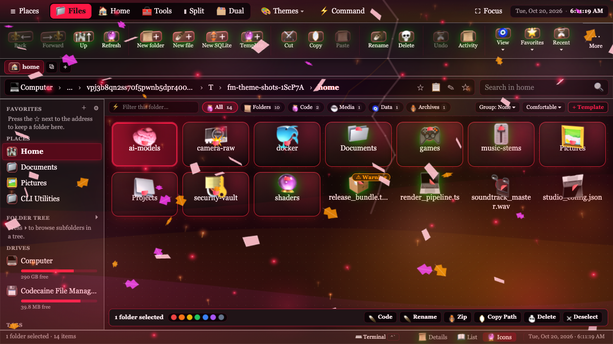

- **Palette:** Background `#0c0407` · Text `#ffeef2` · Accent `#ff1744` · Secondary `#ff9100` · Card `#17070d` · Border `#4a1222`
- **GPU Profile:** Blur `28px` · Glass `0.7` · Folder Shader `horror_blood_moon` · 3D Icons `horror_crypt` · Animation `folder_3d_flip_origami` · Atmosphere `embers+london_fog+volcanic_lightning`
- **Download JSON:** [`custom_themes/17_ultra_crimson_blood_moon_crypt.json`](./17_ultra_crimson_blood_moon_crypt.json)

```text
CCFM-THEME-v1:eyJmb3JtYXQiOiJidW4tcmFkLXN0dWRpby1maWxlLW1hbmFnZXItdGhlbWUiLCJ2ZXJzaW9uIjoxLCJuYW1lIjoiQ3JpbXNvbiBCbG9vZC1Nb29uIENyeXB0IFVsdHJhIiwiZGFyayI6dHJ1ZSwiYmFzZSI6Ik5vc2ZlcmF0dSBCbG9vZC1Nb29uIEdvdGhpYyBDcnlwdCIsImNvbG9ycyI6eyJiYWNrZ3JvdW5kIjoiIzBjMDQwNyIsInRleHQiOiIjZmZlZWYyIiwiYWNjZW50IjoiI2ZmMTc0NCIsInNlY29uZGFyeSI6IiNmZjkxMDAiLCJjYXJkIjoiIzE3MDcwZCIsImJvcmRlciI6IiM0YTEyMjIiLCJkYW5nZXIiOiIjZmYxNzQ0Iiwid2FybmluZyI6IiNmZjkxMDAiLCJzdWNjZXNzIjoiIzAwZTY3NiIsImluZm8iOiIjZmY1MjUyIn0sImZ4Ijp7Imdsb3ciOiJwbGFzbWEiLCJnbG93Q29sb3IiOiIjZmYxNzQ0IiwiZ2xvd0NvbG9yMiI6IiNmZjkxMDAiLCJibHVyIjoyOCwiZ2xhc3MiOjAuNywiZ2xvd0ludGVuc2l0eSI6MSwiYm9yZGVyT3BhY2l0eSI6MC4zNiwiZ3JhaW4iOiJmaWxtIiwic2NhbmxpbmVzIjoibm9uZSIsInJhZGl1cyI6InNoYXJwIiwiYm9yZGVyIjoiZG91YmxlIiwibW90aW9uIjoiY2luZW1hdGljIiwic2hlZW4iOnRydWUsIm5vaXNlIjp0cnVlLCJjaHJvbWF0aWMiOnRydWUsImFtYmllbnQiOnRydWUsImF0bW9zcGhlcmUiOiJlbWJlcnMrbG9uZG9uX2ZvZyt2b2xjYW5pY19saWdodG5pbmciLCJiYWNrZHJvcFN0eWxlIjoib2xlZCIsImN1cnNvckVmZmVjdCI6InNwb3RsaWdodCIsInZpZ25ldHRlIjoiY2luZW1hIiwic2F0dXJhdGlvbiI6MS41NSwidWlFbGVtZW50RngiOiJob3Jyb3JfYmxvb2RfbW9vbiIsImljb25QYWNrU3R5bGUiOiJob3Jyb3JfY3J5cHQiLCJmb250UHJvZmlsZSI6ImVkaXRvcmlhbCIsImNvcm5lclByb2ZpbGUiOiJjaGFtZmVyZWQiLCJpY29uR2xvdyI6Imh5cGVyIiwiaWNvbkFuaW1hdGlvbiI6ImZvbGRlcl8zZF9mbGlwX29yaWdhbWkiLCJjdXN0b21WYXJzIjp7InJvdy1ob3ZlciI6InJnYmEoMjU1LCAyMywgNjgsIDAuMTgpIiwiZm9jdXMtcmluZyI6IiNmZjE3NDQifSwiY3VzdG9tQ3NzIjoiI2xpc3Qudmlldy1pY29ucyAucm93W2RhdGEta2luZD1cImRpclwiXSB7IGJveC1zaGFkb3c6IDAgMTRweCAzMnB4IHJnYmEoMjU1LCAyMywgNjgsIDAuMjgpLCBpbnNldCAwIDFweCAwIHJnYmEoMjU1LCAxMzgsIDEyOCwgMC40NSk7IH0iLCJwcmlzbUVkZ2UiOnRydWUsImlubmVyR2xvdyI6dHJ1ZSwibmVvblB1bHNlIjp0cnVlLCJwYXJhbGxheCI6dHJ1ZX19
```

### Compiz Hellfire Forge 120Hz (`custom_00000012` · `ULTRA`)

> **Target System:** Apple Mac Studio M4 Ultra · 80-Core GPU · 120Hz ProMotion Display  
> **Design Notes:** Tribute to Linux Compiz Fusion burn shaders: roaring flame folders, inferno 3D icons, ember heat-shimmer, and flame wall + solar flare.

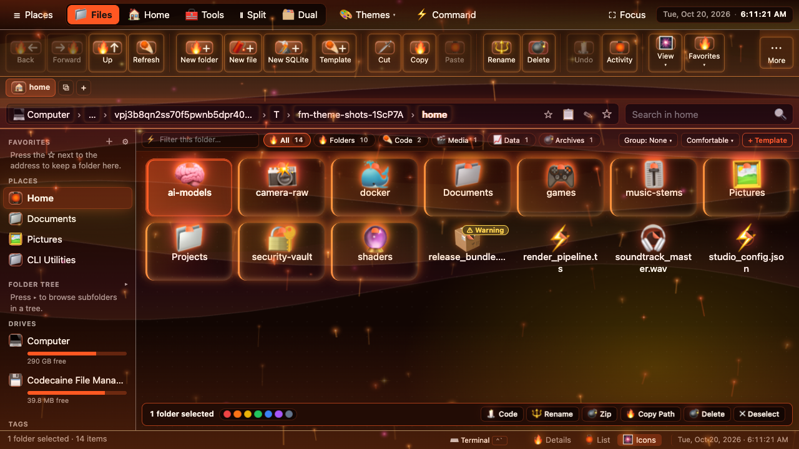

- **Palette:** Background `#120603` · Text `#fff5eb` · Accent `#ff5722` · Secondary `#ffd54f` · Card `#1f0b05` · Border `#5c220e`
- **GPU Profile:** Blur `26px` · Glass `0.68` · Folder Shader `fire_folders` · 3D Icons `inferno_burn` · Animation `fire_ember_flicker` · Atmosphere `dragon_forge+embers+solar_flare`
- **Download JSON:** [`custom_themes/18_ultra_compiz_hellfire_forge_120hz.json`](./18_ultra_compiz_hellfire_forge_120hz.json)

```text
CCFM-THEME-v1:eyJmb3JtYXQiOiJidW4tcmFkLXN0dWRpby1maWxlLW1hbmFnZXItdGhlbWUiLCJ2ZXJzaW9uIjoxLCJuYW1lIjoiQ29tcGl6IEhlbGxmaXJlIEZvcmdlIDEyMEh6IiwiZGFyayI6dHJ1ZSwiYmFzZSI6IkluZmVybm8gRmlyZSBGb2xkZXJzIiwiY29sb3JzIjp7ImJhY2tncm91bmQiOiIjMTIwNjAzIiwidGV4dCI6IiNmZmY1ZWIiLCJhY2NlbnQiOiIjZmY1NzIyIiwic2Vjb25kYXJ5IjoiI2ZmZDU0ZiIsImNhcmQiOiIjMWYwYjA1IiwiYm9yZGVyIjoiIzVjMjIwZSIsImRhbmdlciI6IiNmZjE3NDQiLCJ3YXJuaW5nIjoiI2ZmZDU0ZiIsInN1Y2Nlc3MiOiIjNjlmMGFlIiwiaW5mbyI6IiNmZjkxMDAifSwiZngiOnsiZ2xvdyI6ImVtYmVyIiwiZ2xvd0NvbG9yIjoiI2ZmNTcyMiIsImdsb3dDb2xvcjIiOiIjZmZkNTRmIiwiYmx1ciI6MjYsImdsYXNzIjowLjY4LCJnbG93SW50ZW5zaXR5IjoxLCJib3JkZXJPcGFjaXR5IjowLjM4LCJncmFpbiI6InN1YnRsZSIsInNjYW5saW5lcyI6Im5vbmUiLCJyYWRpdXMiOiJzb2Z0IiwiYm9yZGVyIjoiZ3JhZGllbnQiLCJtb3Rpb24iOiJzbmFwcHkiLCJzaGVlbiI6dHJ1ZSwibm9pc2UiOnRydWUsImNocm9tYXRpYyI6ZmFsc2UsImFtYmllbnQiOnRydWUsImF0bW9zcGhlcmUiOiJkcmFnb25fZm9yZ2UrZW1iZXJzK3NvbGFyX2ZsYXJlIiwiYmFja2Ryb3BTdHlsZSI6ImxpcXVpZCIsImN1cnNvckVmZmVjdCI6InJpcHBsZSIsInZpZ25ldHRlIjoiY2luZW1hIiwic2F0dXJhdGlvbiI6MS42LCJ1aUVsZW1lbnRGeCI6ImZpcmVfZm9sZGVycyIsImljb25QYWNrU3R5bGUiOiJpbmZlcm5vX2J1cm4iLCJmb250UHJvZmlsZSI6InNjaWZpIiwiY29ybmVyUHJvZmlsZSI6ImNoYW1mZXJlZCIsImljb25HbG93IjoiaHlwZXIiLCJpY29uQW5pbWF0aW9uIjoiZmlyZV9lbWJlcl9mbGlja2VyIiwiY3VzdG9tVmFycyI6eyJyb3ctaG92ZXIiOiJyZ2JhKDI1NSwgODcsIDM0LCAwLjIwKSIsImZvY3VzLXJpbmciOiIjZmY5MTAwIn0sImN1c3RvbUNzcyI6IiNsaXN0LnZpZXctaWNvbnMgLnJvd1tkYXRhLWtpbmQ9XCJkaXJcIl0geyBib3gtc2hhZG93OiAwIDE2cHggMzZweCByZ2JhKDI1NSwgODcsIDM0LCAwLjMwKSwgaW5zZXQgMCAxcHggMCByZ2JhKDI1NSwgMjEzLCA3OSwgMC41NSk7IH0iLCJwcmlzbUVkZ2UiOnRydWUsImlubmVyR2xvdyI6dHJ1ZSwibmVvblB1bHNlIjp0cnVlLCJwYXJhbGxheCI6dHJ1ZX19
```

### Bio-Hazard Dali Screen-Melt (`custom_00000013` · `ULTRA`)

> **Target System:** Apple Mac Studio M4 Ultra · 80-Core GPU · 120Hz ProMotion Display  
> **Design Notes:** Salvador Dalí surrealist screen-melt ooze folders with 120Hz liquid-jelly morphing bio-slime 3D icons and plasma spore storms.

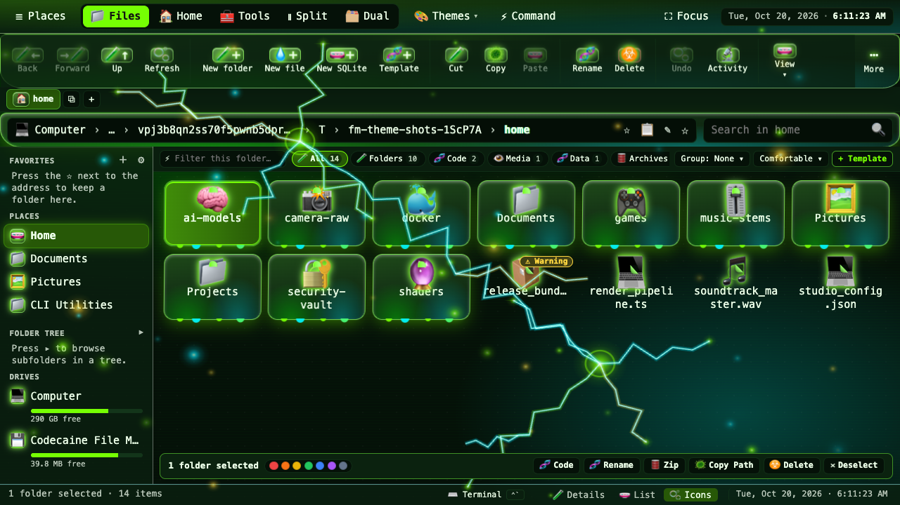

- **Palette:** Background `#051108` · Text `#ecffe8` · Accent `#76ff03` · Secondary `#00e5ff` · Card `#0a1f0f` · Border `#1f5429`
- **GPU Profile:** Blur `28px` · Glass `0.72` · Folder Shader `screen_melt_ooze` · 3D Icons `bio_slime` · Animation `liquid_jelly_morph` · Atmosphere `pollen_glow+fireflies+plasma_storm`
- **Download JSON:** [`custom_themes/19_ultra_bio_hazard_dali_screen_melt.json`](./19_ultra_bio_hazard_dali_screen_melt.json)

```text
CCFM-THEME-v1:eyJmb3JtYXQiOiJidW4tcmFkLXN0dWRpby1maWxlLW1hbmFnZXItdGhlbWUiLCJ2ZXJzaW9uIjoxLCJuYW1lIjoiQmlvLUhhemFyZCBEYWxpIFNjcmVlbi1NZWx0IiwiZGFyayI6dHJ1ZSwiYmFzZSI6IkJpby1IYXphcmQgTGV2ZWwtNCBDb250YWlubWVudCBMYWIiLCJjb2xvcnMiOnsiYmFja2dyb3VuZCI6IiMwNTExMDgiLCJ0ZXh0IjoiI2VjZmZlOCIsImFjY2VudCI6IiM3NmZmMDMiLCJzZWNvbmRhcnkiOiIjMDBlNWZmIiwiY2FyZCI6IiMwYTFmMGYiLCJib3JkZXIiOiIjMWY1NDI5IiwiZGFuZ2VyIjoiI2ZmNTI1MiIsIndhcm5pbmciOiIjZmZkNzQwIiwic3VjY2VzcyI6IiM3NmZmMDMiLCJpbmZvIjoiIzAwZTVmZiJ9LCJmeCI6eyJnbG93IjoibmVvbiIsImdsb3dDb2xvciI6IiM3NmZmMDMiLCJnbG93Q29sb3IyIjoiIzAwZTVmZiIsImJsdXIiOjI4LCJnbGFzcyI6MC43MiwiZ2xvd0ludGVuc2l0eSI6MC45NiwiYm9yZGVyT3BhY2l0eSI6MC4zNiwiZ3JhaW4iOiJzdWJ0bGUiLCJzY2FubGluZXMiOiJzdWJ0bGUiLCJyYWRpdXMiOiJyb3VuZCIsImJvcmRlciI6Im5lb24iLCJtb3Rpb24iOiJlbGFzdGljIiwic2hlZW4iOnRydWUsIm5vaXNlIjp0cnVlLCJjaHJvbWF0aWMiOnRydWUsImFtYmllbnQiOnRydWUsImF0bW9zcGhlcmUiOiJwb2xsZW5fZ2xvdytmaXJlZmxpZXMrcGxhc21hX3N0b3JtIiwiYmFja2Ryb3BTdHlsZSI6ImxpcXVpZCIsImN1cnNvckVmZmVjdCI6InJpcHBsZSIsInZpZ25ldHRlIjoiY2luZW1hIiwic2F0dXJhdGlvbiI6MS41NSwidWlFbGVtZW50RngiOiJzY3JlZW5fbWVsdF9vb3plIiwiaWNvblBhY2tTdHlsZSI6ImJpb19zbGltZSIsImZvbnRQcm9maWxlIjoidGVybWluYWwiLCJjb3JuZXJQcm9maWxlIjoicm91bmRlZCIsImljb25HbG93IjoibmVvbiIsImljb25BbmltYXRpb24iOiJsaXF1aWRfamVsbHlfbW9ycGgiLCJjdXN0b21WYXJzIjp7InJvdy1ob3ZlciI6InJnYmEoMTE4LCAyNTUsIDMsIDAuMTYpIiwiZm9jdXMtcmluZyI6IiM3NmZmMDMifSwiY3VzdG9tQ3NzIjoiI2xpc3Qudmlldy1pY29ucyAucm93W2RhdGEta2luZD1cImRpclwiXSB7IGJveC1zaGFkb3c6IDAgMTRweCAzMnB4IHJnYmEoMTE4LCAyNTUsIDMsIDAuMjUpLCBpbnNldCAwIDFweCAwIHJnYmEoMTc4LCAyNTUsIDg5LCAwLjUwKTsgfSIsInByaXNtRWRnZSI6dHJ1ZSwiaW5uZXJHbG93Ijp0cnVlLCJuZW9uUHVsc2UiOnRydWUsInBhcmFsbGF4Ijp0cnVlfX0
```

### Omega Pantheon 3099 Singularity (`custom_00000014` · `ULTRA`)

> **Target System:** Apple Mac Studio M4 Ultra · 32c CPU · 80c GPU · 192GB Unified · Pro Display XDR 6K @ 120Hz  
> **Design Notes:** Year-3099 post-singularity Omega Point theme with Dyson-lattice halo folders, Omni-Pantheon 3D icons, and 4D tesseract supernova shaders.

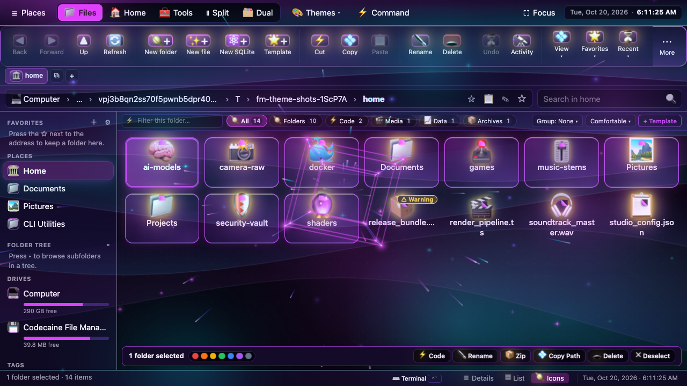

- **Palette:** Background `#06040f` · Text `#faf5ff` · Accent `#e040fb` · Secondary `#00e5ff` · Card `#110a26` · Border `#39206b`
- **GPU Profile:** Blur `32px` · Glass `0.78` · Folder Shader `godmode_omega_halo` · 3D Icons `godmode_omni_pantheon` · Animation `godmode_pantheon_ascend` · Atmosphere `supernova+tesseract_4d+aurora_australis`
- **Download JSON:** [`custom_themes/20_ultra_omega_pantheon_3099_singularity.json`](./20_ultra_omega_pantheon_3099_singularity.json)

```text
CCFM-THEME-v1:eyJmb3JtYXQiOiJidW4tcmFkLXN0dWRpby1maWxlLW1hbmFnZXItdGhlbWUiLCJ2ZXJzaW9uIjoxLCJuYW1lIjoiT21lZ2EgUGFudGhlb24gMzA5OSBTaW5ndWxhcml0eSIsImRhcmsiOnRydWUsImJhc2UiOiJPbWVnYSBQb2ludCBTaW5ndWxhcml0eSAzMDk5IiwiY29sb3JzIjp7ImJhY2tncm91bmQiOiIjMDYwNDBmIiwidGV4dCI6IiNmYWY1ZmYiLCJhY2NlbnQiOiIjZTA0MGZiIiwic2Vjb25kYXJ5IjoiIzAwZTVmZiIsImNhcmQiOiIjMTEwYTI2IiwiYm9yZGVyIjoiIzM5MjA2YiIsImRhbmdlciI6IiNmZjE3NDQiLCJ3YXJuaW5nIjoiI2ZmZDc0MCIsInN1Y2Nlc3MiOiIjMDBlNjc2IiwiaW5mbyI6IiMwMGU1ZmYifSwiZngiOnsiZ2xvdyI6ImF1cm9yYSIsImdsb3dDb2xvciI6IiNlMDQwZmIiLCJnbG93Q29sb3IyIjoiIzAwZTVmZiIsImJsdXIiOjMyLCJnbGFzcyI6MC43OCwiZ2xvd0ludGVuc2l0eSI6MSwiYm9yZGVyT3BhY2l0eSI6MC4zOCwiZ3JhaW4iOiJzdWJ0bGUiLCJzY2FubGluZXMiOiJub25lIiwicmFkaXVzIjoic3F1aXJjbGUiLCJib3JkZXIiOiJpcmlkZXNjZW50IiwibW90aW9uIjoic3ByaW5nIiwic2hlZW4iOnRydWUsIm5vaXNlIjp0cnVlLCJjaHJvbWF0aWMiOnRydWUsImFtYmllbnQiOnRydWUsImF0bW9zcGhlcmUiOiJzdXBlcm5vdmErdGVzc2VyYWN0XzRkK2F1cm9yYV9hdXN0cmFsaXMiLCJiYWNrZHJvcFN0eWxlIjoibGlxdWlkIiwiY3Vyc29yRWZmZWN0IjoicHJpc20iLCJ2aWduZXR0ZSI6ImFtYmllbnQiLCJzYXR1cmF0aW9uIjoxLjYsInVpRWxlbWVudEZ4IjoiZ29kbW9kZV9vbWVnYV9oYWxvIiwiaWNvblBhY2tTdHlsZSI6ImdvZG1vZGVfb21uaV9wYW50aGVvbiIsImZvbnRQcm9maWxlIjoic2NpZmkiLCJjb3JuZXJQcm9maWxlIjoic3F1aXJjbGVfaGlnIiwiaWNvbkdsb3ciOiJoeXBlciIsImljb25BbmltYXRpb24iOiJnb2Rtb2RlX3BhbnRoZW9uX2FzY2VuZCIsImN1c3RvbVZhcnMiOnsicm93LWhvdmVyIjoicmdiYSgyMjQsIDY0LCAyNTEsIDAuMTYpIiwiZm9jdXMtcmluZyI6IiNlMDQwZmIifSwiY3VzdG9tQ3NzIjoiI2xpc3Qudmlldy1pY29ucyAucm93W2RhdGEta2luZD1cImRpclwiXSB7IGJveC1zaGFkb3c6IDAgMTZweCAzNnB4IHJnYmEoMjI0LCA2NCwgMjUxLCAwLjI4KSwgaW5zZXQgMCAxcHggMCByZ2JhKDAsIDIyOSwgMjU1LCAwLjU1KTsgfSIsInByaXNtRWRnZSI6dHJ1ZSwiaW5uZXJHbG93Ijp0cnVlLCJmcm9zdGVkUmltIjp0cnVlLCJuZW9uUHVsc2UiOnRydWUsInBhcmFsbGF4Ijp0cnVlfX0
```

---

## ❄️ Polar Night & Cryo-Glacier 6K Ultra Collection

Featuring **`polar_night` (`Polar Night`)**, **`cryo_icicle_blizzard` (`Cryo-Glacier Icicle Storm`)**, and **`orbital_ice` (`Orbital Ice`)** with sculpted hanging crystal icicles (`cryo_frost`), `cryo_crystal` / `aurora_nordic_ice` 3D icons, and `blizzard+aurora_australis` 120Hz shaders:

### ❄️ Polar Night (`polar_night`)


- **Shader / Icons / Atmosphere:** `cryo_frost` · `cryo_crystal` · `blizzard+aurora_australis`

```text
CCFM-THEME-v1:eyJmb3JtYXQiOiJidW4tcmFkLXN0dWRpby1maWxlLW1hbmFnZXItdGhlbWUiLCJ2ZXJzaW9uIjoxLCJuYW1lIjoiUG9sYXIgTmlnaHQiLCJkYXJrIjp0cnVlLCJiYXNlIjoiUG9sYXIgTmlnaHQiLCJjb2xvcnMiOnsiYmFja2dyb3VuZCI6IiMwNzEwMWEiLCJ0ZXh0IjoiI2U4ZjZmZiIsImFjY2VudCI6IiM4ZmUzZmYiLCJzZWNvbmRhcnkiOiIjYjljN2ZmIiwiY2FyZCI6IiMwZjFkMmIiLCJib3JkZXIiOiIjNTI3YTk5IiwiZGFuZ2VyIjoiI2Y4NzE3MSIsIndhcm5pbmciOiIjZmJiZjI0Iiwic3VjY2VzcyI6IiM0YWRlODAiLCJpbmZvIjoiIzM4YmRmOCJ9LCJmeCI6eyJnbG93Ijoic29mdCIsImdsb3dDb2xvciI6IiM4ZmUzZmYiLCJnbG93Q29sb3IyIjoiI2I5YzdmZiIsImJsdXIiOjI0LCJnbGFzcyI6MC42NSwiZ2xvd0ludGVuc2l0eSI6MC42LCJib3JkZXJPcGFjaXR5IjowLjE2LCJncmFpbiI6Im5vbmUiLCJzY2FubGluZXMiOiJub25lIiwicmFkaXVzIjoic29mdCIsImJvcmRlciI6Im1ldGFsIiwibW90aW9uIjoiY2FsbSIsInNoZWVuIjp0cnVlLCJub2lzZSI6ZmFsc2UsImNocm9tYXRpYyI6ZmFsc2UsImFtYmllbnQiOnRydWUsImF0bW9zcGhlcmUiOiJibGl6emFyZCthdXJvcmFfYXVzdHJhbGlzIiwiYmFja2Ryb3BTdHlsZSI6ImZyb3N0ZWQiLCJjdXJzb3JFZmZlY3QiOiJzcG90bGlnaHQiLCJ2aWduZXR0ZSI6ImFtYmllbnQiLCJ1aUVsZW1lbnRGeCI6ImNyeW9fZnJvc3QiLCJpY29uUGFja1N0eWxlIjoiY3J5b19jcnlzdGFsIiwiZm9udFByb2ZpbGUiOiJzY2lmaSIsImNvcm5lclByb2ZpbGUiOiJyb3VuZGVkIiwiaWNvbkdsb3ciOiJuZW9uIiwiaW5uZXJHbG93Ijp0cnVlLCJmcm9zdGVkUmltIjp0cnVlfX0
```

### ❄️ Cryo-Glacier Icicle Storm (`cryo_icicle_blizzard`)

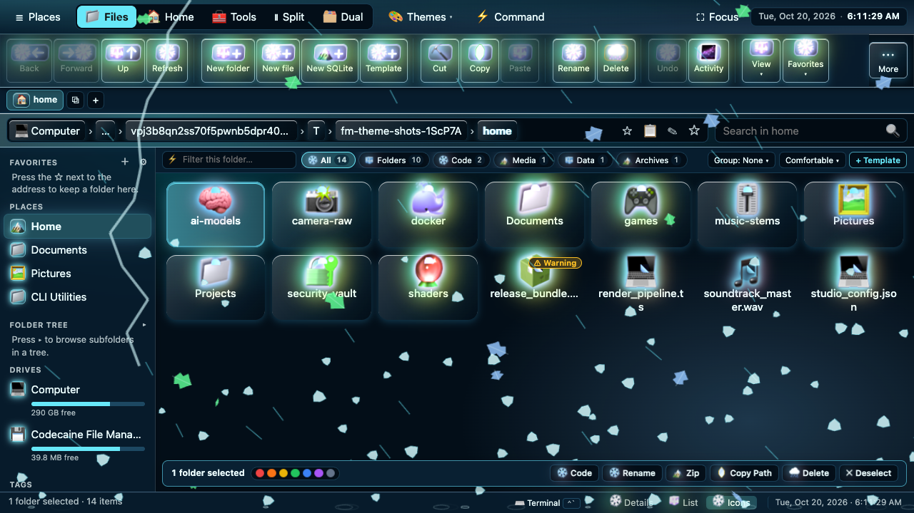

- **Shader / Icons / Atmosphere:** `cryo_frost` · `cryo_crystal` · `freezing_ice_storm`

```text
CCFM-THEME-v1:eyJmb3JtYXQiOiJidW4tcmFkLXN0dWRpby1maWxlLW1hbmFnZXItdGhlbWUiLCJ2ZXJzaW9uIjoxLCJuYW1lIjoiQ3J5by1HbGFjaWVyIEljaWNsZSBTdG9ybSIsImRhcmsiOnRydWUsImJhc2UiOiJDcnlvLUdsYWNpZXIgSWNpY2xlIFN0b3JtIiwiY29sb3JzIjp7ImJhY2tncm91bmQiOiIjMDMwZTE4IiwidGV4dCI6IiNlY2ZlZmYiLCJhY2NlbnQiOiIjNjdlOGY5Iiwic2Vjb25kYXJ5IjoiIzkzYzVmZCIsImNhcmQiOiIjMDgxZTMwIiwiYm9yZGVyIjoiIzNiODJhNiIsImRhbmdlciI6IiNmODcxNzEiLCJ3YXJuaW5nIjoiI2ZiYmYyNCIsInN1Y2Nlc3MiOiIjNGFkZTgwIiwiaW5mbyI6IiMzOGJkZjgifSwiZngiOnsiZ2xvdyI6ImF1cm9yYSIsImdsb3dDb2xvciI6IiM2N2U4ZjkiLCJnbG93Q29sb3IyIjoiIzkzYzVmZCIsImJsdXIiOjI4LCJnbGFzcyI6MC42NSwiZ2xvd0ludGVuc2l0eSI6MC44LCJib3JkZXJPcGFjaXR5IjowLjE2LCJncmFpbiI6Im5vbmUiLCJzY2FubGluZXMiOiJub25lIiwicmFkaXVzIjoic29mdCIsImJvcmRlciI6ImlyaWRlc2NlbnQiLCJtb3Rpb24iOiJjYWxtIiwic2hlZW4iOnRydWUsIm5vaXNlIjpmYWxzZSwiY2hyb21hdGljIjpmYWxzZSwiYW1iaWVudCI6dHJ1ZSwiYXRtb3NwaGVyZSI6ImZyZWV6aW5nX2ljZV9zdG9ybSIsImJhY2tkcm9wU3R5bGUiOiJmcm9zdGVkIiwiY3Vyc29yRWZmZWN0Ijoic3BvdGxpZ2h0IiwidmlnbmV0dGUiOiJhbWJpZW50IiwidWlFbGVtZW50RngiOiJjcnlvX2Zyb3N0IiwiaWNvblBhY2tTdHlsZSI6ImNyeW9fY3J5c3RhbCIsImZvbnRQcm9maWxlIjoic2NpZmkiLCJjb3JuZXJQcm9maWxlIjoicm91bmRlZCIsImljb25HbG93IjoibmVvbiIsInByaXNtRWRnZSI6dHJ1ZSwiaW5uZXJHbG93Ijp0cnVlLCJmcm9zdGVkUmltIjp0cnVlfX0
```

### ❄️ Orbital Ice (`orbital_ice`)

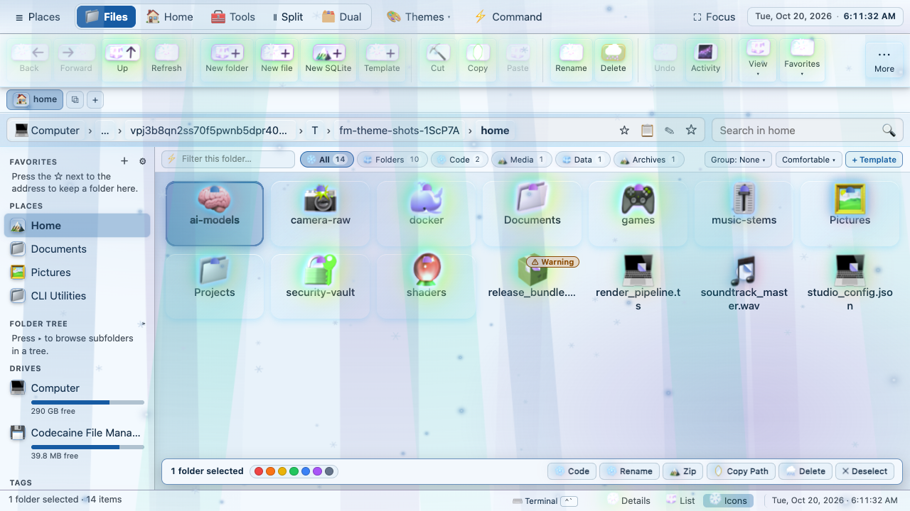

- **Shader / Icons / Atmosphere:** `cryo_frost` · `cryo_crystal` · `northern_pillars+snow`

```text
CCFM-THEME-v1:eyJmb3JtYXQiOiJidW4tcmFkLXN0dWRpby1maWxlLW1hbmFnZXItdGhlbWUiLCJ2ZXJzaW9uIjoxLCJuYW1lIjoiT3JiaXRhbCBJY2UiLCJkYXJrIjpmYWxzZSwiYmFzZSI6Ik9yYml0YWwgSWNlIiwiY29sb3JzIjp7ImJhY2tncm91bmQiOiIjZThmMmZhIiwidGV4dCI6IiMxMzJiNDMiLCJhY2NlbnQiOiIjMTY1YmEzIiwic2Vjb25kYXJ5IjoiIzcyNTVhOCIsImNhcmQiOiIjZjdmYmZmIiwiYm9yZGVyIjoiIzY0ODQ5ZSIsImRhbmdlciI6IiNkYzI2MjYiLCJ3YXJuaW5nIjoiI2Q5NzcwNiIsInN1Y2Nlc3MiOiIjMTZhMzRhIiwiaW5mbyI6IiMwMjg0YzcifSwiZngiOnsiZ2xvdyI6InNvZnQiLCJnbG93Q29sb3IiOiIjMTY1YmEzIiwiZ2xvd0NvbG9yMiI6IiM3MjU1YTgiLCJibHVyIjoyNCwiZ2xhc3MiOjAuNywiZ2xvd0ludGVuc2l0eSI6MC40NSwiYm9yZGVyT3BhY2l0eSI6MC4zLCJncmFpbiI6Im5vbmUiLCJzY2FubGluZXMiOiJub25lIiwicmFkaXVzIjoic29mdCIsImJvcmRlciI6Im1ldGFsIiwibW90aW9uIjoiY2FsbSIsInNoZWVuIjp0cnVlLCJub2lzZSI6ZmFsc2UsImNocm9tYXRpYyI6ZmFsc2UsImFtYmllbnQiOnRydWUsImF0bW9zcGhlcmUiOiJub3J0aGVybl9waWxsYXJzK3Nub3ciLCJiYWNrZHJvcFN0eWxlIjoiZnJvc3RlZCIsImN1cnNvckVmZmVjdCI6InNwb3RsaWdodCIsInZpZ25ldHRlIjoic3VidGxlIiwidWlFbGVtZW50RngiOiJjcnlvX2Zyb3N0IiwiaWNvblBhY2tTdHlsZSI6ImNyeW9fY3J5c3RhbCIsImZvbnRQcm9maWxlIjoic2NpZmkiLCJjb3JuZXJQcm9maWxlIjoicm91bmRlZCIsImljb25HbG93Ijoic3VidGxlIiwiaW5uZXJHbG93Ijp0cnVlLCJmcm9zdGVkUmltIjp0cnVlfX0
```

---

## 🎃🎆🎄 All 18 US Holiday Celebration 6K Ultra Themes (`holiday_*`)

Every built-in US Holiday theme runs at **Ultra tier (`tier: "ultra"`)** with:
- **Animated Holiday Corner Crests (`data-holiday-crest`)** on every 3D folder and file badge (`data-holiday-badge`) in **Icons View** and **List View**.
- **Interactive Celebration Particle Burst** across the 6K viewport whenever selected.
- **Festive 3D Folder Shaders (`holiday_festive_glow`)** and **`us_holidays_festive`** 3D icons.

### 📦 1-Click Pack: All 18 US Holiday Celebration Ultra Themes (`CCFM-PACK-v1`)

Copy this codeblock and press `⌘V` in the File Manager (or import [`us_holidays_18_ultra_pack.json`](./us_holidays_18_ultra_pack.json)):

```text
CCFM-PACK-v1:
```

### 🗓️ All 18 US Holiday Ultra Themes — Live Screenshots & Individual Share Codes

| # | Holiday | Built-In Key | Theme Name | Folder Crest | File Badge | Celebration Particle Burst |
| :-: | :--- | :--- | :--- | :-: | :-: | :--- |
| **1** | New Year's Eve (Jan 1) | `holiday_new_years_times_square` | **New Year's Eve Times Square Ball Drop** | 🥂 | 🎆 | 🥂 🎆 🎊 ✨ 🍾 |
| **2** | MLK Jr. Day (Jan) | `holiday_mlk_dream_memorial` | **MLK Day Lincoln Memorial Sunrise** | 🕊️ | 🕯️ | 🕊️ 🕯️ ✨ 🌟 🤝 |
| **3** | Valentine's Day (Feb 14) | `holiday_valentines_velvet_rose` | **Valentine's Day Velvet Rose & Truffle** | 💝 | 🌹 | 💝 🌹 💘 ✨ 🍫 |
| **4** | Presidents' Day (Feb) | `holiday_presidents_mount_rushmore` | **Presidents' Day Capitol Rotunda & Brass** | 🦅 | 🏛️ | 🦅 🏛️ ⭐ 🔔 📜 |
| **5** | St. Patrick's Day (Mar 17) | `holiday_st_patricks_emerald_clover` | **St. Patrick's Celtic Emerald & Gold Coin** | ☘️ | 🍀 | ☘️ 🍀 🪙 🌈 ✨ |
| **6** | Easter Sunday (Spring) | `holiday_easter_pastel_egg_hunt` | **Easter Sunday Fabergé & Pastel Meadow** | 🥚 | 🐣 | 🥚 🐣 🐰 🌷 🌸 |
| **7** | Mother's Day (May) | `holiday_mothers_day_botanical_tea` | **Mother's Day Peony Conservatory & Porcel** | 🌸 | 🫖 | 🌸 🫖 💐 🌺 ✨ |
| **8** | Memorial Day (May) | `holiday_memorial_day_poppy_honor` | **Memorial Day Arlington Red Poppy & Taps** | 🌺 | 🎖️ | 🌺 🎖️ 🦅 ⭐ 🕯️ |
| **9** | Juneteenth (Jun 19) | `holiday_juneteenth_jubilee_star` | **Juneteenth Freedom Starburst & Jubilee** | 🌟 | 🎆 | 🌟 🎆 ✨ ❤️ 💛 💚 |
| **10** | Father's Day (Jun) | `holiday_fathers_day_leather_den` | **Father's Day Walnut Workshop & Chronogra** | ⌚ | 🧭 | ⌚ 🧭 🥃 🪵 ⭐ |
| **11** | Independence Day (Jul 4) | `holiday_fourth_of_july_fireworks` | **4th of July Independence Sky Fireworks** | 🎆 | 🗽 | 🎆 🎇 🗽 🦅 ⭐ |
| **12** | Labor Day (Sep) | `holiday_labor_day_rivet_forge` | **Labor Day Steelworker Forge & Rivet** | ⚒️ | ⚙️ | ⚒️ ⚙️ 🔥 🏗️ ⭐ |
| **13** | Halloween (Oct 31) | `holiday_halloween_jack_o_lantern` | **Halloween Carved Jack-O'-Lantern & Witch** | 🎃 | 🦇 | 🎃 🦇 👻 🕯️ 🕸️ |
| **14** | Día de los Muertos (Nov 1–2) | `holiday_dia_de_los_muertos_marigold` | **Día de los Muertos Cempasúchil Ofrenda** | 🌼 | 💀 | 🌼 💀 🕯️ 🦋 🌺 |
| **15** | Veterans Day (Nov 11) | `holiday_veterans_day_valor_medallion` | **Veterans Day Bronze Star & Dress Blue** | 🎖️ | 🦅 | 🎖️ 🦅 ⭐ 🛡️ 🕯️ |
| **16** | Thanksgiving (Nov) | `holiday_thanksgiving_harvest_hearth` | **Thanksgiving New England Harvest Hearth** | 🦃 | 🍁 | 🦃 🍁 🥧 🍂 🌽 |
| **17** | Hanukkah (Dec) | `holiday_hanukkah_menorah_sapphire` | **Hanukkah Silver Menorah & Dreidel Sapphi** | 🕎 | ✡️ | 🕎 ✡️ ✨ 🪙 💙 |
| **18** | Christmas Day (Dec 25) | `holiday_christmas_nutcracker_hearth` | **Christmas Eve Nutcracker Pine & Evergree** | 🎄 | 🎅 | 🎄 🎅 ❄️ 🎁 ⭐ |

#### 1. 🥂 New Year's Eve Times Square Ball Drop (`holiday_new_years_times_square`) — New Year's Eve (Jan 1)

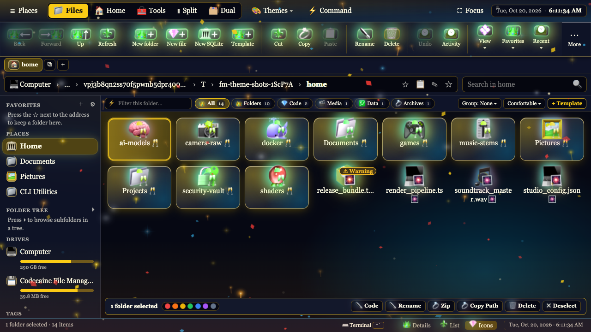

- **Folder Crest:** 🥂 · **File Badge:** 🎆 · **Celebration Particle Burst:** 🥂 🎆 🎊 ✨ 🍾

```text
CCFM-THEME-v1:eyJmb3JtYXQiOiJidW4tcmFkLXN0dWRpby1maWxlLW1hbmFnZXItdGhlbWUiLCJ2ZXJzaW9uIjoxLCJuYW1lIjoiTmV3IFllYXIncyBFdmUgVGltZXMgU3F1YXJlIEJhbGwgRHJvcCIsImRhcmsiOnRydWUsImJhc2UiOiJOZXcgWWVhcidzIEV2ZSBUaW1lcyBTcXVhcmUgQmFsbCBEcm9wIiwiY29sb3JzIjp7ImJhY2tncm91bmQiOiIjMDYwODEzIiwidGV4dCI6IiNmZWZjZTgiLCJhY2NlbnQiOiIjZmFjYzE1Iiwic2Vjb25kYXJ5IjoiIzM4YmRmOCIsImNhcmQiOiIjMTAxNTJiIiwiYm9yZGVyIjoiI2VhYjMwOCIsImRhbmdlciI6IiNmODcxNzEiLCJ3YXJuaW5nIjoiI2ZiYmYyNCIsInN1Y2Nlc3MiOiIjNGFkZTgwIiwiaW5mbyI6IiMzOGJkZjgifSwiZngiOnsiZ2xvdyI6ImJsb29tIiwiZ2xvd0NvbG9yIjoiI2ZhY2MxNSIsImdsb3dDb2xvcjIiOiIjMzhiZGY4IiwiYmx1ciI6MjYsImdsYXNzIjowLjY2LCJnbG93SW50ZW5zaXR5IjowLjkyLCJib3JkZXJPcGFjaXR5IjowLjE2LCJncmFpbiI6Im5vbmUiLCJzY2FubGluZXMiOiJub25lIiwicmFkaXVzIjoic3F1aXJjbGUiLCJib3JkZXIiOiJpcmlkZXNjZW50IiwibW90aW9uIjoic3ByaW5nIiwic2hlZW4iOnRydWUsIm5vaXNlIjpmYWxzZSwiY2hyb21hdGljIjp0cnVlLCJhbWJpZW50Ijp0cnVlLCJhdG1vc3BoZXJlIjoiZmlyZXdvcmtfc3BhcmtzK2NvbmZldHRpX2xpdGUrc3RhcmxpZ2h0X3ZlbHZldCIsImJhY2tkcm9wU3R5bGUiOiJnbGFzcyIsImN1cnNvckVmZmVjdCI6InByaXNtIiwidmlnbmV0dGUiOiJjaW5lbWEiLCJzYXR1cmF0aW9uIjoxLjg1LCJ1aUVsZW1lbnRGeCI6ImhvbGlkYXlfZmVzdGl2ZV9nbG93IiwiaWNvblBhY2tTdHlsZSI6InVzX2hvbGlkYXlzX2Zlc3RpdmUiLCJmb250UHJvZmlsZSI6ImVkaXRvcmlhbCIsImNvcm5lclByb2ZpbGUiOiJyb3VuZGVkIiwiaWNvbkdsb3ciOiJoeXBlciIsImljb25BbmltYXRpb24iOiJyYXl0cmFjZWRfY2F1c3RpY19yZWZyYWN0aW9uIiwicHJpc21FZGdlIjp0cnVlLCJpbm5lckdsb3ciOnRydWUsImZyb3N0ZWRSaW0iOnRydWUsIm5lb25QdWxzZSI6dHJ1ZSwicGFyYWxsYXgiOnRydWV9fQ
```

#### 2. 🕊️ MLK Day Lincoln Memorial Sunrise (`holiday_mlk_dream_memorial`) — MLK Jr. Day (Jan)

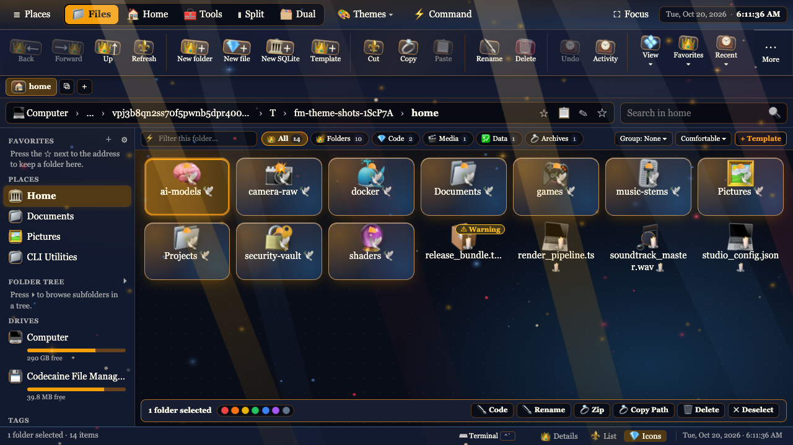

- **Folder Crest:** 🕊️ · **File Badge:** 🕯️ · **Celebration Particle Burst:** 🕊️ 🕯️ ✨ 🌟 🤝

```text
CCFM-THEME-v1:eyJmb3JtYXQiOiJidW4tcmFkLXN0dWRpby1maWxlLW1hbmFnZXItdGhlbWUiLCJ2ZXJzaW9uIjoxLCJuYW1lIjoiTUxLIERheSBMaW5jb2xuIE1lbW9yaWFsIFN1bnJpc2UiLCJkYXJrIjp0cnVlLCJiYXNlIjoiTUxLIERheSBMaW5jb2xuIE1lbW9yaWFsIFN1bnJpc2UiLCJjb2xvcnMiOnsiYmFja2dyb3VuZCI6IiMwOTBkMTgiLCJ0ZXh0IjoiI2ZmZmJlYiIsImFjY2VudCI6IiNmNTllMGIiLCJzZWNvbmRhcnkiOiIjNjBhNWZhIiwiY2FyZCI6IiMxNDFjMzMiLCJib3JkZXIiOiIjZDk3NzA2IiwiZGFuZ2VyIjoiI2Y4NzE3MSIsIndhcm5pbmciOiIjZmJiZjI0Iiwic3VjY2VzcyI6IiM0YWRlODAiLCJpbmZvIjoiIzM4YmRmOCJ9LCJmeCI6eyJnbG93Ijoic29mdCIsImdsb3dDb2xvciI6IiNmNTllMGIiLCJnbG93Q29sb3IyIjoiIzYwYTVmYSIsImJsdXIiOjI0LCJnbGFzcyI6MC42LCJnbG93SW50ZW5zaXR5IjowLjcyLCJib3JkZXJPcGFjaXR5IjowLjE2LCJncmFpbiI6InN1YnRsZSIsInNjYW5saW5lcyI6Im5vbmUiLCJyYWRpdXMiOiJzb2Z0IiwiYm9yZGVyIjoiZ3JhZGllbnQiLCJtb3Rpb24iOiJjYWxtIiwic2hlZW4iOnRydWUsIm5vaXNlIjpmYWxzZSwiY2hyb21hdGljIjpmYWxzZSwiYW1iaWVudCI6dHJ1ZSwiYXRtb3NwaGVyZSI6InN1bmJlYW1zK2R1c3RfbW90ZXMrc3RhcmxpZ2h0X3ZlbHZldCIsImJhY2tkcm9wU3R5bGUiOiJnbGFzcyIsImN1cnNvckVmZmVjdCI6InNwb3RsaWdodCIsInZpZ25ldHRlIjoic3VidGxlIiwic2F0dXJhdGlvbiI6MS41LCJ1aUVsZW1lbnRGeCI6ImhvbGlkYXlfZmVzdGl2ZV9nbG93IiwiaWNvblBhY2tTdHlsZSI6InVzX2hvbGlkYXlzX2Zlc3RpdmUiLCJmb250UHJvZmlsZSI6ImVkaXRvcmlhbCIsImNvcm5lclByb2ZpbGUiOiJyb3VuZGVkIiwiaWNvbkdsb3ciOiJzdWJ0bGUiLCJpY29uQW5pbWF0aW9uIjoib3JiaXRhbF9oYWxvX3NwaW4iLCJpbm5lckdsb3ciOnRydWUsImZyb3N0ZWRSaW0iOnRydWV9fQ
```

#### 3. 💝 Valentine's Day Velvet Rose & Truffle (`holiday_valentines_velvet_rose`) — Valentine's Day (Feb 14)

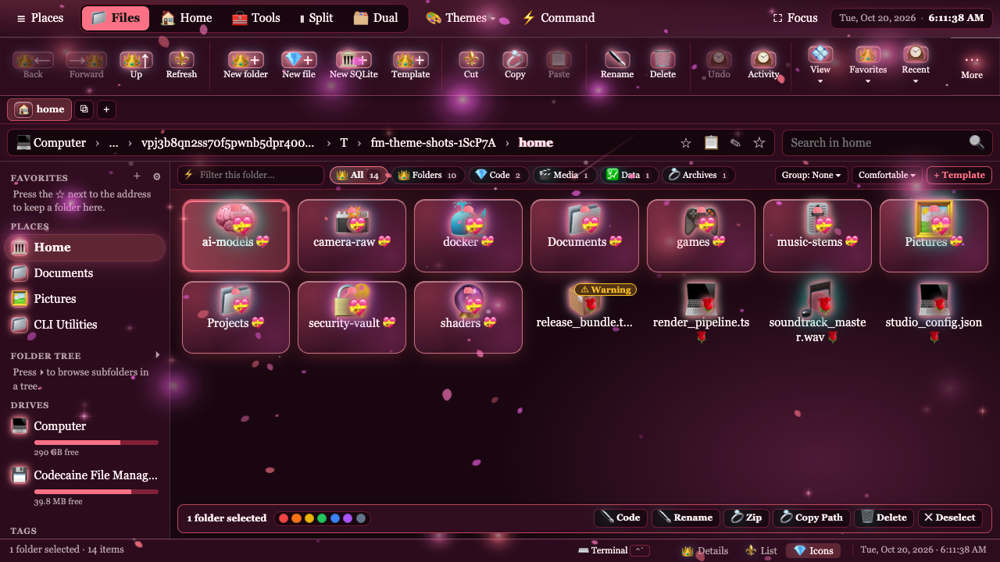

- **Folder Crest:** 💝 · **File Badge:** 🌹 · **Celebration Particle Burst:** 💝 🌹 💘 ✨ 🍫

```text
CCFM-THEME-v1:eyJmb3JtYXQiOiJidW4tcmFkLXN0dWRpby1maWxlLW1hbmFnZXItdGhlbWUiLCJ2ZXJzaW9uIjoxLCJuYW1lIjoiVmFsZW50aW5lJ3MgRGF5IFZlbHZldCBSb3NlICYgVHJ1ZmZsZSIsImRhcmsiOnRydWUsImJhc2UiOiJWYWxlbnRpbmUncyBEYXkgVmVsdmV0IFJvc2UgJiBUcnVmZmxlIiwiY29sb3JzIjp7ImJhY2tncm91bmQiOiIjMWEwNjEwIiwidGV4dCI6IiNmZmYxZjIiLCJhY2NlbnQiOiIjZmI3MTg1Iiwic2Vjb25kYXJ5IjoiI2Y0NzJiNiIsImNhcmQiOiIjMmUwYzFlIiwiYm9yZGVyIjoiI2Y0M2Y1ZSIsImRhbmdlciI6IiNmODcxNzEiLCJ3YXJuaW5nIjoiI2ZiYmYyNCIsInN1Y2Nlc3MiOiIjNGFkZTgwIiwiaW5mbyI6IiMzOGJkZjgifSwiZngiOnsiZ2xvdyI6ImJsb29tIiwiZ2xvd0NvbG9yIjoiI2ZiNzE4NSIsImdsb3dDb2xvcjIiOiIjZjQ3MmI2IiwiYmx1ciI6MjYsImdsYXNzIjowLjY1LCJnbG93SW50ZW5zaXR5IjowLjg1LCJib3JkZXJPcGFjaXR5IjowLjE2LCJncmFpbiI6Im5vbmUiLCJzY2FubGluZXMiOiJub25lIiwicmFkaXVzIjoicGlsbCIsImJvcmRlciI6ImdyYWRpZW50IiwibW90aW9uIjoic3ByaW5nIiwic2hlZW4iOnRydWUsIm5vaXNlIjpmYWxzZSwiY2hyb21hdGljIjpmYWxzZSwiYW1iaWVudCI6dHJ1ZSwiYXRtb3NwaGVyZSI6InNha3VyYStjaW5lbWFfYm9rZWgrc3RhcmxpZ2h0X3ZlbHZldCIsImJhY2tkcm9wU3R5bGUiOiJsaXF1aWQiLCJjdXJzb3JFZmZlY3QiOiJyaXBwbGUiLCJ2aWduZXR0ZSI6ImFtYmllbnQiLCJzYXR1cmF0aW9uIjoxLjgsInVpRWxlbWVudEZ4IjoiaG9saWRheV9mZXN0aXZlX2dsb3ciLCJpY29uUGFja1N0eWxlIjoidXNfaG9saWRheXNfZmVzdGl2ZSIsImZvbnRQcm9maWxlIjoiZWRpdG9yaWFsIiwiY29ybmVyUHJvZmlsZSI6InBpbGwiLCJpY29uR2xvdyI6Im5lb24iLCJpY29uQW5pbWF0aW9uIjoiaGVhcnRiZWF0X2Jpb2x1bSIsInByaXNtRWRnZSI6dHJ1ZSwiaW5uZXJHbG93Ijp0cnVlLCJmcm9zdGVkUmltIjp0cnVlLCJuZW9uUHVsc2UiOnRydWV9fQ
```

#### 4. 🦅 Presidents' Day Capitol Rotunda & Brass (`holiday_presidents_mount_rushmore`) — Presidents' Day (Feb)


- **Folder Crest:** 🦅 · **File Badge:** 🏛️ · **Celebration Particle Burst:** 🦅 🏛️ ⭐ 🔔 📜

```text
CCFM-THEME-v1:eyJmb3JtYXQiOiJidW4tcmFkLXN0dWRpby1maWxlLW1hbmFnZXItdGhlbWUiLCJ2ZXJzaW9uIjoxLCJuYW1lIjoiUHJlc2lkZW50cycgRGF5IENhcGl0b2wgUm90dW5kYSAmIEJyYXNzIiwiZGFyayI6dHJ1ZSwiYmFzZSI6IlByZXNpZGVudHMnIERheSBDYXBpdG9sIFJvdHVuZGEgJiBCcmFzcyIsImNvbG9ycyI6eyJiYWNrZ3JvdW5kIjoiIzA4MTAyMSIsInRleHQiOiIjZjhmYWZjIiwiYWNjZW50IjoiI2ZiYmYyNCIsInNlY29uZGFyeSI6IiNmODcxNzEiLCJjYXJkIjoiIzEyMjAzZCIsImJvcmRlciI6IiNlYWIzMDgiLCJkYW5nZXIiOiIjZjg3MTcxIiwid2FybmluZyI6IiNmYmJmMjQiLCJzdWNjZXNzIjoiIzRhZGU4MCIsImluZm8iOiIjMzhiZGY4In0sImZ4Ijp7Imdsb3ciOiJzb2Z0IiwiZ2xvd0NvbG9yIjoiI2ZiYmYyNCIsImdsb3dDb2xvcjIiOiIjZWY0NDQ0IiwiYmx1ciI6MjIsImdsYXNzIjowLjU4LCJnbG93SW50ZW5zaXR5IjowLjc0LCJib3JkZXJPcGFjaXR5IjowLjE2LCJncmFpbiI6InN1YnRsZSIsInNjYW5saW5lcyI6Im5vbmUiLCJyYWRpdXMiOiJzb2Z0IiwiYm9yZGVyIjoibWV0YWwiLCJtb3Rpb24iOiJjYWxtIiwic2hlZW4iOnRydWUsIm5vaXNlIjpmYWxzZSwiY2hyb21hdGljIjpmYWxzZSwiYW1iaWVudCI6dHJ1ZSwiYXRtb3NwaGVyZSI6InN0YXJsaWdodF92ZWx2ZXQrc3VuYmVhbXMrZHVzdF9tb3RlcyIsImJhY2tkcm9wU3R5bGUiOiJnbGFzcyIsImN1cnNvckVmZmVjdCI6InNwb3RsaWdodCIsInZpZ25ldHRlIjoiY2luZW1hIiwic2F0dXJhdGlvbiI6MS41NSwidWlFbGVtZW50RngiOiJob2xpZGF5X2Zlc3RpdmVfZ2xvdyIsImljb25QYWNrU3R5bGUiOiJ1c19ob2xpZGF5c19mZXN0aXZlIiwiZm9udFByb2ZpbGUiOiJlZGl0b3JpYWwiLCJjb3JuZXJQcm9maWxlIjoicm91bmRlZCIsImljb25HbG93Ijoic3VidGxlIiwiaWNvbkFuaW1hdGlvbiI6ImM0ZF9tb2dyYXBoX2Nsb25lcl93YXZlIiwiaW5uZXJHbG93Ijp0cnVlLCJmcm9zdGVkUmltIjp0cnVlfX0
```

#### 5. ☘️ St. Patrick's Celtic Emerald & Gold Coin (`holiday_st_patricks_emerald_clover`) — St. Patrick's Day (Mar 17)

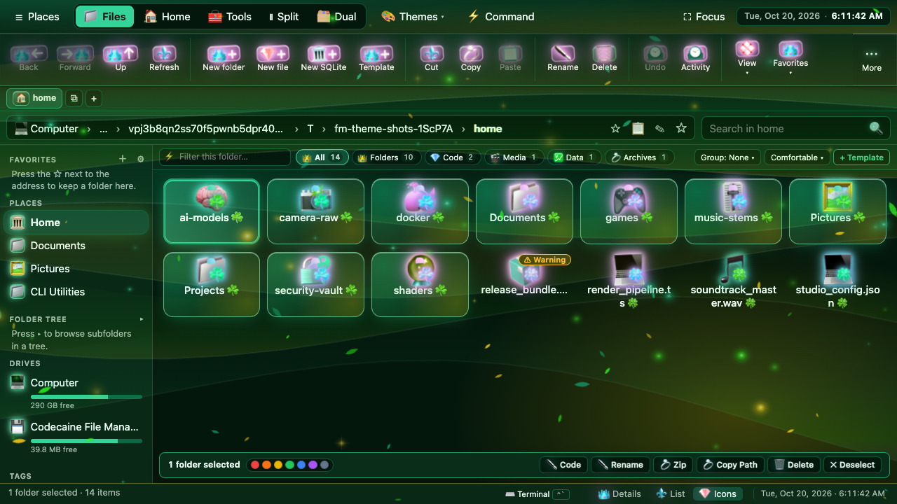

- **Folder Crest:** ☘️ · **File Badge:** 🍀 · **Celebration Particle Burst:** ☘️ 🍀 🪙 🌈 ✨

```text
CCFM-THEME-v1:eyJmb3JtYXQiOiJidW4tcmFkLXN0dWRpby1maWxlLW1hbmFnZXItdGhlbWUiLCJ2ZXJzaW9uIjoxLCJuYW1lIjoiU3QuIFBhdHJpY2sncyBDZWx0aWMgRW1lcmFsZCAmIEdvbGQgQ29pbiIsImRhcmsiOnRydWUsImJhc2UiOiJTdC4gUGF0cmljaydzIENlbHRpYyBFbWVyYWxkICYgR29sZCBDb2luIiwiY29sb3JzIjp7ImJhY2tncm91bmQiOiIjMDQxNzBjIiwidGV4dCI6IiNlY2ZkZjUiLCJhY2NlbnQiOiIjMzRkMzk5Iiwic2Vjb25kYXJ5IjoiI2ZhY2MxNSIsImNhcmQiOiIjMDkyYjE4IiwiYm9yZGVyIjoiIzEwYjk4MSIsImRhbmdlciI6IiNmODcxNzEiLCJ3YXJuaW5nIjoiI2ZiYmYyNCIsInN1Y2Nlc3MiOiIjNGFkZTgwIiwiaW5mbyI6IiMzOGJkZjgifSwiZngiOnsiZ2xvdyI6ImF1cm9yYSIsImdsb3dDb2xvciI6IiMxMGI5ODEiLCJnbG93Q29sb3IyIjoiI2ZhY2MxNSIsImJsdXIiOjI0LCJnbGFzcyI6MC42NCwiZ2xvd0ludGVuc2l0eSI6MC44OCwiYm9yZGVyT3BhY2l0eSI6MC4xNiwiZ3JhaW4iOiJub25lIiwic2NhbmxpbmVzIjoibm9uZSIsInJhZGl1cyI6InNxdWlyY2xlIiwiYm9yZGVyIjoiaXJpZGVzY2VudCIsIm1vdGlvbiI6InNwcmluZyIsInNoZWVuIjp0cnVlLCJub2lzZSI6ZmFsc2UsImNocm9tYXRpYyI6ZmFsc2UsImFtYmllbnQiOnRydWUsImF0bW9zcGhlcmUiOiJiaWZyb3N0K2ZpcmVmbGllcythdXR1bW5fbGVhdmVzIiwiYmFja2Ryb3BTdHlsZSI6ImxpcXVpZCIsImN1cnNvckVmZmVjdCI6InByaXNtIiwidmlnbmV0dGUiOiJhbWJpZW50Iiwic2F0dXJhdGlvbiI6MS44NSwidWlFbGVtZW50RngiOiJob2xpZGF5X2Zlc3RpdmVfZ2xvdyIsImljb25QYWNrU3R5bGUiOiJ1c19ob2xpZGF5c19mZXN0aXZlIiwiZm9udFByb2ZpbGUiOiJyb3VuZGVkIiwiY29ybmVyUHJvZmlsZSI6InJvdW5kZWQiLCJpY29uR2xvdyI6Im5lb24iLCJpY29uQW5pbWF0aW9uIjoiaG9sb19mb2lsX3NoaW1tZXIiLCJwcmlzbUVkZ2UiOnRydWUsImlubmVyR2xvdyI6dHJ1ZSwiZnJvc3RlZFJpbSI6dHJ1ZSwibmVvblB1bHNlIjp0cnVlfX0
```

#### 6. 🥚 Easter Sunday Fabergé & Pastel Meadow (`holiday_easter_pastel_egg_hunt`) — Easter Sunday (Spring)

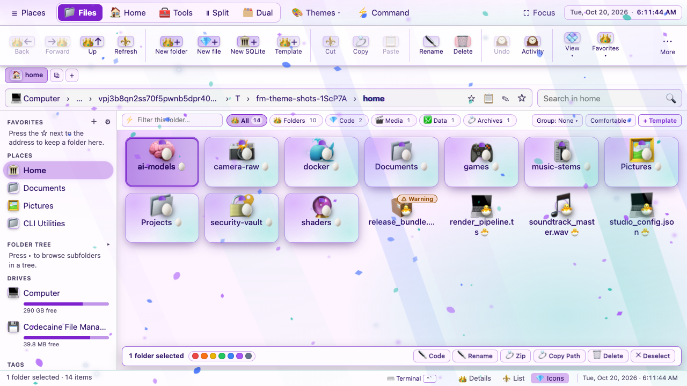

- **Folder Crest:** 🥚 · **File Badge:** 🐣 · **Celebration Particle Burst:** 🥚 🐣 🐰 🌷 🌸

```text
CCFM-THEME-v1:eyJmb3JtYXQiOiJidW4tcmFkLXN0dWRpby1maWxlLW1hbmFnZXItdGhlbWUiLCJ2ZXJzaW9uIjoxLCJuYW1lIjoiRWFzdGVyIFN1bmRheSBGYWJlcmfDqSAmIFBhc3RlbCBNZWFkb3ciLCJkYXJrIjpmYWxzZSwiYmFzZSI6IkVhc3RlciBTdW5kYXkgRmFiZXJnw6kgJiBQYXN0ZWwgTWVhZG93IiwiY29sb3JzIjp7ImJhY2tncm91bmQiOiIjZmRmNGZmIiwidGV4dCI6IiMyZTEwNjUiLCJhY2NlbnQiOiIjN2UyMmNlIiwic2Vjb25kYXJ5IjoiIzBmNzY2ZSIsImNhcmQiOiIjZmZmZmZmIiwiYm9yZGVyIjoiIzdlMjJjZSIsImRhbmdlciI6IiNkYzI2MjYiLCJ3YXJuaW5nIjoiI2Q5NzcwNiIsInN1Y2Nlc3MiOiIjMTZhMzRhIiwiaW5mbyI6IiMwMjg0YzcifSwiZngiOnsiZ2xvdyI6InNvZnQiLCJnbG93Q29sb3IiOiIjYTg1NWY3IiwiZ2xvd0NvbG9yMiI6IiMxNGI4YTYiLCJibHVyIjoyNCwiZ2xhc3MiOjAuNzQsImdsb3dJbnRlbnNpdHkiOjAuNTYsImJvcmRlck9wYWNpdHkiOjAuMTYsImdyYWluIjoibm9uZSIsInNjYW5saW5lcyI6Im5vbmUiLCJyYWRpdXMiOiJwaWxsIiwiYm9yZGVyIjoiZ3JhZGllbnQiLCJtb3Rpb24iOiJzcHJpbmciLCJzaGVlbiI6dHJ1ZSwibm9pc2UiOmZhbHNlLCJjaHJvbWF0aWMiOmZhbHNlLCJhbWJpZW50Ijp0cnVlLCJhdG1vc3BoZXJlIjoic2FrdXJhK2NvbmZldHRpX2xpdGUrc3VuYmVhbXMiLCJiYWNrZHJvcFN0eWxlIjoiYWNyeWxpYyIsImN1cnNvckVmZmVjdCI6InJpcHBsZSIsInZpZ25ldHRlIjoic3VidGxlIiwic2F0dXJhdGlvbiI6MS41NSwidWlFbGVtZW50RngiOiJob2xpZGF5X2Zlc3RpdmVfZ2xvdyIsImljb25QYWNrU3R5bGUiOiJ1c19ob2xpZGF5c19mZXN0aXZlIiwiZm9udFByb2ZpbGUiOiJyb3VuZGVkIiwiY29ybmVyUHJvZmlsZSI6InBpbGwiLCJpY29uR2xvdyI6InN1YnRsZSIsImljb25BbmltYXRpb24iOiJzcHJpbmdfcG9wXzNkIiwicHJpc21FZGdlIjp0cnVlLCJpbm5lckdsb3ciOnRydWUsImZyb3N0ZWRSaW0iOnRydWV9fQ
```

#### 7. 🌸 Mother's Day Peony Conservatory & Porcel (`holiday_mothers_day_botanical_tea`) — Mother's Day (May)

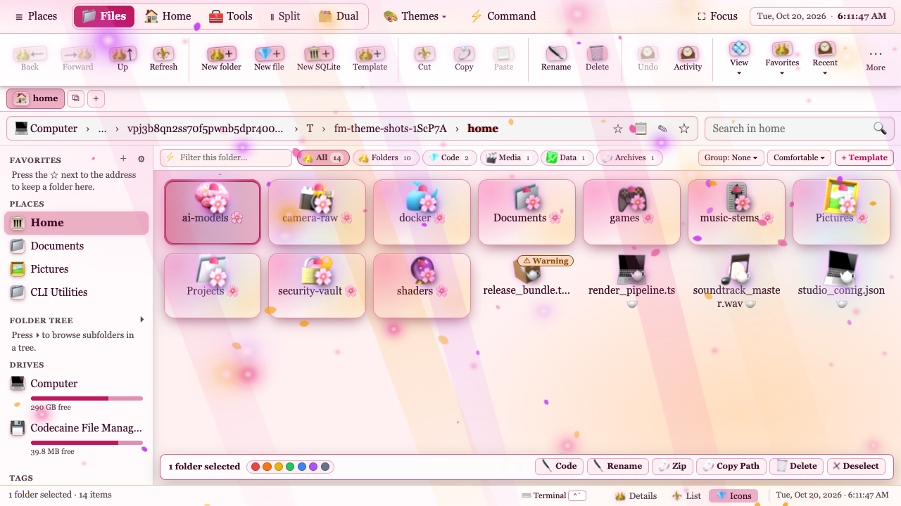

- **Folder Crest:** 🌸 · **File Badge:** 🫖 · **Celebration Particle Burst:** 🌸 🫖 💐 🌺 ✨

```text
CCFM-THEME-v1:eyJmb3JtYXQiOiJidW4tcmFkLXN0dWRpby1maWxlLW1hbmFnZXItdGhlbWUiLCJ2ZXJzaW9uIjoxLCJuYW1lIjoiTW90aGVyJ3MgRGF5IFBlb255IENvbnNlcnZhdG9yeSAmIFBvcmNlbCIsImRhcmsiOmZhbHNlLCJiYXNlIjoiTW90aGVyJ3MgRGF5IFBlb255IENvbnNlcnZhdG9yeSAmIFBvcmNlbCIsImNvbG9ycyI6eyJiYWNrZ3JvdW5kIjoiI2ZmZjFmMiIsInRleHQiOiIjM2IwNzI0IiwiYWNjZW50IjoiI2JlMTg1ZCIsInNlY29uZGFyeSI6IiNiNDUzMDkiLCJjYXJkIjoiI2ZmZmZmZiIsImJvcmRlciI6IiNiZTE4NWQiLCJkYW5nZXIiOiIjZGMyNjI2Iiwid2FybmluZyI6IiNkOTc3MDYiLCJzdWNjZXNzIjoiIzE2YTM0YSIsImluZm8iOiIjMDI4NGM3In0sImZ4Ijp7Imdsb3ciOiJzb2Z0IiwiZ2xvd0NvbG9yIjoiI2VjNDg5OSIsImdsb3dDb2xvcjIiOiIjZjU5ZTBiIiwiYmx1ciI6MjQsImdsYXNzIjowLjc1LCJnbG93SW50ZW5zaXR5IjowLjUyLCJib3JkZXJPcGFjaXR5IjowLjE2LCJncmFpbiI6Im5vbmUiLCJzY2FubGluZXMiOiJub25lIiwicmFkaXVzIjoicm91bmQiLCJib3JkZXIiOiJncmFkaWVudCIsIm1vdGlvbiI6ImNhbG0iLCJzaGVlbiI6dHJ1ZSwibm9pc2UiOmZhbHNlLCJjaHJvbWF0aWMiOmZhbHNlLCJhbWJpZW50Ijp0cnVlLCJhdG1vc3BoZXJlIjoic2FrdXJhK3N1bmJlYW1zK2NpbmVtYV9ib2tlaCIsImJhY2tkcm9wU3R5bGUiOiJhY3J5bGljIiwiY3Vyc29yRWZmZWN0IjoicmlwcGxlIiwidmlnbmV0dGUiOiJzdWJ0bGUiLCJzYXR1cmF0aW9uIjoxLjUsInVpRWxlbWVudEZ4IjoiaG9saWRheV9mZXN0aXZlX2dsb3ciLCJpY29uUGFja1N0eWxlIjoidXNfaG9saWRheXNfZmVzdGl2ZSIsImZvbnRQcm9maWxlIjoiZWRpdG9yaWFsIiwiY29ybmVyUHJvZmlsZSI6InJvdW5kZWQiLCJpY29uR2xvdyI6InN1YnRsZSIsImljb25BbmltYXRpb24iOiJibGVuZGVyX2dlb21ldHJ5X25vZGVzX2Jsb29tIiwicHJpc21FZGdlIjp0cnVlLCJpbm5lckdsb3ciOnRydWUsImZyb3N0ZWRSaW0iOnRydWV9fQ
```

#### 8. 🌺 Memorial Day Arlington Red Poppy & Taps (`holiday_memorial_day_poppy_honor`) — Memorial Day (May)


- **Folder Crest:** 🌺 · **File Badge:** 🎖️ · **Celebration Particle Burst:** 🌺 🎖️ 🦅 ⭐ 🕯️

```text
CCFM-THEME-v1:eyJmb3JtYXQiOiJidW4tcmFkLXN0dWRpby1maWxlLW1hbmFnZXItdGhlbWUiLCJ2ZXJzaW9uIjoxLCJuYW1lIjoiTWVtb3JpYWwgRGF5IEFybGluZ3RvbiBSZWQgUG9wcHkgJiBUYXBzIiwiZGFyayI6dHJ1ZSwiYmFzZSI6Ik1lbW9yaWFsIERheSBBcmxpbmd0b24gUmVkIFBvcHB5ICYgVGFwcyIsImNvbG9ycyI6eyJiYWNrZ3JvdW5kIjoiIzBiMGYxYSIsInRleHQiOiIjZjhmYWZjIiwiYWNjZW50IjoiI2Y4NzE3MSIsInNlY29uZGFyeSI6IiNmYmJmMjQiLCJjYXJkIjoiIzE2MWUzMSIsImJvcmRlciI6IiNlZjQ0NDQiLCJkYW5nZXIiOiIjZjg3MTcxIiwid2FybmluZyI6IiNmYmJmMjQiLCJzdWNjZXNzIjoiIzRhZGU4MCIsImluZm8iOiIjMzhiZGY4In0sImZ4Ijp7Imdsb3ciOiJzb2Z0IiwiZ2xvd0NvbG9yIjoiI2VmNDQ0NCIsImdsb3dDb2xvcjIiOiIjZmJiZjI0IiwiYmx1ciI6MjIsImdsYXNzIjowLjU4LCJnbG93SW50ZW5zaXR5IjowLjcyLCJib3JkZXJPcGFjaXR5IjowLjE2LCJncmFpbiI6InN1YnRsZSIsInNjYW5saW5lcyI6Im5vbmUiLCJyYWRpdXMiOiJzb2Z0IiwiYm9yZGVyIjoibWV0YWwiLCJtb3Rpb24iOiJjYWxtIiwic2hlZW4iOnRydWUsIm5vaXNlIjpmYWxzZSwiY2hyb21hdGljIjpmYWxzZSwiYW1iaWVudCI6dHJ1ZSwiYXRtb3NwaGVyZSI6InN1bmJlYW1zK3Nha3VyYStzdGFybGlnaHRfdmVsdmV0IiwiYmFja2Ryb3BTdHlsZSI6ImdsYXNzIiwiY3Vyc29yRWZmZWN0Ijoic3BvdGxpZ2h0IiwidmlnbmV0dGUiOiJjaW5lbWEiLCJzYXR1cmF0aW9uIjoxLjUsInVpRWxlbWVudEZ4IjoiaG9saWRheV9mZXN0aXZlX2dsb3ciLCJpY29uUGFja1N0eWxlIjoidXNfaG9saWRheXNfZmVzdGl2ZSIsImZvbnRQcm9maWxlIjoiZWRpdG9yaWFsIiwiY29ybmVyUHJvZmlsZSI6InJvdW5kZWQiLCJpY29uR2xvdyI6InN1YnRsZSIsImljb25BbmltYXRpb24iOiJvcmJpdGFsX2hhbG9fc3BpbiIsImlubmVyR2xvdyI6dHJ1ZSwiZnJvc3RlZFJpbSI6dHJ1ZX19
```

#### 9. 🌟 Juneteenth Freedom Starburst & Jubilee (`holiday_juneteenth_jubilee_star`) — Juneteenth (Jun 19)

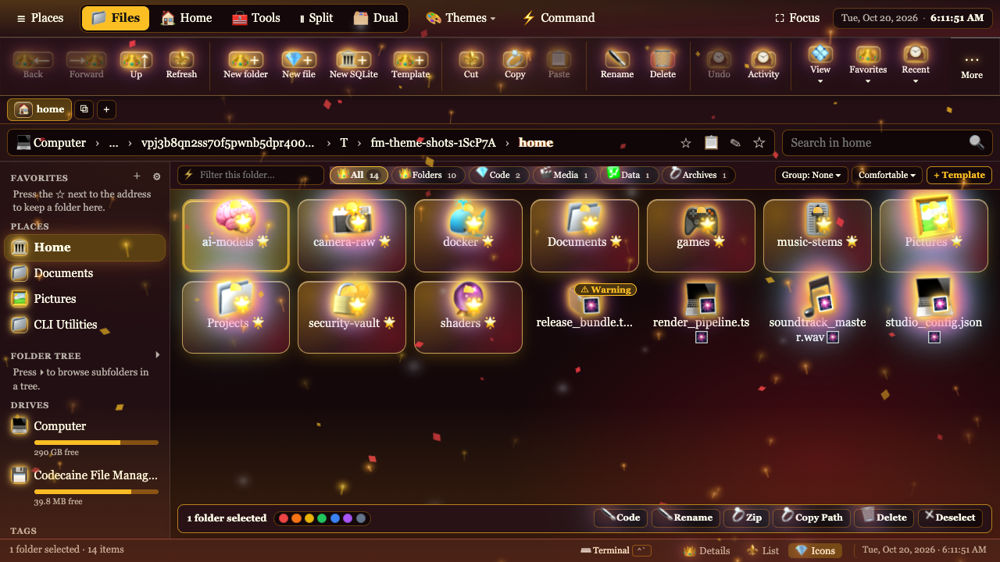

- **Folder Crest:** 🌟 · **File Badge:** 🎆 · **Celebration Particle Burst:** 🌟 🎆 ✨ ❤️ 💛 💚

```text
CCFM-THEME-v1:eyJmb3JtYXQiOiJidW4tcmFkLXN0dWRpby1maWxlLW1hbmFnZXItdGhlbWUiLCJ2ZXJzaW9uIjoxLCJuYW1lIjoiSnVuZXRlZW50aCBGcmVlZG9tIFN0YXJidXJzdCAmIEp1YmlsZWUiLCJkYXJrIjp0cnVlLCJiYXNlIjoiSnVuZXRlZW50aCBGcmVlZG9tIFN0YXJidXJzdCAmIEp1YmlsZWUiLCJjb2xvcnMiOnsiYmFja2dyb3VuZCI6IiMxNDA4MGEiLCJ0ZXh0IjoiI2ZlZmNlOCIsImFjY2VudCI6IiNmYmJmMjQiLCJzZWNvbmRhcnkiOiIjMjJjNTVlIiwiY2FyZCI6IiMyNjEwMTUiLCJib3JkZXIiOiIjZjU5ZTBiIiwiZGFuZ2VyIjoiI2Y4NzE3MSIsIndhcm5pbmciOiIjZmJiZjI0Iiwic3VjY2VzcyI6IiM0YWRlODAiLCJpbmZvIjoiIzM4YmRmOCJ9LCJmeCI6eyJnbG93IjoiYmxvb20iLCJnbG93Q29sb3IiOiIjZmJiZjI0IiwiZ2xvd0NvbG9yMiI6IiNlZjQ0NDQiLCJibHVyIjoyNCwiZ2xhc3MiOjAuNjIsImdsb3dJbnRlbnNpdHkiOjAuODgsImJvcmRlck9wYWNpdHkiOjAuMTYsImdyYWluIjoibm9uZSIsInNjYW5saW5lcyI6Im5vbmUiLCJyYWRpdXMiOiJzcXVpcmNsZSIsImJvcmRlciI6ImdyYWRpZW50IiwibW90aW9uIjoic3ByaW5nIiwic2hlZW4iOnRydWUsIm5vaXNlIjpmYWxzZSwiY2hyb21hdGljIjpmYWxzZSwiYW1iaWVudCI6dHJ1ZSwiYXRtb3NwaGVyZSI6ImZpcmV3b3JrX3NwYXJrcytjb25mZXR0aV9saXRlK2VtYmVycyIsImJhY2tkcm9wU3R5bGUiOiJnbGFzcyIsImN1cnNvckVmZmVjdCI6InByaXNtIiwidmlnbmV0dGUiOiJhbWJpZW50Iiwic2F0dXJhdGlvbiI6MS44NSwidWlFbGVtZW50RngiOiJob2xpZGF5X2Zlc3RpdmVfZ2xvdyIsImljb25QYWNrU3R5bGUiOiJ1c19ob2xpZGF5c19mZXN0aXZlIiwiZm9udFByb2ZpbGUiOiJlZGl0b3JpYWwiLCJjb3JuZXJQcm9maWxlIjoicm91bmRlZCIsImljb25HbG93IjoibmVvbiIsImljb25BbmltYXRpb24iOiJob3VkaW5pX3ZleF9wYXJ0aWNsZV9idXJzdCIsInByaXNtRWRnZSI6dHJ1ZSwiaW5uZXJHbG93Ijp0cnVlLCJmcm9zdGVkUmltIjp0cnVlLCJuZW9uUHVsc2UiOnRydWV9fQ
```

#### 10. ⌚ Father's Day Walnut Workshop & Chronogra (`holiday_fathers_day_leather_den`) — Father's Day (Jun)

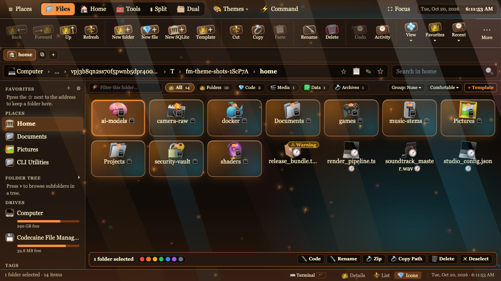

- **Folder Crest:** ⌚ · **File Badge:** 🧭 · **Celebration Particle Burst:** ⌚ 🧭 🥃 🪵 ⭐

```text
CCFM-THEME-v1:eyJmb3JtYXQiOiJidW4tcmFkLXN0dWRpby1maWxlLW1hbmFnZXItdGhlbWUiLCJ2ZXJzaW9uIjoxLCJuYW1lIjoiRmF0aGVyJ3MgRGF5IFdhbG51dCBXb3Jrc2hvcCAmIENocm9ub2dyYSIsImRhcmsiOnRydWUsImJhc2UiOiJGYXRoZXIncyBEYXkgV2FsbnV0IFdvcmtzaG9wICYgQ2hyb25vZ3JhIiwiY29sb3JzIjp7ImJhY2tncm91bmQiOiIjMTEwYzA4IiwidGV4dCI6IiNmZWYzYzciLCJhY2NlbnQiOiIjZmI5MjNjIiwic2Vjb25kYXJ5IjoiIzM4YmRmOCIsImNhcmQiOiIjMjExNzEwIiwiYm9yZGVyIjoiI2VhNTgwYyIsImRhbmdlciI6IiNmODcxNzEiLCJ3YXJuaW5nIjoiI2ZiYmYyNCIsInN1Y2Nlc3MiOiIjNGFkZTgwIiwiaW5mbyI6IiMzOGJkZjgifSwiZngiOnsiZ2xvdyI6ImVtYmVyIiwiZ2xvd0NvbG9yIjoiI2ZiOTIzYyIsImdsb3dDb2xvcjIiOiIjMzhiZGY4IiwiYmx1ciI6MjAsImdsYXNzIjowLjU0LCJnbG93SW50ZW5zaXR5IjowLjc1LCJib3JkZXJPcGFjaXR5IjowLjE2LCJncmFpbiI6InN1YnRsZSIsInNjYW5saW5lcyI6Im5vbmUiLCJyYWRpdXMiOiJzb2Z0IiwiYm9yZGVyIjoibWV0YWwiLCJtb3Rpb24iOiJjYWxtIiwic2hlZW4iOnRydWUsIm5vaXNlIjpmYWxzZSwiY2hyb21hdGljIjpmYWxzZSwiYW1iaWVudCI6dHJ1ZSwiYXRtb3NwaGVyZSI6ImR1c3RfbW90ZXMrc3VuYmVhbXMrZW1iZXJzIiwiYmFja2Ryb3BTdHlsZSI6Im1hdHRlIiwiY3Vyc29yRWZmZWN0Ijoic3BvdGxpZ2h0IiwidmlnbmV0dGUiOiJjaW5lbWEiLCJzYXR1cmF0aW9uIjoxLjUsInVpRWxlbWVudEZ4IjoiaG9saWRheV9mZXN0aXZlX2dsb3ciLCJpY29uUGFja1N0eWxlIjoidXNfaG9saWRheXNfZmVzdGl2ZSIsImZvbnRQcm9maWxlIjoiZWRpdG9yaWFsIiwiY29ybmVyUHJvZmlsZSI6InJvdW5kZWQiLCJpY29uR2xvdyI6InN1YnRsZSIsImljb25BbmltYXRpb24iOiJjbG9ja3dvcmtfZ2Vhcl90aWNrIiwiaW5uZXJHbG93Ijp0cnVlLCJmcm9zdGVkUmltIjp0cnVlfX0
```

#### 11. 🎆 4th of July Independence Sky Fireworks (`holiday_fourth_of_july_fireworks`) — Independence Day (Jul 4)

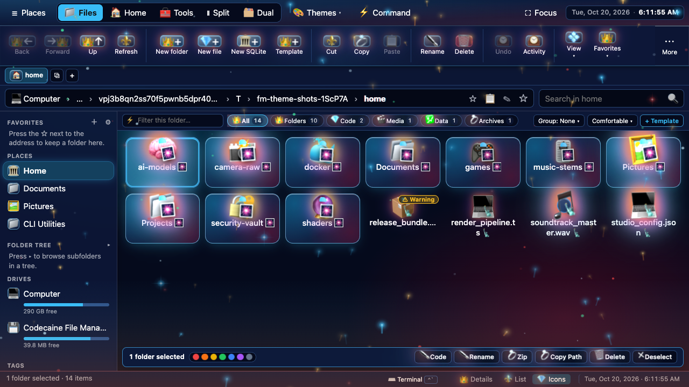

- **Folder Crest:** 🎆 · **File Badge:** 🗽 · **Celebration Particle Burst:** 🎆 🎇 🗽 🦅 ⭐

```text
CCFM-THEME-v1:eyJmb3JtYXQiOiJidW4tcmFkLXN0dWRpby1maWxlLW1hbmFnZXItdGhlbWUiLCJ2ZXJzaW9uIjoxLCJuYW1lIjoiNHRoIG9mIEp1bHkgSW5kZXBlbmRlbmNlIFNreSBGaXJld29ya3MiLCJkYXJrIjp0cnVlLCJiYXNlIjoiNHRoIG9mIEp1bHkgSW5kZXBlbmRlbmNlIFNreSBGaXJld29ya3MiLCJjb2xvcnMiOnsiYmFja2dyb3VuZCI6IiMwNTBhMWMiLCJ0ZXh0IjoiI2ZmZmZmZiIsImFjY2VudCI6IiMzOGJkZjgiLCJzZWNvbmRhcnkiOiIjZjg3MTcxIiwiY2FyZCI6IiMwZDE4MzgiLCJib3JkZXIiOiIjNjBhNWZhIiwiZGFuZ2VyIjoiI2Y4NzE3MSIsIndhcm5pbmciOiIjZmJiZjI0Iiwic3VjY2VzcyI6IiM0YWRlODAiLCJpbmZvIjoiIzM4YmRmOCJ9LCJmeCI6eyJnbG93IjoicGxhc21hIiwiZ2xvd0NvbG9yIjoiIzM4YmRmOCIsImdsb3dDb2xvcjIiOiIjZWY0NDQ0IiwiYmx1ciI6MjQsImdsYXNzIjowLjY0LCJnbG93SW50ZW5zaXR5IjowLjk0LCJib3JkZXJPcGFjaXR5IjowLjE2LCJncmFpbiI6Im5vbmUiLCJzY2FubGluZXMiOiJub25lIiwicmFkaXVzIjoic3F1aXJjbGUiLCJib3JkZXIiOiJpcmlkZXNjZW50IiwibW90aW9uIjoic25hcHB5Iiwic2hlZW4iOnRydWUsIm5vaXNlIjpmYWxzZSwiY2hyb21hdGljIjp0cnVlLCJhbWJpZW50Ijp0cnVlLCJhdG1vc3BoZXJlIjoiZmlyZXdvcmtfc3BhcmtzK2VtYmVycytzdGFycyIsImJhY2tkcm9wU3R5bGUiOiJnbGFzcyIsImN1cnNvckVmZmVjdCI6InByaXNtIiwidmlnbmV0dGUiOiJjaW5lbWEiLCJzYXR1cmF0aW9uIjoxLjk1LCJ1aUVsZW1lbnRGeCI6ImhvbGlkYXlfZmVzdGl2ZV9nbG93IiwiaWNvblBhY2tTdHlsZSI6InVzX2hvbGlkYXlzX2Zlc3RpdmUiLCJmb250UHJvZmlsZSI6InJvdW5kZWQiLCJjb3JuZXJQcm9maWxlIjoicm91bmRlZCIsImljb25HbG93IjoiaHlwZXIiLCJpY29uQW5pbWF0aW9uIjoiaG91ZGluaV92ZXhfcGFydGljbGVfYnVyc3QiLCJwcmlzbUVkZ2UiOnRydWUsImlubmVyR2xvdyI6dHJ1ZSwiZnJvc3RlZFJpbSI6dHJ1ZSwibmVvblB1bHNlIjp0cnVlLCJwYXJhbGxheCI6dHJ1ZX19
```

#### 12. ⚒️ Labor Day Steelworker Forge & Rivet (`holiday_labor_day_rivet_forge`) — Labor Day (Sep)

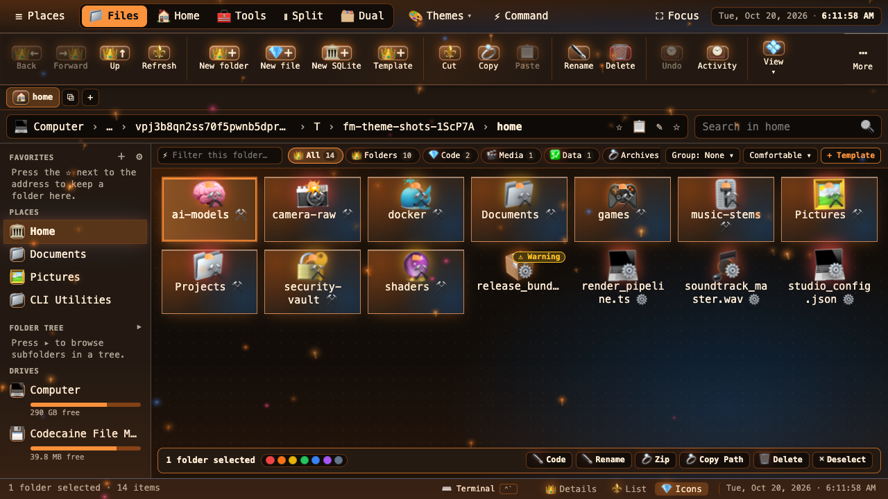

- **Folder Crest:** ⚒️ · **File Badge:** ⚙️ · **Celebration Particle Burst:** ⚒️ ⚙️ 🔥 🏗️ ⭐

```text
CCFM-THEME-v1:eyJmb3JtYXQiOiJidW4tcmFkLXN0dWRpby1maWxlLW1hbmFnZXItdGhlbWUiLCJ2ZXJzaW9uIjoxLCJuYW1lIjoiTGFib3IgRGF5IFN0ZWVsd29ya2VyIEZvcmdlICYgUml2ZXQiLCJkYXJrIjp0cnVlLCJiYXNlIjoiTGFib3IgRGF5IFN0ZWVsd29ya2VyIEZvcmdlICYgUml2ZXQiLCJjb2xvcnMiOnsiYmFja2dyb3VuZCI6IiMxMjBkMDkiLCJ0ZXh0IjoiI2ZmZWRkNSIsImFjY2VudCI6IiNmYjkyM2MiLCJzZWNvbmRhcnkiOiIjNjBhNWZhIiwiY2FyZCI6IiMyMzE5MTIiLCJib3JkZXIiOiIjZjk3MzE2IiwiZGFuZ2VyIjoiI2Y4NzE3MSIsIndhcm5pbmciOiIjZmJiZjI0Iiwic3VjY2VzcyI6IiM0YWRlODAiLCJpbmZvIjoiIzM4YmRmOCJ9LCJmeCI6eyJnbG93IjoiZW1iZXIiLCJnbG93Q29sb3IiOiIjZjk3MzE2IiwiZ2xvd0NvbG9yMiI6IiMzYjgyZjYiLCJibHVyIjoxOCwiZ2xhc3MiOjAuNTIsImdsb3dJbnRlbnNpdHkiOjAuODIsImJvcmRlck9wYWNpdHkiOjAuMTYsImdyYWluIjoiZmlsbSIsInNjYW5saW5lcyI6Im5vbmUiLCJyYWRpdXMiOiJzaGFycCIsImJvcmRlciI6Im1ldGFsIiwibW90aW9uIjoic25hcHB5Iiwic2hlZW4iOnRydWUsIm5vaXNlIjpmYWxzZSwiY2hyb21hdGljIjpmYWxzZSwiYW1iaWVudCI6dHJ1ZSwiYXRtb3NwaGVyZSI6ImVtYmVycytkdXN0X21vdGVzIiwiYmFja2Ryb3BTdHlsZSI6Im1hdHRlIiwiY3Vyc29yRWZmZWN0Ijoic3BvdGxpZ2h0IiwidmlnbmV0dGUiOiJjaW5lbWEiLCJzYXR1cmF0aW9uIjoxLjYsInVpRWxlbWVudEZ4IjoiaG9saWRheV9mZXN0aXZlX2dsb3ciLCJpY29uUGFja1N0eWxlIjoidXNfaG9saWRheXNfZmVzdGl2ZSIsImZvbnRQcm9maWxlIjoidGVybWluYWwiLCJjb3JuZXJQcm9maWxlIjoic2hhcnAiLCJpY29uR2xvdyI6InN1YnRsZSIsImljb25BbmltYXRpb24iOiJmaXJlX2VtYmVyX2ZsaWNrZXIiLCJpbm5lckdsb3ciOnRydWUsImZyb3N0ZWRSaW0iOnRydWV9fQ
```

#### 13. 🎃 Halloween Carved Jack-O'-Lantern & Witch (`holiday_halloween_jack_o_lantern`) — Halloween (Oct 31)


- **Folder Crest:** 🎃 · **File Badge:** 🦇 · **Celebration Particle Burst:** 🎃 🦇 👻 🕯️ 🕸️

```text
CCFM-THEME-v1:eyJmb3JtYXQiOiJidW4tcmFkLXN0dWRpby1maWxlLW1hbmFnZXItdGhlbWUiLCJ2ZXJzaW9uIjoxLCJuYW1lIjoiSGFsbG93ZWVuIENhcnZlZCBKYWNrLU8nLUxhbnRlcm4gJiBXaXRjaCIsImRhcmsiOnRydWUsImJhc2UiOiJIYWxsb3dlZW4gQ2FydmVkIEphY2stTyctTGFudGVybiAmIFdpdGNoIiwiY29sb3JzIjp7ImJhY2tncm91bmQiOiIjMGIwNTEyIiwidGV4dCI6IiNmZmVkZDUiLCJhY2NlbnQiOiIjZmY3YjAwIiwic2Vjb25kYXJ5IjoiI2MwODRmYyIsImNhcmQiOiIjMTkwYjI4IiwiYm9yZGVyIjoiI2Y5NzMxNiIsImRhbmdlciI6IiNmODcxNzEiLCJ3YXJuaW5nIjoiI2ZiYmYyNCIsInN1Y2Nlc3MiOiIjNGFkZTgwIiwiaW5mbyI6IiMzOGJkZjgifSwiZngiOnsiZ2xvdyI6ImVtYmVyIiwiZ2xvd0NvbG9yIjoiI2ZmN2IwMCIsImdsb3dDb2xvcjIiOiIjYTg1NWY3IiwiYmx1ciI6MjQsImdsYXNzIjowLjYyLCJnbG93SW50ZW5zaXR5IjowLjkyLCJib3JkZXJPcGFjaXR5IjowLjE2LCJncmFpbiI6ImZpbG0iLCJzY2FubGluZXMiOiJub25lIiwicmFkaXVzIjoic3F1aXJjbGUiLCJib3JkZXIiOiJuZW9uIiwibW90aW9uIjoiZWxhc3RpYyIsInNoZWVuIjp0cnVlLCJub2lzZSI6ZmFsc2UsImNocm9tYXRpYyI6dHJ1ZSwiYW1iaWVudCI6dHJ1ZSwiYXRtb3NwaGVyZSI6ImF1dHVtbl9sZWF2ZXMrZW1iZXJzK2ZpcmVmbGllcyIsImJhY2tkcm9wU3R5bGUiOiJnbGFzcyIsImN1cnNvckVmZmVjdCI6Im1hZ25ldGljIiwidmlnbmV0dGUiOiJjaW5lbWEiLCJzYXR1cmF0aW9uIjoxLjksInVpRWxlbWVudEZ4IjoiaG9saWRheV9mZXN0aXZlX2dsb3ciLCJpY29uUGFja1N0eWxlIjoidXNfaG9saWRheXNfZmVzdGl2ZSIsImZvbnRQcm9maWxlIjoiZWRpdG9yaWFsIiwiY29ybmVyUHJvZmlsZSI6InJvdW5kZWQiLCJpY29uR2xvdyI6Imh5cGVyIiwiaWNvbkFuaW1hdGlvbiI6ImplbGx5X3NxdWlzaF8zZCIsInByaXNtRWRnZSI6dHJ1ZSwiaW5uZXJHbG93Ijp0cnVlLCJmcm9zdGVkUmltIjp0cnVlLCJuZW9uUHVsc2UiOnRydWUsInBhcmFsbGF4Ijp0cnVlfX0
```

#### 14. 🌼 Día de los Muertos Cempasúchil Ofrenda (`holiday_dia_de_los_muertos_marigold`) — Día de los Muertos (Nov 1–2)


- **Folder Crest:** 🌼 · **File Badge:** 💀 · **Celebration Particle Burst:** 🌼 💀 🕯️ 🦋 🌺

```text
CCFM-THEME-v1:eyJmb3JtYXQiOiJidW4tcmFkLXN0dWRpby1maWxlLW1hbmFnZXItdGhlbWUiLCJ2ZXJzaW9uIjoxLCJuYW1lIjoiRMOtYSBkZSBsb3MgTXVlcnRvcyBDZW1wYXPDumNoaWwgT2ZyZW5kYSIsImRhcmsiOnRydWUsImJhc2UiOiJEw61hIGRlIGxvcyBNdWVydG9zIENlbXBhc8O6Y2hpbCBPZnJlbmRhIiwiY29sb3JzIjp7ImJhY2tncm91bmQiOiIjMTIwNDFjIiwidGV4dCI6IiNmZWY5YzMiLCJhY2NlbnQiOiIjZmY5ZTAwIiwic2Vjb25kYXJ5IjoiI2VjNDg5OSIsImNhcmQiOiIjMjIwOTMzIiwiYm9yZGVyIjoiI2Y1OWUwYiIsImRhbmdlciI6IiNmODcxNzEiLCJ3YXJuaW5nIjoiI2ZiYmYyNCIsInN1Y2Nlc3MiOiIjNGFkZTgwIiwiaW5mbyI6IiMzOGJkZjgifSwiZngiOnsiZ2xvdyI6ImJsb29tIiwiZ2xvd0NvbG9yIjoiI2ZmOWUwMCIsImdsb3dDb2xvcjIiOiIjZWM0ODk5IiwiYmx1ciI6MjYsImdsYXNzIjowLjY0LCJnbG93SW50ZW5zaXR5IjowLjksImJvcmRlck9wYWNpdHkiOjAuMTYsImdyYWluIjoibm9uZSIsInNjYW5saW5lcyI6Im5vbmUiLCJyYWRpdXMiOiJyb3VuZCIsImJvcmRlciI6ImlyaWRlc2NlbnQiLCJtb3Rpb24iOiJzcHJpbmciLCJzaGVlbiI6dHJ1ZSwibm9pc2UiOmZhbHNlLCJjaHJvbWF0aWMiOnRydWUsImFtYmllbnQiOnRydWUsImF0bW9zcGhlcmUiOiJhdXR1bW5fbGVhdmVzK2VtYmVycytjaW5lbWFfYm9rZWgiLCJiYWNrZHJvcFN0eWxlIjoiZ2xhc3MiLCJjdXJzb3JFZmZlY3QiOiJwcmlzbSIsInZpZ25ldHRlIjoiYW1iaWVudCIsInNhdHVyYXRpb24iOjEuOTUsInVpRWxlbWVudEZ4IjoiaG9saWRheV9mZXN0aXZlX2dsb3ciLCJpY29uUGFja1N0eWxlIjoidXNfaG9saWRheXNfZmVzdGl2ZSIsImZvbnRQcm9maWxlIjoiZWRpdG9yaWFsIiwiY29ybmVyUHJvZmlsZSI6InJvdW5kZWQiLCJpY29uR2xvdyI6Imh5cGVyIiwiaWNvbkFuaW1hdGlvbiI6ImJsZW5kZXJfZ2VvbWV0cnlfbm9kZXNfYmxvb20iLCJwcmlzbUVkZ2UiOnRydWUsImlubmVyR2xvdyI6dHJ1ZSwiZnJvc3RlZFJpbSI6dHJ1ZSwibmVvblB1bHNlIjp0cnVlfX0
```

#### 15. 🎖️ Veterans Day Bronze Star & Dress Blue (`holiday_veterans_day_valor_medallion`) — Veterans Day (Nov 11)

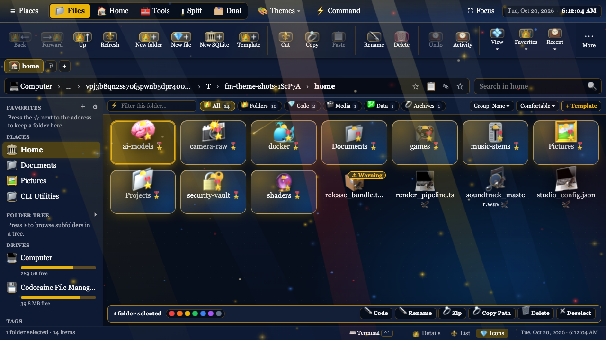

- **Folder Crest:** 🎖️ · **File Badge:** 🦅 · **Celebration Particle Burst:** 🎖️ 🦅 ⭐ 🛡️ 🕯️

```text
CCFM-THEME-v1:eyJmb3JtYXQiOiJidW4tcmFkLXN0dWRpby1maWxlLW1hbmFnZXItdGhlbWUiLCJ2ZXJzaW9uIjoxLCJuYW1lIjoiVmV0ZXJhbnMgRGF5IEJyb256ZSBTdGFyICYgRHJlc3MgQmx1ZSIsImRhcmsiOnRydWUsImJhc2UiOiJWZXRlcmFucyBEYXkgQnJvbnplIFN0YXIgJiBEcmVzcyBCbHVlIiwiY29sb3JzIjp7ImJhY2tncm91bmQiOiIjMDcwZTFjIiwidGV4dCI6IiNmOGZhZmMiLCJhY2NlbnQiOiIjZWFiMzA4Iiwic2Vjb25kYXJ5IjoiIzYwYTVmYSIsImNhcmQiOiIjMTAxZDM4IiwiYm9yZGVyIjoiI2NhOGEwNCIsImRhbmdlciI6IiNmODcxNzEiLCJ3YXJuaW5nIjoiI2ZiYmYyNCIsInN1Y2Nlc3MiOiIjNGFkZTgwIiwiaW5mbyI6IiMzOGJkZjgifSwiZngiOnsiZ2xvdyI6InNvZnQiLCJnbG93Q29sb3IiOiIjZWFiMzA4IiwiZ2xvd0NvbG9yMiI6IiMzYjgyZjYiLCJibHVyIjoyMCwiZ2xhc3MiOjAuNTYsImdsb3dJbnRlbnNpdHkiOjAuNzQsImJvcmRlck9wYWNpdHkiOjAuMTYsImdyYWluIjoic3VidGxlIiwic2NhbmxpbmVzIjoibm9uZSIsInJhZGl1cyI6InNvZnQiLCJib3JkZXIiOiJtZXRhbCIsIm1vdGlvbiI6ImNhbG0iLCJzaGVlbiI6dHJ1ZSwibm9pc2UiOmZhbHNlLCJjaHJvbWF0aWMiOmZhbHNlLCJhbWJpZW50Ijp0cnVlLCJhdG1vc3BoZXJlIjoic3VuYmVhbXMrc3RhcmxpZ2h0X3ZlbHZldCtkdXN0X21vdGVzIiwiYmFja2Ryb3BTdHlsZSI6ImdsYXNzIiwiY3Vyc29yRWZmZWN0Ijoic3BvdGxpZ2h0IiwidmlnbmV0dGUiOiJjaW5lbWEiLCJzYXR1cmF0aW9uIjoxLjUsInVpRWxlbWVudEZ4IjoiaG9saWRheV9mZXN0aXZlX2dsb3ciLCJpY29uUGFja1N0eWxlIjoidXNfaG9saWRheXNfZmVzdGl2ZSIsImZvbnRQcm9maWxlIjoiZWRpdG9yaWFsIiwiY29ybmVyUHJvZmlsZSI6InJvdW5kZWQiLCJpY29uR2xvdyI6InN1YnRsZSIsImljb25BbmltYXRpb24iOiJjNGRfbW9ncmFwaF9jbG9uZXJfd2F2ZSIsImlubmVyR2xvdyI6dHJ1ZSwiZnJvc3RlZFJpbSI6dHJ1ZX19
```

#### 16. 🦃 Thanksgiving New England Harvest Hearth (`holiday_thanksgiving_harvest_hearth`) — Thanksgiving (Nov)

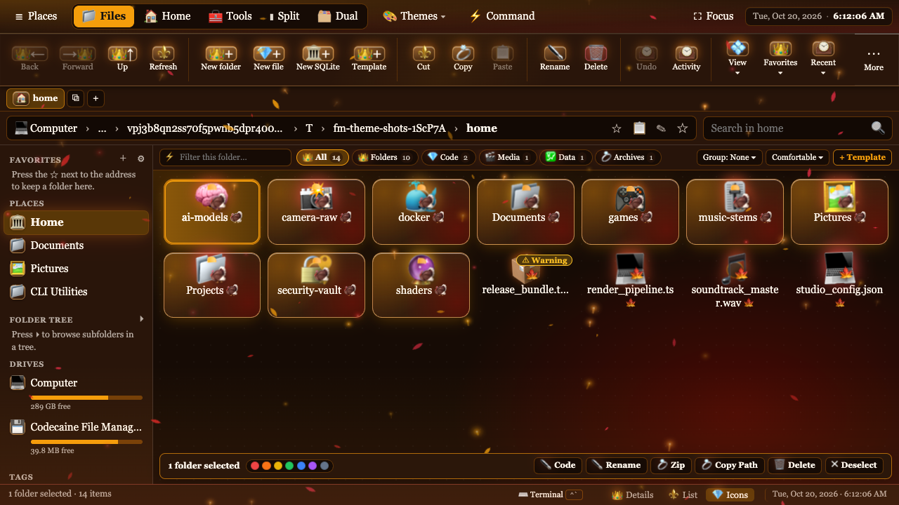

- **Folder Crest:** 🦃 · **File Badge:** 🍁 · **Celebration Particle Burst:** 🦃 🍁 🥧 🍂 🌽

```text
CCFM-THEME-v1:eyJmb3JtYXQiOiJidW4tcmFkLXN0dWRpby1maWxlLW1hbmFnZXItdGhlbWUiLCJ2ZXJzaW9uIjoxLCJuYW1lIjoiVGhhbmtzZ2l2aW5nIE5ldyBFbmdsYW5kIEhhcnZlc3QgSGVhcnRoIiwiZGFyayI6dHJ1ZSwiYmFzZSI6IlRoYW5rc2dpdmluZyBOZXcgRW5nbGFuZCBIYXJ2ZXN0IEhlYXJ0aCIsImNvbG9ycyI6eyJiYWNrZ3JvdW5kIjoiIzE2MGIwNSIsInRleHQiOiIjZmZmN2VkIiwiYWNjZW50IjoiI2Y1OWUwYiIsInNlY29uZGFyeSI6IiNmODcxNzEiLCJjYXJkIjoiIzI5MTUwYSIsImJvcmRlciI6IiNkOTc3MDYiLCJkYW5nZXIiOiIjZjg3MTcxIiwid2FybmluZyI6IiNmYmJmMjQiLCJzdWNjZXNzIjoiIzRhZGU4MCIsImluZm8iOiIjMzhiZGY4In0sImZ4Ijp7Imdsb3ciOiJlbWJlciIsImdsb3dDb2xvciI6IiNmNTllMGIiLCJnbG93Q29sb3IyIjoiI2RjMjYyNiIsImJsdXIiOjIyLCJnbGFzcyI6MC41OCwiZ2xvd0ludGVuc2l0eSI6MC44NCwiYm9yZGVyT3BhY2l0eSI6MC4xNiwiZ3JhaW4iOiJzdWJ0bGUiLCJzY2FubGluZXMiOiJub25lIiwicmFkaXVzIjoic29mdCIsImJvcmRlciI6ImdyYWRpZW50IiwibW90aW9uIjoiY2FsbSIsInNoZWVuIjp0cnVlLCJub2lzZSI6ZmFsc2UsImNocm9tYXRpYyI6ZmFsc2UsImFtYmllbnQiOnRydWUsImF0bW9zcGhlcmUiOiJhdXR1bW5fbGVhdmVzK2VtYmVycytkdXN0X21vdGVzIiwiYmFja2Ryb3BTdHlsZSI6Im1hdHRlIiwiY3Vyc29yRWZmZWN0Ijoic3BvdGxpZ2h0IiwidmlnbmV0dGUiOiJjaW5lbWEiLCJzYXR1cmF0aW9uIjoxLjY1LCJ1aUVsZW1lbnRGeCI6ImhvbGlkYXlfZmVzdGl2ZV9nbG93IiwiaWNvblBhY2tTdHlsZSI6InVzX2hvbGlkYXlzX2Zlc3RpdmUiLCJmb250UHJvZmlsZSI6ImVkaXRvcmlhbCIsImNvcm5lclByb2ZpbGUiOiJyb3VuZGVkIiwiaWNvbkdsb3ciOiJzdWJ0bGUiLCJpY29uQW5pbWF0aW9uIjoiZmlyZV9lbWJlcl9mbGlja2VyIiwiaW5uZXJHbG93Ijp0cnVlLCJmcm9zdGVkUmltIjp0cnVlfX0
```

#### 17. 🕎 Hanukkah Silver Menorah & Dreidel Sapphi (`holiday_hanukkah_menorah_sapphire`) — Hanukkah (Dec)

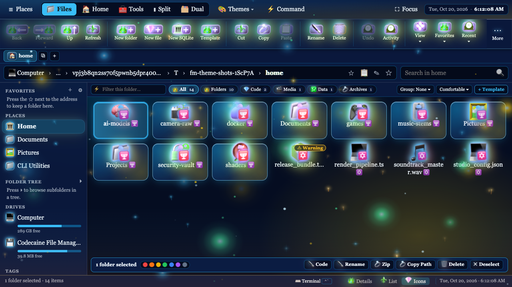

- **Folder Crest:** 🕎 · **File Badge:** ✡️ · **Celebration Particle Burst:** 🕎 ✡️ ✨ 🪙 💙

```text
CCFM-THEME-v1:eyJmb3JtYXQiOiJidW4tcmFkLXN0dWRpby1maWxlLW1hbmFnZXItdGhlbWUiLCJ2ZXJzaW9uIjoxLCJuYW1lIjoiSGFudWtrYWggU2lsdmVyIE1lbm9yYWggJiBEcmVpZGVsIFNhcHBoaSIsImRhcmsiOnRydWUsImJhc2UiOiJIYW51a2thaCBTaWx2ZXIgTWVub3JhaCAmIERyZWlkZWwgU2FwcGhpIiwiY29sb3JzIjp7ImJhY2tncm91bmQiOiIjMDUwZDIxIiwidGV4dCI6IiNmMGY5ZmYiLCJhY2NlbnQiOiIjMzhiZGY4Iiwic2Vjb25kYXJ5IjoiI2ZhY2MxNSIsImNhcmQiOiIjMGIxYTQwIiwiYm9yZGVyIjoiIzBlYTVlOSIsImRhbmdlciI6IiNmODcxNzEiLCJ3YXJuaW5nIjoiI2ZiYmYyNCIsInN1Y2Nlc3MiOiIjNGFkZTgwIiwiaW5mbyI6IiMzOGJkZjgifSwiZngiOnsiZ2xvdyI6ImJsb29tIiwiZ2xvd0NvbG9yIjoiIzM4YmRmOCIsImdsb3dDb2xvcjIiOiIjZmFjYzE1IiwiYmx1ciI6MjYsImdsYXNzIjowLjY2LCJnbG93SW50ZW5zaXR5IjowLjg4LCJib3JkZXJPcGFjaXR5IjowLjE2LCJncmFpbiI6Im5vbmUiLCJzY2FubGluZXMiOiJub25lIiwicmFkaXVzIjoic3F1aXJjbGUiLCJib3JkZXIiOiJncmFkaWVudCIsIm1vdGlvbiI6InNwcmluZyIsInNoZWVuIjp0cnVlLCJub2lzZSI6ZmFsc2UsImNocm9tYXRpYyI6ZmFsc2UsImFtYmllbnQiOnRydWUsImF0bW9zcGhlcmUiOiJzdGFybGlnaHRfdmVsdmV0K2VtYmVycytjaW5lbWFfYm9rZWgiLCJiYWNrZHJvcFN0eWxlIjoiZ2xhc3MiLCJjdXJzb3JFZmZlY3QiOiJwcmlzbSIsInZpZ25ldHRlIjoiYW1iaWVudCIsInNhdHVyYXRpb24iOjEuNzUsInVpRWxlbWVudEZ4IjoiaG9saWRheV9mZXN0aXZlX2dsb3ciLCJpY29uUGFja1N0eWxlIjoidXNfaG9saWRheXNfZmVzdGl2ZSIsImZvbnRQcm9maWxlIjoiZWRpdG9yaWFsIiwiY29ybmVyUHJvZmlsZSI6InJvdW5kZWQiLCJpY29uR2xvdyI6Im5lb24iLCJpY29uQW5pbWF0aW9uIjoicmF5dHJhY2VkX2NhdXN0aWNfcmVmcmFjdGlvbiIsInByaXNtRWRnZSI6dHJ1ZSwiaW5uZXJHbG93Ijp0cnVlLCJmcm9zdGVkUmltIjp0cnVlLCJuZW9uUHVsc2UiOnRydWV9fQ
```

#### 18. 🎄 Christmas Eve Nutcracker Pine & Evergree (`holiday_christmas_nutcracker_hearth`) — Christmas Day (Dec 25)

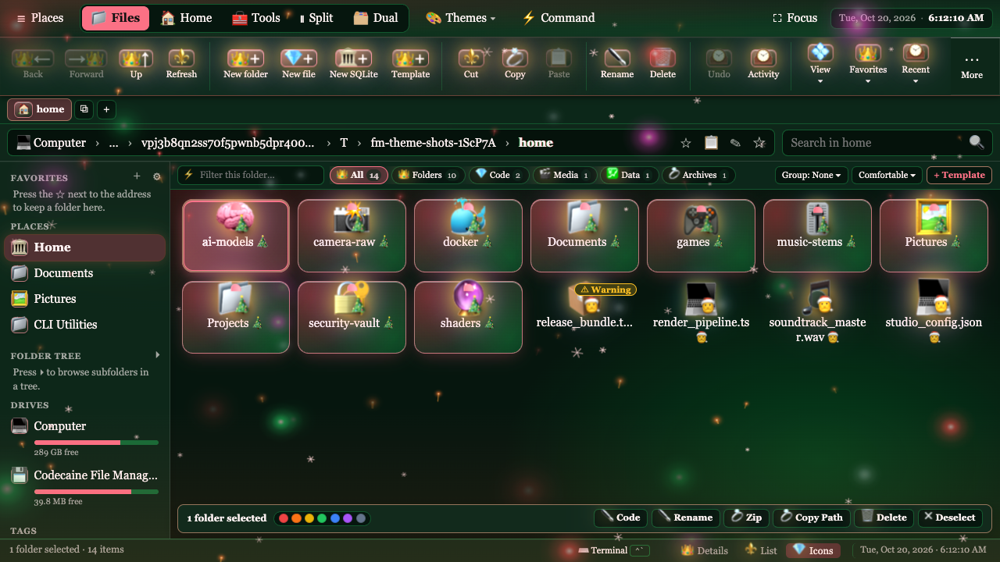

- **Folder Crest:** 🎄 · **File Badge:** 🎅 · **Celebration Particle Burst:** 🎄 🎅 ❄️ 🎁 ⭐

```text
CCFM-THEME-v1:eyJmb3JtYXQiOiJidW4tcmFkLXN0dWRpby1maWxlLW1hbmFnZXItdGhlbWUiLCJ2ZXJzaW9uIjoxLCJuYW1lIjoiQ2hyaXN0bWFzIEV2ZSBOdXRjcmFja2VyIFBpbmUgJiBFdmVyZ3JlZSIsImRhcmsiOnRydWUsImJhc2UiOiJDaHJpc3RtYXMgRXZlIE51dGNyYWNrZXIgUGluZSAmIEV2ZXJncmVlIiwiY29sb3JzIjp7ImJhY2tncm91bmQiOiIjMDYxNjBlIiwidGV4dCI6IiNmZWYyZjIiLCJhY2NlbnQiOiIjZmI3MTg1Iiwic2Vjb25kYXJ5IjoiI2ZhY2MxNSIsImNhcmQiOiIjMGQyOTFiIiwiYm9yZGVyIjoiIzIyYzU1ZSIsImRhbmdlciI6IiNmODcxNzEiLCJ3YXJuaW5nIjoiI2ZiYmYyNCIsInN1Y2Nlc3MiOiIjNGFkZTgwIiwiaW5mbyI6IiMzOGJkZjgifSwiZngiOnsiZ2xvdyI6ImJsb29tIiwiZ2xvd0NvbG9yIjoiI2VmNDQ0NCIsImdsb3dDb2xvcjIiOiIjMjJjNTVlIiwiYmx1ciI6MjYsImdsYXNzIjowLjY2LCJnbG93SW50ZW5zaXR5IjowLjksImJvcmRlck9wYWNpdHkiOjAuMTYsImdyYWluIjoibm9uZSIsInNjYW5saW5lcyI6Im5vbmUiLCJyYWRpdXMiOiJzcXVpcmNsZSIsImJvcmRlciI6ImdyYWRpZW50IiwibW90aW9uIjoic3ByaW5nIiwic2hlZW4iOnRydWUsIm5vaXNlIjpmYWxzZSwiY2hyb21hdGljIjpmYWxzZSwiYW1iaWVudCI6dHJ1ZSwiYXRtb3NwaGVyZSI6InNub3crY2luZW1hX2Jva2VoK2VtYmVycyIsImJhY2tkcm9wU3R5bGUiOiJnbGFzcyIsImN1cnNvckVmZmVjdCI6InByaXNtIiwidmlnbmV0dGUiOiJjaW5lbWEiLCJzYXR1cmF0aW9uIjoxLjg1LCJ1aUVsZW1lbnRGeCI6ImhvbGlkYXlfZmVzdGl2ZV9nbG93IiwiaWNvblBhY2tTdHlsZSI6InVzX2hvbGlkYXlzX2Zlc3RpdmUiLCJmb250UHJvZmlsZSI6ImVkaXRvcmlhbCIsImNvcm5lclByb2ZpbGUiOiJyb3VuZGVkIiwiaWNvbkdsb3ciOiJoeXBlciIsImljb25BbmltYXRpb24iOiJnb2Rtb2RlX3BhbnRoZW9uX2FzY2VuZCIsInByaXNtRWRnZSI6dHJ1ZSwiaW5uZXJHbG93Ijp0cnVlLCJmcm9zdGVkUmltIjp0cnVlLCJuZW9uUHVsc2UiOnRydWUsInBhcmFsbGF4Ijp0cnVlfX0
```

---

## 📐 Professional Theme Design & Architecture Style Guide

> **From Zero-Watt Featherweight Systems (`low`) to 120Hz ProMotion 6K XDR Flagships (`ultra`)**

This style guide documents the engineering principles, color science, GPU shader budgeting, 3D folder iconography, and CSS variable architecture used to craft professional themes for the **Codecaine File Manager**.

---

## 1. System Hardware Tier Budgeting (`low` · `medium` · `high` · `ultra`)

A professional theme designer never forces a single heavy shader budget onto every machine. Always classify your theme into one of four **Hardware Tiers** so users on any computer get a locked framerate:

| Tier | Target Hardware | Backdrop Blur (`blur`) | Glass Opacity (`glass`) | Atmosphere Layers (`atmosphere`) | 3D Icon Animation (`iconAnimation`) | Motion Profile (`motion`) |
| :--- | :--- | :-: | :-: | :--- | :--- | :-: |
| **🟢 `low`** | Raspberry Pi, Chromebook, Intel N100, Remote VNC/SSH, Laptop Battery Saver | `0` (Zero GPU blur) | `0` (Opaque matte/OLED) | `"none"` (0 canvas particles) | `"off"` (Static crisp 3D SVG icons) | `"zero"` or `"calm"` |
| **🟡 `medium`** | MacBook Air M1/M2/M3, Ultrabooks, Surface Pro, Steam Deck (60Hz) | `10` – `14` px | `0.45` – `0.55` | **1 lightweight layer** (`bokeh`, `snow`, `autumn_leaves`, `fireflies`) | Gentle 2D/3D (`spring_pop_3d`, `levitate_float`) | `"calm"` or `"spring"` |
| **🟠 `high`** | MacBook Pro M3/M4 Pro, iMac 24", Desktop RTX 3060–4070 / Radeon RX (60–120Hz) | `20` – `24` px | `0.62` – `0.68` | **2 combined layers** (`aurora_ribbons+bokeh`, `snow+aurora_ribbons`, `data_rain+hud_reticle`) | Active 3D (`holo_foil_shimmer`, `orbital_halo_spin`, `clockwork_gear_tick`) | `"spring"` or `"cinematic"` |
| **🔴 `ultra`** | **Apple Mac Studio M4 Ultra (32c CPU · 80c GPU · 192GB Unified · Pro Display XDR 6K @ 120Hz)**, RTX 4090/5090 | `26` – `32` px | `0.70` – `0.78` | **3 to 6 combined layers** (`autumn_leaves+embers+fireflies`, `blizzard+aurora_australis`, `supernova_remnant+tesseract_4d+aurora_australis`) | Full 120Hz 3D Turntable / Origami / Cube / C4D (`folder_3d_spin_turntable`, `folder_3d_flip_origami`, `c4d_mograph_cloner_wave`, `m4_liquid_metal_morph`) | `"spring"`, `"snappy"`, or `"elastic"` |

---

## 2. Color Science & WCAG AA/AAA Legibility Rules

Every theme defines **3 required hex colors** and **7 optional semantic hex colors**:

```json
"colors": {
  "background": "#0d0614",
  "text":       "#fff4e6",
  "accent":     "#ff6d00",
  "secondary":  "#b388ff",
  "card":       "#170b24",
  "border":     "#3b1d54",
  "danger":     "#ff3d00",
  "warning":    "#ffab00",
  "success":    "#00e676",
  "info":       "#b388ff"
}
```

### Golden Rules of Palette Engineering
1. **Primary Body Contrast ≥ 7.0:1 (WCAG AAA):** Keep `text` against both `background` and `card` above **7.0:1** (10:1+ preferred for 6K XDR studio monitors). The File Manager's `fmThemes.ts` engine automatically audits contrast and lifts/darkens tokens that fall below **4.5:1 (WCAG AA)**.
2. **Card Elevation Step (`card` vs `background`):**
   - **Dark Themes (`dark: true`):** Make `card` **4% to 8% lighter** in relative luminance than `background` (e.g. `#050d17` background → `#0a1829` card) so panels, sidebars, and 3D folder plates separate cleanly without relying solely on borders.
   - **Light Themes (`dark: false`):** Set `background` to a soft tinted paper/glacier tone (`#f2f8ff` or `#faf7f0`) and `card` to pure crisp `#ffffff` so cards float naturally above the workspace.
3. **Complementary Dual-Glow Pairing (`glowColor` + `glowColor2`):** Pair a warm or primary `glowColor` with a cool or harmonic `glowColor2` (e.g., Halloween `#ff6d00` pumpkin amber + `#b388ff` witching-hour violet; Polar `#64ffda` aurora mint + `#80d8ff` glacier cyan).
4. **Semantic Distinctness:** Never make `danger`, `warning`, and `success` the same hue as `accent`. Keep `danger` in the crimson/coral family, `warning` in amber/gold, and `success` in emerald/mint so destructive prompts (`Delete`, `Bury (Rip)`) and audit badges remain unmistakable.

---

## 3. Sculpted 3D Folder Shaders (`uiElementFx` — 44 Shaders)

The `fx.uiElementFx` property transforms every folder row and **Icons View (`#list.view-icons`)** tile into a physical 3D material with custom top-tab geometry, specular rim lighting, and animated surface shaders:

| Category | `uiElementFx` Keys | Visual Signature |
| :--- | :--- | :--- |
| **Apple / Desktop Pro** | `tahoe_glass_folders`, `cupertino_ceramic_bevel`, `xdr_titanium_folders`, `fluent_mica_folders`, `google_material_folders` | Specular refractive glass, CNC-machined titanium chamfers, and layered mica elevation |
| **Holiday & Seasonal** | `holiday_festive_glow`, `cryo_frost` | Warm festive lantern glow with animated holiday crests (`🎃`, `🎄`, `🎆`, `🦃`), or sculpted hanging ice crystals along folder rims |
| **Visceral & Elemental** | `fire_folders`, `screen_melt_ooze`, `slime_drip`, `molten_lava_melt`, `storm_wind`, `tesla_arcs` | Compiz roaring flames, Salvador Dalí dripping bio-slime, molten magma fissures, and high-voltage plasma arcs |
| **Gothic, Sci-Fi & Retro** | `horror_blood_moon`, `horror_vhs_static`, `void_tentacles`, `flash_3000_vector_hud`, `nerd_lcars_hud`, `nerd_arcane_runes` | Crimson gothic filigree, 2Advanced v3 vector targeting reticles, Starfleet LCARS bezels, and glowing arcane runes |
| **3D Motion & Luxury** | `spinning_3d_holo_folders`, `c4d_mograph_extrude_folders`, `houdini_procedural_vex_hud`, `swiss_sapphire_chronograph`, `kyoto_washi_sumi`, `carbon_kevlar_weave` | Cinema 4D beveled extrusions, Houdini VEX wireframe cages, 24K gold horology bezels, and tactile Washi paper |
| **Year 3000+ God-Mode** | `godmode_omega_halo`, `godmode_photonic_crystal`, `godmode_dyson_lattice`, `godmode_chrono_crystal`, `godmode_neural_synapse`, `godmode_zero_point_arc` | Post-singularity Dyson-sphere lattices, photonic waveguides, and zero-point energy halos |

---

## 4. 3D Icon Packs (`iconPackStyle` — 56 Packs) & Icons View Choreography

When the File Manager is switched to **Icons View (`#status-views button >> Icons` / `#list.view-icons`)**, every item renders at **`2.85rem` (`45.6px`)** inside a 3D stage card (`min-height: 118px`) with:
- **Sculpted 3D Folder Top Tabs (`::before`)** and **3D Pedestal Plates (`::after`)**.
- **Semantic Folder Detection (`folderIconTypeForName`):** Folders named `src`, `tests`, `docs`, `docker`, `ai-models`, `shaders`, `security-vault`, `camera-raw`, `music-stems`, `games`, `database`, `cloud`, etc. automatically receive bespoke 3D inner emblems.
- **Holiday Corner Crests (`data-holiday-crest` & `data-holiday-badge`):** All 18 `holiday_*` themes automatically mount a floating, bobbing holiday crest (`🎃`, `🎄`, `🎆`, `🦃`, `☘️`, `💝`, `🥂`, `🕎`, `🌼`, etc.) on the top-right corner of every 3D icon.

### Recommended `uiElementFx` + `iconPackStyle` + `iconAnimation` Triads

| Theme Archetype | `uiElementFx` | `iconPackStyle` | `iconAnimation` |
| :--- | :--- | :--- | :--- |
| **🎃 Halloween Ultra** | `holiday_festive_glow` | `us_holidays_festive` | `folder_3d_spin_turntable` |
| **❄️ Polar Night Ultra** | `cryo_frost` | `aurora_nordic_ice` or `cryo_crystal` | `raytraced_caustic_refraction` |
| **🍎 M4 Ultra Studio** | `xdr_titanium_folders` | `pro_studio_xdr` | `m4_liquid_metal_morph` |
| **🧛 Gothic Crypt Ultra** | `horror_blood_moon` | `horror_crypt` | `folder_3d_flip_origami` |
| **🔥 Compiz Hellfire** | `fire_folders` | `inferno_burn` | `fire_ember_flicker` |
| **🧪 Bio-Slime Melt** | `screen_melt_ooze` | `bio_slime` | `liquid_jelly_morph` |
| **🎯 Flash-3000 HUD** | `flash_3000_vector_hud` | `cyberdeck_matrix_hud` | `flash_2advanced_vector_hud` |
| **🎬 Cinema 4D Studio** | `c4d_mograph_extrude_folders` | `creative_cinema_8k` | `c4d_mograph_cloner_wave` |
| **⌚ 24K Gold Horology** | `swiss_sapphire_chronograph` | `royal_24k_gold_obsidian` | `clockwork_gear_tick` |
| **🌌 Year 3099 Omega** | `godmode_omega_halo` | `godmode_omni_pantheon` | `godmode_pantheon_ascend` |

---

## 5. Multi-Layer Atmosphere Composition (`atmosphere`)

- Combine up to **6 simultaneous particle/shader layers** using `+` (e.g. `"autumn_leaves+embers+fireflies"` or `"blizzard+aurora_australis"`).
- Fine-tune individual layers with `@speed`, `@density`, and `@opacity` modifiers (e.g. `"snow@speed=1.3,density=1.4+aurora_australis@opacity=0.85"`).
- Always pair `atmosphere` with a matching `vignette` (`"subtle"`, `"cinema"`, or `"ambient"`) so particles have depth against the window edges.

---

## 6. Theme Hacker Lab (`customVars` & Sanitized `customCss`)

For pixel-level mastery, every custom theme supports:
1. **`fx.customVars` (Up to 64 CSS Custom Property Overrides):**
   ```json
   "customVars": {
     "row-hover": "rgba(255, 109, 0, 0.16)",
     "focus-ring": "#ff9100"
   }
   ```
2. **`fx.customCss` (Up to 8,000 Characters of Sanitized CSS):**
   - Target `#list.view-icons .row[data-kind="dir"]` to add bespoke 3D drop shadows and inner specular highlights in Icons View.
   - **Security Guardrails:** External `url(...)`, `@import`, `<script>`, and `expression(...)` are automatically stripped by `sanitizeCustomCss()` so shared themes are 100% safe to paste.

---

## 7. Packaging & Sharing (`CCFM-THEME-v1:` & `CCFM-PACK-v1:`)

- **Single Theme Share Code (`CCFM-THEME-v1:<base64url>`):** Encodes a single `ThemeDraft` into a one-line string that users can copy from any GitHub README codeblock and paste directly into the File Manager with **`⌘V` / `Ctrl+V`**.
- **Multi-Theme Pack Share Code (`CCFM-PACK-v1:<base64url>`):** Bundles up to 50 themes into a single one-line string for 1-click collection installs.

---

## 8. 🤖 Customizing & Generating Themes with Google Gemini (`gemini.google.com`)

You can use **Google Gemini** (either via the built-in **🤖 Google Gemini AI Theme Customizer** inside **🎨 Theme → Share / Export / Import…** or by chatting in **[gemini.google.com](https://gemini.google.com)**) to design or remix custom themes for any hardware tier (`low`, `medium`, `high`, `ultra`).

### Copy-Paste Master Prompt for Google Gemini Chat

Copy the block below into **Google Gemini**, replace the last line with your dream theme idea and computer tier, and paste Gemini's JSON response straight into the Codecaine File Manager with **`⌘V` / `Ctrl+V`**:

```text
You are a Master UI/UX Theme Architect for the Codecaine File Manager.
Generate a valid Codecaine File Manager Custom Theme JSON object matching this exact schema:
{
  "format": "bun-rad-studio-file-manager-theme",
  "version": 1,
  "name": "Theme Name (MAX 40 chars)",
  "dark": true,
  "base": "Google Gemini AI Studio",
  "colors": {
    "background": "#0d0614",
    "text": "#fff4e6",
    "accent": "#ff6d00",
    "secondary": "#b388ff",
    "card": "#170b24",
    "border": "#3b1d54",
    "danger": "#ff3d00",
    "warning": "#ffab00",
    "success": "#00e676",
    "info": "#b388ff"
  },
  "fx": {
    "glow": "ember",
    "glowColor": "#ff6d00",
    "glowColor2": "#b388ff",
    "blur": 28,
    "glass": 0.72,
    "glowIntensity": 1,
    "borderOpacity": 0.34,
    "grain": "subtle",
    "scanlines": "none",
    "radius": "squircle",
    "border": "iridescent",
    "motion": "spring",
    "sheen": true,
    "noise": true,
    "chromatic": false,
    "ambient": true,
    "atmosphere": "autumn_leaves+embers+fireflies",
    "backdropStyle": "liquid",
    "cursorEffect": "spotlight",
    "vignette": "cinema",
    "saturation": 1.55,
    "uiElementFx": "holiday_festive_glow",
    "iconPackStyle": "us_holidays_festive",
    "fontProfile": "editorial",
    "cornerProfile": "squircle_hig",
    "iconGlow": "xdr_specular",
    "iconAnimation": "folder_3d_spin_turntable",
    "prismEdge": true,
    "innerGlow": true,
    "frostedRim": true
  }
}

Allowed values:
- Hardware Tier rules:
  * LOW (0% GPU): blur=0, glass=0, atmosphere="none", iconAnimation="off", motion="zero"
  * MEDIUM (60fps): blur=12, glass=0.52, 1 atmosphere layer (e.g. "snow", "autumn_leaves", "fireflies", "bokeh"), iconAnimation="spring_pop_3d" or "levitate_float"
  * HIGH (60-120Hz): blur=22, glass=0.66, 2 atmosphere layers joined with '+' (e.g. "snow+aurora_ribbons", "aurora_ribbons+bokeh", "data_rain+hud_reticle"), iconAnimation="orbital_halo_spin" or "holo_foil_shimmer"
  * ULTRA (120Hz 6K XDR): blur=28..32, glass=0.72..0.78, 3 atmosphere layers (e.g. "autumn_leaves+embers+fireflies", "blizzard+aurora_australis", "dragon_forge+embers+solar_flare"), iconAnimation="folder_3d_spin_turntable", "folder_3d_flip_origami", "c4d_mograph_cloner_wave", "m4_liquid_metal_morph", or "raytraced_caustic_refraction"
- uiElementFx: "off", "tahoe_glass_folders", "fluent_mica_folders", "xdr_titanium_folders", "cupertino_ceramic_bevel", "swiss_sapphire_chronograph", "kyoto_washi_sumi", "carbon_kevlar_weave", "fire_folders", "screen_melt_ooze", "cryo_frost", "storm_wind", "holiday_festive_glow", "horror_blood_moon", "flash_3000_vector_hud", "c4d_mograph_extrude_folders", "godmode_omega_halo"
- iconPackStyle: "default", "macos_sequoia_hig", "apple_vision_glass_3d", "pro_studio_xdr", "us_holidays_festive", "aurora_nordic_ice", "cryo_crystal", "inferno_burn", "bio_slime", "horror_crypt", "cyberdeck_matrix_hud", "creative_cinema_8k", "royal_24k_gold_obsidian", "kyoto_zen_ink", "dev_polyglot_pro", "bioluminescent_eden", "godmode_omni_pantheon"
- Contrast rule: Keep text vs background/card contrast >= 7.0:1 (WCAG AAA).

My Request: Create an ULTRA 120Hz 6K XDR theme combining Halloween Jack-O'-Lanterns and Polar Night Aurora Borealis with 3D spinning folders.
```

> 📄 **Standalone Style Guide Reference:** See [`custom_themes/THEME_DESIGN_STYLE_GUIDE.md`](./THEME_DESIGN_STYLE_GUIDE.md) for the dedicated printable guide.
