# 🎨 Bun RAD Studio — Complete Theme Visual Gallery (298 Themes)

<a id="top"></a>
Welcome to the **Bun RAD Studio & SimpleGUI Visual Theme Gallery**. Every theme below is built directly into the framework with pixel-perfect color harmony, curated typography, WCAG-tested high contrast, and custom styling for all 30+ desktop RAD controls.

> [!TIP]
> **Interactive Theme Showcase**: Launch a live desktop window showcasing any theme by running:
> ```bash
> bun run demo:themes <theme_name>
> # Examples:
> bun run demo:themes codefreelance
> bun run demo:themes ubuntu_dark
> bun run demo:themes mac_os_aqua
> bun run demo:themes monokai_pro
> ```

<a id="table-of-contents"></a>
## 📑 Table of Contents

- [🌟 Signature & Brand Theme (1 Theme)](#cat-brand)
- [🍏 Modern macOS & Apple Themes (9 Themes)](#cat-macos)
- [🚀 AAA Studio & Designer Dark Themes (14 Themes)](#cat-designer)
- [💻 Popular Developer & IDE Syntax Themes (16 Themes)](#cat-developer)
- [☀️ Clean Light & High-Contrast Themes (6 Themes)](#cat-light)
- [🕹️ Retro & Nostalgic Computing Themes (10 Themes)](#cat-retro)
- [🐧 Modern Linux Desktop Themes (7 Themes)](#cat-linux)
- [🐧 Linux Distributions & Desktop Environments (28 Themes)](#os-linux)
- [🪟 Windows Versions (11 Themes)](#os-windows)
- [🍎 macOS Versions (7 Themes)](#os-macos)
- [💾 Rare & Beloved Systems (22 Themes)](#os-rare)
- [🌌 Futuristic Themes with glass, glow and motion (155 Themes)](#fx-themes)
- [🚦 Status colours: danger, warning, success, info](#status-colors)
- [⚡ Quick Reference Index Table (the first 76 Themes)](#quick-reference-index)
- [💻 How to Use Any Theme in SimpleGUI Code](#-how-to-use-any-theme-in-simplegui-code)

---

<a id="cat-brand"></a>
## 🌟 Signature & Brand Theme

The flagship brand theme featuring deep obsidian black and vibrant neon emerald.

<a id="theme-codefreelance"></a>
### 01. CodeFreelance (`codefreelance`)

> Official CodeFreelance dark theme: #050505 obsidian canvas, #121212 cards, #0fb36a neon emerald green & #bd00ff purple accents (codefreelance.net)

- **Mode**: 🌙 Dark | **Primary Accent**: `#0fb36a` | **Secondary**: `#bd00ff`
- **Canvas**: `#050505` | **Card Background**: `#121212` | **Text**: `#ffffff`
- **Live Preview Command**: `bun run demo:themes codefreelance`

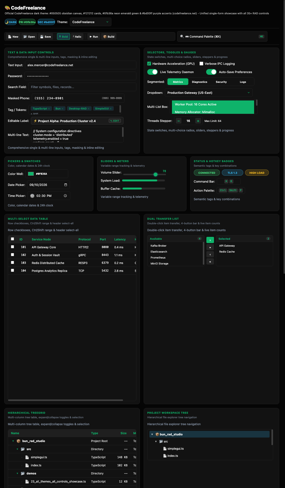

<p align="right"><a href="#top">▲ Back to Top</a> • <a href="#table-of-contents">📑 Table of Contents</a> • <a href="#quick-reference-index">⚡ Index Table</a></p>

---

<a id="cat-macos"></a>
## 🍏 Modern macOS & Apple Themes

Authentic Apple operating system designs from classic Mac OS X Aqua to contemporary macOS Sonoma and Apple Sunset.

<a id="theme-sonoma_emerald"></a>
### 02. Sonoma Emerald (`sonoma_emerald`)

> macOS Sonoma dark forest glass palette with radiant emerald and mint accents

- **Mode**: 🌙 Dark | **Primary Accent**: `#30d158` | **Secondary**: `#34d399`
- **Canvas**: `#091811` | **Card Background**: `#10261c` | **Text**: `#ecfdf5`
- **Live Preview Command**: `bun run demo:themes sonoma_emerald`

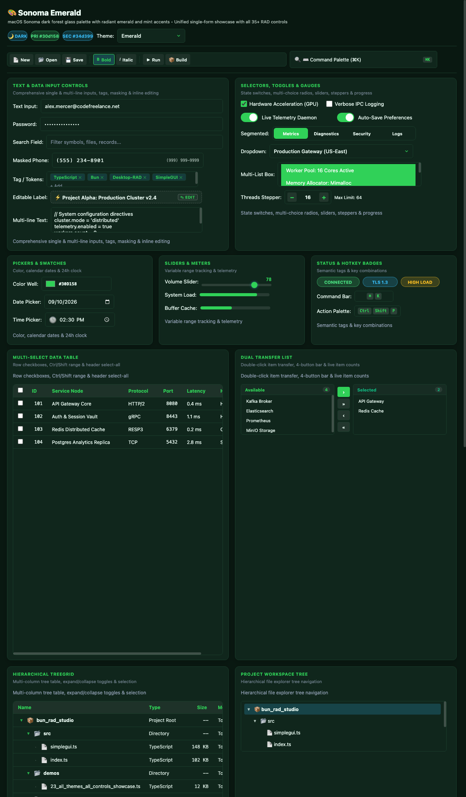

<p align="right"><a href="#top">▲ Back to Top</a> • <a href="#table-of-contents">📑 Table of Contents</a> • <a href="#quick-reference-index">⚡ Index Table</a></p>

---

<a id="theme-apple_dark"></a>
### 03. Apple Dark (`apple_dark`)

> Vibrant Apple macOS Dark Mode surface with titanium gray cards and iOS system blue

- **Mode**: 🌙 Dark | **Primary Accent**: `#0a84ff` | **Secondary**: `#bf5af2`
- **Canvas**: `#161618` | **Card Background**: `#242426` | **Text**: `#f5f5f7`
- **Live Preview Command**: `bun run demo:themes apple_dark`

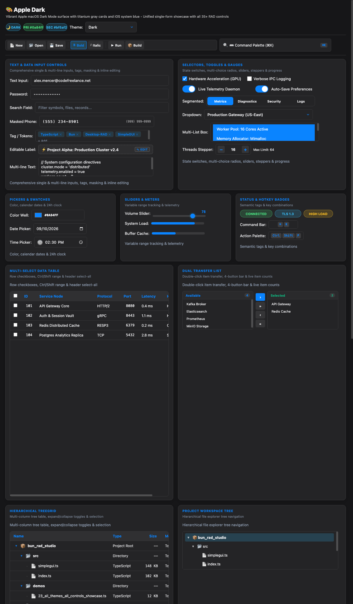

<p align="right"><a href="#top">▲ Back to Top</a> • <a href="#table-of-contents">📑 Table of Contents</a> • <a href="#quick-reference-index">⚡ Index Table</a></p>

---

<a id="theme-apple_light"></a>
### 04. Apple Light (`apple_light`)

> Clean Apple macOS Aqua light canvas with SF Pro typography and Cupertino system blue

- **Mode**: ☀️ Light | **Primary Accent**: `#0071e3` | **Secondary**: `#5e5ce6`
- **Canvas**: `#f5f5f7` | **Card Background**: `#ffffff` | **Text**: `#1d1d1f`
- **Live Preview Command**: `bun run demo:themes apple_light`

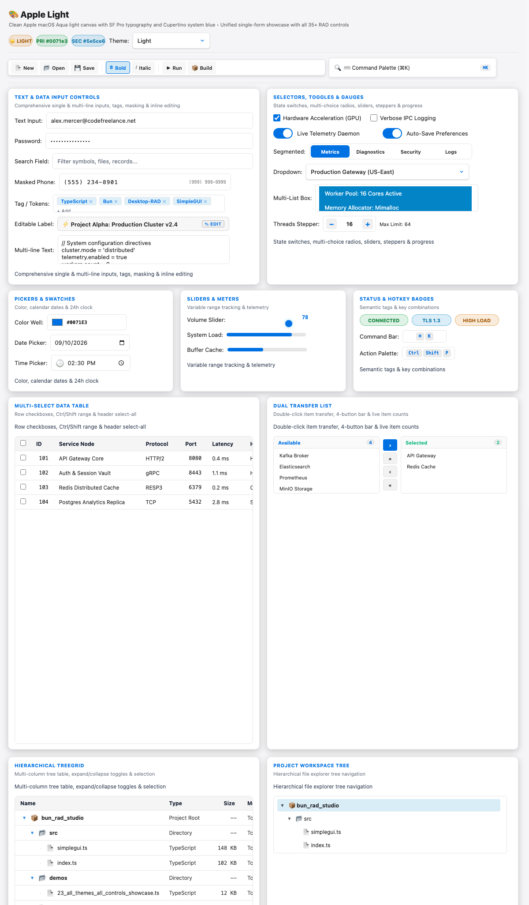

<p align="right"><a href="#top">▲ Back to Top</a> • <a href="#table-of-contents">📑 Table of Contents</a> • <a href="#quick-reference-index">⚡ Index Table</a></p>

---

<a id="theme-midnight"></a>
### 05. Midnight Space Gray (`midnight`)

> Pro dark titanium space gray theme with deep slate surfaces and luminous sky blue

- **Mode**: 🌙 Dark | **Primary Accent**: `#38bdf8` | **Secondary**: `#818cf8`
- **Canvas**: `#0f1115` | **Card Background**: `#161922` | **Text**: `#e6edf3`
- **Live Preview Command**: `bun run demo:themes midnight`


<p align="right"><a href="#top">▲ Back to Top</a> • <a href="#table-of-contents">📑 Table of Contents</a> • <a href="#quick-reference-index">⚡ Index Table</a></p>

---

<a id="theme-apple_sunset"></a>
### 06. Apple Sunset (`apple_sunset`)

> Warm macOS Mojave twilight sunset hues with rich plum surfaces and neon amber accents

- **Mode**: 🌙 Dark | **Primary Accent**: `#ff7733` | **Secondary**: `#e056fd`
- **Canvas**: `#221526` | **Card Background**: `#2d1e33` | **Text**: `#fdf4f8`
- **Live Preview Command**: `bun run demo:themes apple_sunset`

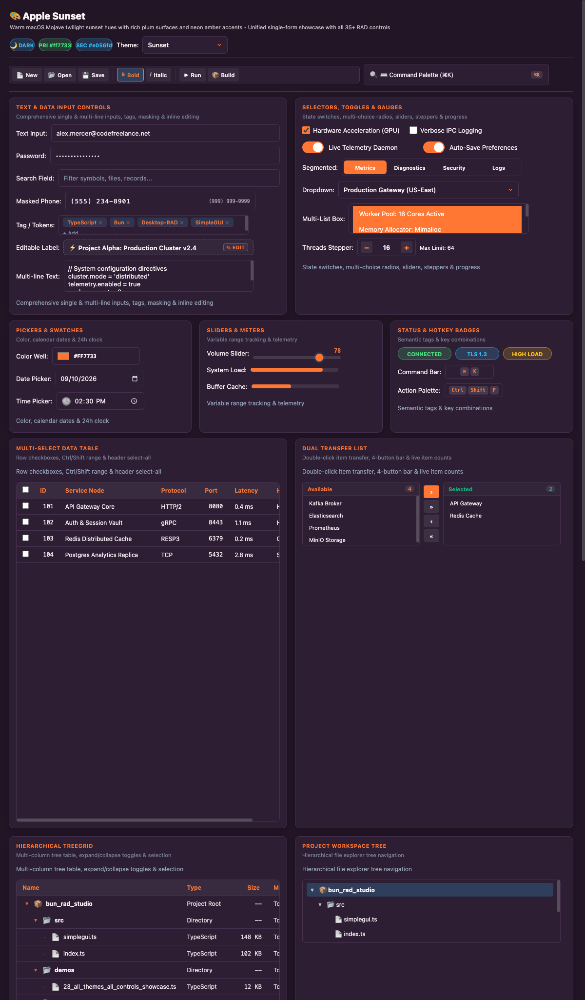

<p align="right"><a href="#top">▲ Back to Top</a> • <a href="#table-of-contents">📑 Table of Contents</a> • <a href="#quick-reference-index">⚡ Index Table</a></p>

---

<a id="theme-ventura_amber"></a>
### 07. Ventura Amber (`ventura_amber`)

> macOS Ventura golden sunset dark hues with warm amber and roasted espresso cards

- **Mode**: 🌙 Dark | **Primary Accent**: `#ff9500` | **Secondary**: `#f97316`
- **Canvas**: `#1c140e` | **Card Background**: `#281e16` | **Text**: `#fffbeb`
- **Live Preview Command**: `bun run demo:themes ventura_amber`

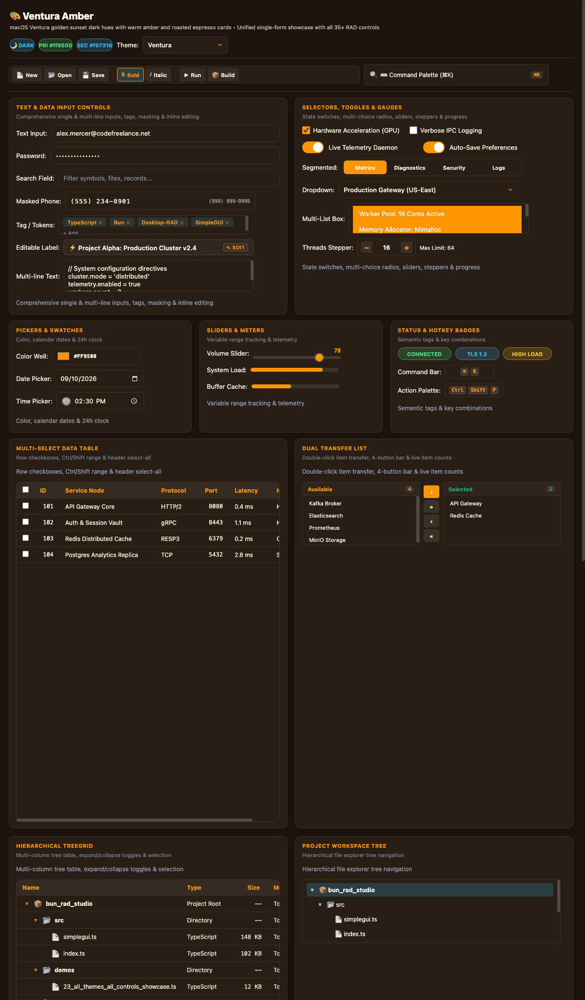

<p align="right"><a href="#top">▲ Back to Top</a> • <a href="#table-of-contents">📑 Table of Contents</a> • <a href="#quick-reference-index">⚡ Index Table</a></p>

---

<a id="theme-soft_pastel"></a>
### 08. Soft Pastel (`soft_pastel`)

> Apple Studio warm soft linen light theme with terracotta coral and artisan cards

- **Mode**: ☀️ Light | **Primary Accent**: `#c05638` | **Secondary**: `#3d405b`
- **Canvas**: `#f9f6f0` | **Card Background**: `#ffffff` | **Text**: `#1c1917`
- **Live Preview Command**: `bun run demo:themes soft_pastel`

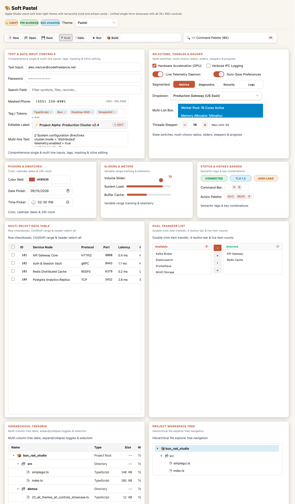

<p align="right"><a href="#top">▲ Back to Top</a> • <a href="#table-of-contents">📑 Table of Contents</a> • <a href="#quick-reference-index">⚡ Index Table</a></p>

---

<a id="theme-mac_os_aqua"></a>
### 09. Mac OS X Aqua (`mac_os_aqua`)

> Early 2001 OS X Cheetah glossy gel buttons and brushed pinstripes

- **Mode**: ☀️ Light | **Primary Accent**: `#0066cc` | **Secondary**: `#ff9500`
- **Canvas**: `#e6ebed` | **Card Background**: `#ffffff` | **Text**: `#0f172a`
- **Live Preview Command**: `bun run demo:themes mac_os_aqua`

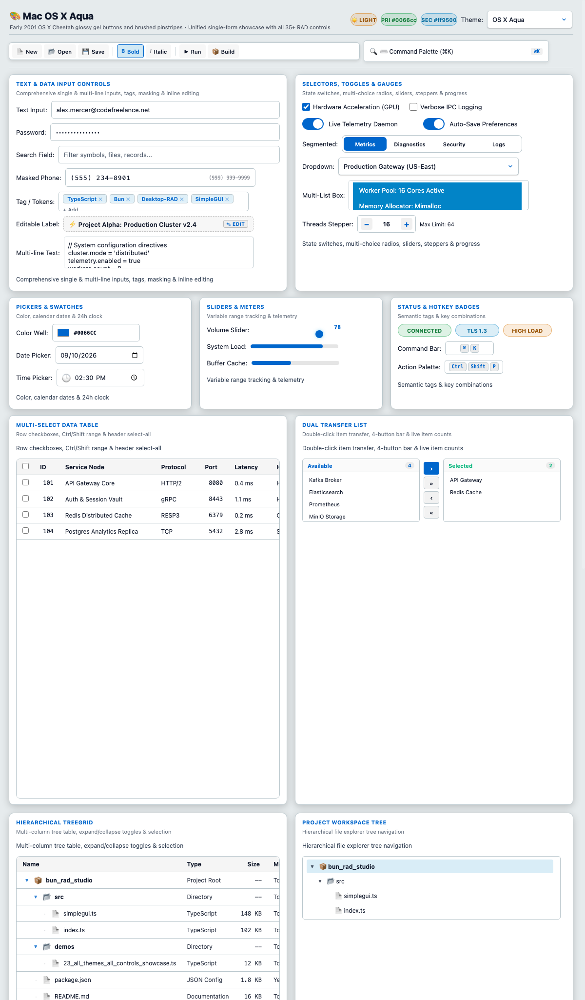

<p align="right"><a href="#top">▲ Back to Top</a> • <a href="#table-of-contents">📑 Table of Contents</a> • <a href="#quick-reference-index">⚡ Index Table</a></p>

---

<a id="theme-mac_classic"></a>
### 10. Macintosh System 7 (`mac_classic`)

> Vintage 1991 System 7 Platinum desktop with Chicago typography and pinstripe accents

- **Mode**: ☀️ Light | **Primary Accent**: `#5555aa` | **Secondary**: `#ded9cf`
- **Canvas**: `#ebe7df` | **Card Background**: `#ffffff` | **Text**: `#1c1b18`
- **Live Preview Command**: `bun run demo:themes mac_classic`

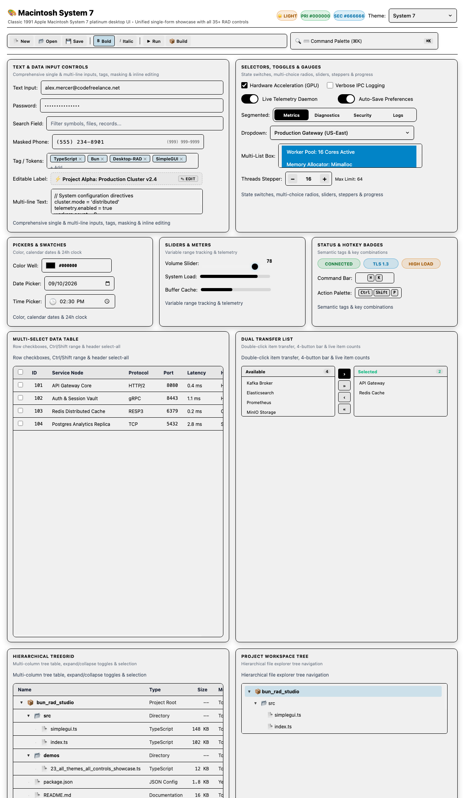

<p align="right"><a href="#top">▲ Back to Top</a> • <a href="#table-of-contents">📑 Table of Contents</a> • <a href="#quick-reference-index">⚡ Index Table</a></p>

---

<a id="cat-designer"></a>
## 🚀 AAA Studio & Designer Dark Themes

Premium, modern software company aesthetics engineered for maximum focus and visual hierarchy.

<a id="theme-raycast_dark"></a>
### 11. Raycast Dark (`raycast_dark`)

> Silicon Valley developer command palette with ultra-slick charcoal surfaces and laser red

- **Mode**: 🌙 Dark | **Primary Accent**: `#ff6363` | **Secondary**: `#ff9494`
- **Canvas**: `#0e0f12` | **Card Background**: `#18191e` | **Text**: `#f3f4f6`
- **Live Preview Command**: `bun run demo:themes raycast_dark`

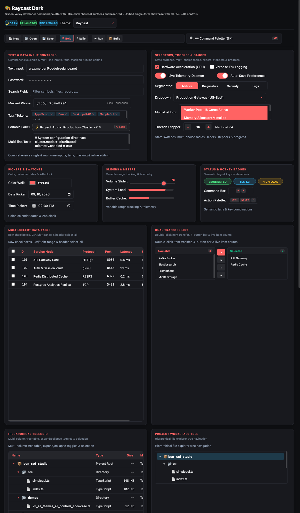

<p align="right"><a href="#top">▲ Back to Top</a> • <a href="#table-of-contents">📑 Table of Contents</a> • <a href="#quick-reference-index">⚡ Index Table</a></p>

---

<a id="theme-linear_dark"></a>
### 12. Linear Studio (`linear_dark`)

> High-craft Linear project workspace with deep obsidian cards and electric indigo accents

- **Mode**: 🌙 Dark | **Primary Accent**: `#5e6ad2` | **Secondary**: `#8e9df6`
- **Canvas**: `#0f1015` | **Card Background**: `#181922` | **Text**: `#e2e4ed`
- **Live Preview Command**: `bun run demo:themes linear_dark`

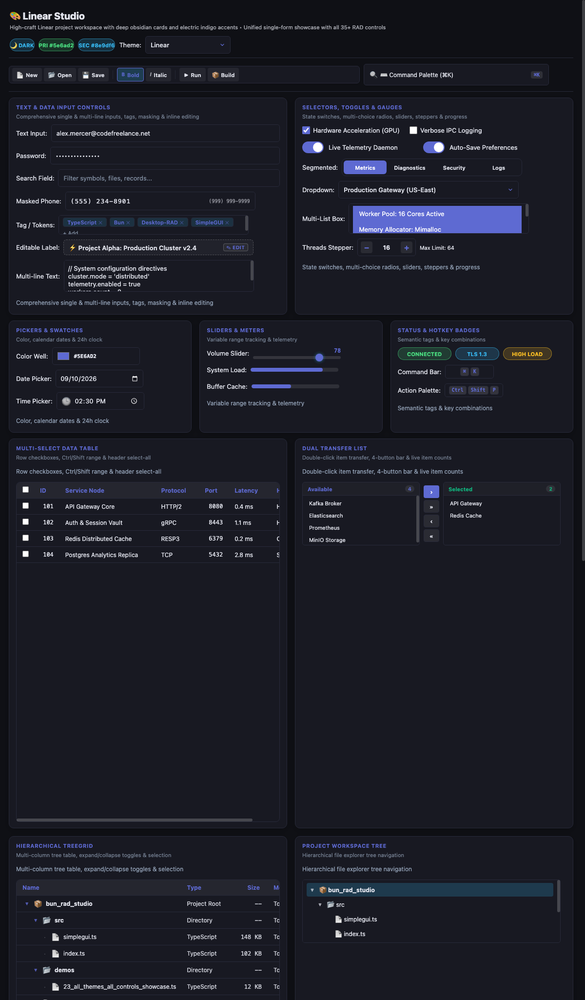

<p align="right"><a href="#top">▲ Back to Top</a> • <a href="#table-of-contents">📑 Table of Contents</a> • <a href="#quick-reference-index">⚡ Index Table</a></p>

---

<a id="theme-vercel_dark"></a>
### 13. Vercel Geist (`vercel_dark`)

> Ultra-minimalist Next.js & Vercel design system with pure monochrome contrast and electric blue

- **Mode**: 🌙 Dark | **Primary Accent**: `#ffffff` | **Secondary**: `#0070f3`
- **Canvas**: `#000000` | **Card Background**: `#0a0a0a` | **Text**: `#ededed`
- **Live Preview Command**: `bun run demo:themes vercel_dark`

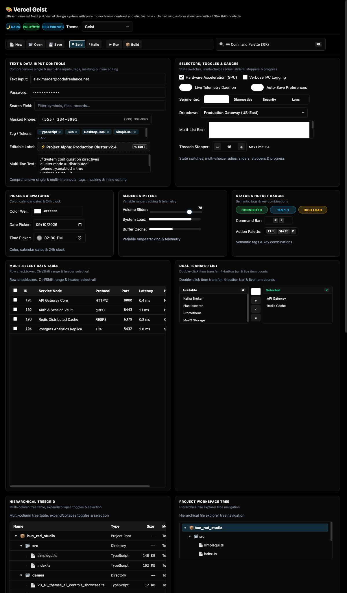

<p align="right"><a href="#top">▲ Back to Top</a> • <a href="#table-of-contents">📑 Table of Contents</a> • <a href="#quick-reference-index">⚡ Index Table</a></p>

---

<a id="theme-unreal_engine"></a>
### 14. Unreal Engine 5 (`unreal_engine`)

> Epic Games Unreal Engine 5 professional workstation with dark graphite & Blueprint blue

- **Mode**: 🌙 Dark | **Primary Accent**: `#0e86d4` | **Secondary**: `#e5a93c`
- **Canvas**: `#18191c` | **Card Background**: `#222328` | **Text**: `#e1e2e6`
- **Live Preview Command**: `bun run demo:themes unreal_engine`

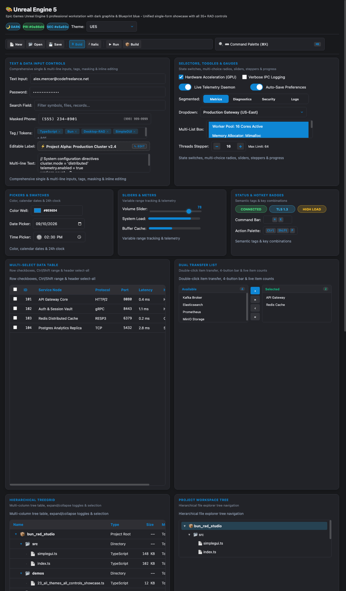

<p align="right"><a href="#top">▲ Back to Top</a> • <a href="#table-of-contents">📑 Table of Contents</a> • <a href="#quick-reference-index">⚡ Index Table</a></p>

---

<a id="theme-arc_velvet"></a>
### 15. Arc Velvet (`arc_velvet`)

> Arc Browser velvet aesthetic with deep plum indigo and luminous neon magenta accents

- **Mode**: 🌙 Dark | **Primary Accent**: `#f72585` | **Secondary**: `#4cc9f0`
- **Canvas**: `#170f26` | **Card Background**: `#23183a` | **Text**: `#f8f6fc`
- **Live Preview Command**: `bun run demo:themes arc_velvet`

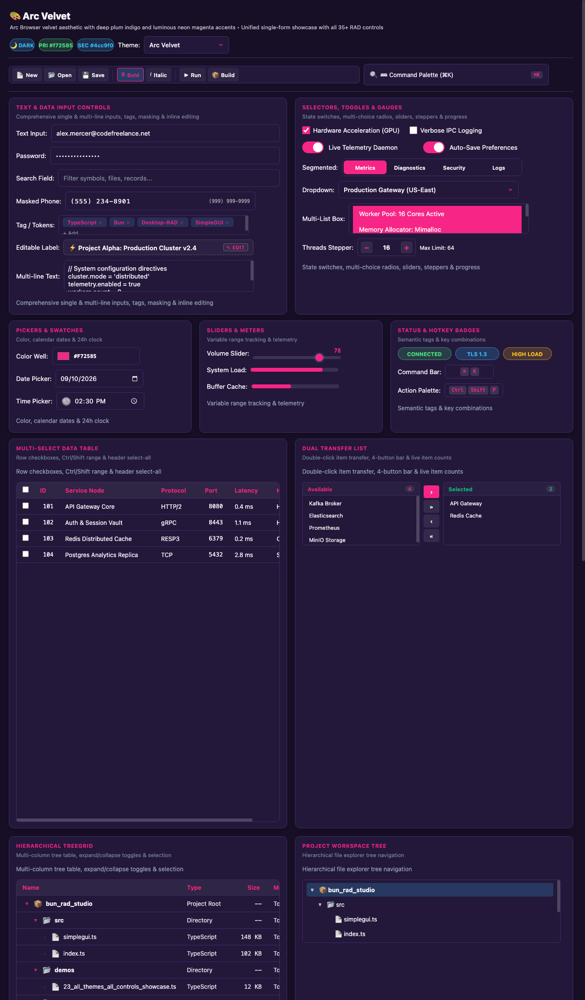

<p align="right"><a href="#top">▲ Back to Top</a> • <a href="#table-of-contents">📑 Table of Contents</a> • <a href="#quick-reference-index">⚡ Index Table</a></p>

---

<a id="theme-abyss"></a>
### 16. Abyss Bioluminescence (`abyss`)

> Deep oceanic trench dark theme with radiant bioluminescent cyan and marine slate

- **Mode**: 🌙 Dark | **Primary Accent**: `#06b6d4` | **Secondary**: `#3b82f6`
- **Canvas**: `#030712` | **Card Background**: `#0b1329` | **Text**: `#f0fdfa`
- **Live Preview Command**: `bun run demo:themes abyss`

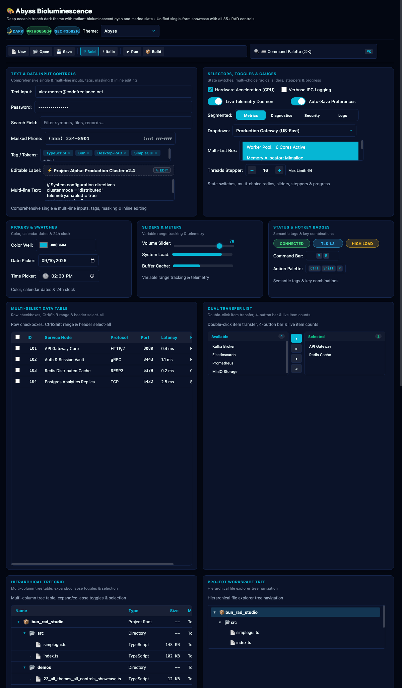

<p align="right"><a href="#top">▲ Back to Top</a> • <a href="#table-of-contents">📑 Table of Contents</a> • <a href="#quick-reference-index">⚡ Index Table</a></p>

---

<a id="theme-night_city"></a>
### 17. Cyberpunk Night City (`night_city`)

> AAA Cyberpunk 2077 Night City HUD with Trauma Team red, Samurai yellow and chrome cards

- **Mode**: 🌙 Dark | **Primary Accent**: `#ff003c` | **Secondary**: `#00f0ff`
- **Canvas**: `#0e0e13` | **Card Background**: `#171720` | **Text**: `#fcee0a`
- **Live Preview Command**: `bun run demo:themes night_city`

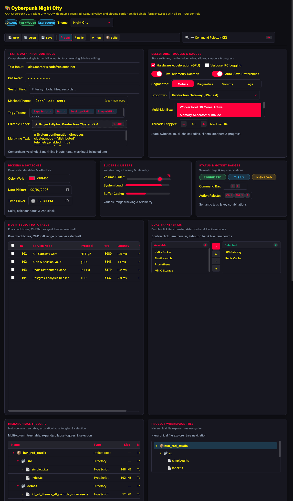

<p align="right"><a href="#top">▲ Back to Top</a> • <a href="#table-of-contents">📑 Table of Contents</a> • <a href="#quick-reference-index">⚡ Index Table</a></p>

---

<a id="theme-horizon"></a>
### 18. Horizon Sunset (`horizon`)

> Warm twilight horizon spectrum with glowing neon coral, peach and dusk plum

- **Mode**: 🌙 Dark | **Primary Accent**: `#e95678` | **Secondary**: `#fab795`
- **Canvas**: `#1c1e26` | **Card Background**: `#232530` | **Text**: `#fdf0ed`
- **Live Preview Command**: `bun run demo:themes horizon`

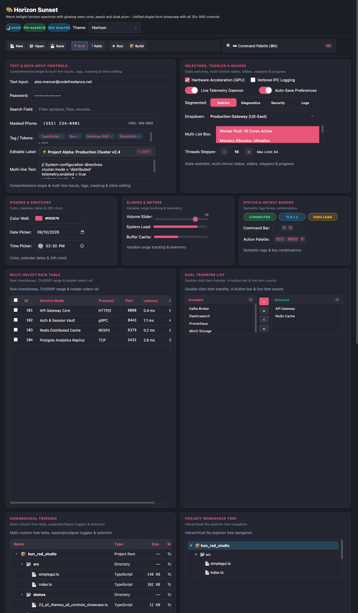

<p align="right"><a href="#top">▲ Back to Top</a> • <a href="#table-of-contents">📑 Table of Contents</a> • <a href="#quick-reference-index">⚡ Index Table</a></p>

---

<a id="theme-tailwind_dark"></a>
### 19. Tailwind Slate Emerald (`tailwind_dark`)

> Modern Tailwind CSS flagship developer theme with deep slate 950 and vibrant emerald

- **Mode**: 🌙 Dark | **Primary Accent**: `#10b981` | **Secondary**: `#06b6d4`
- **Canvas**: `#0b1120` | **Card Background**: `#151e32` | **Text**: `#f1f5f9`
- **Live Preview Command**: `bun run demo:themes tailwind_dark`

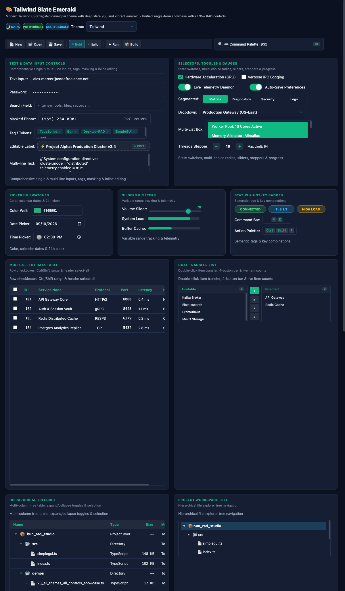

<p align="right"><a href="#top">▲ Back to Top</a> • <a href="#table-of-contents">📑 Table of Contents</a> • <a href="#quick-reference-index">⚡ Index Table</a></p>

---

<a id="theme-supabase"></a>
### 20. Supabase Dark (`supabase`)

> Supabase cloud database dashboard with sleek dark obsidian and signature emerald

- **Mode**: 🌙 Dark | **Primary Accent**: `#3ecf8e` | **Secondary**: `#70e1a5`
- **Canvas**: `#121212` | **Card Background**: `#1c1c1c` | **Text**: `#f8fafc`
- **Live Preview Command**: `bun run demo:themes supabase`

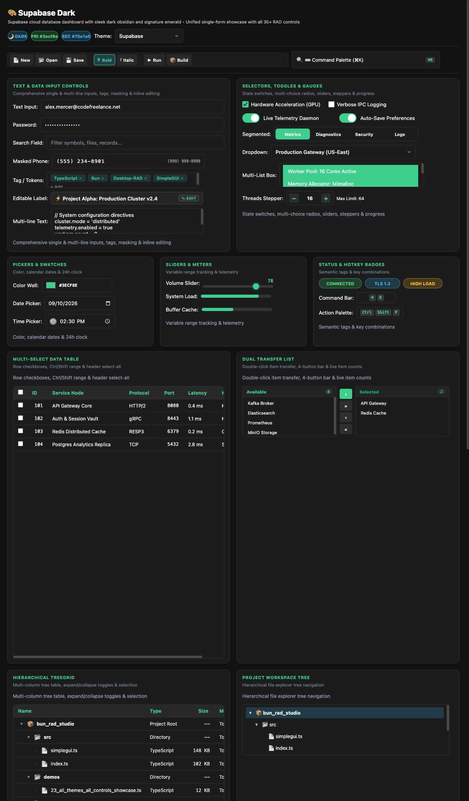

<p align="right"><a href="#top">▲ Back to Top</a> • <a href="#table-of-contents">📑 Table of Contents</a> • <a href="#quick-reference-index">⚡ Index Table</a></p>

---

<a id="theme-oled_black"></a>
### 21. OLED Laser Black (`oled_black`)

> Zero-power pure OLED black canvas with ultra-sharp laser green and high-contrast cards

- **Mode**: 🌙 Dark | **Primary Accent**: `#00e676` | **Secondary**: `#2979ff`
- **Canvas**: `#000000` | **Card Background**: `#0a0a0a` | **Text**: `#ffffff`
- **Live Preview Command**: `bun run demo:themes oled_black`

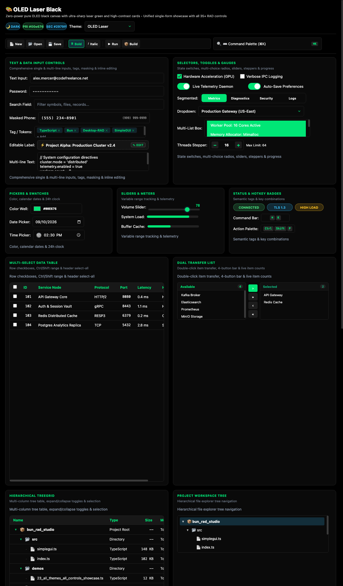

<p align="right"><a href="#top">▲ Back to Top</a> • <a href="#table-of-contents">📑 Table of Contents</a> • <a href="#quick-reference-index">⚡ Index Table</a></p>

---

<a id="theme-titanium_slate"></a>
### 22. Titanium Slate Pro (`titanium_slate`)

> Apple Pro hardware grade aerospace titanium space black with aviation orange accents

- **Mode**: 🌙 Dark | **Primary Accent**: `#ff6b22` | **Secondary**: `#98989d`
- **Canvas**: `#131417` | **Card Background**: `#1c1d22` | **Text**: `#e5e5ea`
- **Live Preview Command**: `bun run demo:themes titanium_slate`

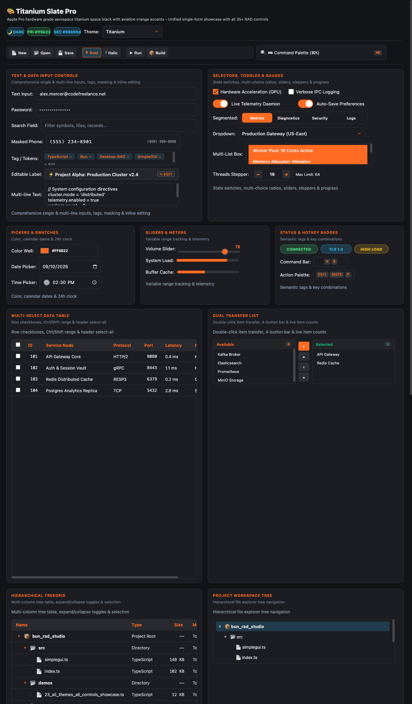

<p align="right"><a href="#top">▲ Back to Top</a> • <a href="#table-of-contents">📑 Table of Contents</a> • <a href="#quick-reference-index">⚡ Index Table</a></p>

---

<a id="theme-jetbrains_darcula"></a>
### 23. JetBrains Darcula (`jetbrains_darcula`)

> Iconic JetBrains IntelliJ IDEA / PyCharm Darcula IDE workspace with warm syntax orange

- **Mode**: 🌙 Dark | **Primary Accent**: `#cc7832` | **Secondary**: `#6897bb`
- **Canvas**: `#2b2b2b` | **Card Background**: `#313335` | **Text**: `#a9b7c6`
- **Live Preview Command**: `bun run demo:themes jetbrains_darcula`


<p align="right"><a href="#top">▲ Back to Top</a> • <a href="#table-of-contents">📑 Table of Contents</a> • <a href="#quick-reference-index">⚡ Index Table</a></p>

---

<a id="theme-nordic_paper"></a>
### 24. Nordic Paper Light (`nordic_paper`)

> Nordic editorial paper light canvas with deep fjord blue and crisp typographic elegance

- **Mode**: ☀️ Light | **Primary Accent**: `#2b5c8f` | **Secondary**: `#c2593f`
- **Canvas**: `#f7f7f5` | **Card Background**: `#ffffff` | **Text**: `#202124`
- **Live Preview Command**: `bun run demo:themes nordic_paper`


<p align="right"><a href="#top">▲ Back to Top</a> • <a href="#table-of-contents">📑 Table of Contents</a> • <a href="#quick-reference-index">⚡ Index Table</a></p>

---

<a id="cat-developer"></a>
## 💻 Popular Developer & IDE Syntax Themes

World-renowned editor and syntax color schemes beloved by engineers worldwide.

<a id="theme-monokai_pro"></a>
### 25. Monokai Pro (`monokai_pro`)

> Monokai Pro refined dark spectrum with warm yellow and vivid magenta accents

- **Mode**: 🌙 Dark | **Primary Accent**: `#ffd866` | **Secondary**: `#ff6188`
- **Canvas**: `#2d2a2e` | **Card Background**: `#221f22` | **Text**: `#fcfcfa`
- **Live Preview Command**: `bun run demo:themes monokai_pro`


<p align="right"><a href="#top">▲ Back to Top</a> • <a href="#table-of-contents">📑 Table of Contents</a> • <a href="#quick-reference-index">⚡ Index Table</a></p>

---

<a id="theme-tokyo_night"></a>
### 26. Tokyo Night (`tokyo_night`)

> Tokyo Night dark neon indigo city theme with vibrant blue and lavender accents

- **Mode**: 🌙 Dark | **Primary Accent**: `#7aa2f7` | **Secondary**: `#bb9af7`
- **Canvas**: `#1a1b26` | **Card Background**: `#24283b` | **Text**: `#c0caf5`
- **Live Preview Command**: `bun run demo:themes tokyo_night`

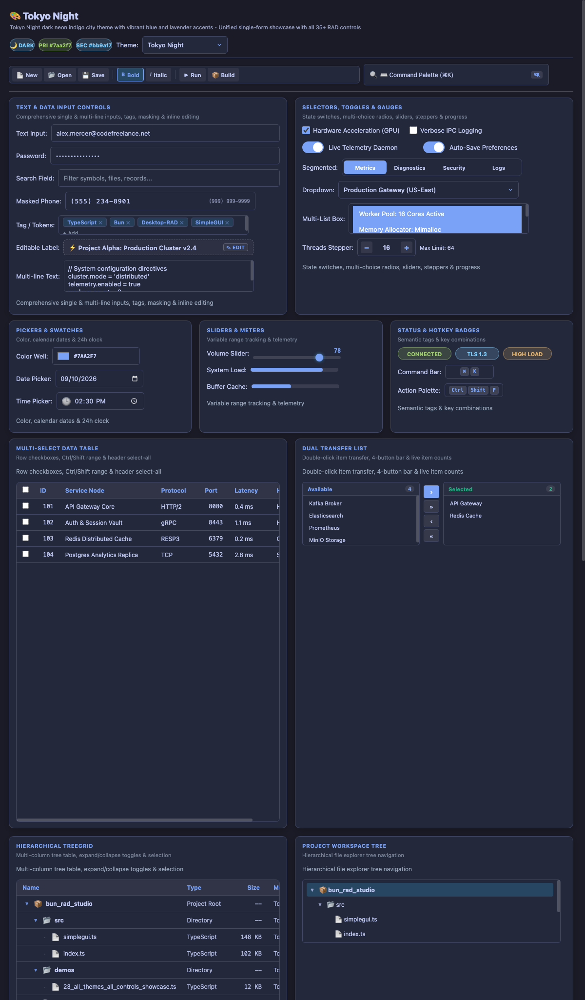

<p align="right"><a href="#top">▲ Back to Top</a> • <a href="#table-of-contents">📑 Table of Contents</a> • <a href="#quick-reference-index">⚡ Index Table</a></p>

---

<a id="theme-one_dark_pro"></a>
### 27. One Dark Pro (`one_dark_pro`)

> Iconic Atom & VS Code One Dark Pro deep slate canvas with vibrant syntax hues

- **Mode**: 🌙 Dark | **Primary Accent**: `#61afef` | **Secondary**: `#98c379`
- **Canvas**: `#21252b` | **Card Background**: `#282c34` | **Text**: `#abb2bf`
- **Live Preview Command**: `bun run demo:themes one_dark_pro`

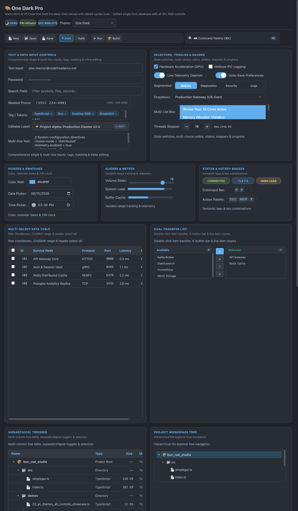

<p align="right"><a href="#top">▲ Back to Top</a> • <a href="#table-of-contents">📑 Table of Contents</a> • <a href="#quick-reference-index">⚡ Index Table</a></p>

---

<a id="theme-gruvbox_dark"></a>
### 28. Gruvbox Dark (`gruvbox_dark`)

> Retro groove warm earthy dark palette with amber gold and terracotta orange

- **Mode**: 🌙 Dark | **Primary Accent**: `#fabd2f` | **Secondary**: `#fe8019`
- **Canvas**: `#282828` | **Card Background**: `#1d2021` | **Text**: `#ebdbb2`
- **Live Preview Command**: `bun run demo:themes gruvbox_dark`

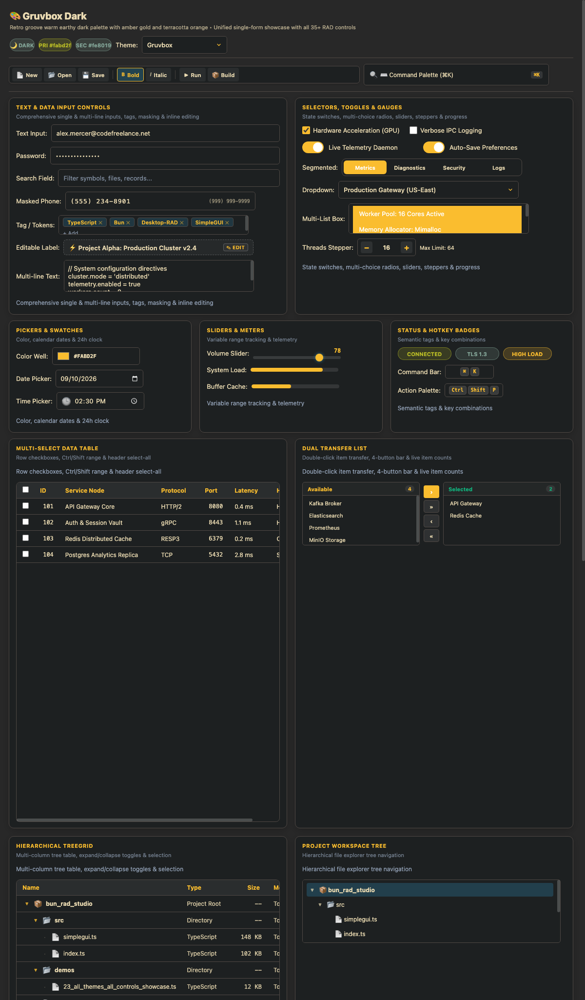

<p align="right"><a href="#top">▲ Back to Top</a> • <a href="#table-of-contents">📑 Table of Contents</a> • <a href="#quick-reference-index">⚡ Index Table</a></p>

---

<a id="theme-rose_pine"></a>
### 29. Rosé Pine (`rose_pine`)

> All-natural soft dark palette with dusty rose, pine foam, and warm gold

- **Mode**: 🌙 Dark | **Primary Accent**: `#eb6f92` | **Secondary**: `#9ccfd8`
- **Canvas**: `#191724` | **Card Background**: `#21202e` | **Text**: `#e0def4`
- **Live Preview Command**: `bun run demo:themes rose_pine`

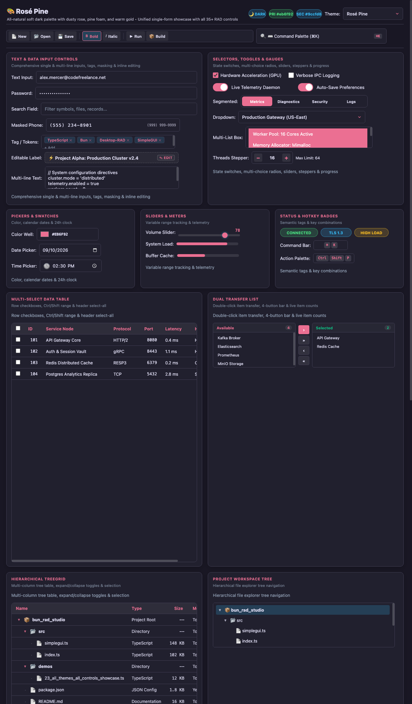

<p align="right"><a href="#top">▲ Back to Top</a> • <a href="#table-of-contents">📑 Table of Contents</a> • <a href="#quick-reference-index">⚡ Index Table</a></p>

---

<a id="theme-everforest"></a>
### 30. Everforest Dark (`everforest`)

> Natural comfort forest dark mode engineered for zero eye strain

- **Mode**: 🌙 Dark | **Primary Accent**: `#a7c080` | **Secondary**: `#7fbbb3`
- **Canvas**: `#2d353b` | **Card Background**: `#232a2e` | **Text**: `#d3c6aa`
- **Live Preview Command**: `bun run demo:themes everforest`

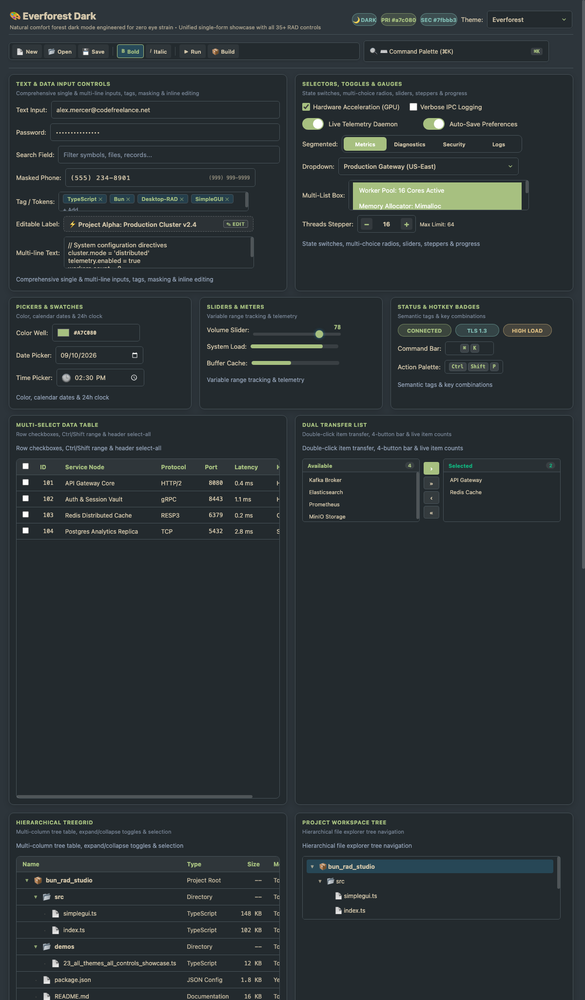

<p align="right"><a href="#top">▲ Back to Top</a> • <a href="#table-of-contents">📑 Table of Contents</a> • <a href="#quick-reference-index">⚡ Index Table</a></p>

---

<a id="theme-kanagawa"></a>
### 31. Kanagawa (`kanagawa`)

> Japanese ukiyo-e wave art inspired dark sumi ink palette

- **Mode**: 🌙 Dark | **Primary Accent**: `#7e9cd8` | **Secondary**: `#ffa066`
- **Canvas**: `#1f1f28` | **Card Background**: `#16161d` | **Text**: `#dcd7ba`
- **Live Preview Command**: `bun run demo:themes kanagawa`

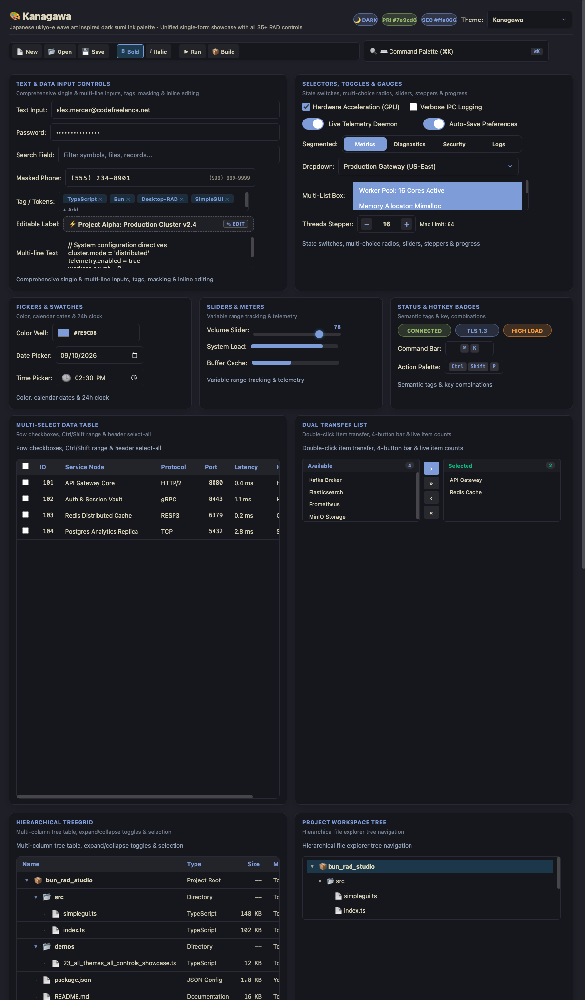

<p align="right"><a href="#top">▲ Back to Top</a> • <a href="#table-of-contents">📑 Table of Contents</a> • <a href="#quick-reference-index">⚡ Index Table</a></p>

---

<a id="theme-cobalt2"></a>
### 32. Cobalt2 (`cobalt2`)

> Wes Bos official Cobalt2 deep navy blue with brilliant canary yellow accents

- **Mode**: 🌙 Dark | **Primary Accent**: `#ffc600` | **Secondary**: `#0088ff`
- **Canvas**: `#193549` | **Card Background**: `#15232d` | **Text**: `#ffffff`
- **Live Preview Command**: `bun run demo:themes cobalt2`

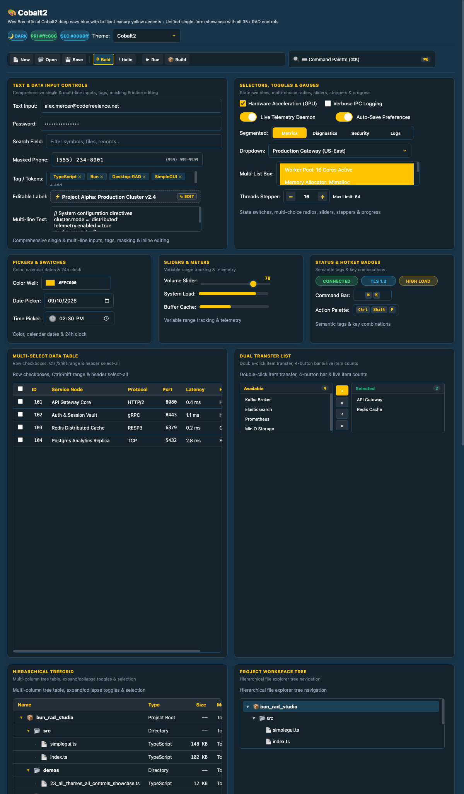

<p align="right"><a href="#top">▲ Back to Top</a> • <a href="#table-of-contents">📑 Table of Contents</a> • <a href="#quick-reference-index">⚡ Index Table</a></p>

---

<a id="theme-win11_slate"></a>
### 33. Windows 11 Fluent Slate (`win11_slate`)

> Modern Windows 11 Fluent Dark Acrylic with vibrant sky blue accents

- **Mode**: 🌙 Dark | **Primary Accent**: `#60cdff` | **Secondary**: `#0078d4`
- **Canvas**: `#202020` | **Card Background**: `#2c2c2c` | **Text**: `#ffffff`
- **Live Preview Command**: `bun run demo:themes win11_slate`

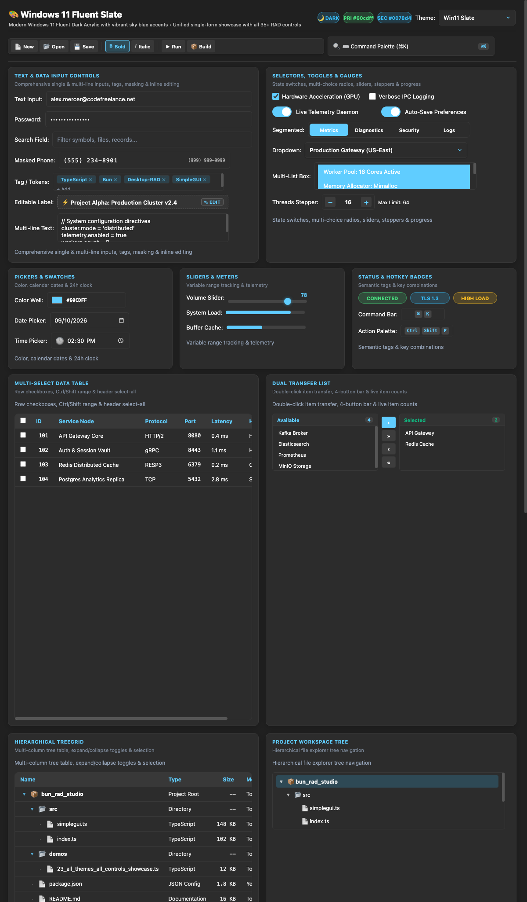

<p align="right"><a href="#top">▲ Back to Top</a> • <a href="#table-of-contents">📑 Table of Contents</a> • <a href="#quick-reference-index">⚡ Index Table</a></p>

---

<a id="theme-dracula"></a>
### 34. Dracula (`dracula`)

> High-contrast vampire purple palette with gothic violet and neon pink accents

- **Mode**: 🌙 Dark | **Primary Accent**: `#bd93f9` | **Secondary**: `#ff79c6`
- **Canvas**: `#282a36` | **Card Background**: `#21222c` | **Text**: `#f8f8f2`
- **Live Preview Command**: `bun run demo:themes dracula`

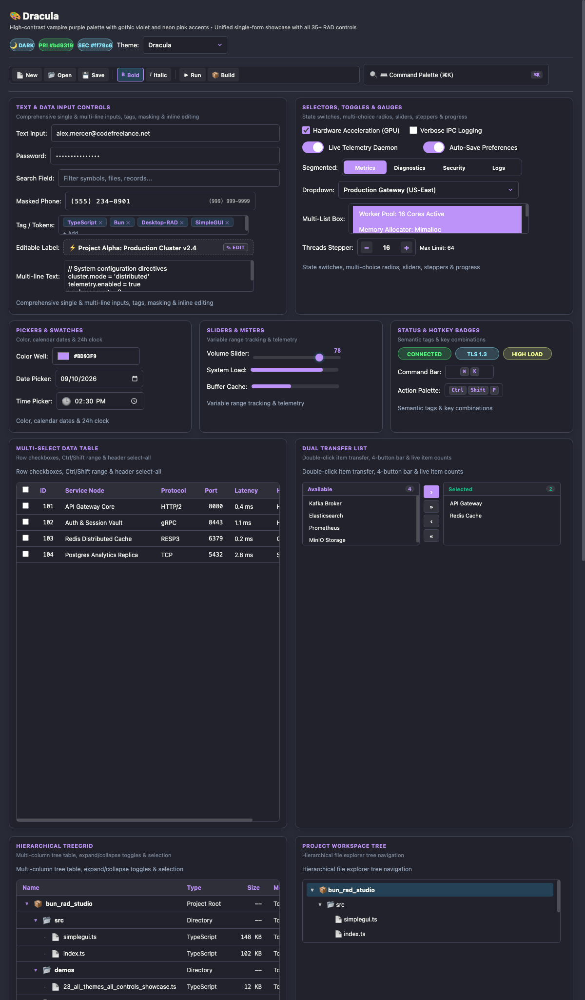

<p align="right"><a href="#top">▲ Back to Top</a> • <a href="#table-of-contents">📑 Table of Contents</a> • <a href="#quick-reference-index">⚡ Index Table</a></p>

---

<a id="theme-nord"></a>
### 35. Nord (`nord`)

> Arctic frost Nord developer palette with icy cyan and polar slate surfaces

- **Mode**: 🌙 Dark | **Primary Accent**: `#88c0d0` | **Secondary**: `#81a1c1`
- **Canvas**: `#2e3440` | **Card Background**: `#3b4252` | **Text**: `#eceff4`
- **Live Preview Command**: `bun run demo:themes nord`

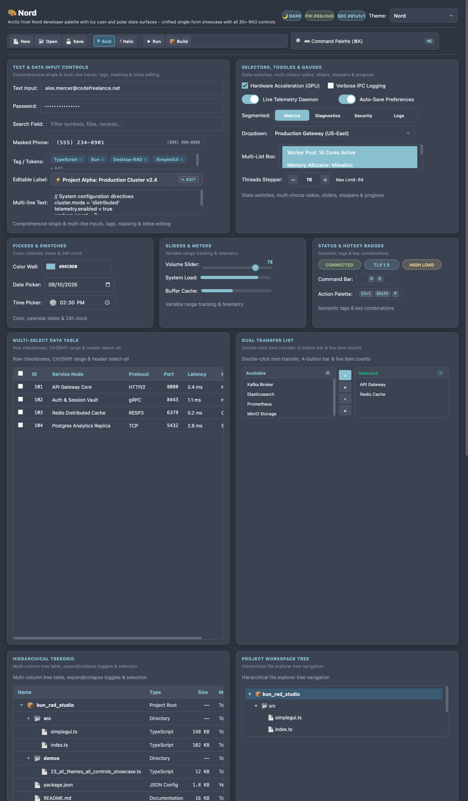

<p align="right"><a href="#top">▲ Back to Top</a> • <a href="#table-of-contents">📑 Table of Contents</a> • <a href="#quick-reference-index">⚡ Index Table</a></p>

---

<a id="theme-cyberpunk"></a>
### 36. Cyberpunk (`cyberpunk`)

> Neon glow dark contrast palette with electric magenta and laser cyan

- **Mode**: 🌙 Dark | **Primary Accent**: `#ff007f` | **Secondary**: `#fee440`
- **Canvas**: `#0a0b12` | **Card Background**: `#121320` | **Text**: `#00f5d4`
- **Live Preview Command**: `bun run demo:themes cyberpunk`

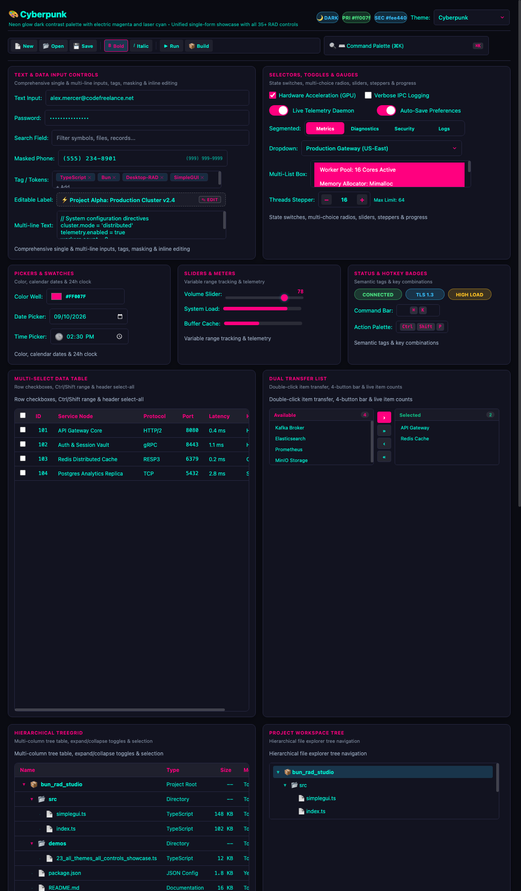

<p align="right"><a href="#top">▲ Back to Top</a> • <a href="#table-of-contents">📑 Table of Contents</a> • <a href="#quick-reference-index">⚡ Index Table</a></p>

---

<a id="theme-github_dark"></a>
### 37. GitHub Dark (`github_dark`)

> Official GitHub dark interface palette with refined code repository slate cards

- **Mode**: 🌙 Dark | **Primary Accent**: `#58a6ff` | **Secondary**: `#3fb950`
- **Canvas**: `#0d1117` | **Card Background**: `#161b22` | **Text**: `#e6edf3`
- **Live Preview Command**: `bun run demo:themes github_dark`

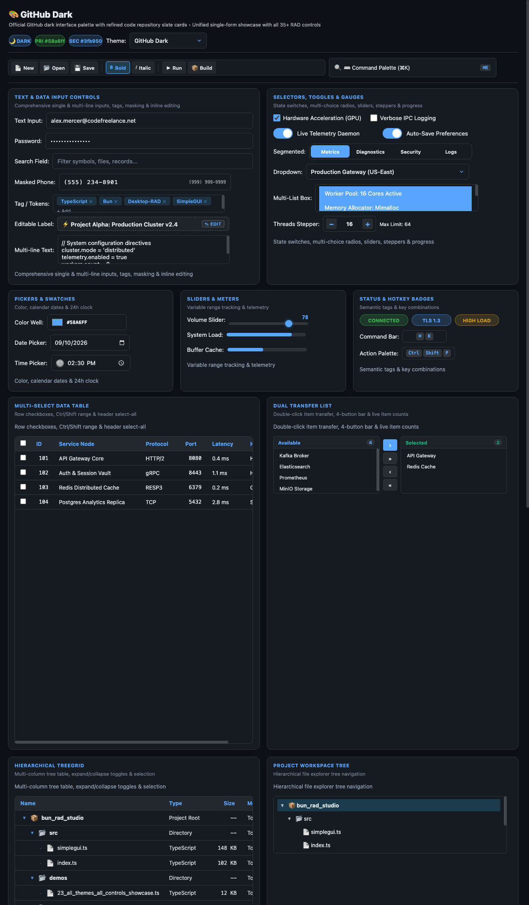

<p align="right"><a href="#top">▲ Back to Top</a> • <a href="#table-of-contents">📑 Table of Contents</a> • <a href="#quick-reference-index">⚡ Index Table</a></p>

---

<a id="theme-solarized_dark"></a>
### 38. Solarized Dark (`solarized_dark`)

> Precision engineered dark palette with optimized teal-slate contrast

- **Mode**: 🌙 Dark | **Primary Accent**: `#2aa198` | **Secondary**: `#268bd2`
- **Canvas**: `#002b36` | **Card Background**: `#073642` | **Text**: `#eee8d5`
- **Live Preview Command**: `bun run demo:themes solarized_dark`

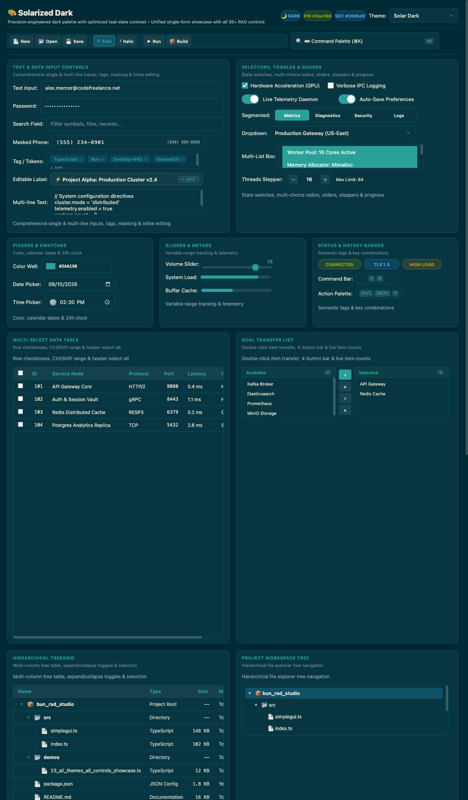

<p align="right"><a href="#top">▲ Back to Top</a> • <a href="#table-of-contents">📑 Table of Contents</a> • <a href="#quick-reference-index">⚡ Index Table</a></p>

---

<a id="theme-aura"></a>
### 39. Aura Dark (`aura`)

> Lush mystical dark theme with ethereal neon purple and mint green accents

- **Mode**: 🌙 Dark | **Primary Accent**: `#a277ff` | **Secondary**: `#61ffca`
- **Canvas**: `#15141b` | **Card Background**: `#1f1d2b` | **Text**: `#edecee`
- **Live Preview Command**: `bun run demo:themes aura`

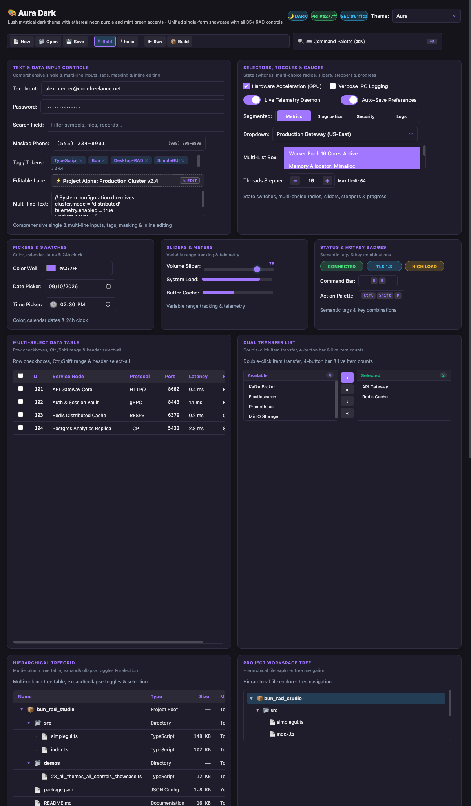

<p align="right"><a href="#top">▲ Back to Top</a> • <a href="#table-of-contents">📑 Table of Contents</a> • <a href="#quick-reference-index">⚡ Index Table</a></p>

---

<a id="theme-catppuccin"></a>
### 40. Catppuccin Mocha (`catppuccin`)

> Soothing lavender Catppuccin Mocha dark mode with pastel mauve and pink accents

- **Mode**: 🌙 Dark | **Primary Accent**: `#cba6f7` | **Secondary**: `#f5c2e7`
- **Canvas**: `#1e1e2e` | **Card Background**: `#242438` | **Text**: `#cdd6f4`
- **Live Preview Command**: `bun run demo:themes catppuccin`

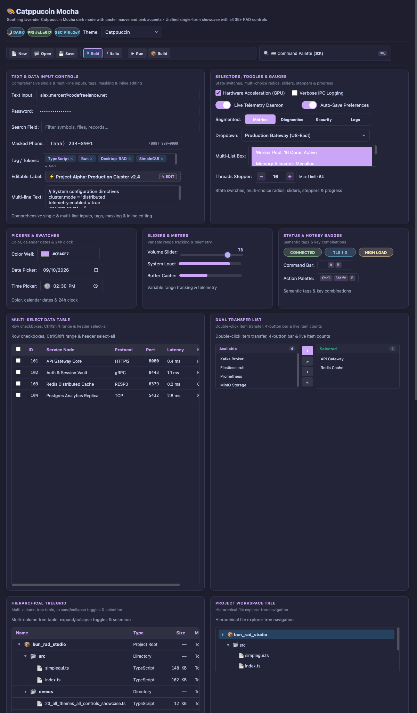

<p align="right"><a href="#top">▲ Back to Top</a> • <a href="#table-of-contents">📑 Table of Contents</a> • <a href="#quick-reference-index">⚡ Index Table</a></p>

---

<a id="cat-light"></a>
## ☀️ Clean Light & High-Contrast Themes

Optimized daytime reading themes with clear visual borders and WCAG AAA contrast compliance.

<a id="theme-github_light"></a>
### 41. GitHub Light (`github_light`)

> Clean official GitHub light canvas palette with crisp borders and classic blue

- **Mode**: ☀️ Light | **Primary Accent**: `#0969da` | **Secondary**: `#1a7f37`
- **Canvas**: `#f6f8fa` | **Card Background**: `#ffffff` | **Text**: `#1f2328`
- **Live Preview Command**: `bun run demo:themes github_light`


<p align="right"><a href="#top">▲ Back to Top</a> • <a href="#table-of-contents">📑 Table of Contents</a> • <a href="#quick-reference-index">⚡ Index Table</a></p>

---

<a id="theme-solarized_light"></a>
### 42. Solarized Light (`solarized_light`)

> Precision engineered light palette for maximum reading comfort

- **Mode**: ☀️ Light | **Primary Accent**: `#268bd2` | **Secondary**: `#2aa198`
- **Canvas**: `#fdf6e3` | **Card Background**: `#eee8d5` | **Text**: `#073642`
- **Live Preview Command**: `bun run demo:themes solarized_light`

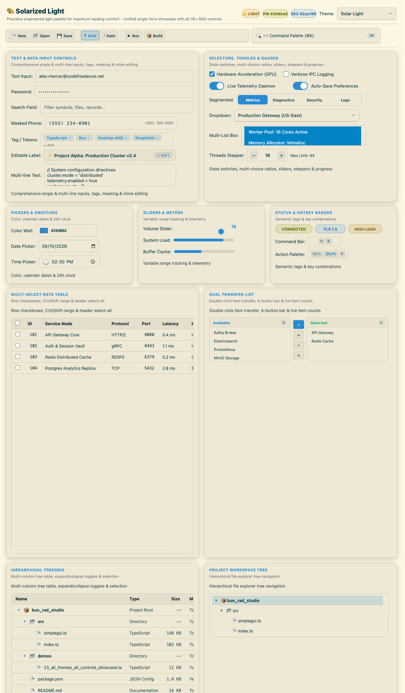

<p align="right"><a href="#top">▲ Back to Top</a> • <a href="#table-of-contents">📑 Table of Contents</a> • <a href="#quick-reference-index">⚡ Index Table</a></p>

---

<a id="theme-win11_light"></a>
### 43. Windows 11 Mica Light (`win11_light`)

> Modern Windows 11 Mica Light desktop with crisp Fluent typography

- **Mode**: ☀️ Light | **Primary Accent**: `#005fb8` | **Secondary**: `#0078d4`
- **Canvas**: `#f3f3f3` | **Card Background**: `#ffffff` | **Text**: `#1b1b1b`
- **Live Preview Command**: `bun run demo:themes win11_light`

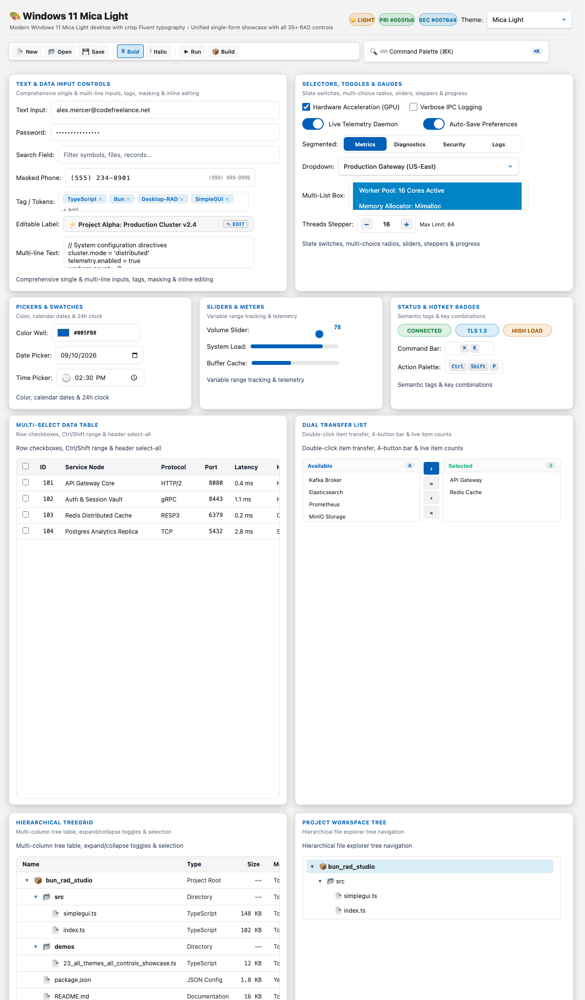

<p align="right"><a href="#top">▲ Back to Top</a> • <a href="#table-of-contents">📑 Table of Contents</a> • <a href="#quick-reference-index">⚡ Index Table</a></p>

---

<a id="theme-gruvbox_light"></a>
### 44. Gruvbox Light (`gruvbox_light`)

> Retro groove parchment light canvas with earthy amber and walnut tones

- **Mode**: ☀️ Light | **Primary Accent**: `#b57614` | **Secondary**: `#af3a03`
- **Canvas**: `#fbf1c7` | **Card Background**: `#f2e5bc` | **Text**: `#3c3836`
- **Live Preview Command**: `bun run demo:themes gruvbox_light`

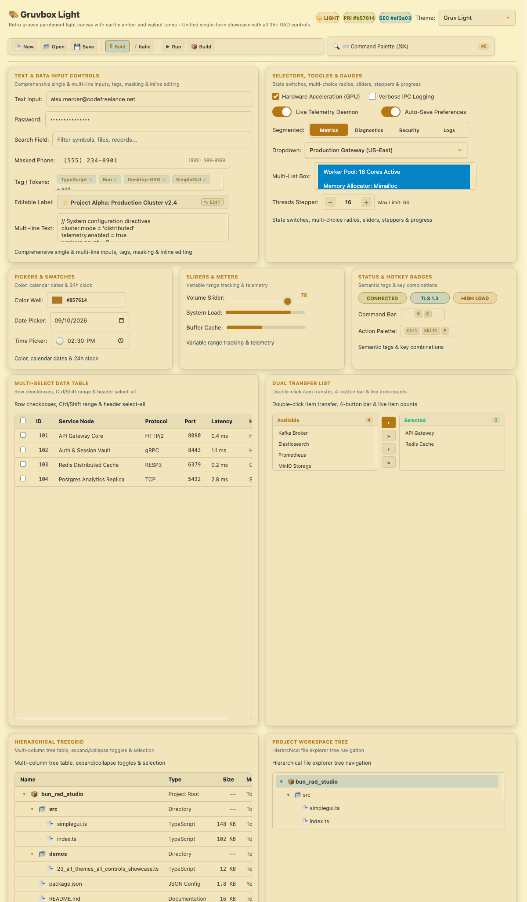

<p align="right"><a href="#top">▲ Back to Top</a> • <a href="#table-of-contents">📑 Table of Contents</a> • <a href="#quick-reference-index">⚡ Index Table</a></p>

---

<a id="theme-forest_green"></a>
### 45. Forest Green (`forest_green`)

> Rich botanical evergreen forest dark theme with moss cards and radiant jade accents

- **Mode**: 🌙 Dark | **Primary Accent**: `#4ade80` | **Secondary**: `#86efac`
- **Canvas**: `#0b1f14` | **Card Background**: `#122e1f` | **Text**: `#f0fdf4`
- **Live Preview Command**: `bun run demo:themes forest_green`

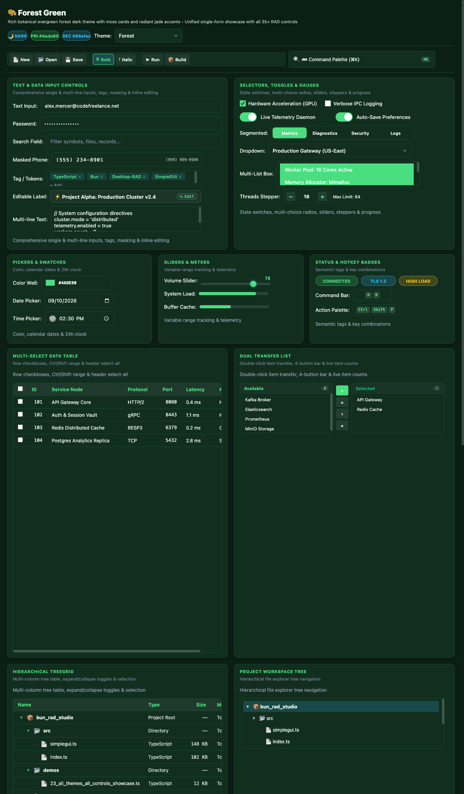

<p align="right"><a href="#top">▲ Back to Top</a> • <a href="#table-of-contents">📑 Table of Contents</a> • <a href="#quick-reference-index">⚡ Index Table</a></p>

---

<a id="theme-navy_blue"></a>
### 46. Navy Blue (`navy_blue`)

> Executive maritime deep slate navy dark theme with oceanic blue surfaces

- **Mode**: 🌙 Dark | **Primary Accent**: `#38bdf8` | **Secondary**: `#6366f1`
- **Canvas**: `#0a0f1d` | **Card Background**: `#111c33` | **Text**: `#f8fafc`
- **Live Preview Command**: `bun run demo:themes navy_blue`

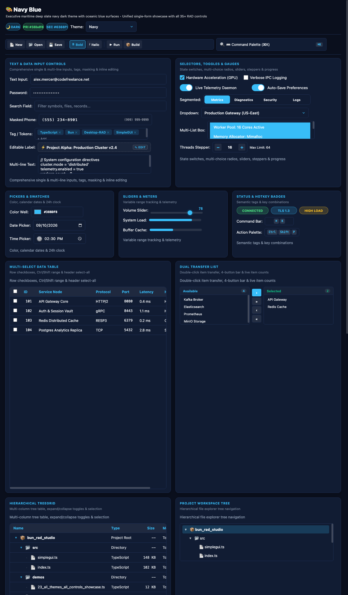

<p align="right"><a href="#top">▲ Back to Top</a> • <a href="#table-of-contents">📑 Table of Contents</a> • <a href="#quick-reference-index">⚡ Index Table</a></p>

---

<a id="cat-retro"></a>
## 🕹️ Retro & Nostalgic Computing Themes

Faithful recreations of vintage computing hardware, phosphor CRTs, and retro gaming consoles.

<a id="theme-win95"></a>
### 47. Windows 95 (`win95`)

> Iconic Windows 95 classic teal desktop with silver 3D beveled cards and titlebar navy

- **Mode**: ☀️ Light | **Primary Accent**: `#000080` | **Secondary**: `#c0c0c0`
- **Canvas**: `#008080` | **Card Background**: `#c0c0c0` | **Text**: `#000000`
- **Live Preview Command**: `bun run demo:themes win95`

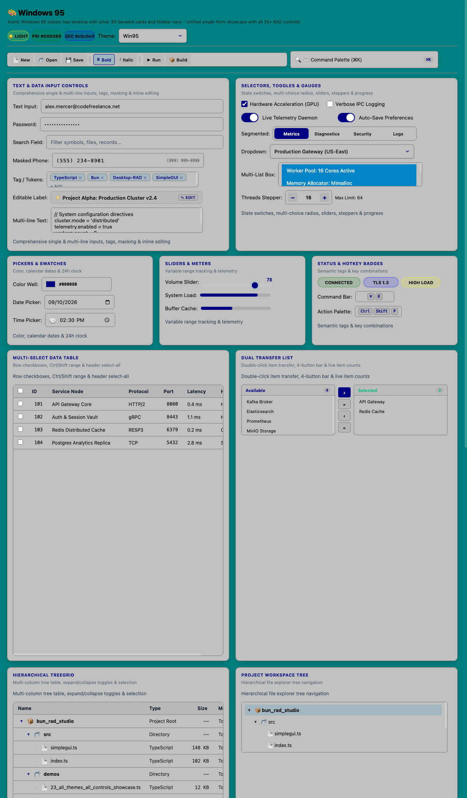

<p align="right"><a href="#top">▲ Back to Top</a> • <a href="#table-of-contents">📑 Table of Contents</a> • <a href="#quick-reference-index">⚡ Index Table</a></p>

---

<a id="theme-gameboy"></a>
### 48. Game Boy 1989 (`gameboy`)

> Nostalgic 4-shade monochrome dot matrix Game Boy DMG-01 screen

- **Mode**: 🌙 Dark | **Primary Accent**: `#8bac0f` | **Secondary**: `#306230`
- **Canvas**: `#0f380f` | **Card Background**: `#1c4a1c` | **Text**: `#9bbc0f`
- **Live Preview Command**: `bun run demo:themes gameboy`

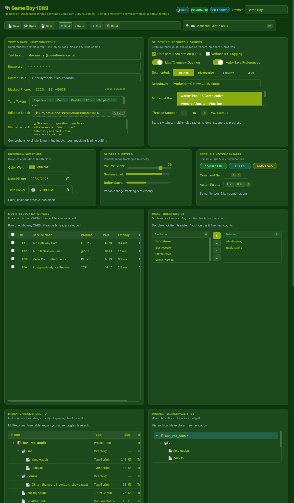

<p align="right"><a href="#top">▲ Back to Top</a> • <a href="#table-of-contents">📑 Table of Contents</a> • <a href="#quick-reference-index">⚡ Index Table</a></p>

---

<a id="theme-c64"></a>
### 49. Commodore 64 (`c64`)

> Legendary 1982 Commodore 64 READY prompt and VIC-II blue palette

- **Mode**: 🌙 Dark | **Primary Accent**: `#7974ff` | **Secondary**: `#a09eff`
- **Canvas**: `#40318d` | **Card Background**: `#281b5c` | **Text**: `#b8b5ff`
- **Live Preview Command**: `bun run demo:themes c64`

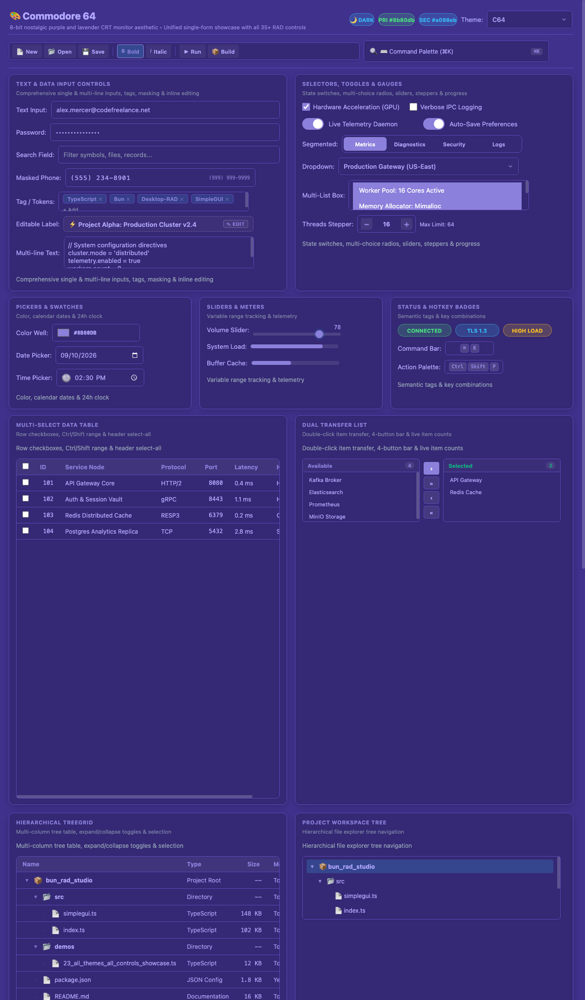

<p align="right"><a href="#top">▲ Back to Top</a> • <a href="#table-of-contents">📑 Table of Contents</a> • <a href="#quick-reference-index">⚡ Index Table</a></p>

---

<a id="theme-amber_crt"></a>
### 50. Phosphor Amber CRT (`amber_crt`)

> Warm VT220 / Pip-Boy amber phosphor monochrome terminal cathode glow

- **Mode**: 🌙 Dark | **Primary Accent**: `#ffb000` | **Secondary**: `#ff9000`
- **Canvas**: `#0a0600` | **Card Background**: `#160d00` | **Text**: `#ffb000`
- **Live Preview Command**: `bun run demo:themes amber_crt`

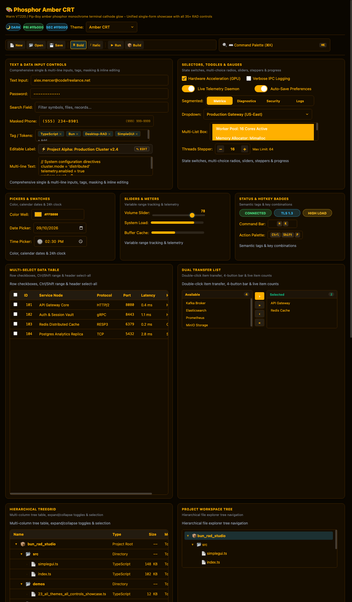

<p align="right"><a href="#top">▲ Back to Top</a> • <a href="#table-of-contents">📑 Table of Contents</a> • <a href="#quick-reference-index">⚡ Index Table</a></p>

---

<a id="theme-matrix"></a>
### 51. Matrix Phosphor (`matrix`)

> Iconic 1999 digital rain phosphor green mainframe terminal

- **Mode**: 🌙 Dark | **Primary Accent**: `#00ff41` | **Secondary**: `#03a628`
- **Canvas**: `#040a05` | **Card Background**: `#08140a` | **Text**: `#00ff66`
- **Live Preview Command**: `bun run demo:themes matrix`

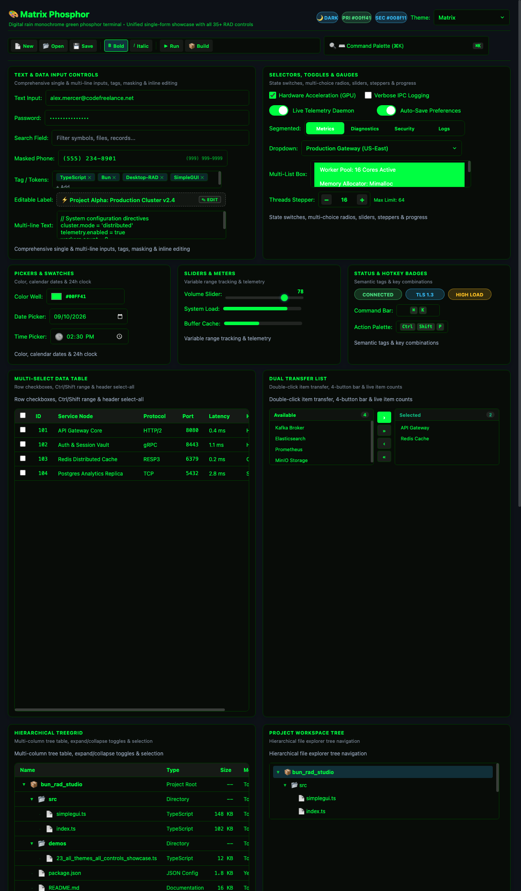

<p align="right"><a href="#top">▲ Back to Top</a> • <a href="#table-of-contents">📑 Table of Contents</a> • <a href="#quick-reference-index">⚡ Index Table</a></p>

---

<a id="theme-synthwave"></a>
### 52. Synthwave '84 (`synthwave`)

> 1980s neon synthwave, sunset magenta grid, and retro arcade glow

- **Mode**: 🌙 Dark | **Primary Accent**: `#ff2a85` | **Secondary**: `#05d9e8`
- **Canvas**: `#130924` | **Card Background**: `#22113d` | **Text**: `#fce7f3`
- **Live Preview Command**: `bun run demo:themes synthwave`

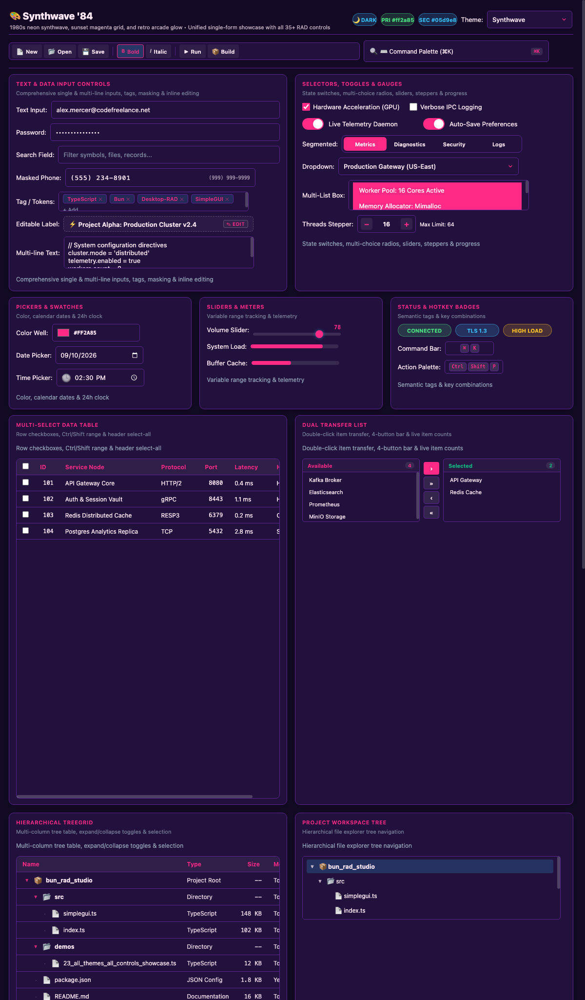

<p align="right"><a href="#top">▲ Back to Top</a> • <a href="#table-of-contents">📑 Table of Contents</a> • <a href="#quick-reference-index">⚡ Index Table</a></p>

---

<a id="theme-amiga"></a>
### 53. Amiga Workbench (`amiga`)

> Retro Amiga 500 Workbench 1.3 royal blue, orange buttons, and Topaz white

- **Mode**: 🌙 Dark | **Primary Accent**: `#ff8800` | **Secondary**: `#003b77`
- **Canvas**: `#0055aa` | **Card Background**: `#003870` | **Text**: `#ffffff`
- **Live Preview Command**: `bun run demo:themes amiga`

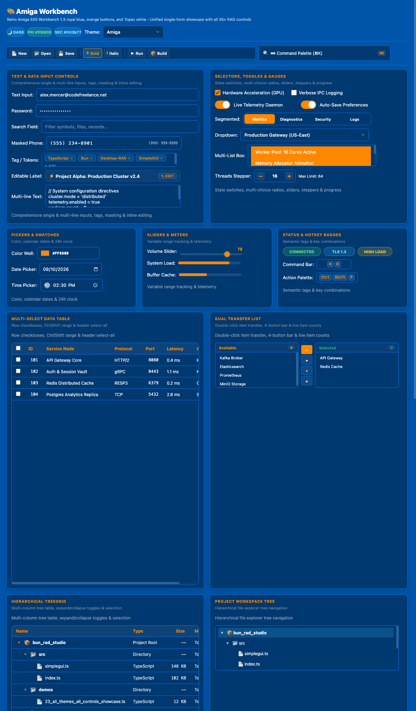

<p align="right"><a href="#top">▲ Back to Top</a> • <a href="#table-of-contents">📑 Table of Contents</a> • <a href="#quick-reference-index">⚡ Index Table</a></p>

---

<a id="theme-nextstep"></a>
### 54. NeXTSTEP 1989 (`nextstep`)

> Steve Jobs 1989 NeXTSTEP UNIX workstation dark minimalist elegance

- **Mode**: 🌙 Dark | **Primary Accent**: `#4a90e2` | **Secondary**: `#707070`
- **Canvas**: `#262626` | **Card Background**: `#333333` | **Text**: `#dedede`
- **Live Preview Command**: `bun run demo:themes nextstep`

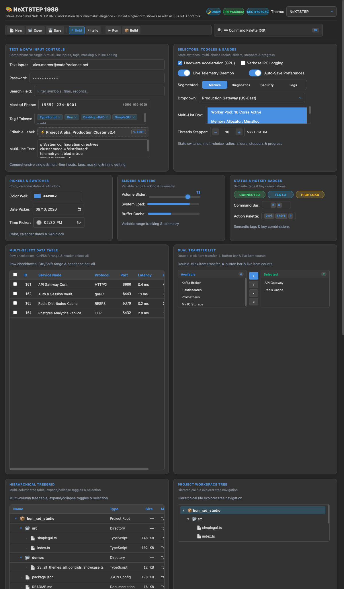

<p align="right"><a href="#top">▲ Back to Top</a> • <a href="#table-of-contents">📑 Table of Contents</a> • <a href="#quick-reference-index">⚡ Index Table</a></p>

---

<a id="theme-hotdog_stand"></a>
### 55. Hot Dog Stand (`hotdog_stand`)

> Unforgettable Windows 3.1 1992 Hot Dog Stand high-contrast yellow & red

- **Mode**: 🌙 Dark | **Primary Accent**: `#ff0000` | **Secondary**: `#ffff00`
- **Canvas**: `#000000` | **Card Background**: `#1c0000` | **Text**: `#ffffff`
- **Live Preview Command**: `bun run demo:themes hotdog_stand`

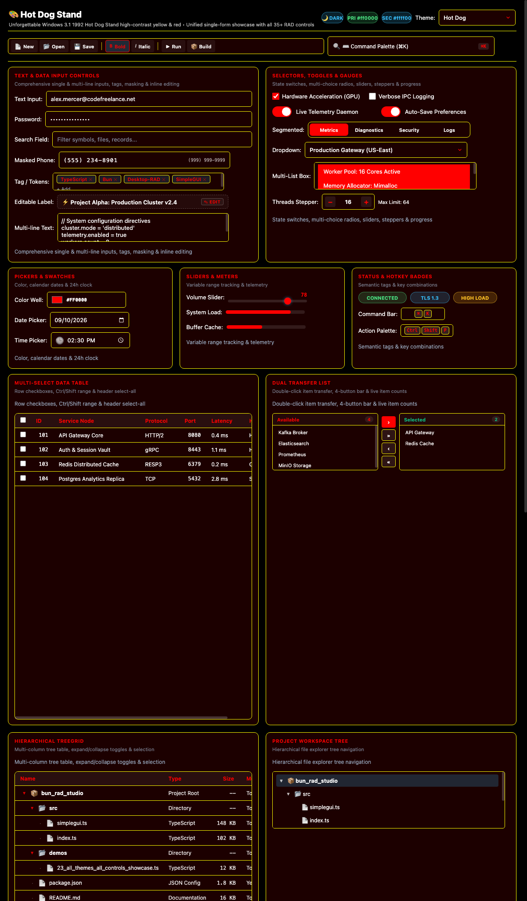

<p align="right"><a href="#top">▲ Back to Top</a> • <a href="#table-of-contents">📑 Table of Contents</a> • <a href="#quick-reference-index">⚡ Index Table</a></p>

---

<a id="theme-playstation"></a>
### 56. PlayStation 1994 (`playstation`)

> 1994 PSX console gray with iconic geometric controller accents

- **Mode**: 🌙 Dark | **Primary Accent**: `#00d2c4` | **Secondary**: `#f44336`
- **Canvas**: `#1e1e24` | **Card Background**: `#2a2b34` | **Text**: `#e4e5eb`
- **Live Preview Command**: `bun run demo:themes playstation`


<p align="right"><a href="#top">▲ Back to Top</a> • <a href="#table-of-contents">📑 Table of Contents</a> • <a href="#quick-reference-index">⚡ Index Table</a></p>

---

<a id="cat-linux"></a>
## 🐧 Modern Linux Desktop Themes

Authentic Linux desktop operating system styling covering Ubuntu Yaru, GNOME Libadwaita, Linux Mint Cinnamon, System76 Pop!_OS, and Fedora Workstation.

<a id="theme-ubuntu_dark"></a>
### 57. Ubuntu Yaru Dark (`ubuntu_dark`)

> Official Ubuntu Yaru modern Linux dark desktop with warm aubergine charcoal surfaces and signature Ubuntu orange accents

- **Mode**: 🌙 Dark | **Primary Accent**: `#e95420` | **Secondary**: `#77216f`
- **Canvas**: `#242424` | **Card Background**: `#303030` | **Text**: `#ffffff`
- **Live Preview Command**: `bun run demo:themes ubuntu_dark`


<p align="right"><a href="#top">▲ Back to Top</a> • <a href="#table-of-contents">📑 Table of Contents</a> • <a href="#quick-reference-index">⚡ Index Table</a></p>

---

<a id="theme-ubuntu_light"></a>
### 58. Ubuntu Yaru Light (`ubuntu_light`)

> Clean Ubuntu Yaru modern Linux light desktop with crisp white surfaces, warm gray borders, and vibrant Ubuntu orange

- **Mode**: ☀️ Light | **Primary Accent**: `#e95420` | **Secondary**: `#77216f`
- **Canvas**: `#f7f7f7` | **Card Background**: `#ffffff` | **Text**: `#1e1e1e`
- **Live Preview Command**: `bun run demo:themes ubuntu_light`


<p align="right"><a href="#top">▲ Back to Top</a> • <a href="#table-of-contents">📑 Table of Contents</a> • <a href="#quick-reference-index">⚡ Index Table</a></p>

---

<a id="theme-adwaita_dark"></a>
### 59. GNOME Adwaita Dark (`adwaita_dark`)

> Modern GNOME Libadwaita desktop theme with deep slate surfaces and signature Adwaita blue accents

- **Mode**: 🌙 Dark | **Primary Accent**: `#3584e4` | **Secondary**: `#1c71d8`
- **Canvas**: `#242424` | **Card Background**: `#303030` | **Text**: `#ffffff`
- **Live Preview Command**: `bun run demo:themes adwaita_dark`


<p align="right"><a href="#top">▲ Back to Top</a> • <a href="#table-of-contents">📑 Table of Contents</a> • <a href="#quick-reference-index">⚡ Index Table</a></p>

---

<a id="theme-adwaita_light"></a>
### 60. GNOME Adwaita Light (`adwaita_light`)

> Clean GNOME Libadwaita light desktop with neutral paper surfaces and signature blue controls

- **Mode**: ☀️ Light | **Primary Accent**: `#3584e4` | **Secondary**: `#1c71d8`
- **Canvas**: `#fafafa` | **Card Background**: `#ffffff` | **Text**: `#2e3436`
- **Live Preview Command**: `bun run demo:themes adwaita_light`


<p align="right"><a href="#top">▲ Back to Top</a> • <a href="#table-of-contents">📑 Table of Contents</a> • <a href="#quick-reference-index">⚡ Index Table</a></p>

---

<a id="theme-linux_mint"></a>
### 61. Linux Mint Dark (`linux_mint`)

> Modern Linux Mint Cinnamon desktop theme with slate graphite surfaces and signature mint green accents

- **Mode**: 🌙 Dark | **Primary Accent**: `#87a556` | **Secondary**: `#2ebd59`
- **Canvas**: `#2f343f` | **Card Background**: `#242831` | **Text**: `#e0e2e4`
- **Live Preview Command**: `bun run demo:themes linux_mint`


<p align="right"><a href="#top">▲ Back to Top</a> • <a href="#table-of-contents">📑 Table of Contents</a> • <a href="#quick-reference-index">⚡ Index Table</a></p>

---

<a id="theme-pop_os"></a>
### 62. Pop!_OS Dark (`pop_os`)

> System76 Pop!_OS and COSMIC modern Linux desktop with dark charcoal surfaces and signature teal and amber accents

- **Mode**: 🌙 Dark | **Primary Accent**: `#48b9c7` | **Secondary**: `#faa41a`
- **Canvas**: `#202222` | **Card Background**: `#2c2e2e` | **Text**: `#f6f6f6`
- **Live Preview Command**: `bun run demo:themes pop_os`


<p align="right"><a href="#top">▲ Back to Top</a> • <a href="#table-of-contents">📑 Table of Contents</a> • <a href="#quick-reference-index">⚡ Index Table</a></p>

---

<a id="theme-fedora_dark"></a>
### 63. Fedora Blue (`fedora_dark`)

> Official Fedora Workstation modern Linux theme with navy graphite cards and crisp Fedora blue

- **Mode**: 🌙 Dark | **Primary Accent**: `#51a2da` | **Secondary**: `#294172`
- **Canvas**: `#1f232a` | **Card Background**: `#292e38` | **Text**: `#ffffff`
- **Live Preview Command**: `bun run demo:themes fedora_dark`


<p align="right"><a href="#top">▲ Back to Top</a> • <a href="#table-of-contents">📑 Table of Contents</a> • <a href="#quick-reference-index">⚡ Index Table</a></p>

---

<!-- os-themes:start -->

<!-- Generated by scripts/build_os_theme_docs.ts. Edit src/shared/osThemes.ts, not this block. -->

<a id="os-linux"></a>
## 🐧 Linux Distributions & Desktop Environments (27 Themes)

One theme per major distribution, desktop environment and popular GTK theme, built from each project's own colors.

| Theme Key | Display Name | Mode | Primary Accent | Secondary | Canvas | Card | Text | Screenshot |
|---|---|---|---|---|---|---|---|---|
| `debian_dark` | **Debian Dark** | 🌙 Dark | `#f0457a` | `#a80030` | `#1c1b22` | `#26252e` | `#f2f2f5` | [🖼️](../screenshots/themes/debian_dark.png) |
| `debian_light` | **Debian Light** | ☀️ Light | `#c8004a` | `#a80030` | `#f4f3f6` | `#ffffff` | `#1d1b22` | [🖼️](../screenshots/themes/debian_light.png) |
| `arch_dark` | **Arch Linux Dark** | 🌙 Dark | `#1793d1` | `#5fb7e5` | `#0e1317` | `#171e24` | `#dfe6ec` | [🖼️](../screenshots/themes/arch_dark.png) |
| `opensuse_dark` | **openSUSE Dark** | 🌙 Dark | `#73ba25` | `#35b9ab` | `#12262e` | `#1a343f` | `#e8f1f2` | [🖼️](../screenshots/themes/opensuse_dark.png) |
| `manjaro_dark` | **Manjaro Dark** | 🌙 Dark | `#35bf5c` | `#6ee7a0` | `#1a1f1d` | `#232a27` | `#e6efe9` | [🖼️](../screenshots/themes/manjaro_dark.png) |
| `elementary_light` | **elementary OS Light** | ☀️ Light | `#0d52bf` | `#3689e6` | `#fafafa` | `#ffffff` | `#333333` | [🖼️](../screenshots/themes/elementary_light.png) |
| `elementary_dark` | **elementary OS Dark** | 🌙 Dark | `#64baff` | `#3689e6` | `#2b2b2b` | `#333333` | `#fafafa` | [🖼️](../screenshots/themes/elementary_dark.png) |
| `kali_dark` | **Kali Linux Dark** | 🌙 Dark | `#367bf0` | `#4cc9f0` | `#0e1116` | `#181c23` | `#e6e9ef` | [🖼️](../screenshots/themes/kali_dark.png) |
| `zorin_dark` | **Zorin OS Dark** | 🌙 Dark | `#15a6f0` | `#5dd0ff` | `#1b1f27` | `#242932` | `#eceff4` | [🖼️](../screenshots/themes/zorin_dark.png) |
| `rhel_dark` | **Red Hat Enterprise Linux Dark** | 🌙 Dark | `#ff4d4d` | `#a30000` | `#151515` | `#212427` | `#ffffff` | [🖼️](../screenshots/themes/rhel_dark.png) |
| `rocky_dark` | **Rocky Linux Dark** | 🌙 Dark | `#10b981` | `#34d399` | `#0f1a16` | `#17251f` | `#e5f2ec` | [🖼️](../screenshots/themes/rocky_dark.png) |
| `almalinux_dark` | **AlmaLinux Dark** | 🌙 Dark | `#29b6f6` | `#ff9f1c` | `#0b1b2b` | `#12283c` | `#e4eef7` | [🖼️](../screenshots/themes/almalinux_dark.png) |
| `centos_dark` | **CentOS Stream Dark** | 🌙 Dark | `#d268b8` | `#efa724` | `#1d1822` | `#28212f` | `#f1ecf4` | [🖼️](../screenshots/themes/centos_dark.png) |
| `fedora_light` | **Fedora Light** | ☀️ Light | `#3c6eb4` | `#51a2da` | `#f5f7fa` | `#ffffff` | `#1b2330` | [🖼️](../screenshots/themes/fedora_light.png) |
| `endeavouros_dark` | **EndeavourOS Dark** | 🌙 Dark | `#b17fe3` | `#f06292` | `#1a1423` | `#241b30` | `#efe8f7` | [🖼️](../screenshots/themes/endeavouros_dark.png) |
| `nixos_dark` | **NixOS Dark** | 🌙 Dark | `#7ebae4` | `#5277c3` | `#11161d` | `#1a212b` | `#e3e9f2` | [🖼️](../screenshots/themes/nixos_dark.png) |
| `gentoo_dark` | **Gentoo Dark** | 🌙 Dark | `#9b8fd6` | `#dddaec` | `#1c1a28` | `#262336` | `#ece9f7` | [🖼️](../screenshots/themes/gentoo_dark.png) |
| `alpine_dark` | **Alpine Linux Dark** | 🌙 Dark | `#35a9d6` | `#7ccbe8` | `#0f1f2b` | `#172d3c` | `#e3eef5` | [🖼️](../screenshots/themes/alpine_dark.png) |
| `kde_breeze_dark` | **KDE Plasma Breeze Dark** | 🌙 Dark | `#3daee9` | `#1d99f3` | `#31363b` | `#232629` | `#eff0f1` | [🖼️](../screenshots/themes/kde_breeze_dark.png) |
| `kde_breeze_light` | **KDE Plasma Breeze Light** | ☀️ Light | `#1b79b4` | `#3daee9` | `#eff0f1` | `#fcfcfc` | `#232627` | [🖼️](../screenshots/themes/kde_breeze_light.png) |
| `xfce_dark` | **Xfce Greybird Dark** | 🌙 Dark | `#5aa0e8` | `#fcaf3e` | `#2e3436` | `#393f42` | `#eeeeec` | [🖼️](../screenshots/themes/xfce_dark.png) |
| `mate_dark` | **MATE Ambiance Dark** | 🌙 Dark | `#87a556` | `#c4a000` | `#2d2d2d` | `#383838` | `#ebebeb` | [🖼️](../screenshots/themes/mate_dark.png) |
| `deepin_light` | **Deepin Light** | ☀️ Light | `#0a64d6` | `#3fa2ff` | `#f7f7f8` | `#ffffff` | `#1a1a1f` | [🖼️](../screenshots/themes/deepin_light.png) |
| `arc_dark` | **Arc GTK Dark** | 🌙 Dark | `#5294e2` | `#7c6ad6` | `#383c4a` | `#404552` | `#d3dae3` | [🖼️](../screenshots/themes/arc_dark.png) |
| `arc_light` | **Arc GTK Light** | ☀️ Light | `#3b73c0` | `#5294e2` | `#f5f6f7` | `#ffffff` | `#3b3e45` | [🖼️](../screenshots/themes/arc_light.png) |
| `sweet_dark` | **Sweet GTK Dark** | 🌙 Dark | `#d34fe0` | `#4dd0e1` | `#161925` | `#1f2335` | `#e0e3f0` | [🖼️](../screenshots/themes/sweet_dark.png) |
| `numix_dark` | **Numix GTK Dark** | 🌙 Dark | `#f0544c` | `#d64937` | `#2d2d2d` | `#3a3a3a` | `#eeeeee` | [🖼️](../screenshots/themes/numix_dark.png) |

Try one live: `bun run demo:themes debian_dark`

<a id="theme-debian_dark"></a>
### Debian Dark (`debian_dark`)

> Debian GNU/Linux dark desktop with charcoal surfaces and the swirl red accent


<a id="theme-debian_light"></a>
### Debian Light (`debian_light`)

> Debian GNU/Linux light desktop with clean white cards and the Debian swirl red


<a id="theme-arch_dark"></a>
### Arch Linux Dark (`arch_dark`)

> Arch Linux minimal dark desktop with near-black surfaces and the Arch blue


<a id="theme-opensuse_dark"></a>
### openSUSE Dark (`opensuse_dark`)

> openSUSE dark desktop with deep teal surfaces and the chameleon green


<a id="theme-manjaro_dark"></a>
### Manjaro Dark (`manjaro_dark`)

> Manjaro Linux dark desktop with graphite green surfaces and the Manjaro green


<a id="theme-elementary_light"></a>
### elementary OS Light (`elementary_light`)

> elementary OS Pantheon light desktop with soft white surfaces and Blueberry blue


<a id="theme-elementary_dark"></a>
### elementary OS Dark (`elementary_dark`)

> elementary OS Pantheon dark desktop with quiet graphite surfaces and Blueberry blue


<a id="theme-kali_dark"></a>
### Kali Linux Dark (`kali_dark`)

> Kali Linux security desktop with midnight surfaces and the Kali blue


<a id="theme-zorin_dark"></a>
### Zorin OS Dark (`zorin_dark`)

> Zorin OS dark desktop with slate surfaces and bright Zorin blue


<a id="theme-rhel_dark"></a>
### Red Hat Enterprise Linux Dark (`rhel_dark`)

> Red Hat Enterprise Linux dark console with neutral black surfaces and Red Hat red


<a id="theme-rocky_dark"></a>
### Rocky Linux Dark (`rocky_dark`)

> Rocky Linux dark desktop with forest surfaces and the Rocky green


<a id="theme-almalinux_dark"></a>
### AlmaLinux Dark (`almalinux_dark`)

> AlmaLinux dark desktop with deep navy surfaces and cyan and orange highlights


<a id="theme-centos_dark"></a>
### CentOS Stream Dark (`centos_dark`)

> CentOS Stream dark desktop with plum surfaces and the CentOS purple and gold


<a id="theme-fedora_light"></a>
### Fedora Light (`fedora_light`)

> Fedora Workstation light desktop with crisp white cards and Fedora blue


<a id="theme-endeavouros_dark"></a>
### EndeavourOS Dark (`endeavouros_dark`)

> EndeavourOS dark desktop with deep violet surfaces and purple and pink accents


<a id="theme-nixos_dark"></a>
### NixOS Dark (`nixos_dark`)

> NixOS dark desktop with ink surfaces and the two-tone Nix blue


<a id="theme-gentoo_dark"></a>
### Gentoo Dark (`gentoo_dark`)

> Gentoo Linux dark desktop with indigo surfaces and the Gentoo purple


<a id="theme-alpine_dark"></a>
### Alpine Linux Dark (`alpine_dark`)

> Alpine Linux dark desktop with icy navy surfaces and Alpine blue


<a id="theme-kde_breeze_dark"></a>
### KDE Plasma Breeze Dark (`kde_breeze_dark`)

> KDE Plasma Breeze Dark with the classic charcoal window and Plasma blue


<a id="theme-kde_breeze_light"></a>
### KDE Plasma Breeze Light (`kde_breeze_light`)

> KDE Plasma Breeze Light with soft gray windows and Plasma blue


<a id="theme-xfce_dark"></a>
### Xfce Greybird Dark (`xfce_dark`)

> Xfce Greybird dark desktop with graphite surfaces and a clear blue selection


<a id="theme-mate_dark"></a>
### MATE Ambiance Dark (`mate_dark`)

> MATE desktop Ambiant dark with warm charcoal surfaces and the MATE green


<a id="theme-deepin_light"></a>
### Deepin Light (`deepin_light`)

> Deepin Desktop Environment light theme with airy white surfaces and Deepin blue


<a id="theme-arc_dark"></a>
### Arc GTK Dark (`arc_dark`)

> Arc GTK dark theme with flat blue-gray surfaces and the Arc blue accent


<a id="theme-arc_light"></a>
### Arc GTK Light (`arc_light`)

> Arc GTK light theme with flat white surfaces and the Arc blue accent


<a id="theme-sweet_dark"></a>
### Sweet GTK Dark (`sweet_dark`)

> Sweet GTK dark theme with midnight surfaces and candy magenta and cyan accents


<a id="theme-numix_dark"></a>
### Numix GTK Dark (`numix_dark`)

> Numix GTK dark theme with flat charcoal surfaces and the Numix red


---

<a id="os-windows"></a>
## 🪟 Windows Versions (11 Themes)

Windows 3.1 through Windows 11, plus the Windows Terminal and High Contrast schemes.

| Theme Key | Display Name | Mode | Primary Accent | Secondary | Canvas | Card | Text | Screenshot |
|---|---|---|---|---|---|---|---|---|
| `win31` | **Windows 3.1** | ☀️ Light | `#000080` | `#c0c0c0` | `#808080` | `#ffffff` | `#000000` | [🖼️](../screenshots/themes/win31.png) |
| `win98` | **Windows 98** | ☀️ Light | `#0a246a` | `#a6caf0` | `#008a8a` | `#c0c0c0` | `#000000` | [🖼️](../screenshots/themes/win98.png) |
| `win2000` | **Windows 2000** | ☀️ Light | `#0a246a` | `#a6caf0` | `#7ba0cf` | `#d4d0c8` | `#000000` | [🖼️](../screenshots/themes/win2000.png) |
| `winxp_luna` | **Windows XP Luna** | ☀️ Light | `#0054e3` | `#3c9e3c` | `#9dbbf2` | `#ece9d8` | `#000000` | [🖼️](../screenshots/themes/winxp_luna.png) |
| `vista_aero` | **Windows Vista Aero** | 🌙 Dark | `#4ca3ff` | `#7fd1ff` | `#14263b` | `#22405f` | `#ffffff` | [🖼️](../screenshots/themes/vista_aero.png) |
| `win7_aero` | **Windows 7 Aero** | ☀️ Light | `#1e6fcf` | `#7eb4ea` | `#dbe6f4` | `#ffffff` | `#1b2433` | [🖼️](../screenshots/themes/win7_aero.png) |
| `win8_metro` | **Windows 8 Metro** | 🌙 Dark | `#2d89ef` | `#00a300` | `#1a1a1a` | `#2b2b2b` | `#ffffff` | [🖼️](../screenshots/themes/win8_metro.png) |
| `win10_dark` | **Windows 10 Dark** | 🌙 Dark | `#4cc2ff` | `#0078d7` | `#202020` | `#2b2b2b` | `#ffffff` | [🖼️](../screenshots/themes/win10_dark.png) |
| `win10_light` | **Windows 10 Light** | ☀️ Light | `#0063b1` | `#0078d7` | `#f0f0f0` | `#ffffff` | `#1a1a1a` | [🖼️](../screenshots/themes/win10_light.png) |
| `windows_terminal` | **Windows Terminal Campbell** | 🌙 Dark | `#3a96dd` | `#13a10e` | `#0c0c0c` | `#1a1a1a` | `#cccccc` | [🖼️](../screenshots/themes/windows_terminal.png) |
| `windows_high_contrast` | **Windows High Contrast** | 🌙 Dark | `#ffff00` | `#1aebff` | `#000000` | `#000000` | `#ffffff` | [🖼️](../screenshots/themes/windows_high_contrast.png) |

Try one live: `bun run demo:themes win31`

<a id="theme-win31"></a>
### Windows 3.1 (`win31`)

> Windows 3.1 Program Manager gray desktop with white windows and navy title bars


<a id="theme-win98"></a>
### Windows 98 (`win98`)

> Windows 98 classic teal desktop with silver 3D cards and the deep navy title gradient


<a id="theme-win2000"></a>
### Windows 2000 (`win2000`)

> Windows 2000 Professional blue desktop with warm beige 3D cards and navy title bars


<a id="theme-winxp_luna"></a>
### Windows XP Luna (`winxp_luna`)

> Windows XP Luna with the rounded blue title bars, cream cards and green Start accent


<a id="theme-vista_aero"></a>
### Windows Vista Aero (`vista_aero`)

> Windows Vista Aero glass with deep blue surfaces and glossy sky blue highlights


<a id="theme-win7_aero"></a>
### Windows 7 Aero (`win7_aero`)

> Windows 7 Aero light with pale blue glass, white cards and the Aero blue


<a id="theme-win8_metro"></a>
### Windows 8 Metro (`win8_metro`)

> Windows 8 Metro flat dark surfaces with bold tile blue and green accents


<a id="theme-win10_dark"></a>
### Windows 10 Dark (`win10_dark`)

> Windows 10 dark mode with neutral gray surfaces and the Windows blue


<a id="theme-win10_light"></a>
### Windows 10 Light (`win10_light`)

> Windows 10 light mode with white surfaces, gray canvas and the Windows blue


<a id="theme-windows_terminal"></a>
### Windows Terminal Campbell (`windows_terminal`)

> Windows Terminal Campbell console scheme with black canvas and blue and green accents


<a id="theme-windows_high_contrast"></a>
### Windows High Contrast (`windows_high_contrast`)

> Windows High Contrast Black with pure black, white text and yellow focus for maximum legibility


---

<a id="os-macos"></a>
## 🍎 macOS Versions (7 Themes)

Mac OS 9 Platinum through macOS Tahoe.

| Theme Key | Display Name | Mode | Primary Accent | Secondary | Canvas | Card | Text | Screenshot |
|---|---|---|---|---|---|---|---|---|
| `mac_os_9` | **Mac OS 9 Platinum** | ☀️ Light | `#5f5fa3` | `#9999cc` | `#cfcfcf` | `#eeeeee` | `#000000` | [🖼️](../screenshots/themes/mac_os_9.png) |
| `snow_leopard` | **Mac OS X Snow Leopard** | ☀️ Light | `#3b6fb6` | `#8a94a3` | `#e0e4ea` | `#f3f4f6` | `#1b1d21` | [🖼️](../screenshots/themes/snow_leopard.png) |
| `yosemite` | **Mac OS X Yosemite** | ☀️ Light | `#0f6cf5` | `#ff2d55` | `#ececec` | `#ffffff` | `#262626` | [🖼️](../screenshots/themes/yosemite.png) |
| `big_sur` | **macOS Big Sur Dark** | 🌙 Dark | `#b07cf5` | `#ff6ea8` | `#1d1730` | `#2a2142` | `#f2eefb` | [🖼️](../screenshots/themes/big_sur.png) |
| `monterey_light` | **macOS Monterey Light** | ☀️ Light | `#6b4de6` | `#ff7a45` | `#efeaf7` | `#ffffff` | `#25212e` | [🖼️](../screenshots/themes/monterey_light.png) |
| `sequoia_dark` | **macOS Sequoia Dark** | 🌙 Dark | `#4cd08a` | `#d9a441` | `#121c16` | `#1b2a22` | `#e8f2ec` | [🖼️](../screenshots/themes/sequoia_dark.png) |
| `tahoe_glass` | **macOS Tahoe Glass** | ☀️ Light | `#0a62d9` | `#00b3ff` | `#e8eef8` | `#f8fbff` | `#162033` | [🖼️](../screenshots/themes/tahoe_glass.png) |

Try one live: `bun run demo:themes mac_os_9`

<a id="theme-mac_os_9"></a>
### Mac OS 9 Platinum (`mac_os_9`)

> Mac OS 8 and 9 Platinum with gray pinstripe windows and the lavender selection


<a id="theme-snow_leopard"></a>
### Mac OS X Snow Leopard (`snow_leopard`)

> Mac OS X Snow Leopard Graphite with brushed gray surfaces and a steel blue accent


<a id="theme-yosemite"></a>
### Mac OS X Yosemite (`yosemite`)

> OS X Yosemite flat vibrancy with translucent white cards and the bright blue


<a id="theme-big_sur"></a>
### macOS Big Sur Dark (`big_sur`)

> macOS Big Sur dark with the violet wallpaper tones and pink highlights


<a id="theme-monterey_light"></a>
### macOS Monterey Light (`monterey_light`)

> macOS Monterey light with the lilac wallpaper tones and warm orange highlights


<a id="theme-sequoia_dark"></a>
### macOS Sequoia Dark (`sequoia_dark`)

> macOS Sequoia dark with redwood forest greens and golden light


<a id="theme-tahoe_glass"></a>
### macOS Tahoe Glass (`tahoe_glass`)

> macOS Tahoe Liquid Glass light with frosted blue-white surfaces and a clear blue


---

<a id="os-rare"></a>
## 💾 Rare & Beloved Systems (22 Themes)

Desktops and devices many people loved but may never have seen: BeOS and Haiku, OS/2 Warp, Solaris CDE, SGI IRIX, Atari GEM, RISC OS, QNX Photon, Symbian, Palm OS and webOS, Windows Phone, Zune, Android Holo, Longhorn, Media Center, Plan 9 Acme, SerenityOS, KDE 3 Keramik, Bluecurve, Ubuntu Human and Window Maker.

| Theme Key | Display Name | Mode | Primary Accent | Secondary | Canvas | Card | Text | Screenshot |
|---|---|---|---|---|---|---|---|---|
| `beos_r5` | **BeOS R5** | ☀️ Light | `#ffcb00` | `#336699` | `#dcdcdc` | `#ececec` | `#000000` | [🖼️](../screenshots/themes/beos_r5.png) |
| `haiku_os` | **Haiku OS** | ☀️ Light | `#f5c400` | `#3366bb` | `#eeeeee` | `#f9f9f9` | `#1a1a1a` | [🖼️](../screenshots/themes/haiku_os.png) |
| `os2_warp` | **OS/2 Warp 4** | ☀️ Light | `#000080` | `#008080` | `#c6c6c6` | `#d4d0c8` | `#000000` | [🖼️](../screenshots/themes/os2_warp.png) |
| `solaris_cde` | **Solaris CDE** | ☀️ Light | `#4b4b7a` | `#5f7f7c` | `#aeb2c3` | `#c3c6d4` | `#000000` | [🖼️](../screenshots/themes/solaris_cde.png) |
| `irix_indigo_magic` | **SGI IRIX Indigo Magic** | ☀️ Light | `#5b3fa0` | `#3c7d8c` | `#c2c4d0` | `#d5d7e0` | `#111111` | [🖼️](../screenshots/themes/irix_indigo_magic.png) |
| `atari_tos_gem` | **Atari TOS GEM** | ☀️ Light | `#0b3d91` | `#1b5e20` | `#4caf50` | `#ffffff` | `#000000` | [🖼️](../screenshots/themes/atari_tos_gem.png) |
| `risc_os` | **RISC OS** | ☀️ Light | `#2648a8` | `#8a6d00` | `#c8c8c8` | `#fffbe0` | `#000000` | [🖼️](../screenshots/themes/risc_os.png) |
| `qnx_photon` | **QNX Photon** | 🌙 Dark | `#7fb4ff` | `#f0b429` | `#2f3b4c` | `#3b4a5e` | `#eef2f7` | [🖼️](../screenshots/themes/qnx_photon.png) |
| `symbian_s60` | **Symbian S60** | 🌙 Dark | `#4fb3ff` | `#ffb000` | `#0b2a4a` | `#12385f` | `#eaf3ff` | [🖼️](../screenshots/themes/symbian_s60.png) |
| `palm_os` | **Palm OS** | ☀️ Light | `#1f3a93` | `#5b6b3a` | `#c6d1b0` | `#d8e0c6` | `#1a1f12` | [🖼️](../screenshots/themes/palm_os.png) |
| `palm_webos` | **Palm webOS** | 🌙 Dark | `#6fb1e8` | `#ff9a33` | `#1c1c1c` | `#2a2a2a` | `#f2f2f2` | [🖼️](../screenshots/themes/palm_webos.png) |
| `windows_phone_metro` | **Windows Phone Metro** | 🌙 Dark | `#1ba1e2` | `#f09609` | `#000000` | `#1f1f1f` | `#ffffff` | [🖼️](../screenshots/themes/windows_phone_metro.png) |
| `zune_desktop` | **Zune Desktop** | 🌙 Dark | `#ff4fa8` | `#f58220` | `#121212` | `#1f1f1f` | `#f5f5f5` | [🖼️](../screenshots/themes/zune_desktop.png) |
| `android_holo` | **Android Holo** | 🌙 Dark | `#33b5e5` | `#99cc00` | `#101214` | `#1b1e21` | `#e8e8e8` | [🖼️](../screenshots/themes/android_holo.png) |
| `windows_longhorn` | **Windows Longhorn Plex** | 🌙 Dark | `#6ec6ff` | `#9bd35a` | `#0f1a24` | `#18283a` | `#e6eef5` | [🖼️](../screenshots/themes/windows_longhorn.png) |
| `ubuntu_human` | **Ubuntu Human (2006)** | ☀️ Light | `#a3521a` | `#7b5427` | `#efebe7` | `#f9f7f5` | `#2e2a26` | [🖼️](../screenshots/themes/ubuntu_human.png) |
| `plan9_acme` | **Plan 9 Acme** | ☀️ Light | `#2f5f9a` | `#6b6b2e` | `#ffffea` | `#eaffff` | `#000000` | [🖼️](../screenshots/themes/plan9_acme.png) |
| `serenity_os` | **SerenityOS** | ☀️ Light | `#3b5fa0` | `#b3601a` | `#e3dfdb` | `#f5f3f1` | `#000000` | [🖼️](../screenshots/themes/serenity_os.png) |
| `kde3_keramik` | **KDE 3 Keramik** | ☀️ Light | `#3a6fb0` | `#b07818` | `#eaeef3` | `#ffffff` | `#10151c` | [🖼️](../screenshots/themes/kde3_keramik.png) |
| `redhat_bluecurve` | **Red Hat Bluecurve** | ☀️ Light | `#3b5a8f` | `#b3262f` | `#dcdfe4` | `#f2f3f5` | `#1b1b1b` | [🖼️](../screenshots/themes/redhat_bluecurve.png) |
| `windows_media_center` | **Windows Media Center** | 🌙 Dark | `#3ac3ff` | `#9bd94a` | `#04254f` | `#0a3a74` | `#ffffff` | [🖼️](../screenshots/themes/windows_media_center.png) |
| `window_maker` | **Window Maker** | 🌙 Dark | `#c8c8ff` | `#bdbdbd` | `#505075` | `#3c3c56` | `#f0f0f0` | [🖼️](../screenshots/themes/window_maker.png) |

Try one live: `bun run demo:themes beos_r5`

<a id="theme-beos_r5"></a>
### BeOS R5 (`beos_r5`)

> BeOS R5 (1999), the beloved media OS: yellow window tabs, soft gray panels and the blue Deskbar


<a id="theme-haiku_os"></a>
### Haiku OS (`haiku_os`)

> Haiku, the open-source heir to BeOS: bright gray surfaces, golden window tabs and calm blue highlights


<a id="theme-os2_warp"></a>
### OS/2 Warp 4 (`os2_warp`)

> IBM OS/2 Warp 4 (1996): the Workplace Shell with gray 3D panels, navy title bars and teal accents


<a id="theme-solaris_cde"></a>
### Solaris CDE (`solaris_cde`)

> The Common Desktop Environment on Sun Solaris: slate lavender panels, indigo and teal, from 1990s Unix workstations


<a id="theme-irix_indigo_magic"></a>
### SGI IRIX Indigo Magic (`irix_indigo_magic`)

> Silicon Graphics IRIX Indigo Magic desktop: cool gray-blue panels and SGI purple, from the workstations behind 90s film effects


<a id="theme-atari_tos_gem"></a>
### Atari TOS GEM (`atari_tos_gem`)

> Atari ST TOS with GEM (1985): the green desktop, crisp white windows and solid black outlines


<a id="theme-risc_os"></a>
### RISC OS (`risc_os`)

> Acorn RISC OS from the Archimedes: light gray desk, cream windows and the three-button Iconbar blue


<a id="theme-qnx_photon"></a>
### QNX Photon (`qnx_photon`)

> QNX Photon microGUI: the real-time OS desktop with steel blue panels and amber highlights


<a id="theme-symbian_s60"></a>
### Symbian S60 (`symbian_s60`)

> Nokia Symbian S60 phones: deep blue gradients, bright blue selection and amber softkey accents


<a id="theme-palm_os"></a>
### Palm OS (`palm_os`)

> Palm OS handhelds: the greenish LCD screen, dark ink text and the navy title tab


<a id="theme-palm_webos"></a>
### Palm webOS (`palm_webos`)

> Palm webOS: dark card-based multitasking with soft blue and orange, the ancestor of modern phone gestures


<a id="theme-windows_phone_metro"></a>
### Windows Phone Metro (`windows_phone_metro`)

> Windows Phone 7 Metro: pure black, bold white type and the cyan live-tile accent


<a id="theme-zune_desktop"></a>
### Zune Desktop (`zune_desktop`)

> The Zune music software: near-black with the magenta and orange Zune gradient


<a id="theme-android_holo"></a>
### Android Holo (`android_holo`)

> Android 4 Holo (Ice Cream Sandwich): dark slate with the Holo blue and green highlights


<a id="theme-windows_longhorn"></a>
### Windows Longhorn Plex (`windows_longhorn`)

> The unreleased Windows Longhorn Plex theme: dark slate glass with sky blue and lime accents


<a id="theme-ubuntu_human"></a>
### Ubuntu Human (2006) (`ubuntu_human`)

> Early Ubuntu's Human theme: warm brown and orange 'Linux for human beings' desktop


<a id="theme-plan9_acme"></a>
### Plan 9 Acme (`plan9_acme`)

> Plan 9 from Bell Labs and the Acme editor: pale yellow text areas, pale cyan tag bars and olive scrollbars


<a id="theme-serenity_os"></a>
### SerenityOS (`serenity_os`)

> SerenityOS: a love letter to late-90s desktops, with beige panels and blue gradient titles


<a id="theme-kde3_keramik"></a>
### KDE 3 Keramik (`kde3_keramik`)

> KDE 3 Keramik: rounded, glossy light blue widgets from the early-2000s Konqueror days


<a id="theme-redhat_bluecurve"></a>
### Red Hat Bluecurve (`redhat_bluecurve`)

> Red Hat Bluecurve: the unified GNOME and KDE look of Red Hat Linux 8 and 9


<a id="theme-windows_media_center"></a>
### Windows Media Center (`windows_media_center`)

> Windows Media Center: the ten-foot living room UI in deep blue with bright cyan focus


<a id="theme-window_maker"></a>
### Window Maker (`window_maker`)

> Window Maker: the NeXTSTEP-style X11 window manager with its dock, tiles and purple-gray desktop


---

<a id="status-colors"></a>
## 🚦 Status colors: danger, warning, success, info

Every theme has four status colors. They are worked out from the theme so they always read well on its canvas and cards (text at least 4.5:1 where the canvas allows it, fills at least 3:1 against the card, and the label on a fill at least 4.5:1). Well-known palettes (Dracula, Nord, Gruvbox, Solarized, Catppuccin, Monokai Pro, Tokyo Night, One Dark, GitHub, Everforest, Kanagawa and the classic Windows palettes) use their own published colors.

```ts
const sem = simplegui.getSemanticColors("dracula");   // sem.danger.solid, .on, .text, .soft, .border (same for warning, success, info)
win.addButton("del", "Delete", { variant: "danger" });                     // solid
win.addButton("save", "Save", { variant: "success", appearance: "soft" }); // soft tint; "outline" also works
win.addBadge("Late", "warning");                                           // badges, alerts, toasts and status dots use the same colors
```

In CSS they are variables that follow the theme, including after a live theme switch: `--danger`, `--danger-on`, `--danger-text`, `--danger-soft`, `--danger-border`, and the same for `--warning`, `--success`, `--info`.

| Theme | Danger | Warning | Success | Info |
|---|---|---|---|---|
| `ubuntu_dark` | `#f87171` | `#fbbf24` | `#4ade80` | `#38bdf8` |
| `ubuntu_light` | `#dc2626` | `#d97706` | `#16a34a` | `#0284c7` |
| `dracula` | `#ff5555` | `#f1fa8c` | `#50fa7b` | `#8be9fd` |
| `nord` | `#c97980` | `#ebcb8b` | `#a3be8c` | `#88c0d0` |
| `solarized_light` | `#dc322f` | `#a37b00` | `#788a00` | `#268bd2` |
| `github_dark` | `#f85149` | `#d29922` | `#3fb950` | `#58a6ff` |
| `win95` | `#c00000` | `#262600` | `#002d00` | `#0000ff` |
| `windows_high_contrast` | `#ff6e6e` | `#ffff00` | `#3ff23f` | `#1aebff` |
| `debian_dark` | `#f87171` | `#fbbf24` | `#4ade80` | `#38bdf8` |
| `tahoe_glass` | `#dc2626` | `#d97706` | `#16a34a` | `#0284c7` |

<!-- os-themes:end -->

<!-- fx-themes:start -->

<!-- Generated by scripts/build_os_theme_docs.ts. Edit src/shared/fxThemes.ts, not this block. -->

<a id="fx-themes"></a>
## 🌌 Futuristic Themes (155 Themes)

Glass surfaces, edge glow, a slow living backdrop and a motion layer (button bloom, floating labels, sliding tab pill, tilting cards). Every theme here carries an `fx` descriptor; the other 143 themes render exactly as before. Body text on glass is checked at 4.5:1 over both a black and a white backdrop, and the effects respect `prefers-reduced-motion`, `prefers-contrast` and forced colors. Guide: [fx-themes developer guide](developer/fx-themes.md).

| Theme Key | Display Name | Mode | Primary Accent | Secondary | Canvas | Card | Text | Glow | Glass | Motion | Border | Screenshot |
|---|---|---|---|---|---|---|---|---|---|---|---|---|
| `prism_reactor` | **Prism Reactor** | 🌙 Dark | `#53f4ff` | `#ff67d8` | `#060918` | `#101a30` | `#edf8ff` | neon | 0.8 | spring | gradient | [view](#theme-prism_reactor) |
| `orbital_ice` | **Orbital Ice** | ☀️ Light | `#165ba3` | `#7255a8` | `#e8f2fa` | `#f7fbff` | `#132b43` | soft | 0.7 | calm | metal | [view](#theme-orbital_ice) |
| `ember_grid` | **Ember Grid** | 🌙 Dark | `#ffb454` | `#ff6178` | `#100905` | `#24150c` | `#fff0dc` | neon | 0.25 | snappy | gradient | [view](#theme-ember_grid) |
| `cyberpunk_hologram` | **Cyberpunk Hologram** | 🌙 Dark | `#00e5ff` | `#ff4fd8` | `#060a14` | `#0d1626` | `#e6f7ff` | neon | 0.55 | snappy | gradient | [view](#theme-cyberpunk_hologram) |
| `neon_hud` | **Neon HUD** | 🌙 Dark | `#19f5d6` | `#ff3d8b` | `#03090c` | `#07171b` | `#dffff8` | neon | 0.45 | snappy | gradient | [view](#theme-neon_hud) |
| `quantum_obsidian` | **Quantum Obsidian** | 🌙 Dark | `#2dd4bf` | `#a78bfa` | `#000000` | `#0a0d10` | `#eaf6f4` | soft | 0.6 | spring | gradient | [view](#theme-quantum_obsidian) |
| `deep_space` | **Deep Space** | 🌙 Dark | `#a78bfa` | `#60a5fa` | `#05060f` | `#0d1030` | `#e8eaff` | soft | 0.5 | spring | gradient | [view](#theme-deep_space) |
| `liquid_metal` | **Liquid Metal** | 🌙 Dark | `#c9d4e0` | `#7fb0e0` | `#101214` | `#1a1e22` | `#eef1f4` | soft | 0.35 | spring | metal | [view](#theme-liquid_metal) |
| `titanium_aurora` | **Titanium Aurora** | 🌙 Dark | `#34d399` | `#a78bfa` | `#0b1014` | `#141c22` | `#e9f1f5` | soft | 0.5 | calm | gradient | [view](#theme-titanium_aurora) |
| `liquid_metal_light` | **Liquid Metal Light** | ☀️ Light | `#2b4a6b` | `#5b6b7c` | `#e7ebef` | `#f6f8fa` | `#14181d` | none | 0.4 | spring | metal | [view](#theme-liquid_metal_light) |
| `neo_tokyo_dark` | **Neo-Tokyo Dark** | 🌙 Dark | `#ff6ac1` | `#2de2c9` | `#0f1021` | `#191a33` | `#eceaff` | soft | 0.4 | snappy | gradient | [view](#theme-neo_tokyo_dark) |
| `synthetic_solar` | **Synthetic Solar** | 🌙 Dark | `#ffb347` | `#ff5fa2` | `#140c0a` | `#211410` | `#fff1e6` | soft | 0.4 | snappy | gradient | [view](#theme-synthetic_solar) |
| `neo_tokyo_day` | **Neo-Tokyo Day** | ☀️ Light | `#b3135f` | `#00796b` | `#f1effa` | `#ffffff` | `#1c1a33` | soft | 0.35 | spring | gradient | [view](#theme-neo_tokyo_day) |
| `aurora_glass` | **Aurora Glass** | 🌙 Dark | `#5ef2d0` | `#7aa8ff` | `#07131c` | `#0f202b` | `#e6fbf7` | soft | 0.62 | spring | gradient | [view](#theme-aurora_glass) |
| `plasma_violet` | **Plasma Violet** | 🌙 Dark | `#d28bff` | `#ff6b9d` | `#0d0716` | `#1a1028` | `#f3e9ff` | neon | 0.45 | spring | gradient | [view](#theme-plasma_violet) |
| `synthwave_sunset` | **Synthwave Sunset** | 🌙 Dark | `#ff7edb` | `#72f1b8` | `#1a0b2e` | `#261447` | `#fdf0ff` | neon | 0.45 | snappy | gradient | [view](#theme-synthwave_sunset) |
| `matrix_rain` | **Matrix Rain** | 🌙 Dark | `#39ff6a` | `#00c8a0` | `#020a04` | `#071a0c` | `#c8ffd4` | neon | 0.3 | snappy | flat | [view](#theme-matrix_rain) |
| `amber_phosphor` | **Amber Phosphor** | 🌙 Dark | `#ffb000` | `#ff8a2a` | `#0e0800` | `#1c1104` | `#ffe2b0` | soft | 0.2 | calm | flat | [view](#theme-amber_phosphor) |
| `midnight_glass` | **Midnight Glass** | 🌙 Dark | `#8ab4ff` | `#c4a1ff` | `#0b0f1a` | `#161c2e` | `#eef2ff` | soft | 0.8 | spring | gradient | [view](#theme-midnight_glass) |
| `abyss_bloom` | **Abyss Bloom** | 🌙 Dark | `#3cf0ff` | `#b06bff` | `#020b12` | `#08202c` | `#dff9ff` | soft | 0.6 | calm | gradient | [view](#theme-abyss_bloom) |
| `cosmic_nebula` | **Cosmic Nebula** | 🌙 Dark | `#ff9ef5` | `#7cc4ff` | `#0a0614` | `#170f2a` | `#f1e9ff` | neon | 0.55 | spring | gradient | [view](#theme-cosmic_nebula) |
| `obsidian_gold` | **Obsidian Gold** | 🌙 Dark | `#e6c068` | `#d39a62` | `#0c0a07` | `#1a160f` | `#f7efdc` | soft | 0.35 | calm | metal | [view](#theme-obsidian_gold) |
| `crimson_eclipse` | **Crimson Eclipse** | 🌙 Dark | `#ff5c6c` | `#ff9a3d` | `#0e0405` | `#1e0a0d` | `#ffe6e8` | neon | 0.35 | snappy | gradient | [view](#theme-crimson_eclipse) |
| `acid_reactor` | **Acid Reactor** | 🌙 Dark | `#b6ff3b` | `#3bffd0` | `#070a02` | `#121a06` | `#f2ffd8` | neon | 0.35 | snappy | gradient | [view](#theme-acid_reactor) |
| `polar_night` | **Polar Night** | 🌙 Dark | `#8fe3ff` | `#b9c7ff` | `#07101a` | `#0f1d2b` | `#e8f6ff` | soft | 0.65 | calm | metal | [view](#theme-polar_night) |
| `emerald_grove` | **Emerald Grove** | 🌙 Dark | `#4ff0a0` | `#c3f56a` | `#04100b` | `#0b2019` | `#e3fff1` | soft | 0.5 | calm | gradient | [view](#theme-emerald_grove) |
| `brass_engine` | **Brass Engine** | 🌙 Dark | `#e0a85a` | `#d48a5c` | `#140e08` | `#22180f` | `#f5e6cc` | soft | 0.25 | calm | metal | [view](#theme-brass_engine) |
| `focus_glow` | **Focus Glow** | 🌙 Dark | `#7fb2ff` | `#a8c7fa` | `#111318` | `#1b1e24` | `#e8eaed` | soft | 0.3 | calm | flat | [view](#theme-focus_glow) |
| `neon_max` | **Neon Max** | 🌙 Dark | `#00ffff` | `#ff4dff` | `#000000` | `#0a0a0a` | `#ffffff` | neon | 0 | snappy | gradient | [view](#theme-neon_max) |
| `vaporwave_dream` | **Vaporwave Dream** | 🌙 Dark | `#ff9de2` | `#8ef6e4` | `#2a1b3d` | `#36244f` | `#fbe9ff` | soft | 0.45 | spring | gradient | [view](#theme-vaporwave_dream) |
| `frosted_glass` | **Frosted Glass** | ☀️ Light | `#2457c5` | `#7a4fc4` | `#eef2f8` | `#ffffff` | `#18202e` | soft | 0.7 | spring | gradient | [view](#theme-frosted_glass) |
| `sakura_glass` | **Sakura Glass** | ☀️ Light | `#b0245e` | `#6b4fa8` | `#fbf0f4` | `#ffffff` | `#2d1a24` | soft | 0.6 | calm | gradient | [view](#theme-sakura_glass) |
| `pearl_hologram` | **Pearl Hologram** | ☀️ Light | `#6a3fd1` | `#00808a` | `#f2f0fa` | `#fbfaff` | `#1f1c33` | soft | 0.55 | spring | gradient | [view](#theme-pearl_hologram) |
| `rose_gold` | **Rose Gold** | ☀️ Light | `#9c4a3a` | `#8a5a78` | `#f8efea` | `#fffaf7` | `#2b1c18` | soft | 0.45 | calm | metal | [view](#theme-rose_gold) |
| `daylight_hud` | **Daylight HUD** | ☀️ Light | `#0b6e5f` | `#8a2d6b` | `#eef5f3` | `#ffffff` | `#0f2420` | soft | 0.3 | snappy | gradient | [view](#theme-daylight_hud) |
| `tesla_coil_plasma` | **Tesla Coil Plasma** | 🌙 Dark | `#c77dff` | `#3bf0ff` | `#070412` | `#120a24` | `#f3ecff` | neon | 0.5 | snappy | gradient | [view](#theme-tesla_coil_plasma) |
| `wardenclyffe_tower` | **Wardenclyffe Megacoil** | 🌙 Dark | `#e09eff` | `#ffb84d` | `#09060f` | `#161022` | `#f7f0ff` | neon | 0.45 | snappy | metal | [view](#theme-wardenclyffe_tower) |
| `nikola_plasma_globe` | **Nikola Plasma Sphere** | 🌙 Dark | `#ff66d9` | `#66d9ff` | `#0b0414` | `#180b29` | `#fcebff` | neon | 0.58 | spring | gradient | [view](#theme-nikola_plasma_globe) |
| `jacobs_ladder_arc` | **Jacob's Ladder Arc** | 🌙 Dark | `#ffbe55` | `#9d7bff` | `#0c0804` | `#1b1209` | `#fff3e0` | neon | 0.4 | snappy | metal | [view](#theme-jacobs_ladder_arc) |
| `ball_lightning_storm` | **Ball Lightning Plasmoid** | 🌙 Dark | `#66e3ff` | `#ff94e8` | `#050a14` | `#0f192b` | `#eaf4ff` | neon | 0.52 | spring | gradient | [view](#theme-ball_lightning_storm) |
| `tokamak_fusion` | **Tokamak Fusion Torus** | 🌙 Dark | `#ff6b9d` | `#4de8ff` | `#11050c` | `#210c18` | `#ffeaf4` | neon | 0.48 | snappy | gradient | [view](#theme-tokamak_fusion) |
| `cherenkov_reactor` | **Cherenkov Blue Reactor** | 🌙 Dark | `#38b6ff` | `#5ce1e6` | `#020b18` | `#07182e` | `#e6f6ff` | neon | 0.58 | calm | gradient | [view](#theme-cherenkov_reactor) |
| `cern_synchrotron` | **CERN Hadron Collider** | 🌙 Dark | `#ffd15c` | `#4ddbff` | `#080c12` | `#121a26` | `#edf5ff` | neon | 0.42 | snappy | metal | [view](#theme-cern_synchrotron) |
| `lorentz_chaos` | **Lorenz Strange Attractor** | 🌙 Dark | `#3df5c4` | `#ffb86c` | `#04110e` | `#0b211c` | `#e6fff9` | soft | 0.48 | spring | gradient | [view](#theme-lorentz_chaos) |
| `ferrofluid_spike` | **Ferrofluid Neodymium** | 🌙 Dark | `#94b8ff` | `#d4a5ff` | `#090a0d` | `#14171f` | `#eef2f9` | soft | 0.45 | spring | metal | [view](#theme-ferrofluid_spike) |
| `hawking_horizon` | **Hawking Event Horizon** | 🌙 Dark | `#ffa654` | `#b388ff` | `#06040a` | `#120d1c` | `#f4eeff` | neon | 0.52 | calm | gradient | [view](#theme-hawking_horizon) |
| `ligo_gravwave` | **LIGO Spacetime Wave** | 🌙 Dark | `#47e5bc` | `#7ab8ff` | `#030d14` | `#0a1c29` | `#e8f8ff` | soft | 0.45 | snappy | gradient | [view](#theme-ligo_gravwave) |
| `meissner_superconductor` | **Meissner Levitation** | 🌙 Dark | `#6ef2ff` | `#a3b8ff` | `#031017` | `#0a1f2b` | `#e6f9ff` | soft | 0.62 | spring | metal | [view](#theme-meissner_superconductor) |
| `antimatter_penning` | **Antimatter Penning Trap** | 🌙 Dark | `#ff5c8a` | `#70e1ff` | `#12040a` | `#240b16` | `#ffebf2` | neon | 0.46 | snappy | gradient | [view](#theme-antimatter_penning) |
| `dyson_megastructure` | **Dyson Sphere Swarm** | 🌙 Dark | `#ffc44d` | `#ff7b54` | `#0f0903` | `#1f1408` | `#fff4e4` | soft | 0.42 | calm | metal | [view](#theme-dyson_megastructure) |
| `alcubierre_metric` | **Alcubierre Warp Drive** | 🌙 Dark | `#6ba4ff` | `#ff7a90` | `#040816` | `#0c142b` | `#ebf1ff` | neon | 0.5 | snappy | gradient | [view](#theme-alcubierre_metric) |
| `lissajous_scope` | **Tektronix Vector Scope** | 🌙 Dark | `#2ef2a0` | `#6be8ff` | `#03120c` | `#082419` | `#e6fff5` | neon | 0.35 | snappy | gradient | [view](#theme-lissajous_scope) |
| `quark_chromodynamics` | **Quark-Gluon Plasma** | 🌙 Dark | `#ff75d8` | `#59f0c8` | `#0d0614` | `#190e26` | `#f6edff` | neon | 0.5 | spring | gradient | [view](#theme-quark_chromodynamics) |
| `arc_reactor_mk` | **Palladium Arc Reactor** | 🌙 Dark | `#52dcff` | `#a6e3ff` | `#030c14` | `#091929` | `#eaf7ff` | neon | 0.5 | snappy | metal | [view](#theme-arc_reactor_mk) |
| `st_elmos_corona` | **St. Elmo's Brush Fire** | 🌙 Dark | `#8caeff` | `#d19cff` | `#060913` | `#101729` | `#edf2ff` | soft | 0.5 | calm | gradient | [view](#theme-st_elmos_corona) |
| `van_de_graaff_day` | **Van de Graaff Lab Light** | ☀️ Light | `#9e4700` | `#5c33a8` | `#f5f2eb` | `#ffffff` | `#1f1912` | soft | 0.45 | snappy | metal | [view](#theme-van_de_graaff_day) |
| `cern_control_day` | **CERN Control Room Light** | ☀️ Light | `#0058a6` | `#007060` | `#edf3f8` | `#ffffff` | `#102030` | soft | 0.4 | snappy | gradient | [view](#theme-cern_control_day) |
| `ef5_debris_tornado` | **EF5 Debris Tornado** | 🌙 Dark | `#34d399` | `#38bdf8` | `#040d09` | `#0b1c14` | `#e8fff2` | plasma | 0.56 | elastic | neon | [view](#theme-ef5_debris_tornado) |
| `inferno_fire_folders` | **Inferno Blazing Folders** | 🌙 Dark | `#ff6b1a` | `#fbbf24` | `#110502` | `#220c05` | `#fff1e6` | ember | 0.5 | snappy | neon | [view](#theme-inferno_fire_folders) |
| `toxic_slime_ooze` | **Radioactive Slime Bio-Vat** | 🌙 Dark | `#a3e635` | `#22c55e` | `#050f04` | `#0d210a` | `#ecfccb` | neon | 0.55 | elastic | gradient | [view](#theme-toxic_slime_ooze) |
| `urban_street_cyclone` | **Street-Canyon Cyclone** | 🌙 Dark | `#38bdf8` | `#f59e0b` | `#060b12` | `#0f1926` | `#eaf4ff` | neon | 0.52 | snappy | gradient | [view](#theme-urban_street_cyclone) |
| `autumn_noreaster_gale` | **October Nor'easter Leaf Gale** | 🌙 Dark | `#f97316` | `#eab308` | `#120904` | `#211209` | `#fff3e6` | ember | 0.48 | spring | gradient | [view](#theme-autumn_noreaster_gale) |
| `supercell_emerald_vortex` | **Supercell Mesocyclone** | 🌙 Dark | `#10b981` | `#6ee7b7` | `#04100d` | `#0a211b` | `#e6fff8` | neon | 0.54 | snappy | neon | [view](#theme-supercell_emerald_vortex) |
| `category_5_eyewall` | **Category 5 Hurricane Eyewall** | 🌙 Dark | `#00d4ff` | `#60a5fa` | `#030c17` | `#091b2e` | `#e8f6ff` | bloom | 0.62 | spring | iridescent | [view](#theme-category_5_eyewall) |
| `mesosphere_red_sprite` | **Mesosphere Red Sprite Storm** | 🌙 Dark | `#ff3366` | `#60a5fa` | `#09030d` | `#170821` | `#ffeef4` | laser | 0.52 | snappy | hologram | [view](#theme-mesosphere_red_sprite) |
| `cryo_icicle_blizzard` | **Cryo-Glacier Icicle Storm** | 🌙 Dark | `#67e8f9` | `#93c5fd` | `#030e18` | `#081e30` | `#ecfeff` | aurora | 0.65 | calm | iridescent | [view](#theme-cryo_icicle_blizzard) |
| `scrapyard_shrapnel_vortex` | **Junkyard Magnetic Maelstrom** | 🌙 Dark | `#fb923c` | `#38bdf8` | `#0d0906` | `#1c140e` | `#f5efe6` | plasma | 0.45 | snappy | metal | [view](#theme-scrapyard_shrapnel_vortex) |
| `jovian_red_spot_storm` | **Jupiter Great Red Spot** | 🌙 Dark | `#ff7849` | `#fbbf24` | `#120704` | `#24100a` | `#fff2eb` | bloom | 0.52 | calm | gradient | [view](#theme-jovian_red_spot_storm) |
| `neptune_diamond_squall` | **Neptune Supersonic Diamond Rain** | 🌙 Dark | `#60a5fa` | `#c084fc` | `#02081a` | `#071433` | `#eef6ff` | aurora | 0.6 | spring | iridescent | [view](#theme-neptune_diamond_squall) |
| `tahoe_studio_3d` | **macOS Tahoe 3D Glass & Picture Studio** | 🌙 Dark | `#38bdf8` | `#818cf8` | `#081426` | `#10233d` | `#f2f8ff` | bloom | 0.72 | spring | iridescent | [view](#theme-tahoe_studio_3d) |
| `m4_pro_display_xdr` | **M4 Max Pro Display XDR Titanium** | 🌙 Dark | `#60a5fa` | `#c084fc` | `#050609` | `#0d111a` | `#f4f7fb` | soft | 0.64 | spring | metal | [view](#theme-m4_pro_display_xdr) |
| `win11_rtx_fluent_3d` | **Windows 11 Fluent 3D & RTX Studio** | 🌙 Dark | `#60cdff` | `#fbbf24` | `#0b101b` | `#151e30` | `#f1f5f9` | bloom | 0.62 | spring | gradient | [view](#theme-win11_rtx_fluent_3d) |
| `hdr_cinema_gallery` | **8K HDR Photo & Cinema Studio** | 🌙 Dark | `#f59e0b` | `#38bdf8` | `#09080c` | `#15131c` | `#f8f5ff` | soft | 0.58 | cinematic | metal | [view](#theme-hdr_cinema_gallery) |
| `linux_workstation_hidpi` | **Linux Papirus HiDPI Workstation** | 🌙 Dark | `#10b981` | `#38bdf8` | `#0c1418` | `#132229` | `#ecfdf5` | soft | 0.56 | snappy | gradient | [view](#theme-linux_workstation_hidpi) |
| `studio_architect_minimal` | **Studio Architect Minimal** | ☀️ Light | `#0369a1` | `#4f46e5` | `#f4f6f9` | `#ffffff` | `#111827` | soft | 0.68 | calm | metal | [view](#theme-studio_architect_minimal) |
| `mac_studio_m4_ultra` | **Mac Studio M4 Ultra Silver Vault** | 🌙 Dark | `#4da6ff` | `#a5b4fc` | `#070a10` | `#111722` | `#f3f7fc` | bloom | 0.62 | spring | metal | [view](#theme-mac_studio_m4_ultra) |
| `mac_pro_rack_xdr` | **Mac Pro Afterburner & XDR Reference** | 🌙 Dark | `#38ccf8` | `#fbbf24` | `#040608` | `#0e1218` | `#f5f7fa` | laser | 0.54 | snappy | metal | [view](#theme-mac_pro_rack_xdr) |
| `macbook_pro_space_black` | **MacBook Pro 16 M4 Max Space Black** | 🌙 Dark | `#6699ff` | `#c084fc` | `#030407` | `#0b0e16` | `#f4f6fb` | bloom | 0.58 | spring | metal | [view](#theme-macbook_pro_space_black) |
| `apple_studio_display_5k` | **Apple Studio Display 5K Daylight** | ☀️ Light | `#005ce6` | `#5850ec` | `#edf2f8` | `#ffffff` | `#111824` | soft | 0.72 | spring | metal | [view](#theme-apple_studio_display_5k) |
| `imac_m4_spectrum_p3` | **iMac 24 M4 4.5K Retina Spectrum** | 🌙 Dark | `#2ce6d0` | `#ff7eb6` | `#061318` | `#0d222b` | `#eefbfd` | aurora | 0.64 | spring | iridescent | [view](#theme-imac_m4_spectrum_p3) |
| `macos_sequoia_redwood_xdr` | **macOS Sequoia XDR Redwood Canopy** | 🌙 Dark | `#3be398` | `#f5b841` | `#06100b` | `#0e2017` | `#eefaf3` | bloom | 0.6 | spring | gradient | [view](#theme-macos_sequoia_redwood_xdr) |
| `macos_vision_spatial_mac` | **Mac Virtual Display Spatial Vision** | 🌙 Dark | `#7cc4ff` | `#d8b4fe` | `#070a14` | `#12182b` | `#f4f7ff` | bloom | 0.68 | spring | iridescent | [view](#theme-macos_vision_spatial_mac) |
| `mac_mini_m4_pro_carbon` | **Mac mini M4 Pro Compact Forge** | 🌙 Dark | `#22d3ee` | `#818cf8` | `#090d13` | `#141c27` | `#f1f5f9` | soft | 0.56 | snappy | metal | [view](#theme-mac_mini_m4_pro_carbon) |
| `kaleidoscope_mandala` | **Kaleidoscope Fractal Mandala** | 🌙 Dark | `#ff2a85` | `#00f5d4` | `#0b0318` | `#17072e` | `#fdf4ff` | aurora | 0.68 | elastic | iridescent | [view](#theme-kaleidoscope_mandala) |
| `lava_lamp_groovy_69` | **1969 Psychedelic Lava Lamp** | 🌙 Dark | `#ff6b00` | `#ff1493` | `#140414` | `#260926` | `#fff5eb` | bloom | 0.66 | elastic | gradient | [view](#theme-lava_lamp_groovy_69) |
| `dmt_hyperspace_lattice` | **Hyperspace Chrysanthemum Lattice** | 🌙 Dark | `#e879f9` | `#facc15` | `#060212` | `#120629` | `#f5f3ff` | plasma | 0.7 | spring | hologram | [view](#theme-dmt_hyperspace_lattice) |
| `holographic_oil_slick` | **Iridescent Oil-Slick Dichroic** | 🌙 Dark | `#2dd4bf` | `#e879f9` | `#05080f` | `#0d1524` | `#f0fdf4` | aurora | 0.72 | spring | iridescent | [view](#theme-holographic_oil_slick) |
| `electric_mycelium_forest` | **Bioluminescent Mycelium Spore Trip** | 🌙 Dark | `#00f5d4` | `#a855f7` | `#040c12` | `#0a1c28` | `#ecfeff` | plasma | 0.66 | elastic | neon | [view](#theme-electric_mycelium_forest) |
| `optical_moire_hypnosis` | **Op-Art Moiré Hypnosis** | 🌙 Dark | `#00ffcc` | `#ff007f` | `#07070c` | `#12121f` | `#ffffff` | laser | 0.58 | snappy | double | [view](#theme-optical_moire_hypnosis) |
| `acid_house_rave_92` | **Acid House UV Blacklight '92** | 🌙 Dark | `#ccff00` | `#ff00aa` | `#080314` | `#14082c` | `#f7fee7` | laser | 0.62 | snappy | neon | [view](#theme-acid_house_rave_92) |
| `mobius_wormhole_odyssey` | **2001 Stargate Möbius Wormhole** | 🌙 Dark | `#38bdf8` | `#f43f5e` | `#05030d` | `#100924` | `#f8fafc` | plasma | 0.65 | cinematic | hologram | [view](#theme-mobius_wormhole_odyssey) |
| `pastel_dreamcore_cloud` | **Lucid Dreamcore Pastel Prism** | ☀️ Light | `#9333ea` | `#db2777` | `#fdf4ff` | `#ffffff` | `#2e1065` | aurora | 0.72 | elastic | iridescent | [view](#theme-pastel_dreamcore_cloud) |
| `solarpunk_kaleidoscope_day` | **Solarpunk Dichroic Conservatory** | ☀️ Light | `#047857` | `#b45309` | `#f0fdf4` | `#ffffff` | `#064e3b` | bloom | 0.68 | spring | iridescent | [view](#theme-solarpunk_kaleidoscope_day) |
| `google_gemini_ultra` | **Google Gemini Ultra Aurora** | 🌙 Dark | `#7cacf8` | `#d09bf8` | `#060812` | `#0e1324` | `#f3f6fc` | aurora | 0.68 | spring | iridescent | [view](#theme-google_gemini_ultra) |
| `google_material_you_3d` | **Google Material 3 Expressive 3D** | 🌙 Dark | `#8ab4f8` | `#81c995` | `#0d111a` | `#171d2b` | `#eef2f9` | bloom | 0.64 | elastic | gradient | [view](#theme-google_material_you_3d) |
| `google_pixel_amoled` | **Google Pixel 10 Pro Super Actua OLED** | 🌙 Dark | `#669df6` | `#f28b82` | `#020408` | `#0b0f18` | `#f4f7fb` | soft | 0.56 | spring | metal | [view](#theme-google_pixel_amoled) |
| `google_deepmind_quantum` | **Google DeepMind Willow Quantum Lab** | 🌙 Dark | `#22d3ee` | `#fbbc04` | `#040914` | `#0a1526` | `#ecfeff` | plasma | 0.62 | spring | hologram | [view](#theme-google_deepmind_quantum) |
| `google_cloud_vertex_pro` | **Google Cloud & Vertex AI Studio** | 🌙 Dark | `#5c9aff` | `#34a853` | `#080d18` | `#111a2e` | `#f1f5f9` | soft | 0.54 | snappy | gradient | [view](#theme-google_cloud_vertex_pro) |
| `google_project_idx_studio` | **Google Project IDX & Firebase Studio** | 🌙 Dark | `#ffb74d` | `#a855f7` | `#0b0914` | `#161226` | `#faf5ff` | bloom | 0.6 | snappy | gradient | [view](#theme-google_project_idx_studio) |
| `google_chromeos_aurora` | **Google ChromeOS & Project Astra Glass** | 🌙 Dark | `#4fd1c5` | `#7cacf8` | `#07101c` | `#101f33` | `#f0f7ff` | aurora | 0.7 | spring | iridescent | [view](#theme-google_chromeos_aurora) |
| `google_workspace_daylight` | **Google Material 3 Daylight Studio** | ☀️ Light | `#0b57d0` | `#146c2e` | `#f0f4f9` | `#ffffff` | `#111827` | soft | 0.72 | spring | gradient | [view](#theme-google_workspace_daylight) |
| `ayahuasca_vine_vision` | **Ayahuasca Shipibo Jungle Vision** | 🌙 Dark | `#10f59b` | `#f43f5e` | `#04110b` | `#092117` | `#ecfdf5` | plasma | 0.68 | elastic | iridescent | [view](#theme-ayahuasca_vine_vision) |
| `alex_grey_astral_cathedral` | **Astral Chakra Net of Being** | 🌙 Dark | `#f59e0b` | `#c084fc` | `#070314` | `#13092b` | `#faf5ff` | plasma | 0.7 | spring | hologram | [view](#theme-alex_grey_astral_cathedral) |
| `summer_of_love_tiedye_67` | **Haight-Ashbury Tie-Dye '67** | 🌙 Dark | `#fbbf24` | `#ec4899` | `#1a0721` | `#2d0e38` | `#fffbeb` | bloom | 0.66 | elastic | iridescent | [view](#theme-summer_of_love_tiedye_67) |
| `vaporwave_mall_plaza_95` | **1995 Vaporwave Mall Fountain Plaza** | 🌙 Dark | `#00f5d4` | `#ff55b8` | `#120824` | `#21103d` | `#fdf2f8` | neon | 0.64 | spring | hologram | [view](#theme-vaporwave_mall_plaza_95) |
| `frutiger_aero_aqua_2007` | **Frutiger Aero Tropical Reef 2007** | ☀️ Light | `#0369a1` | `#15803d` | `#ecfeff` | `#ffffff` | `#083344` | bloom | 0.78 | spring | gradient | [view](#theme-frutiger_aero_aqua_2007) |
| `steampunk_chronometer_foundry` | **Victorian Steampunk Chronometer Foundry** | 🌙 Dark | `#f59e0b` | `#ea580c` | `#120c07` | `#21160d` | `#fef3c7` | ember | 0.52 | snappy | metal | [view](#theme-steampunk_chronometer_foundry) |
| `art_deco_metropolis_1929` | **1929 Art Deco Chrysler Metropolis** | 🌙 Dark | `#eab308` | `#38bdf8` | `#090b10` | `#131722` | `#fef9c3` | soft | 0.56 | calm | double | [view](#theme-art_deco_metropolis_1929) |
| `synth_arcade_crt_1984` | **1984 Neon Vector Arcade Cabinet** | 🌙 Dark | `#00f0ff` | `#ff0055` | `#05020d` | `#110726` | `#f0abfc` | neon | 0.55 | snappy | neon | [view](#theme-synth_arcade_crt_1984) |
| `mariana_bioluminescent_trench` | **Mariana Trench Hadal Bioluminescence** | 🌙 Dark | `#00e5ff` | `#c084fc` | `#01070f` | `#051426` | `#e0f2fe` | aurora | 0.68 | spring | hologram | [view](#theme-mariana_bioluminescent_trench) |
| `kyoto_zen_karesansui_day` | **Kyoto Moss & Karesansui Zen Garden** | ☀️ Light | `#15803d` | `#b45309` | `#f5f5f0` | `#ffffff` | `#1c1917` | soft | 0.65 | calm | flat | [view](#theme-kyoto_zen_karesansui_day) |
| `holiday_new_years_times_square` | **New Year's Eve Times Square Ball Drop** | 🌙 Dark | `#facc15` | `#38bdf8` | `#060813` | `#10152b` | `#fefce8` | bloom | 0.66 | spring | iridescent | [view](#theme-holiday_new_years_times_square) |
| `holiday_mlk_dream_memorial` | **MLK Day Lincoln Memorial Sunrise** | 🌙 Dark | `#f59e0b` | `#60a5fa` | `#090d18` | `#141c33` | `#fffbeb` | soft | 0.6 | calm | gradient | [view](#theme-holiday_mlk_dream_memorial) |
| `holiday_valentines_velvet_rose` | **Valentine's Day Velvet Rose & Truffle** | 🌙 Dark | `#fb7185` | `#f472b6` | `#1a0610` | `#2e0c1e` | `#fff1f2` | bloom | 0.65 | spring | gradient | [view](#theme-holiday_valentines_velvet_rose) |
| `holiday_presidents_mount_rushmore` | **Presidents' Day Capitol Rotunda & Brass** | 🌙 Dark | `#fbbf24` | `#f87171` | `#081021` | `#12203d` | `#f8fafc` | soft | 0.58 | calm | metal | [view](#theme-holiday_presidents_mount_rushmore) |
| `holiday_st_patricks_emerald_clover` | **St. Patrick's Celtic Emerald & Gold Coin** | 🌙 Dark | `#34d399` | `#facc15` | `#04170c` | `#092b18` | `#ecfdf5` | aurora | 0.64 | spring | iridescent | [view](#theme-holiday_st_patricks_emerald_clover) |
| `holiday_easter_pastel_egg_hunt` | **Easter Sunday Fabergé & Pastel Meadow** | ☀️ Light | `#7e22ce` | `#0f766e` | `#fdf4ff` | `#ffffff` | `#2e1065` | soft | 0.74 | spring | gradient | [view](#theme-holiday_easter_pastel_egg_hunt) |
| `holiday_mothers_day_botanical_tea` | **Mother's Day Peony Conservatory & Porcelain** | ☀️ Light | `#be185d` | `#b45309` | `#fff1f2` | `#ffffff` | `#3b0724` | soft | 0.75 | calm | gradient | [view](#theme-holiday_mothers_day_botanical_tea) |
| `holiday_memorial_day_poppy_honor` | **Memorial Day Arlington Red Poppy & Taps** | 🌙 Dark | `#f87171` | `#fbbf24` | `#0b0f1a` | `#161e31` | `#f8fafc` | soft | 0.58 | calm | metal | [view](#theme-holiday_memorial_day_poppy_honor) |
| `holiday_juneteenth_jubilee_star` | **Juneteenth Freedom Starburst & Jubilee** | 🌙 Dark | `#fbbf24` | `#22c55e` | `#14080a` | `#261015` | `#fefce8` | bloom | 0.62 | spring | gradient | [view](#theme-holiday_juneteenth_jubilee_star) |
| `holiday_fathers_day_leather_den` | **Father's Day Walnut Workshop & Chronograph** | 🌙 Dark | `#fb923c` | `#38bdf8` | `#110c08` | `#211710` | `#fef3c7` | ember | 0.54 | calm | metal | [view](#theme-holiday_fathers_day_leather_den) |
| `holiday_fourth_of_july_fireworks` | **4th of July Independence Sky Fireworks** | 🌙 Dark | `#38bdf8` | `#f87171` | `#050a1c` | `#0d1838` | `#ffffff` | plasma | 0.64 | snappy | iridescent | [view](#theme-holiday_fourth_of_july_fireworks) |
| `holiday_labor_day_rivet_forge` | **Labor Day Steelworker Forge & Rivet** | 🌙 Dark | `#fb923c` | `#60a5fa` | `#120d09` | `#231912` | `#ffedd5` | ember | 0.52 | snappy | metal | [view](#theme-holiday_labor_day_rivet_forge) |
| `holiday_halloween_jack_o_lantern` | **Halloween Carved Jack-O'-Lantern & Witching Hour** | 🌙 Dark | `#ff7b00` | `#c084fc` | `#0b0512` | `#190b28` | `#ffedd5` | ember | 0.62 | elastic | neon | [view](#theme-holiday_halloween_jack_o_lantern) |
| `holiday_dia_de_los_muertos_marigold` | **Día de los Muertos Cempasúchil Ofrenda** | 🌙 Dark | `#ff9e00` | `#ec4899` | `#12041c` | `#220933` | `#fef9c3` | bloom | 0.64 | spring | iridescent | [view](#theme-holiday_dia_de_los_muertos_marigold) |
| `holiday_veterans_day_valor_medallion` | **Veterans Day Bronze Star & Dress Blue** | 🌙 Dark | `#eab308` | `#60a5fa` | `#070e1c` | `#101d38` | `#f8fafc` | soft | 0.56 | calm | metal | [view](#theme-holiday_veterans_day_valor_medallion) |
| `holiday_thanksgiving_harvest_hearth` | **Thanksgiving New England Harvest Hearth** | 🌙 Dark | `#f59e0b` | `#f87171` | `#160b05` | `#29150a` | `#fff7ed` | ember | 0.58 | calm | gradient | [view](#theme-holiday_thanksgiving_harvest_hearth) |
| `holiday_hanukkah_menorah_sapphire` | **Hanukkah Silver Menorah & Dreidel Sapphire** | 🌙 Dark | `#38bdf8` | `#facc15` | `#050d21` | `#0b1a40` | `#f0f9ff` | bloom | 0.66 | spring | gradient | [view](#theme-holiday_hanukkah_menorah_sapphire) |
| `holiday_christmas_nutcracker_hearth` | **Christmas Eve Nutcracker Pine & Evergreen** | 🌙 Dark | `#fb7185` | `#facc15` | `#06160e` | `#0d291b` | `#fef2f2` | bloom | 0.66 | spring | gradient | [view](#theme-holiday_christmas_nutcracker_hearth) |
| `nerd_dnd_arcane_grimoire` | **D&D 5e Arcane Grimoire & Critical d20** | 🌙 Dark | `#fbbf24` | `#c084fc` | `#13091c` | `#231133` | `#fef3c7` | plasma | 0.6 | spring | iridescent | [view](#theme-nerd_dnd_arcane_grimoire) |
| `nerd_starfleet_lcars_bridge` | **Starfleet LCARS Galaxy-Class Bridge** | 🌙 Dark | `#ff9933` | `#60a5fa` | `#05070f` | `#0d1226` | `#fff7ed` | neon | 0.58 | snappy | neon | [view](#theme-nerd_starfleet_lcars_bridge) |
| `nerd_kyber_holocron_forge` | **Jedi & Sith Kyber Lightsaber Holocron** | 🌙 Dark | `#00d4ff` | `#f87171` | `#040812` | `#0a1429` | `#f0f9ff` | laser | 0.64 | snappy | hologram | [view](#theme-nerd_kyber_holocron_forge) |
| `nerd_lotr_mithril_elven` | **Rivendell Mithril & Star of Eärendil** | 🌙 Dark | `#5eead4` | `#fde047` | `#061412` | `#0d2925` | `#f0fdf4` | aurora | 0.66 | calm | iridescent | [view](#theme-nerd_lotr_mithril_elven) |
| `nerd_mecha_eva_nerv_hud` | **Mecha Unit-01 NERV Tactical Hex-HUD** | 🌙 Dark | `#84cc16` | `#f97316` | `#0d0618` | `#1b0d30` | `#f7fee7` | neon | 0.56 | snappy | neon | [view](#theme-nerd_mecha_eva_nerv_hud) |
| `nerd_defcon_blackhat_mainframe` | **DEFCON Red-Team Zero-Day Mainframe** | 🌙 Dark | `#10b981` | `#f43f5e` | `#070907` | `#0f1710` | `#ecfdf5` | laser | 0.52 | snappy | neon | [view](#theme-nerd_defcon_blackhat_mainframe) |
| `nerd_16bit_snes_jrpg_cartridge` | **16-Bit SNES JRPG Crystal Cartridge** | 🌙 Dark | `#60a5fa` | `#facc15` | `#090d2b` | `#131c52` | `#ffffff` | bloom | 0.6 | snappy | double | [view](#theme-nerd_16bit_snes_jrpg_cartridge) |
| `nerd_golden_age_comic_halftone` | **Golden-Age Comic Book Ben-Day Halftone** | ☀️ Light | `#b91c1c` | `#1d4ed8` | `#fffbeb` | `#ffffff` | `#0f172a` | soft | 0.72 | elastic | double | [view](#theme-nerd_golden_age_comic_halftone) |
| `nerd_apollo_11_dsky_guidance` | **NASA Apollo 11 AGC DSKY Lunar Module** | 🌙 Dark | `#34d399` | `#fbbf24` | `#070b0a` | `#101a17` | `#ecfdf5` | neon | 0.54 | snappy | metal | [view](#theme-nerd_apollo_11_dsky_guidance) |
| `nerd_enigma_bletchley_cipher` | **Bletchley Park Enigma & Turing Bombe** | 🌙 Dark | `#fbbf24` | `#34d399` | `#120d07` | `#21180d` | `#fef3c7` | ember | 0.52 | snappy | metal | [view](#theme-nerd_enigma_bletchley_cipher) |
| `horror_nosferatu_blood_moon` | **Nosferatu Gothic Blood Moon Cathedral** | 🌙 Dark | `#ff2a55` | `#e2e8f0` | `#0d0205` | `#1f050c` | `#ffe4e6` | ember | 0.6 | cinematic | double | [view](#theme-horror_nosferatu_blood_moon) |
| `horror_lovecraft_eldritch_rlyeh` | **Lovecraft Non-Euclidean R'lyeh Abyss** | 🌙 Dark | `#2dd4bf` | `#a855f7` | `#030f0c` | `#07211b` | `#ecfdf5` | plasma | 0.64 | cinematic | hologram | [view](#theme-horror_lovecraft_eldritch_rlyeh) |
| `horror_vhs_found_footage_1999` | **1999 Found-Footage Hi8 Camcorder Glitch** | 🌙 Dark | `#4ade80` | `#f87171` | `#040805` | `#0b170e` | `#dcfce7` | neon | 0.5 | snappy | neon | [view](#theme-horror_vhs_found_footage_1999) |
| `horror_silent_fog_asylum` | **Silent Fog & Rusted Chainlink Sanatorium** | 🌙 Dark | `#f97316` | `#a8a29e` | `#110d0b` | `#211915` | `#f5f5f4` | ember | 0.54 | cinematic | metal | [view](#theme-horror_silent_fog_asylum) |
| `horror_biohazard_containment_lab` | **Level-4 Biohazard Containment Breach** | 🌙 Dark | `#a3e635` | `#ef4444` | `#070c04` | `#111c09` | `#f7fee7` | laser | 0.58 | snappy | neon | [view](#theme-horror_biohazard_containment_lab) |
| `horror_camp_crystal_slasher_80s` | **1980 Camp Crystal Midnight Slasher VHS** | 🌙 Dark | `#fb7185` | `#38bdf8` | `#09040a` | `#1a091c` | `#ffe4e6` | neon | 0.56 | snappy | neon | [view](#theme-horror_camp_crystal_slasher_80s) |
| `horror_haunted_victorian_seance` | **Haunted Victorian Parlor & Ouija Séance** | 🌙 Dark | `#c084fc` | `#5eead4` | `#0b0714` | `#18102b` | `#f3e8ff` | aurora | 0.62 | cinematic | iridescent | [view](#theme-horror_haunted_victorian_seance) |
| `horror_necronomicon_parchment_day` | **Necronomicon Blood-Ink Grimoire Folio** | ☀️ Light | `#991b1b` | `#78350f` | `#f5ebe0` | `#fffaf5` | `#1c0a0a` | soft | 0.72 | calm | double | [view](#theme-horror_necronomicon_parchment_day) |
| `horror_thalassophobia_abyssal_jaw` | **Thalassophobia 11,000m Trench Leviathan** | 🌙 Dark | `#38bdf8` | `#fb7185` | `#01060a` | `#04121c` | `#e0f2fe` | bloom | 0.66 | cinematic | hologram | [view](#theme-horror_thalassophobia_abyssal_jaw) |
| `horror_cursed_carnival_calliope` | **Cursed Midnight Calliope & Funhouse** | 🌙 Dark | `#facc15` | `#f43f5e` | `#14040d` | `#260819` | `#fef9c3` | neon | 0.6 | elastic | iridescent | [view](#theme-horror_cursed_carnival_calliope) |
| `realworld_grandfather_clockwork_mahogany` | **Grandfather Mahogany Clockwork & Pendulum** | 🌙 Dark | `#f59e0b` | `#38bdf8` | `#120a06` | `#22130b` | `#fef3c7` | ember | 0.58 | calm | metal | [view](#theme-realworld_grandfather_clockwork_mahogany) |
| `realworld_vinyl_jukebox_wurlitzer` | **1959 Sunburst Vinyl Jukebox & Vacuum Tubes** | 🌙 Dark | `#fbbf24` | `#2dd4bf` | `#14070c` | `#260d17` | `#fffbeb` | bloom | 0.64 | spring | iridescent | [view](#theme-realworld_vinyl_jukebox_wurlitzer) |
| `realworld_stained_glass_cathedral` | **Chartres Cathedral Stained-Glass Rose Window** | 🌙 Dark | `#fbbf24` | `#38bdf8` | `#090617` | `#150e30` | `#fefce8` | bloom | 0.72 | calm | iridescent | [view](#theme-realworld_stained_glass_cathedral) |
| `realworld_murano_blown_glass_day` | **Venetian Murano Blown-Glass Chandelier** | ☀️ Light | `#0369a1` | `#be185d` | `#f0f9ff` | `#ffffff` | `#0c192c` | bloom | 0.8 | spring | iridescent | [view](#theme-realworld_murano_blown_glass_day) |
| `realworld_katana_urushi_forge` | **Tamahagane Katana & Black Urushi Lacquer** | 🌙 Dark | `#f87171` | `#fbbf24` | `#0a0708` | `#171012` | `#fafaf9` | ember | 0.56 | snappy | metal | [view](#theme-realworld_katana_urushi_forge) |
| `realworld_pinball_wizard_arcade` | **1978 Electro-Mechanical Pinball Backglass** | 🌙 Dark | `#facc15` | `#22d3ee` | `#0c051a` | `#1a0b36` | `#fefce8` | neon | 0.62 | elastic | iridescent | [view](#theme-realworld_pinball_wizard_arcade) |

Try one live: `bun run demo:themes prism_reactor`

<a id="theme-prism_reactor"></a>
### Prism Reactor (`prism_reactor`)

> A cyan reactor core in prismatic glass, magenta edge light, soft round panels and a slow holographic atmosphere

- **fx**: glow neon (#53f4ff + #ff67d8), blur 28px, glass 0.8, radius round, border gradient, motion spring, sheen, chromatic headings, ambient backdrop


<a id="theme-orbital_ice"></a>
### Orbital Ice (`orbital_ice`)

> A bright orbital observatory with ice-blue frosted glass, polished metal borders and calm, readable instrumentation

- **fx**: glow soft (#165ba3 + #7255a8), blur 24px, glass 0.7, radius soft, border metal, motion calm, sheen, ambient backdrop


<a id="theme-ember_grid"></a>
### Ember Grid (`ember_grid`)

> An amber command deck with sharp copper edges, low scanlines, restrained glow and fast tactical controls

- **fx**: glow neon (#ffb454 + #ff6178), blur 8px, glass 0.25, radius sharp, border gradient, motion snappy, scanlines, grain, ambient backdrop


<a id="theme-cyberpunk_hologram"></a>
### Cyberpunk Hologram (`cyberpunk_hologram`)

> Translucent holographic glass over deep navy with cyan and magenta edge glow, a faint scanline layer and chromatic-aberration headings

- **fx**: glow neon (#00e5ff + #ff4fd8), blur 16px, glass 0.55, radius soft, border gradient, motion snappy, scanlines, sheen, chromatic headings, ambient backdrop


<a id="theme-neon_hud"></a>
### Neon HUD (`neon_hud`)

> Tactical heads-up display: square corners, teal and magenta edge light, scanlines and instant, snappy motion

- **fx**: glow neon (#19f5d6 + #ff3d8b), blur 10px, glass 0.45, radius sharp, border gradient, motion snappy, scanlines, chromatic headings


<a id="theme-quantum_obsidian"></a>
### Quantum Obsidian (`quantum_obsidian`)

> OLED pure black with teal and violet bioluminescent gradients, deep glass and a slow living backdrop

- **fx**: glow soft (#2dd4bf + #a78bfa), blur 20px, glass 0.6, radius round, border gradient, motion spring, sheen, noise, ambient backdrop


<a id="theme-deep_space"></a>
### Deep Space (`deep_space`)

> Blue-black void with nebula violet light, soft glow and a faint star-grain texture

- **fx**: glow soft (#a78bfa + #60a5fa), blur 18px, glass 0.5, radius round, border gradient, motion spring, grain, ambient backdrop


<a id="theme-liquid_metal"></a>
### Liquid Metal (`liquid_metal`)

> Brushed titanium gradients with frosted glass and a fluid sheen that drifts along the metal borders

- **fx**: glow soft (#c9d4e0 + #7fb0e0), blur 14px, glass 0.35, radius soft, border metal, motion spring, sheen, noise


<a id="theme-titanium_aurora"></a>
### Titanium Aurora (`titanium_aurora`)

> Cool steel surfaces lit by an aurora of green and violet, calm motion and a drifting backdrop

- **fx**: glow soft (#34d399 + #a78bfa), blur 20px, glass 0.5, radius round, border gradient, motion calm, sheen, ambient backdrop


<a id="theme-liquid_metal_light"></a>
### Liquid Metal Light (`liquid_metal_light`)

> Polished brushed-steel light theme: frosted white glass, a deep steel-blue accent and a gentle metal sheen

- **fx**: glow none (#2b4a6b + #7a8a9a), blur 16px, glass 0.4, radius soft, border metal, motion spring, sheen, noise


<a id="theme-neo_tokyo_dark"></a>
### Neo-Tokyo Dark (`neo_tokyo_dark`)

> Cyber-cool night city in indigo with pink neon and teal highlights, tuned for code

- **fx**: glow soft (#ff6ac1 + #2de2c9), blur 12px, glass 0.4, radius soft, border gradient, motion snappy


<a id="theme-synthetic_solar"></a>
### Synthetic Solar (`synthetic_solar`)

> Cyber-warm: amber and coral light with magenta edges on warm black, with a hint of film grain

- **fx**: glow soft (#ffb347 + #ff5fa2), blur 12px, glass 0.4, radius soft, border gradient, motion snappy, grain, ambient backdrop


<a id="theme-neo_tokyo_day"></a>
### Neo-Tokyo Day (`neo_tokyo_day`)

> Neo-Tokyo in daylight: lavender paper, deep pink and teal accents with soft frosted glass

- **fx**: glow soft (#b3135f + #4f46e5), blur 14px, glass 0.35, radius soft, border gradient, motion spring


<a id="theme-aurora_glass"></a>
### Aurora Glass (`aurora_glass`)

> Deep-sea glass in mint and periwinkle with heavy blur, a drifting aurora behind it and a slow border sheen

- **fx**: glow soft (#5ef2d0 + #7aa8ff), blur 24px, glass 0.62, radius round, border gradient, motion spring, sheen, ambient backdrop


<a id="theme-plasma_violet"></a>
### Plasma Violet (`plasma_violet`)

> Electric violet plasma with rose edge light, pill-shaped controls and a bold neon glow

- **fx**: glow neon (#d28bff + #ff6b9d), blur 14px, glass 0.45, radius pill, border gradient, motion spring, sheen, ambient backdrop


<a id="theme-synthwave_sunset"></a>
### Synthwave Sunset (`synthwave_sunset`)

> Outrun nights: a purple sky, hot pink neon and mint edges with scanlines, chromatic headings and a drifting sunset glow

- **fx**: glow neon (#ff7edb + #72f1b8), blur 14px, glass 0.45, radius soft, border gradient, motion snappy, scanlines, sheen, chromatic headings, ambient backdrop


<a id="theme-matrix_rain"></a>
### Matrix Rain (`matrix_rain`)

> A green phosphor terminal: square corners, bright code-green glow, scanlines and film grain over pitch black

- **fx**: glow neon (#39ff6a + #00c8a0), blur 6px, glass 0.3, radius sharp, border flat, motion snappy, scanlines, grain, chromatic headings


<a id="theme-amber_phosphor"></a>
### Amber Phosphor (`amber_phosphor`)

> A warm amber monitor from the 1980s: soft phosphor glow, scanlines and grain, sharp edges and calm motion

- **fx**: glow soft (#ffb000 + #ff8a2a), blur 4px, glass 0.2, radius sharp, border flat, motion calm, scanlines, grain


<a id="theme-midnight_glass"></a>
### Midnight Glass (`midnight_glass`)

> Pure glassmorphism at night: heavy frosted blur, very clear panels, periwinkle light and a slow drifting glow

- **fx**: glow soft (#8ab4ff + #c4a1ff), blur 30px, glass 0.8, radius round, border gradient, motion spring, sheen, noise, ambient backdrop


<a id="theme-abyss_bloom"></a>
### Abyss Bloom (`abyss_bloom`)

> Bioluminescent deep sea: cyan and violet creatures glowing through dark water glass, with a slow living backdrop

- **fx**: glow soft (#3cf0ff + #b06bff), blur 22px, glass 0.6, radius round, border gradient, motion calm, sheen, ambient backdrop


<a id="theme-cosmic_nebula"></a>
### Cosmic Nebula (`cosmic_nebula`)

> A pink and blue galaxy: star-grain texture, neon nebula glow, chromatic headings and pill-shaped controls

- **fx**: glow neon (#ff9ef5 + #7cc4ff), blur 18px, glass 0.55, radius pill, border gradient, motion spring, grain, sheen, chromatic headings, ambient backdrop


<a id="theme-obsidian_gold"></a>
### Obsidian Gold (`obsidian_gold`)

> Luxury black and gold: polished metal borders, a slow gold sheen, soft warm glow and calm motion

- **fx**: glow soft (#e6c068 + #d39a62), blur 12px, glass 0.35, radius soft, border metal, motion calm, sheen, noise


<a id="theme-crimson_eclipse"></a>
### Crimson Eclipse (`crimson_eclipse`)

> A blood moon: red and ember neon over black, sharp edges, grain and a dark drifting glow

- **fx**: glow neon (#ff5c6c + #ff9a3d), blur 10px, glass 0.35, radius sharp, border gradient, motion snappy, grain, ambient backdrop


<a id="theme-acid_reactor"></a>
### Acid Reactor (`acid_reactor`)

> Toxic lime and aqua neon: a hazard-lab console with scanlines, chromatic headings and fast controls

- **fx**: glow neon (#b6ff3b + #3bffd0), blur 8px, glass 0.35, radius sharp, border gradient, motion snappy, scanlines, chromatic headings


<a id="theme-polar_night"></a>
### Polar Night (`polar_night`)

> Arctic night: icy frosted glass, metal borders, a cold blue glow and a slow drifting aurora

- **fx**: glow soft (#8fe3ff + #b9c7ff), blur 24px, glass 0.65, radius soft, border metal, motion calm, sheen, ambient backdrop


<a id="theme-emerald_grove"></a>
### Emerald Grove (`emerald_grove`)

> A glowing forest at night: emerald and lime light, soft textured glass, round corners and gentle motion

- **fx**: glow soft (#4ff0a0 + #c3f56a), blur 16px, glass 0.5, radius round, border gradient, motion calm, noise, ambient backdrop


<a id="theme-brass_engine"></a>
### Brass Engine (`brass_engine`)

> Steampunk brass and copper: metal borders, film grain, a soft furnace glow and steady, calm motion

- **fx**: glow soft (#e0a85a + #d48a5c), blur 6px, glass 0.25, radius sharp, border metal, motion calm, grain, sheen


<a id="theme-focus_glow"></a>
### Focus Glow (`focus_glow`)

> Effects for people who want them quiet: a faint blue glow and light glass, with no moving light, texture or sheen

- **fx**: glow soft (#7fb2ff + #a8c7fa), blur 10px, glass 0.3, radius soft, border flat, motion calm


<a id="theme-neon_max"></a>
### Neon Max (`neon_max`)

> Maximum contrast neon: white text on pure black with full-strength cyan and magenta glow and instant motion

- **fx**: glow neon (#00ffff + #ff4dff), blur 0px, glass 0, radius sharp, border gradient, motion snappy


<a id="theme-vaporwave_dream"></a>
### Vaporwave Dream (`vaporwave_dream`)

> A 90s vaporwave mall: pastel pink and aqua neon on purple, pill controls, grain, scanlines and a dreamy glow

- **fx**: glow soft (#ff9de2 + #8ef6e4), blur 14px, glass 0.45, radius pill, border gradient, motion spring, scanlines, grain, sheen, ambient backdrop


<a id="theme-frosted_glass"></a>
### Frosted Glass (`frosted_glass`)

> Bright glassmorphism: clear frosted white panels, heavy blur, a blue and violet glow and a soft moving light

- **fx**: glow soft (#2457c5 + #7a4fc4), blur 28px, glass 0.7, radius round, border gradient, motion spring, sheen, ambient backdrop


<a id="theme-sakura_glass"></a>
### Sakura Glass (`sakura_glass`)

> Cherry blossom light: pink frosted glass, a soft petal glow, round corners and a calm drifting light

- **fx**: glow soft (#b0245e + #6b4fa8), blur 20px, glass 0.6, radius round, border gradient, motion calm, sheen, ambient backdrop


<a id="theme-pearl_hologram"></a>
### Pearl Hologram (`pearl_hologram`)

> Iridescent pearl: a light holographic theme with violet and teal shimmer, pill controls and a moving sheen

- **fx**: glow soft (#6a3fd1 + #00808a), blur 18px, glass 0.55, radius pill, border gradient, motion spring, sheen, ambient backdrop


<a id="theme-rose_gold"></a>
### Rose Gold (`rose_gold`)

> Soft rose gold: warm light glass, polished metal borders, a gentle sheen and calm motion

- **fx**: glow soft (#9c4a3a + #c08a6a), blur 14px, glass 0.45, radius soft, border metal, motion calm, sheen, noise


<a id="theme-daylight_hud"></a>
### Daylight HUD (`daylight_hud`)

> A light tactical display: sharp corners, crisp teal edge light, faint scanlines and fast motion

- **fx**: glow soft (#0b6e5f + #8a2d6b), blur 8px, glass 0.3, radius sharp, border gradient, motion snappy, scanlines


<a id="theme-tesla_coil_plasma"></a>
### Tesla Coil Plasma (`tesla_coil_plasma`)

> High-voltage Tesla coil discharge: branching violet and electric-cyan corona filaments over dark dielectric glass

- **fx**: glow neon (#c77dff + #3bf0ff), blur 18px, glass 0.5, radius soft, border gradient, motion snappy, sheen, chromatic headings, ambient backdrop


<a id="theme-wardenclyffe_tower"></a>
### Wardenclyffe Megacoil (`wardenclyffe_tower`)

> Nikola Tesla's magnifying transmitter: 12-million-volt lavender plasma arcs and spun brass toroid terminals

- **fx**: glow neon (#e09eff + #ffb84d), blur 16px, glass 0.45, radius sharp, border metal, motion snappy, grain, sheen, ambient backdrop


<a id="theme-nikola_plasma_globe"></a>
### Nikola Plasma Sphere (`nikola_plasma_globe`)

> Noble-gas dielectric plasma orb: neon rose-magenta and xenon-blue tendrils that lock onto your cursor

- **fx**: glow neon (#ff66d9 + #66d9ff), blur 22px, glass 0.58, radius round, border gradient, motion spring, sheen, ambient backdrop


<a id="theme-jacobs_ladder_arc"></a>
### Jacob's Ladder Arc (`jacobs_ladder_arc`)

> Climbing high-voltage electric arcs rising between diverging V-shaped copper electrodes in ionized ozone air

- **fx**: glow neon (#ffbe55 + #9d7bff), blur 12px, glass 0.4, radius sharp, border metal, motion snappy, grain, sheen


<a id="theme-ball_lightning_storm"></a>
### Ball Lightning Plasmoid (`ball_lightning_storm`)

> Autonomous spherical ball-lightning plasmoids crackling with internal filaments and inter-orb voltage arcs

- **fx**: glow neon (#66e3ff + #ff94e8), blur 20px, glass 0.52, radius pill, border gradient, motion spring, sheen, ambient backdrop


<a id="theme-tokamak_fusion"></a>
### Tokamak Fusion Torus (`tokamak_fusion`)

> ITER magnetic fusion confinement: 150-million-kelvin deuterium-tritium plasma spiraling inside superconducting field coils

- **fx**: glow neon (#ff6b9d + #4de8ff), blur 18px, glass 0.48, radius round, border gradient, motion snappy, sheen, chromatic headings, ambient backdrop


<a id="theme-cherenkov_reactor"></a>
### Cherenkov Blue Reactor (`cherenkov_reactor`)

> Submerged nuclear core: phase-coherent Cerenkov radiation blue shockcones and heavy-water refraction

- **fx**: glow neon (#38b6ff + #5ce1e6), blur 22px, glass 0.58, radius soft, border gradient, motion calm, sheen, ambient backdrop


<a id="theme-cern_synchrotron"></a>
### CERN Hadron Collider (`cern_synchrotron`)

> Relativistic proton beam collisions bursting into curved Lorentz-force bubble-chamber decay spirals

- **fx**: glow neon (#ffd15c + #4ddbff), blur 14px, glass 0.42, radius sharp, border metal, motion snappy, scanlines, sheen


<a id="theme-lorentz_chaos"></a>
### Lorenz Strange Attractor (`lorentz_chaos`)

> Chaotic phase-space butterfly trajectories integrated in real time with glowing phosphor emerald and amber ribbons

- **fx**: glow soft (#3df5c4 + #ffb86c), blur 16px, glass 0.48, radius round, border gradient, motion spring, sheen, ambient backdrop


<a id="theme-ferrofluid_spike"></a>
### Ferrofluid Neodymium (`ferrofluid_spike`)

> Rosensweig instability liquid-metal magnetic peaks that bristle and orient toward your cursor's magnetic dipole

- **fx**: glow soft (#94b8ff + #d4a5ff), blur 16px, glass 0.45, radius soft, border metal, motion spring, sheen, noise


<a id="theme-hawking_horizon"></a>
### Hawking Event Horizon (`hawking_horizon`)

> Schwarzschild black hole boundary with Doppler-beamed accretion gold and quantum Hawking pair radiation

- **fx**: glow neon (#ffa654 + #b388ff), blur 20px, glass 0.52, radius round, border gradient, motion calm, sheen, ambient backdrop


<a id="theme-ligo_gravwave"></a>
### LIGO Spacetime Wave (`ligo_gravwave`)

> Binary black-hole merger quadrupolar spacetime metric ripples measured by orthogonal Fabry-Perot laser arms

- **fx**: glow soft (#47e5bc + #7ab8ff), blur 14px, glass 0.45, radius sharp, border gradient, motion snappy, scanlines, ambient backdrop


<a id="theme-meissner_superconductor"></a>
### Meissner Levitation (`meissner_superconductor`)

> Cryogenic liquid-nitrogen YBCO superconductor with Abrikosov flux pinning and diamagnetic levitation

- **fx**: glow soft (#6ef2ff + #a3b8ff), blur 24px, glass 0.62, radius soft, border metal, motion spring, sheen, ambient backdrop


<a id="theme-antimatter_penning"></a>
### Antimatter Penning Trap (`antimatter_penning`)

> High-vacuum quadrupole magnetic bottle confining positrons and antiprotons with gamma annihilation flashes

- **fx**: glow neon (#ff5c8a + #70e1ff), blur 16px, glass 0.46, radius sharp, border gradient, motion snappy, sheen, chromatic headings, ambient backdrop


<a id="theme-dyson_megastructure"></a>
### Dyson Sphere Swarm (`dyson_megastructure`)

> Kardashev Type-II stellar harvesting megastructure with orbital solar-collector mirrors and power beams

- **fx**: glow soft (#ffc44d + #ff7b54), blur 14px, glass 0.42, radius soft, border metal, motion calm, grain, sheen, ambient backdrop


<a id="theme-alcubierre_metric"></a>
### Alcubierre Warp Drive (`alcubierre_metric`)

> Superluminal Alcubierre metric tensor: blue-shifted contracting bow wave and red-shifted expanding spacetime wake

- **fx**: glow neon (#6ba4ff + #ff7a90), blur 18px, glass 0.5, radius pill, border gradient, motion snappy, sheen, chromatic headings, ambient backdrop


<a id="theme-lissajous_scope"></a>
### Tektronix Vector Scope (`lissajous_scope`)

> P31 phosphor X-Y vector oscilloscope rendering phase-locked 3D Lissajous harmonic laser figures

- **fx**: glow neon (#2ef2a0 + #6be8ff), blur 10px, glass 0.35, radius sharp, border gradient, motion snappy, scanlines


<a id="theme-quark_chromodynamics"></a>
### Quark-Gluon Plasma (`quark_chromodynamics`)

> Primordial relativistic color-charge confinement with snapping gluon flux tubes and hadronization jets

- **fx**: glow neon (#ff75d8 + #59f0c8), blur 18px, glass 0.5, radius round, border gradient, motion spring, sheen, chromatic headings, ambient backdrop


<a id="theme-arc_reactor_mk"></a>
### Palladium Arc Reactor (`arc_reactor_mk`)

> Toroidal palladium induction core with ten segmented copper-iridium coils and radial high-current plasma arcs

- **fx**: glow neon (#52dcff + #a6e3ff), blur 16px, glass 0.5, radius round, border metal, motion snappy, sheen, ambient backdrop


<a id="theme-st_elmos_corona"></a>
### St. Elmo's Brush Fire (`st_elmos_corona`)

> Atmospheric masthead brush corona: luminous periwinkle-blue and violet electric plumes in stormy air

- **fx**: glow soft (#8caeff + #d19cff), blur 18px, glass 0.5, radius soft, border gradient, motion calm, sheen, ambient backdrop


<a id="theme-van_de_graaff_day"></a>
### Van de Graaff Lab Light (`van_de_graaff_day`)

> Daylight high-voltage electrostatics lab: porcelain insulators, spun copper spheres and crisp violet-amber sparks

- **fx**: glow soft (#9e4700 + #5c33a8), blur 14px, glass 0.45, radius round, border metal, motion snappy, sheen


<a id="theme-cern_control_day"></a>
### CERN Control Room Light (`cern_control_day`)

> Bright accelerator control deck: high-contrast cobalt and teal telemetry, crisp vector borders and oscilloscope traces

- **fx**: glow soft (#0058a6 + #007060), blur 12px, glass 0.4, radius sharp, border gradient, motion snappy, scanlines


<a id="theme-ef5_debris_tornado"></a>
### EF5 Debris Tornado (`ef5_debris_tornado`)

> Violent EF5 wedge tornado with 3D-tumbling leaves, shingles, flyers, lightning strobes, and wind-buffeted folders & toolbars

- **fx**: glow plasma (#34d399 + #38bdf8), blur 22px, glass 0.56, radius soft, border neon, motion elastic, sheen, chromatic headings, ambient backdrop


<a id="theme-inferno_fire_folders"></a>
### Inferno Blazing Folders (`inferno_fire_folders`)

> Molten volcanic forge where File Manager folders, toolbars, breadcrumbs, and icons visibly burn with rising ember flames

- **fx**: glow ember (#ff6b1a + #fbbf24), blur 18px, glass 0.5, radius soft, border neon, motion snappy, grain, sheen, ambient backdrop


<a id="theme-toxic_slime_ooze"></a>
### Radioactive Slime Bio-Vat (`toxic_slime_ooze`)

> Glowing neon-chartreuse radioactive slime dripping off folders, toolbars, and breadcrumbs with bio-gel capsule icons

- **fx**: glow neon (#a3e635 + #22c55e), blur 20px, glass 0.55, radius round, border gradient, motion elastic, sheen, ambient backdrop


<a id="theme-urban_street_cyclone"></a>
### Street-Canyon Cyclone (`urban_street_cyclone`)

> Downtown urban wind-tunnel tempest whipping flying newspapers, leaves, trash wrappers, and transformer arcs across toolbars

- **fx**: glow neon (#38bdf8 + #f59e0b), blur 20px, glass 0.52, radius soft, border gradient, motion snappy, grain, sheen, ambient backdrop


<a id="theme-autumn_noreaster_gale"></a>
### October Nor'easter Leaf Gale (`autumn_noreaster_gale`)

> Howling Atlantic autumn gale blowing 1,000 3D-tumbling maple & oak leaves, twigs, and rain sheets across the File Manager

- **fx**: glow ember (#f97316 + #eab308), blur 18px, glass 0.48, radius round, border gradient, motion spring, grain, sheen, ambient backdrop


<a id="theme-supercell_emerald_vortex"></a>
### Supercell Mesocyclone (`supercell_emerald_vortex`)

> Rotating hail-core green mesocyclone with barometric radar HUD borders, wall-cloud lightning, and storm-swept folders

- **fx**: glow neon (#10b981 + #6ee7b7), blur 20px, glass 0.54, radius sharp, border neon, motion snappy, scanlines, grain, sheen, chromatic headings, ambient backdrop


<a id="theme-category_5_eyewall"></a>
### Category 5 Hurricane Eyewall (`category_5_eyewall`)

> Deep oceanic cyclone stadium eyewall with 185-mph whiteout sea-spray squalls, pressure isobars, and rain-slicked glass

- **fx**: glow bloom (#00d4ff + #60a5fa), blur 26px, glass 0.62, radius round, border iridescent, motion spring, sheen, ambient backdrop


<a id="theme-mesosphere_red_sprite"></a>
### Mesosphere Red Sprite Storm (`mesosphere_red_sprite`)

> Upper-atmospheric 80-km crimson jellyfish sprites and blue starter jets discharging above a nocturnal anvil storm

- **fx**: glow laser (#ff3366 + #60a5fa), blur 20px, glass 0.52, radius sharp, border hologram, motion snappy, scanlines, sheen, chromatic headings, ambient backdrop


<a id="theme-cryo_icicle_blizzard"></a>
### Cryo-Glacier Icicle Storm (`cryo_icicle_blizzard`)

> Sub-zero freezing ice storm with crystalline icicles hanging off toolbars and folders, diamond rime, and cryo-crystal icons

- **fx**: glow aurora (#67e8f9 + #93c5fd), blur 28px, glass 0.65, radius soft, border iridescent, motion calm, sheen, ambient backdrop


<a id="theme-scrapyard_shrapnel_vortex"></a>
### Junkyard Magnetic Maelstrom (`scrapyard_shrapnel_vortex`)

> Industrial electromagnet maelstrom ripping corrugated metal shingles, copper arcs, and welding sparks across steel chrome

- **fx**: glow plasma (#fb923c + #38bdf8), blur 16px, glass 0.45, radius sharp, border metal, motion snappy, sheen, ambient backdrop


<a id="theme-jovian_red_spot_storm"></a>
### Jupiter Great Red Spot (`jovian_red_spot_storm`)

> 400-year anticyclonic gas-giant vortex with turbulent ammonia cloud bands, Galilean super-bolts, and liquid-mercury chrome

- **fx**: glow bloom (#ff7849 + #fbbf24), blur 22px, glass 0.52, radius round, border gradient, motion calm, sheen, ambient backdrop


<a id="theme-neptune_diamond_squall"></a>
### Neptune Supersonic Diamond Rain (`neptune_diamond_squall`)

> 2,000-km/h ice-giant methane gale precipitating glittering octahedral diamond crystals and 3D liquid-gem icons

- **fx**: glow aurora (#60a5fa + #c084fc), blur 24px, glass 0.6, radius squircle, border iridescent, motion spring, sheen, ambient backdrop


<a id="theme-tahoe_studio_3d"></a>
### macOS Tahoe 3D Glass & Picture Studio (`tahoe_studio_3d`)

> High-end macOS Tahoe 3D sculpted regular folders with translucent Liquid Glass pockets, studio-framed picture icons, and Display-P3 caustics

- **fx**: glow bloom (#38bdf8 + #818cf8), blur 30px, glass 0.72, radius squircle, border iridescent, motion spring, sheen, ambient backdrop


<a id="theme-m4_pro_display_xdr"></a>
### M4 Max Pro Display XDR Titanium (`m4_pro_display_xdr`)

> Space-Black machined titanium workstation with 1600-nit XDR specular rim folders, 8K RAW camera picture plates, and 120Hz ProMotion raytraced prisms

- **fx**: glow soft (#60a5fa + #c084fc), blur 28px, glass 0.64, radius round, border metal, motion spring, grain, sheen, ambient backdrop


<a id="theme-win11_rtx_fluent_3d"></a>
### Windows 11 Fluent 3D & RTX Studio (`win11_rtx_fluent_3d`)

> Layered Windows 11 Fluent 3D amber-and-cobalt regular folders, DirectX 12 Mica & Acrylic depth cards, and framed gallery picture icons

- **fx**: glow bloom (#60cdff + #fbbf24), blur 26px, glass 0.62, radius round, border gradient, motion spring, sheen, ambient backdrop


<a id="theme-hdr_cinema_gallery"></a>
### 8K HDR Photo & Cinema Studio (`hdr_cinema_gallery`)

> Color-calibrated darkroom & cinema suite with gallery-framed picture icons, 35mm contact-sheet folders, and Display-P3 warm specular highlights

- **fx**: glow soft (#f59e0b + #38bdf8), blur 24px, glass 0.58, radius round, border metal, motion cinematic, grain, sheen, ambient backdrop


<a id="theme-linux_workstation_hidpi"></a>
### Linux Papirus HiDPI Workstation (`linux_workstation_hidpi`)

> Crisp Linux KDE Breeze & Papirus HiDPI workstation with emerald/teal regular folders, developer topic badges, and low-latency snappy glass

- **fx**: glow soft (#10b981 + #38bdf8), blur 22px, glass 0.56, radius soft, border gradient, motion snappy, sheen, ambient backdrop


<a id="theme-studio_architect_minimal"></a>
### Studio Architect Minimal (`studio_architect_minimal`)

> Bright architectural studio with tactile 3D paper-and-glass regular folders, gallery picture frames, and calm daylight ergonomics

- **fx**: glow soft (#0369a1 + #4f46e5), blur 22px, glass 0.68, radius round, border metal, motion calm, sheen, ambient backdrop


<a id="theme-mac_studio_m4_ultra"></a>
### Mac Studio M4 Ultra Silver Vault (`mac_studio_m4_ultra`)

> CNC-machined anodized silver-graphite Mac Studio M4 Ultra workstation with 32-core Neural Engine bloom, Thunderbolt 5 cobalt-ice telemetry, and 3D titanium XDR folders

- **fx**: glow bloom (#4da6ff + #a5b4fc), blur 28px, glass 0.62, radius squircle, border metal, motion spring, grain, sheen, noise, ambient backdrop


<a id="theme-mac_pro_rack_xdr"></a>
### Mac Pro Afterburner & XDR Reference (`mac_pro_rack_xdr`)

> Stainless-steel lattice Mac Pro tower & rack workstation paired with Pro Display XDR 6K 1600-nit reference mastering, PCIe Gen5 gold bus accents, and precision titanium folders

- **fx**: glow laser (#38ccf8 + #fbbf24), blur 26px, glass 0.54, radius round, border metal, motion snappy, grain, sheen, noise, ambient backdrop


<a id="theme-macbook_pro_space_black"></a>
### MacBook Pro 16 M4 Max Space Black (`macbook_pro_space_black`)

> Anodized fingerprint-resistant Space Black MacBook Pro 16-inch M4 Max with 120Hz ProMotion Liquid Retina XDR mini-LED deep blacks, nano-texture specular control, and Display-P3 indigo-violet bloom

- **fx**: glow bloom (#6699ff + #c084fc), blur 28px, glass 0.58, radius squircle, border metal, motion spring, grain, sheen, noise, ambient backdrop


<a id="theme-apple_studio_display_5k"></a>
### Apple Studio Display 5K Daylight (`apple_studio_display_5k`)

> 600-nit 5K Retina Apple Studio Display daylight reference with nano-texture anti-reflective glass, True Tone optical balance, and sculpted macOS Tahoe 3D translucent folders

- **fx**: glow soft (#005ce6 + #5850ec), blur 28px, glass 0.72, radius squircle, border metal, motion spring, sheen, ambient backdrop


<a id="theme-imac_m4_spectrum_p3"></a>
### iMac 24 M4 4.5K Retina Spectrum (`imac_m4_spectrum_p3`)

> Ultra-thin 11.5mm iMac 24-inch M4 4.5K Retina workstation celebrating 1 billion Display-P3 colors with vibrant Pacific teal, magenta-coral refraction, and 3D glass folders

- **fx**: glow aurora (#2ce6d0 + #ff7eb6), blur 26px, glass 0.64, radius squircle, border iridescent, motion spring, sheen, chromatic headings, ambient backdrop


<a id="theme-macos_sequoia_redwood_xdr"></a>
### macOS Sequoia XDR Redwood Canopy (`macos_sequoia_redwood_xdr`)

> macOS Sequoia & Tahoe Sierra Nevada giant redwood canopy at golden hour on Liquid Retina XDR, blending deep forest shadow glass with sunbeam emerald and warm amber rim light

- **fx**: glow bloom (#3be398 + #f5b841), blur 26px, glass 0.6, radius squircle, border gradient, motion spring, grain, sheen, ambient backdrop


<a id="theme-macos_vision_spatial_mac"></a>
### Mac Virtual Display Spatial Vision (`macos_vision_spatial_mac`)

> Ultra-wide curved 8K Mac Virtual Display inside Apple Vision Pro visionOS spatial glass with foveated specular highlights, micro-OLED depth, and floating 3D folders

- **fx**: glow bloom (#7cc4ff + #d8b4fe), blur 30px, glass 0.68, radius pill, border iridescent, motion spring, sheen, chromatic headings, ambient backdrop


<a id="theme-mac_mini_m4_pro_carbon"></a>
### Mac mini M4 Pro Compact Forge (`mac_mini_m4_pro_carbon`)

> 5x5-inch carbon-neutral aluminum Mac mini M4 Pro desktop powerhouse with thermal-vent cyan-indigo glow, Thunderbolt 5 bandwidth bus, and crisp 120Hz developer ergonomics

- **fx**: glow soft (#22d3ee + #818cf8), blur 24px, glass 0.56, radius round, border metal, motion snappy, grain, sheen, noise, ambient backdrop


<a id="theme-kaleidoscope_mandala"></a>
### Kaleidoscope Fractal Mandala (`kaleidoscope_mandala`)

> Counter-rotating sacred lotus geometry, 11D Calabi-Yau prism refraction, and iridescent kaleidoscope folder borders

- **fx**: glow aurora (#ff2a85 + #00f5d4), blur 28px, glass 0.68, radius squircle, border iridescent, motion elastic, sheen, chromatic headings, ambient backdrop


<a id="theme-lava_lamp_groovy_69"></a>
### 1969 Psychedelic Lava Lamp (`lava_lamp_groovy_69`)

> Groovy molten orange & hot-magenta wax blobs undulating through warm violet oil with morphing lava-lamp folder cards

- **fx**: glow bloom (#ff6b00 + #ff1493), blur 30px, glass 0.66, radius pill, border gradient, motion elastic, sheen, ambient backdrop


<a id="theme-dmt_hyperspace_lattice"></a>
### Hyperspace Chrysanthemum Lattice (`dmt_hyperspace_lattice`)

> Non-Euclidean Penrose quasicrystal chrysanthemum dome folding through 11D Calabi-Yau ribbons and Bifrost light

- **fx**: glow plasma (#e879f9 + #facc15), blur 28px, glass 0.7, radius round, border hologram, motion spring, sheen, chromatic headings, ambient backdrop


<a id="theme-holographic_oil_slick"></a>
### Iridescent Oil-Slick Dichroic (`holographic_oil_slick`)

> Thin-film petrol iridescence over dark liquid titanium with rainbow dichroic folder sheen and refractive caustics

- **fx**: glow aurora (#2dd4bf + #e879f9), blur 30px, glass 0.72, radius squircle, border iridescent, motion spring, grain, sheen, chromatic headings, ambient backdrop


<a id="theme-electric_mycelium_forest"></a>
### Bioluminescent Mycelium Spore Trip (`electric_mycelium_forest`)

> Ultraviolet forest-floor fungal neural network pulsing with neon cyan & violet spores and bioluminescent folder halos

- **fx**: glow plasma (#00f5d4 + #a855f7), blur 26px, glass 0.66, radius squircle, border neon, motion elastic, sheen, ambient backdrop


<a id="theme-optical_moire_hypnosis"></a>
### Op-Art Moiré Hypnosis (`optical_moire_hypnosis`)

> Bridget Riley & Victor Vasarely inspired kinetic Op-Art wave interference, Chladni cymatics, and chromatic RGB split

- **fx**: glow laser (#00ffcc + #ff007f), blur 20px, glass 0.58, radius sharp, border double, motion snappy, sheen, chromatic headings, ambient backdrop


<a id="theme-acid_house_rave_92"></a>
### Acid House UV Blacklight '92 (`acid_house_rave_92`)

> 1992 warehouse rave UV blacklight poster with fluorescent acid-lime & hot-magenta laser prisms and sonic wave modulation

- **fx**: glow laser (#ccff00 + #ff00aa), blur 22px, glass 0.62, radius round, border neon, motion snappy, scanlines, sheen, chromatic headings, ambient backdrop


<a id="theme-mobius_wormhole_odyssey"></a>
### 2001 Stargate Möbius Wormhole (`mobius_wormhole_odyssey`)

> Slit-scan relativistic Stargate corridor where 4D Klein bottles and tesseracts invert through a Lorentz strange attractor

- **fx**: glow plasma (#38bdf8 + #f43f5e), blur 26px, glass 0.65, radius round, border hologram, motion cinematic, scanlines, sheen, chromatic headings, ambient backdrop


<a id="theme-pastel_dreamcore_cloud"></a>
### Lucid Dreamcore Pastel Prism (`pastel_dreamcore_cloud`)

> Surreal daylight cotton-candy dreamscape with Bifrost rainbow clouds, iridescent soap-bubble folders, and holographic pastel icons

- **fx**: glow aurora (#a855f7 + #ec4899), blur 28px, glass 0.72, radius pill, border iridescent, motion elastic, sheen, chromatic headings, ambient backdrop


<a id="theme-solarpunk_kaleidoscope_day"></a>
### Solarpunk Dichroic Conservatory (`solarpunk_kaleidoscope_day`)

> Sun-drenched botanical crystal conservatory with stained-glass dichroic caustics, golden pollen, and sacred geometry

- **fx**: glow bloom (#10b981 + #f59e0b), blur 26px, glass 0.68, radius squircle, border iridescent, motion spring, sheen, ambient backdrop


<a id="theme-google_gemini_ultra"></a>
### Google Gemini Ultra Aurora (`google_gemini_ultra`)

> Google Gemini Ultra 2.5 deep-space obsidian studio with 4-color AI sparkle refraction, sculpted Material 3D folders, and synaptic neural-nexus light

- **fx**: glow aurora (#4285f4 + #c084fc), blur 28px, glass 0.68, radius squircle, border iridescent, motion spring, sheen, chromatic headings, ambient backdrop


<a id="theme-google_material_you_3d"></a>
### Google Material 3 Expressive 3D (`google_material_you_3d`)

> Google Material 3 Expressive & Android 16 dynamic tonal elevation with spring-physics squircle containers, 3D Material folders, and gallery photo plates

- **fx**: glow bloom (#8ab4f8 + #81c995), blur 26px, glass 0.64, radius squircle, border gradient, motion elastic, sheen, ambient backdrop


<a id="theme-google_pixel_amoled"></a>
### Google Pixel 10 Pro Super Actua OLED (`google_pixel_amoled`)

> True pitch-black 3000-nit Super Actua LTPO OLED engineered for Google Tensor G5 with sapphire-blue & coral-red accents and 120Hz smooth spring motion

- **fx**: glow soft (#669df6 + #f28b82), blur 24px, glass 0.56, radius squircle, border metal, motion spring, grain, sheen, ambient backdrop


<a id="theme-google_deepmind_quantum"></a>
### Google DeepMind Willow Quantum Lab (`google_deepmind_quantum`)

> Google DeepMind & Quantum AI Willow dilution-cryostat observatory with golden superconducting qubit interconnects, AlphaFold lattice geometry, and cyan-gold bloom

- **fx**: glow plasma (#22d3ee + #fbbc04), blur 26px, glass 0.62, radius round, border hologram, motion spring, sheen, chromatic headings, ambient backdrop


<a id="theme-google_cloud_vertex_pro"></a>
### Google Cloud & Vertex AI Studio (`google_cloud_vertex_pro`)

> Enterprise Google Cloud Console & Vertex AI Workbench dark engineering suite with Google Blue, Cloud Emerald telemetry, and precision developer folders

- **fx**: glow soft (#4285f4 + #34a853), blur 22px, glass 0.54, radius soft, border gradient, motion snappy, sheen, ambient backdrop


<a id="theme-google_project_idx_studio"></a>
### Google Project IDX & Firebase Studio (`google_project_idx_studio`)

> Next-gen Google Project IDX & Firebase Studio cloud IDE with warm flame-amber & electric-violet gradients, full-stack container badges, and snappy glass

- **fx**: glow bloom (#ff9100 + #a855f7), blur 24px, glass 0.6, radius round, border gradient, motion snappy, sheen, ambient backdrop


<a id="theme-google_chromeos_aurora"></a>
### Google ChromeOS & Project Astra Glass (`google_chromeos_aurora`)

> Translucent ChromeOS Desktop & Project Astra spatial multimodal visor with frosted teal-cobalt shelf glass, pill launcher geometry, and calm northern pillars

- **fx**: glow aurora (#4fd1c5 + #4285f4), blur 30px, glass 0.7, radius pill, border iridescent, motion spring, sheen, ambient backdrop


<a id="theme-google_workspace_daylight"></a>
### Google Material 3 Daylight Studio (`google_workspace_daylight`)

> High-craft Google Workspace & Material 3 Daylight alabaster studio with porcelain tonal cards, Royal Google Blue `#0b57d0` accents, and sculpted 3D Material folders

- **fx**: glow soft (#0b57d0 + #146c2e), blur 26px, glass 0.72, radius squircle, border gradient, motion spring, sheen, ambient backdrop


<a id="theme-ayahuasca_vine_vision"></a>
### Ayahuasca Shipibo Jungle Vision (`ayahuasca_vine_vision`)

> Amazonian Shipibo-Conibo sacred geometric songlines, bioluminescent rainforest vines, emerald-magenta DMT serpent fractals, and glowing spore folders

- **fx**: glow plasma (#10f59b + #f43f5e), blur 28px, glass 0.68, radius squircle, border iridescent, motion elastic, sheen, chromatic headings, ambient backdrop


<a id="theme-alex_grey_astral_cathedral"></a>
### Astral Chakra Net of Being (`alex_grey_astral_cathedral`)

> Infinite Alex Grey inspired multidimensional torus cathedral of flaming golden eyes, violet crown-chakra meridians, and prismatic mandala folders

- **fx**: glow plasma (#f59e0b + #a855f7), blur 28px, glass 0.7, radius round, border hologram, motion spring, sheen, chromatic headings, ambient backdrop


<a id="theme-summer_of_love_tiedye_67"></a>
### Haight-Ashbury Tie-Dye '67 (`summer_of_love_tiedye_67`)

> 1967 San Francisco Summer of Love concert poster with swirling tie-dye spiral pigments, liquid-light overhead projector blobs, and vinyl record badges

- **fx**: glow bloom (#fbbf24 + #ec4899), blur 26px, glass 0.66, radius pill, border iridescent, motion elastic, sheen, chromatic headings, ambient backdrop


<a id="theme-vaporwave_mall_plaza_95"></a>
### 1995 Vaporwave Mall Fountain Plaza (`vaporwave_mall_plaza_95`)

> Nostalgic 1995 marble shopping mall atrium at midnight with turquoise chlorinated fountain water, neon pink palm trees, and holographic bust statues

- **fx**: glow neon (#00f5d4 + #ff55b8), blur 24px, glass 0.64, radius soft, border hologram, motion spring, scanlines, sheen, chromatic headings, ambient backdrop


<a id="theme-frutiger_aero_aqua_2007"></a>
### Frutiger Aero Tropical Reef 2007 (`frutiger_aero_aqua_2007`)

> Utopian 2007 Frutiger Aero glossy aqua glass orbs, sunlit tropical coral reef water droplets, fresh emerald grass horizons, and 3D jewel icons

- **fx**: glow bloom (#0ea5e9 + #22c55e), blur 28px, glass 0.78, radius pill, border gradient, motion spring, sheen, ambient backdrop


<a id="theme-steampunk_chronometer_foundry"></a>
### Victorian Steampunk Chronometer Foundry (`steampunk_chronometer_foundry`)

> Clockwork Victorian brass escapement observatory with riveted copper boiler plates, glowing Nixie vacuum filaments, and pressurized steam embers

- **fx**: glow ember (#f59e0b + #ea580c), blur 18px, glass 0.52, radius soft, border metal, motion snappy, sheen, ambient backdrop


<a id="theme-art_deco_metropolis_1929"></a>
### 1929 Art Deco Chrysler Metropolis (`art_deco_metropolis_1929`)

> Roaring Twenties Manhattan skyscraper lobby with geometric sunburst brass inlays, black Belgian marble, and champagne-gold bevelled folders

- **fx**: glow soft (#eab308 + #38bdf8), blur 20px, glass 0.56, radius sharp, border double, motion calm, grain, sheen, ambient backdrop


<a id="theme-synth_arcade_crt_1984"></a>
### 1984 Neon Vector Arcade Cabinet (`synth_arcade_crt_1984`)

> Curved Trinitron arcade monitor glowing in a dark 1984 coin-op hall with vector laser grids, phosphor scanlines, and 16-bit cartridge icons

- **fx**: glow neon (#00f0ff + #ff0055), blur 18px, glass 0.55, radius sharp, border neon, motion snappy, sheen, chromatic headings, ambient backdrop


<a id="theme-mariana_bioluminescent_trench"></a>
### Mariana Trench Hadal Bioluminescence (`mariana_bioluminescent_trench`)

> 11,000-meter Hadal deep-sea submersible viewport surrounded by glowing siphonophores, Ctenophore rainbow comb-jellies, and abyssal hydrothermal vents

- **fx**: glow aurora (#00e5ff + #c084fc), blur 28px, glass 0.68, radius squircle, border hologram, motion spring, sheen, ambient backdrop


<a id="theme-kyoto_zen_karesansui_day"></a>
### Kyoto Moss & Karesansui Zen Garden (`kyoto_zen_karesansui_day`)

> Tranquil Ryoan-ji raked white gravel and temple moss sanctuary with warm hinoki cedar wood, drifting cherry blossoms, and tactile paper folders

- **fx**: glow soft (#15803d + #d97706), blur 22px, glass 0.65, radius soft, border flat, motion calm, grain, sheen, ambient backdrop


<a id="theme-holiday_new_years_times_square"></a>
### New Year's Eve Times Square Ball Drop (`holiday_new_years_times_square`)

> Waterford crystal Times Square ball drop at midnight with champagne bubbles, confetti blizzards, and golden countdown pyrotechnics

- **fx**: glow bloom (#facc15 + #38bdf8), blur 26px, glass 0.66, radius squircle, border iridescent, motion spring, sheen, chromatic headings, ambient backdrop


<a id="theme-holiday_mlk_dream_memorial"></a>
### MLK Day Lincoln Memorial Sunrise (`holiday_mlk_dream_memorial`)

> Reflecting Pool dawn at the Martin Luther King Jr. Stone of Hope memorial with warm marble sunbeams, olive branch doves, and bell-of-freedom bronze

- **fx**: glow soft (#f59e0b + #60a5fa), blur 24px, glass 0.6, radius soft, border gradient, motion calm, grain, sheen, ambient backdrop


<a id="theme-holiday_valentines_velvet_rose"></a>
### Valentine's Day Velvet Rose & Truffle (`holiday_valentines_velvet_rose`)

> Long-stem crimson Baccara roses, gold-leaf Belgian chocolate truffle boxes, silk ribbon wax seals, and floating rose-petal bokeh

- **fx**: glow bloom (#fb7185 + #f472b6), blur 26px, glass 0.65, radius pill, border gradient, motion spring, sheen, ambient backdrop


<a id="theme-holiday_presidents_mount_rushmore"></a>
### Presidents' Day Capitol Rotunda & Brass (`holiday_presidents_mount_rushmore`)

> Historic Resolute Desk mahogany, Great Seal eagle brass medallions, parchment quill scrolls, and Washington Monument twilight stars

- **fx**: glow soft (#fbbf24 + #ef4444), blur 22px, glass 0.58, radius soft, border metal, motion calm, grain, sheen, ambient backdrop


<a id="theme-holiday_st_patricks_emerald_clover"></a>
### St. Patrick's Celtic Emerald & Gold Coin (`holiday_st_patricks_emerald_clover`)

> Dew-kissed four-leaf shamrocks, wrought-iron pot of leprechaun gold doubloons, illuminated Book of Kells knotwork, and rainbow prism mist

- **fx**: glow aurora (#10b981 + #facc15), blur 24px, glass 0.64, radius squircle, border iridescent, motion spring, sheen, ambient backdrop


<a id="theme-holiday_easter_pastel_egg_hunt"></a>
### Easter Sunday Fabergé & Pastel Meadow (`holiday_easter_pastel_egg_hunt`)

> Sunlit spring crocus meadow with hand-painted porcelain Fabergé eggs, woven willow baskets, marshmallow bunnies, and floating pastel confetti

- **fx**: glow soft (#a855f7 + #14b8a6), blur 24px, glass 0.74, radius pill, border gradient, motion spring, sheen, ambient backdrop


<a id="theme-holiday_mothers_day_botanical_tea"></a>
### Mother's Day Peony Conservatory & Porcelain (`holiday_mothers_day_botanical_tea`)

> Victorian glass conservatory overflowing with pink Sarah Bernhardt peonies, Wedgwood bone-china teacups, pearl brooches, and warm sunbeams

- **fx**: glow soft (#ec4899 + #f59e0b), blur 24px, glass 0.75, radius round, border gradient, motion calm, sheen, ambient backdrop


<a id="theme-holiday_memorial_day_poppy_honor"></a>
### Memorial Day Arlington Red Poppy & Taps (`holiday_memorial_day_poppy_honor`)

> Flanders red remembrance poppies against white headstone marble, brass bugle Taps salute, folded Old Glory stars, and golden dusk rays

- **fx**: glow soft (#ef4444 + #fbbf24), blur 22px, glass 0.58, radius soft, border metal, motion calm, grain, sheen, ambient backdrop


<a id="theme-holiday_juneteenth_jubilee_star"></a>
### Juneteenth Freedom Starburst & Jubilee (`holiday_juneteenth_jubilee_star`)

> Pan-African red, black, green, and Galveston lone-star gold freedom celebration with brass djembe drums, hibiscus punch, and sky-bursting fireworks

- **fx**: glow bloom (#fbbf24 + #ef4444), blur 24px, glass 0.62, radius squircle, border gradient, motion spring, sheen, ambient backdrop


<a id="theme-holiday_fathers_day_leather_den"></a>
### Father's Day Walnut Workshop & Chronograph (`holiday_fathers_day_leather_den`)

> Hand-rubbed saddle leather armchair, burl walnut woodworking planes, mechanical Swiss chronograph gears, and warm bourbon-amber desk lamp glow

- **fx**: glow ember (#fb923c + #38bdf8), blur 20px, glass 0.54, radius soft, border metal, motion calm, grain, sheen, ambient backdrop


<a id="theme-holiday_fourth_of_july_fireworks"></a>
### 4th of July Independence Sky Fireworks (`holiday_fourth_of_july_fireworks`)

> Grand finale chrysanthemum fireworks over the Statue of Liberty harbor with crackling magnesium sparklers, Liberty Bell brass, and red-white-blue trails

- **fx**: glow plasma (#38bdf8 + #ef4444), blur 24px, glass 0.64, radius squircle, border iridescent, motion snappy, sheen, chromatic headings, ambient backdrop


<a id="theme-holiday_labor_day_rivet_forge"></a>
### Labor Day Steelworker Forge & Rivet (`holiday_labor_day_rivet_forge`)

> American industrial riveted steel girders, selvedge workwear denim stitch, glowing blacksmith anvil sparks, and locomotive brass gauges

- **fx**: glow ember (#f97316 + #3b82f6), blur 18px, glass 0.52, radius sharp, border metal, motion snappy, sheen, ambient backdrop


<a id="theme-holiday_halloween_jack_o_lantern"></a>
### Halloween Carved Jack-O'-Lantern & Witching Hour (`holiday_halloween_jack_o_lantern`)

> Flickering candlelit Jack-O'-Lantern pumpkins on a cobblestone porch, candy corn buckets, gothic wrought-iron gates, and swirling autumn leaves

- **fx**: glow ember (#ff7b00 + #a855f7), blur 24px, glass 0.62, radius squircle, border neon, motion elastic, sheen, chromatic headings, ambient backdrop


<a id="theme-holiday_dia_de_los_muertos_marigold"></a>
### Día de los Muertos Cempasúchil Ofrenda (`holiday_dia_de_los_muertos_marigold`)

> Glowing cempasúchil marigold petal bridges, intricately painted calavera sugar skulls, cut-paper papel picado banners, and warm copal altar candles

- **fx**: glow bloom (#ff9e00 + #ec4899), blur 26px, glass 0.64, radius round, border iridescent, motion spring, sheen, chromatic headings, ambient backdrop


<a id="theme-holiday_veterans_day_valor_medallion"></a>
### Veterans Day Bronze Star & Dress Blue (`holiday_veterans_day_valor_medallion`)

> Cast bronze valor medallions, dress-blue wool bullion braid, engraved dog-tag steel plates, and ceremonial 21-gun salute sunbeams

- **fx**: glow soft (#eab308 + #3b82f6), blur 20px, glass 0.56, radius soft, border metal, motion calm, grain, sheen, ambient backdrop


<a id="theme-holiday_thanksgiving_harvest_hearth"></a>
### Thanksgiving New England Harvest Hearth (`holiday_thanksgiving_harvest_hearth`)

> Crackling fieldstone hearth fireplace, woven horn-of-plenty cornucopia, copper stockpots, spiced pumpkin pie crust, and drifting maple leaves

- **fx**: glow ember (#f59e0b + #dc2626), blur 22px, glass 0.58, radius soft, border gradient, motion calm, grain, sheen, ambient backdrop


<a id="theme-holiday_hanukkah_menorah_sapphire"></a>
### Hanukkah Silver Menorah & Dreidel Sapphire (`holiday_hanukkah_menorah_sapphire`)

> Polished sterling-silver hanukkiah with nine dancing olive-oil flames, spinning cobalt-glass dreidels, foil-wrapped gelt coins, and starlight

- **fx**: glow bloom (#38bdf8 + #facc15), blur 26px, glass 0.66, radius squircle, border gradient, motion spring, sheen, ambient backdrop


<a id="theme-holiday_christmas_nutcracker_hearth"></a>
### Christmas Eve Nutcracker Pine & Evergreen (`holiday_christmas_nutcracker_hearth`)

> Douglas fir boughs strung with warm C9 incandescent fairy lights, hand-blown mercury glass ornaments, peppermint candy canes, and gently falling snow

- **fx**: glow bloom (#ef4444 + #22c55e), blur 26px, glass 0.66, radius squircle, border gradient, motion spring, sheen, ambient backdrop


<a id="theme-nerd_dnd_arcane_grimoire"></a>
### D&D 5e Arcane Grimoire & Critical d20 (`nerd_dnd_arcane_grimoire`)

> Gold-tooled dragonhide spellbook, polyhedral liquid-core d20 dice rolling Natural 20s, wax-sealed parchment scrolls, and eldritch summoning runes

- **fx**: glow plasma (#fbbf24 + #a855f7), blur 24px, glass 0.6, radius soft, border iridescent, motion spring, sheen, chromatic headings, ambient backdrop


<a id="theme-nerd_starfleet_lcars_bridge"></a>
### Starfleet LCARS Galaxy-Class Bridge (`nerd_starfleet_lcars_bridge`)

> 24th-century USS Enterprise-D LCARS swept-elbow tactical console in Okuda amber, periwinkle, and lavender with warp-field starlight streaks

- **fx**: glow neon (#ff9933 + #60a5fa), blur 20px, glass 0.58, radius pill, border neon, motion snappy, scanlines, sheen, ambient backdrop


<a id="theme-nerd_kyber_holocron_forge"></a>
### Jedi & Sith Kyber Lightsaber Holocron (`nerd_kyber_holocron_forge`)

> Ancient bronze-and-crystal Jedi Holocron levitating above a beskar workbench with humming cyan and crimson kyber plasma blades

- **fx**: glow laser (#00d4ff + #ef4444), blur 24px, glass 0.64, radius sharp, border hologram, motion snappy, scanlines, sheen, chromatic headings, ambient backdrop


<a id="theme-nerd_lotr_mithril_elven"></a>
### Rivendell Mithril & Star of Eärendil (`nerd_lotr_mithril_elven`)

> Moonlit Elven sanctuary of Imladris with Khazad-dûm silver ithildin door runes, Phial of Galadriel starlight glass, and golden Mallorn leaves

- **fx**: glow aurora (#5eead4 + #fde047), blur 26px, glass 0.66, radius round, border iridescent, motion calm, sheen, ambient backdrop


<a id="theme-nerd_mecha_eva_nerv_hud"></a>
### Mecha Unit-01 NERV Tactical Hex-HUD (`nerd_mecha_eva_nerv_hud`)

> Tokyo-3 GeoFront command center MAGI hexagonal AT-Field honeycomb barrier in cyber-violet, toxic LCL green, and emergency warning amber

- **fx**: glow neon (#84cc16 + #f97316), blur 18px, glass 0.56, radius sharp, border neon, motion snappy, grain, sheen, chromatic headings, ambient backdrop


<a id="theme-nerd_defcon_blackhat_mainframe"></a>
### DEFCON Red-Team Zero-Day Mainframe (`nerd_defcon_blackhat_mainframe`)

> Black-badge hardware hacking village logic analyzer with matte-black PCB gold traces, Flipper packet captures, and live hex-dump rain

- **fx**: glow laser (#10b981 + #f43f5e), blur 16px, glass 0.52, radius sharp, border neon, motion snappy, grain, sheen, chromatic headings, ambient backdrop


<a id="theme-nerd_16bit_snes_jrpg_cartridge"></a>
### 16-Bit SNES JRPG Crystal Cartridge (`nerd_16bit_snes_jrpg_cartridge`)

> Classic 1994 Chrono/Final Fantasy royal-blue pixel dialogue windows with silver-bordered menu cursors, Mode-7 airship clouds, and save crystals

- **fx**: glow bloom (#60a5fa + #facc15), blur 18px, glass 0.6, radius sharp, border double, motion snappy, scanlines, sheen, ambient backdrop


<a id="theme-nerd_golden_age_comic_halftone"></a>
### Golden-Age Comic Book Ben-Day Halftone (`nerd_golden_age_comic_halftone`)

> Four-color CMYK newsprint comic panels with Jack Kirby Krackle energy dots, Ben-Day halftone ink screening, and bold speech-bubble borders

- **fx**: glow soft (#dc2626 + #2563eb), blur 14px, glass 0.72, radius sharp, border double, motion elastic, sheen, chromatic headings, ambient backdrop


<a id="theme-nerd_apollo_11_dsky_guidance"></a>
### NASA Apollo 11 AGC DSKY Lunar Module (`nerd_apollo_11_dsky_guidance`)

> 1969 MIT Instrumentation Lab Apollo Guidance Computer DSKY electroluminescent VERB/NOUN display, Kapton gold foil, and lunar horizon telemetry

- **fx**: glow neon (#34d399 + #fbbf24), blur 18px, glass 0.54, radius sharp, border metal, motion snappy, sheen, ambient backdrop


<a id="theme-nerd_enigma_bletchley_cipher"></a>
### Bletchley Park Enigma & Turing Bombe (`nerd_enigma_bletchley_cipher`)

> Oak-cased 4-rotor M4 Enigma cipher machine with glowing incandescent lampboard letters, Bakelite plugboard cables, and spinning brass rotors

- **fx**: glow ember (#fbbf24 + #34d399), blur 18px, glass 0.52, radius soft, border metal, motion snappy, sheen, ambient backdrop


<a id="theme-horror_nosferatu_blood_moon"></a>
### Nosferatu Gothic Blood Moon Cathedral (`horror_nosferatu_blood_moon`)

> Carpathian vampire castle under an eclipsed crimson blood moon with gargoyle stone buttresses, dripping candelabra wax, and velvet coffin linings

- **fx**: glow ember (#ff2a55 + #991b1b), blur 24px, glass 0.6, radius sharp, border double, motion cinematic, sheen, chromatic headings, ambient backdrop


<a id="theme-horror_lovecraft_eldritch_rlyeh"></a>
### Lovecraft Non-Euclidean R'lyeh Abyss (`horror_lovecraft_eldritch_rlyeh`)

> Cyclopean sunken monoliths of R'lyeh carved in green soapstone with writhing cosmic void tentacles, phosphorescent deep-sea ichor, and madness runes

- **fx**: glow plasma (#2dd4bf + #a855f7), blur 26px, glass 0.64, radius squircle, border hologram, motion cinematic, sheen, chromatic headings, ambient backdrop


<a id="theme-horror_vhs_found_footage_1999"></a>
### 1999 Found-Footage Hi8 Camcorder Glitch (`horror_vhs_found_footage_1999`)

> Degraded 1999 night-vision Hi8 magnetic tape with tracking-head snow static, blinking red REC battery OSD, and haunted Black Hills forest shadows

- **fx**: glow neon (#4ade80 + #ef4444), blur 14px, glass 0.5, radius sharp, border neon, motion snappy, chromatic headings, ambient backdrop


<a id="theme-horror_silent_fog_asylum"></a>
### Silent Fog & Rusted Chainlink Sanatorium (`horror_silent_fog_asylum`)

> Ash-choked ghost town shifting into the Otherworld with flaking hospital tile, rusted chainlink grates, crackling pocket radio static, and air-raid sirens

- **fx**: glow ember (#ea580c + #78716c), blur 20px, glass 0.54, radius sharp, border metal, motion cinematic, scanlines, chromatic headings, ambient backdrop


<a id="theme-horror_biohazard_containment_lab"></a>
### Level-4 Biohazard Containment Breach (`horror_biohazard_containment_lab`)

> Underground bioweapon laboratory under lockdown with shattered mutagen stasis tubes, flashing klaxon hazard stripes, and glowing viral spores

- **fx**: glow laser (#a3e635 + #ef4444), blur 20px, glass 0.58, radius sharp, border neon, motion snappy, grain, sheen, chromatic headings, ambient backdrop


<a id="theme-horror_camp_crystal_slasher_80s"></a>
### 1980 Camp Crystal Midnight Slasher VHS (`horror_camp_crystal_slasher_80s`)

> Rain-lashed 1980 summer camp cabin at midnight with neon synth-horror title cards, moonlit lake ripples, and lightning flashes through pine trees

- **fx**: glow neon (#f43f5e + #38bdf8), blur 18px, glass 0.56, radius sharp, border neon, motion snappy, sheen, chromatic headings, ambient backdrop


<a id="theme-horror_haunted_victorian_seance"></a>
### Haunted Victorian Parlor & Ouija Séance (`horror_haunted_victorian_seance`)

> Candlelit 1892 Victorian spiritualist parlor with a gliding wooden planchette, ectoplasmic spirit-photography wisps, and peeling damask wallpaper

- **fx**: glow aurora (#c084fc + #2dd4bf), blur 24px, glass 0.62, radius round, border iridescent, motion cinematic, sheen, chromatic headings, ambient backdrop


<a id="theme-horror_necronomicon_parchment_day"></a>
### Necronomicon Blood-Ink Grimoire Folio (`horror_necronomicon_parchment_day`)

> Weathered 16th-century forbidden vellum folio hand-lettered in dried carmine ink with anatomical woodcut engravings and singed parchment edges

- **fx**: glow soft (#991b1b + #b45309), blur 16px, glass 0.72, radius soft, border double, motion calm, ambient backdrop


<a id="theme-horror_thalassophobia_abyssal_jaw"></a>
### Thalassophobia 11,000m Trench Leviathan (`horror_thalassophobia_abyssal_jaw`)

> Cracked bathysphere porthole in pitch-black ocean depths illuminated only by an anglerfish esca lure and colossal sonar shadows below

- **fx**: glow bloom (#38bdf8 + #f43f5e), blur 26px, glass 0.66, radius squircle, border hologram, motion cinematic, scanlines, grain, sheen, chromatic headings, ambient backdrop


<a id="theme-horror_cursed_carnival_calliope"></a>
### Cursed Midnight Calliope & Funhouse (`horror_cursed_carnival_calliope`)

> Abandoned midnight boardwalk carousel with flickering marquee bulbs, cracked hall-of-mirrors reflections, striped canvas tents, and steam calliope pipes

- **fx**: glow neon (#facc15 + #f43f5e), blur 22px, glass 0.6, radius round, border iridescent, motion elastic, sheen, chromatic headings, ambient backdrop


<a id="theme-realworld_grandfather_clockwork_mahogany"></a>
### Grandfather Mahogany Clockwork & Pendulum (`realworld_grandfather_clockwork_mahogany`)

> Hand-carved Honduras mahogany grandfather clock case with a swinging polished brass lyre pendulum, enameled moon-phase dial, and bevelled glass doors

- **fx**: glow ember (#f59e0b + #38bdf8), blur 22px, glass 0.58, radius soft, border metal, motion calm, grain, sheen, ambient backdrop


<a id="theme-realworld_vinyl_jukebox_wurlitzer"></a>
### 1959 Sunburst Vinyl Jukebox & Vacuum Tubes (`realworld_vinyl_jukebox_wurlitzer`)

> Chrome-fin 1959 Wurlitzer 1015 jukebox with bubbling neon color-cylinders, spinning 45-RPM microgroove vinyl records, and warm 12AX7 vacuum tubes

- **fx**: glow bloom (#fbbf24 + #ec4899), blur 24px, glass 0.64, radius pill, border iridescent, motion spring, grain, sheen, chromatic headings, ambient backdrop


<a id="theme-realworld_stained_glass_cathedral"></a>
### Chartres Cathedral Stained-Glass Rose Window (`realworld_stained_glass_cathedral`)

> Soldered lead-came Gothic rose window casting cobalt-blue, ruby-gold, and emerald sunbeams across limestone nave pillars

- **fx**: glow bloom (#fbbf24 + #38bdf8), blur 28px, glass 0.72, radius round, border iridescent, motion calm, sheen, chromatic headings, ambient backdrop


<a id="theme-realworld_murano_blown_glass_day"></a>
### Venetian Murano Blown-Glass Chandelier (`realworld_murano_blown_glass_day`)

> Hand-blown Venetian Murano cristallo glass filigree with cobalt-and-rose millefiori canes, gold aventurine flecks, and lagoon water caustics

- **fx**: glow bloom (#0284c7 + #ec4899), blur 28px, glass 0.8, radius pill, border iridescent, motion spring, sheen, chromatic headings, ambient backdrop


<a id="theme-realworld_katana_urushi_forge"></a>
### Tamahagane Katana & Black Urushi Lacquer (`realworld_katana_urushi_forge`)

> Folded tamahagane steel blade with a wavy water-quenched hamon temper line, crimson silk tsuka-ito cord wrap, and gold maki-e urushi lacquerware

- **fx**: glow ember (#ef4444 + #fbbf24), blur 20px, glass 0.56, radius sharp, border metal, motion snappy, grain, sheen, ambient backdrop


<a id="theme-realworld_pinball_wizard_arcade"></a>
### 1978 Electro-Mechanical Pinball Backglass (`realworld_pinball_wizard_arcade`)

> Silverball arcade playfield under glass with chrome pop-bumpers, glowing acrylic drop-targets, mechanical chime reels, and mirror-chromed steel balls

- **fx**: glow neon (#facc15 + #22d3ee), blur 22px, glass 0.62, radius round, border iridescent, motion elastic, sheen, chromatic headings, ambient backdrop


<a id="fx-states"></a>
### Interaction states

Captured from a real browser with the pointer parked on each element (the browser tab is hidden while capturing, so transitions are finished before each capture; the images show the end state of each interaction).

**Cyberpunk Hologram**


**Quantum Obsidian**


**Liquid Metal Light**


<a id="fx-effects-switch"></a>
### Turning effects down or off

```ts
const win = simplegui.createWindow("App", 900, 600, { theme: "neon_hud", effects: "reduced" }); // "full" (default), "reduced" or "off"
win.setEffects("off");                                                                          // live switch, no reload
```

In the Visual Designer the **Effects** control next to **Form Theme** does the same and is saved with the form. Full follows the system's reduced-motion setting automatically.

---

<!-- fx-themes:end -->

<a id="quick-reference-index"></a>
## ⚡ Quick Reference Index Table (the first 76 Themes)

| # | Theme Key | Display Name | Mode | Primary Accent | Secondary | Background | Quick Screenshot |
|---|---|---|---|---|---|---|---|
| **01** | `codefreelance` | **CodeFreelance** | 🌙 Dark | `#0fb36a` | `#bd00ff` | `#050505` | [🖼️ View Screenshot](#theme-codefreelance) |
| **02** | `sonoma_emerald` | **Sonoma Emerald** | 🌙 Dark | `#30d158` | `#34d399` | `#091811` | [🖼️ View Screenshot](#theme-sonoma_emerald) |
| **03** | `apple_dark` | **Apple Dark** | 🌙 Dark | `#0a84ff` | `#bf5af2` | `#161618` | [🖼️ View Screenshot](#theme-apple_dark) |
| **04** | `apple_light` | **Apple Light** | ☀️ Light | `#0071e3` | `#5e5ce6` | `#f5f5f7` | [🖼️ View Screenshot](#theme-apple_light) |
| **05** | `midnight` | **Midnight Space Gray** | 🌙 Dark | `#38bdf8` | `#818cf8` | `#0f1115` | [🖼️ View Screenshot](#theme-midnight) |
| **06** | `apple_sunset` | **Apple Sunset** | 🌙 Dark | `#ff7733` | `#e056fd` | `#221526` | [🖼️ View Screenshot](#theme-apple_sunset) |
| **07** | `ventura_amber` | **Ventura Amber** | 🌙 Dark | `#ff9500` | `#f97316` | `#1c140e` | [🖼️ View Screenshot](#theme-ventura_amber) |
| **08** | `soft_pastel` | **Soft Pastel** | ☀️ Light | `#c05638` | `#3d405b` | `#f9f6f0` | [🖼️ View Screenshot](#theme-soft_pastel) |
| **09** | `mac_os_aqua` | **Mac OS X Aqua** | ☀️ Light | `#0066cc` | `#ff9500` | `#e6ebed` | [🖼️ View Screenshot](#theme-mac_os_aqua) |
| **10** | `mac_classic` | **Macintosh System 7** | ☀️ Light | `#5555aa` | `#ded9cf` | `#ebe7df` | [🖼️ View Screenshot](#theme-mac_classic) |
| **11** | `raycast_dark` | **Raycast Dark** | 🌙 Dark | `#ff6363` | `#ff9494` | `#0e0f12` | [🖼️ View Screenshot](#theme-raycast_dark) |
| **12** | `linear_dark` | **Linear Studio** | 🌙 Dark | `#5e6ad2` | `#8e9df6` | `#0f1015` | [🖼️ View Screenshot](#theme-linear_dark) |
| **13** | `vercel_dark` | **Vercel Geist** | 🌙 Dark | `#ffffff` | `#0070f3` | `#000000` | [🖼️ View Screenshot](#theme-vercel_dark) |
| **14** | `unreal_engine` | **Unreal Engine 5** | 🌙 Dark | `#0e86d4` | `#e5a93c` | `#18191c` | [🖼️ View Screenshot](#theme-unreal_engine) |
| **15** | `arc_velvet` | **Arc Velvet** | 🌙 Dark | `#f72585` | `#4cc9f0` | `#170f26` | [🖼️ View Screenshot](#theme-arc_velvet) |
| **16** | `abyss` | **Abyss Bioluminescence** | 🌙 Dark | `#06b6d4` | `#3b82f6` | `#030712` | [🖼️ View Screenshot](#theme-abyss) |
| **17** | `night_city` | **Cyberpunk Night City** | 🌙 Dark | `#ff003c` | `#00f0ff` | `#0e0e13` | [🖼️ View Screenshot](#theme-night_city) |
| **18** | `horizon` | **Horizon Sunset** | 🌙 Dark | `#e95678` | `#fab795` | `#1c1e26` | [🖼️ View Screenshot](#theme-horizon) |
| **19** | `tailwind_dark` | **Tailwind Slate Emerald** | 🌙 Dark | `#10b981` | `#06b6d4` | `#0b1120` | [🖼️ View Screenshot](#theme-tailwind_dark) |
| **20** | `supabase` | **Supabase Dark** | 🌙 Dark | `#3ecf8e` | `#70e1a5` | `#121212` | [🖼️ View Screenshot](#theme-supabase) |
| **21** | `oled_black` | **OLED Laser Black** | 🌙 Dark | `#00e676` | `#2979ff` | `#000000` | [🖼️ View Screenshot](#theme-oled_black) |
| **22** | `titanium_slate` | **Titanium Slate Pro** | 🌙 Dark | `#ff6b22` | `#98989d` | `#131417` | [🖼️ View Screenshot](#theme-titanium_slate) |
| **23** | `jetbrains_darcula` | **JetBrains Darcula** | 🌙 Dark | `#cc7832` | `#6897bb` | `#2b2b2b` | [🖼️ View Screenshot](#theme-jetbrains_darcula) |
| **24** | `nordic_paper` | **Nordic Paper Light** | ☀️ Light | `#2b5c8f` | `#c2593f` | `#f7f7f5` | [🖼️ View Screenshot](#theme-nordic_paper) |
| **25** | `monokai_pro` | **Monokai Pro** | 🌙 Dark | `#ffd866` | `#ff6188` | `#2d2a2e` | [🖼️ View Screenshot](#theme-monokai_pro) |
| **26** | `tokyo_night` | **Tokyo Night** | 🌙 Dark | `#7aa2f7` | `#bb9af7` | `#1a1b26` | [🖼️ View Screenshot](#theme-tokyo_night) |
| **27** | `one_dark_pro` | **One Dark Pro** | 🌙 Dark | `#61afef` | `#98c379` | `#21252b` | [🖼️ View Screenshot](#theme-one_dark_pro) |
| **28** | `gruvbox_dark` | **Gruvbox Dark** | 🌙 Dark | `#fabd2f` | `#fe8019` | `#282828` | [🖼️ View Screenshot](#theme-gruvbox_dark) |
| **29** | `rose_pine` | **Rosé Pine** | 🌙 Dark | `#eb6f92` | `#9ccfd8` | `#191724` | [🖼️ View Screenshot](#theme-rose_pine) |
| **30** | `everforest` | **Everforest Dark** | 🌙 Dark | `#a7c080` | `#7fbbb3` | `#2d353b` | [🖼️ View Screenshot](#theme-everforest) |
| **31** | `kanagawa` | **Kanagawa** | 🌙 Dark | `#7e9cd8` | `#ffa066` | `#1f1f28` | [🖼️ View Screenshot](#theme-kanagawa) |
| **32** | `cobalt2` | **Cobalt2** | 🌙 Dark | `#ffc600` | `#0088ff` | `#193549` | [🖼️ View Screenshot](#theme-cobalt2) |
| **33** | `win11_slate` | **Windows 11 Fluent Slate** | 🌙 Dark | `#60cdff` | `#0078d4` | `#202020` | [🖼️ View Screenshot](#theme-win11_slate) |
| **34** | `dracula` | **Dracula** | 🌙 Dark | `#bd93f9` | `#ff79c6` | `#282a36` | [🖼️ View Screenshot](#theme-dracula) |
| **35** | `nord` | **Nord** | 🌙 Dark | `#88c0d0` | `#81a1c1` | `#2e3440` | [🖼️ View Screenshot](#theme-nord) |
| **36** | `cyberpunk` | **Cyberpunk** | 🌙 Dark | `#ff007f` | `#fee440` | `#0a0b12` | [🖼️ View Screenshot](#theme-cyberpunk) |
| **37** | `github_dark` | **GitHub Dark** | 🌙 Dark | `#58a6ff` | `#3fb950` | `#0d1117` | [🖼️ View Screenshot](#theme-github_dark) |
| **38** | `solarized_dark` | **Solarized Dark** | 🌙 Dark | `#2aa198` | `#268bd2` | `#002b36` | [🖼️ View Screenshot](#theme-solarized_dark) |
| **39** | `aura` | **Aura Dark** | 🌙 Dark | `#a277ff` | `#61ffca` | `#15141b` | [🖼️ View Screenshot](#theme-aura) |
| **40** | `catppuccin` | **Catppuccin Mocha** | 🌙 Dark | `#cba6f7` | `#f5c2e7` | `#1e1e2e` | [🖼️ View Screenshot](#theme-catppuccin) |
| **41** | `github_light` | **GitHub Light** | ☀️ Light | `#0969da` | `#1a7f37` | `#f6f8fa` | [🖼️ View Screenshot](#theme-github_light) |
| **42** | `solarized_light` | **Solarized Light** | ☀️ Light | `#268bd2` | `#2aa198` | `#fdf6e3` | [🖼️ View Screenshot](#theme-solarized_light) |
| **43** | `win11_light` | **Windows 11 Mica Light** | ☀️ Light | `#005fb8` | `#0078d4` | `#f3f3f3` | [🖼️ View Screenshot](#theme-win11_light) |
| **44** | `gruvbox_light` | **Gruvbox Light** | ☀️ Light | `#b57614` | `#af3a03` | `#fbf1c7` | [🖼️ View Screenshot](#theme-gruvbox_light) |
| **45** | `forest_green` | **Forest Green** | 🌙 Dark | `#4ade80` | `#86efac` | `#0b1f14` | [🖼️ View Screenshot](#theme-forest_green) |
| **46** | `navy_blue` | **Navy Blue** | 🌙 Dark | `#38bdf8` | `#6366f1` | `#0a0f1d` | [🖼️ View Screenshot](#theme-navy_blue) |
| **47** | `win95` | **Windows 95** | ☀️ Light | `#000080` | `#c0c0c0` | `#008080` | [🖼️ View Screenshot](#theme-win95) |
| **48** | `gameboy` | **Game Boy 1989** | 🌙 Dark | `#8bac0f` | `#306230` | `#0f380f` | [🖼️ View Screenshot](#theme-gameboy) |
| **49** | `c64` | **Commodore 64** | 🌙 Dark | `#7974ff` | `#a09eff` | `#40318d` | [🖼️ View Screenshot](#theme-c64) |
| **50** | `amber_crt` | **Phosphor Amber CRT** | 🌙 Dark | `#ffb000` | `#ff9000` | `#0a0600` | [🖼️ View Screenshot](#theme-amber_crt) |
| **51** | `matrix` | **Matrix Phosphor** | 🌙 Dark | `#00ff41` | `#03a628` | `#040a05` | [🖼️ View Screenshot](#theme-matrix) |
| **52** | `synthwave` | **Synthwave '84** | 🌙 Dark | `#ff2a85` | `#05d9e8` | `#130924` | [🖼️ View Screenshot](#theme-synthwave) |
| **53** | `amiga` | **Amiga Workbench** | 🌙 Dark | `#ff8800` | `#003b77` | `#0055aa` | [🖼️ View Screenshot](#theme-amiga) |
| **54** | `nextstep` | **NeXTSTEP 1989** | 🌙 Dark | `#4a90e2` | `#707070` | `#262626` | [🖼️ View Screenshot](#theme-nextstep) |
| **55** | `hotdog_stand` | **Hot Dog Stand** | 🌙 Dark | `#ff0000` | `#ffff00` | `#000000` | [🖼️ View Screenshot](#theme-hotdog_stand) |
| **56** | `playstation` | **PlayStation 1994** | 🌙 Dark | `#00d2c4` | `#f44336` | `#1e1e24` | [🖼️ View Screenshot](#theme-playstation) |
| **57** | `ubuntu_dark` | **Ubuntu Yaru Dark** | 🌙 Dark | `#e95420` | `#77216f` | `#242424` | [🖼️ View Screenshot](#theme-ubuntu_dark) |
| **58** | `ubuntu_light` | **Ubuntu Yaru Light** | ☀️ Light | `#e95420` | `#77216f` | `#f7f7f7` | [🖼️ View Screenshot](#theme-ubuntu_light) |
| **59** | `adwaita_dark` | **GNOME Adwaita Dark** | 🌙 Dark | `#3584e4` | `#1c71d8` | `#242424` | [🖼️ View Screenshot](#theme-adwaita_dark) |
| **60** | `adwaita_light` | **GNOME Adwaita Light** | ☀️ Light | `#3584e4` | `#1c71d8` | `#fafafa` | [🖼️ View Screenshot](#theme-adwaita_light) |
| **61** | `linux_mint` | **Linux Mint Dark** | 🌙 Dark | `#87a556` | `#2ebd59` | `#2f343f` | [🖼️ View Screenshot](#theme-linux_mint) |
| **62** | `pop_os` | **Pop!_OS Dark** | 🌙 Dark | `#48b9c7` | `#faa41a` | `#202222` | [🖼️ View Screenshot](#theme-pop_os) |
| **63** | `fedora_dark` | **Fedora Blue** | 🌙 Dark | `#51a2da` | `#294172` | `#1f232a` | [🖼️ View Screenshot](#theme-fedora_dark) |

---

## 💻 How to Use Any Theme in SimpleGUI Code

### Method 1: Specify Theme at Window Creation

```typescript
import { createWindow } from "./index.ts";

// Create a desktop window using any of the 63 built-in themes
const win = createWindow("My Desktop Application", 840, 600, {
    theme: "mac_os_aqua" // or "codefreelance", "tokyo_night", "win95", etc.
});
```

### Method 2: Dynamic Theme Switching at Runtime

```typescript
// Change theme dynamically in response to user events
win.setTheme("monokai_pro", true);

// Or add a built-in theme selector dropdown to your UI with 1 line of code:
win.addThemeSelector("dd_theme", "Theme:", false, 160);
```

### Method 3: Command-Line Demo Runner

```bash
bun run demo:themes <theme_name>
```

---

<a id="vlang-parity-themes"></a>
## 👑 Vlang Webview RAD Studio 76 Desktop Themes Parity Matrix

Full 1:1 cross-platform parity with all 76 desktop form themes from [`vlang_webview_rad_studio`](https://github.com/codecaine-zz/vlang_webview_rad_studio). All themes are accessible via `getTheme(name)`, `getThemeNames()`, `get_theme_names()`, or passed directly to `createWindow(..., { theme })`.

| # | Theme Key | Display Name | Mode | Canvas | Text | Primary Accent | Secondary Accent | Card Background | Card Border |
|---|-----------|--------------|------|--------|------|----------------|------------------|-----------------|-------------|
| 01 | `abyss` | **Abyss Bioluminescence** | 🌙 Dark | `#030712` | `#f0fdfa` | `#06b6d4` | `#3b82f6` | `#0b1329` | `#16274e` |
| 02 | `adwaita_dark` | **GNOME Adwaita Dark** | 🌙 Dark | `#242424` | `#ffffff` | `#3584e4` | `#1c71d8` | `#303030` | `#3d3d3d` |
| 03 | `adwaita_light` | **GNOME Adwaita Light** | ☀️ Light | `#fafafa` | `#2e3436` | `#3584e4` | `#1c71d8` | `#ffffff` | `#dcdcdc` |
| 04 | `amber_crt` | **Amber CRT Terminal** | 🌙 Dark | `#140c00` | `#ffb000` | `#ff9000` | `#cc7000` | `#1f1300` | `#8a5000` |
| 05 | `amethyst` | **Amethyst Purple** | 🌙 Dark | `#160d24` | `#f3e8ff` | `#a855f7` | `#c084fc` | `#201335` | `#331f54` |
| 06 | `amiga` | **Commodore Amiga Workbench** | 🌙 Dark | `#0055aa` | `#ffffff` | `#ff8800` | `#ffffff` | `#ffffff` | `#000000` |
| 07 | `apple_dark` | **Apple Dark** | 🌙 Dark | `#161618` | `#f5f5f7` | `#0a84ff` | `#bf5af2` | `#242426` | `#38383a` |
| 08 | `apple_light` | **Apple Light** | ☀️ Light | `#f5f5f7` | `#1d1d1f` | `#0071e3` | `#5e5ce6` | `#ffffff` | `#e5e5e7` |
| 09 | `apple_sunset` | **Apple Sunset** | 🌙 Dark | `#221526` | `#fdf4f8` | `#ff7733` | `#e056fd` | `#2d1e33` | `#46314f` |
| 10 | `arc_velvet` | **Arc Velvet** | 🌙 Dark | `#170f26` | `#f8f6fc` | `#f72585` | `#4cc9f0` | `#23183a` | `#3d2b63` |
| 11 | `aura` | **Aura Dark** | 🌙 Dark | `#15141b` | `#edecee` | `#a277ff` | `#61ffca` | `#1f1d2b` | `#322f44` |
| 12 | `catppuccin` | **Catppuccin Mocha** | 🌙 Dark | `#1e1e2e` | `#cdd6f4` | `#cba6f7` | `#f38ba8` | `#181825` | `#313244` |
| 13 | `charcoal` | **Charcoal Minimal** | 🌙 Dark | `#18181b` | `#f4f4f5` | `#a1a1aa` | `#71717a` | `#27272a` | `#3f3f46` |
| 14 | `cobalt2` | **Cobalt2** | 🌙 Dark | `#193549` | `#ffffff` | `#ffc600` | `#0088ff` | `#15232d` | `#1f4662` |
| 15 | `codefreelance` | **CodeFreelance Pro** | 🌙 Dark | `#0d111a` | `#f0f6fc` | `#38bdf8` | `#a855f7` | `#161e2e` | `#243048` |
| 16 | `commodore64` | **Commodore 64** | 🌙 Dark | `#40318d` | `#8b80db` | `#8b80db` | `#a098eb` | `#352874` | `#5c48b8` |
| 17 | `crimson` | **Crimson Velvet** | 🌙 Dark | `#1a0c0e` | `#ffebee` | `#ef4444` | `#f43f5e` | `#261216` | `#3d1c23` |
| 18 | `cyberpunk` | **Cyberpunk 2077** | 🌙 Dark | `#0a0a10` | `#00f5d4` | `#fee715` | `#ff007f` | `#12121f` | `#2a2a44` |
| 19 | `dark` | **Standard Dark** | 🌙 Dark | `#121212` | `#ffffff` | `#38bdf8` | `#0284c7` | `#1e1e1e` | `#2e2e2e` |
| 20 | `dracula` | **Dracula** | 🌙 Dark | `#282a36` | `#f8f8f2` | `#bd93f9` | `#ff79c6` | `#1e1f29` | `#44475a` |
| 21 | `emerald` | **Emerald Jewel** | 🌙 Dark | `#061a14` | `#e6fffa` | `#10b981` | `#059669` | `#0d2820` | `#163d32` |
| 22 | `everforest` | **Everforest** | 🌙 Dark | `#2d353b` | `#d3c6aa` | `#a7c080` | `#7fbbb3` | `#232a2e` | `#3d484d` |
| 23 | `fedora_dark` | **Fedora Blue** | 🌙 Dark | `#1f232a` | `#ffffff` | `#51a2da` | `#294172` | `#292e38` | `#3b4250` |
| 24 | `fluent_dark` | **Windows 11 Fluent Dark** | 🌙 Dark | `#202020` | `#ffffff` | `#60cdff` | `#76b9ed` | `#2c2c2c` | `#383838` |
| 25 | `fluent_light` | **Windows 11 Fluent Light** | ☀️ Light | `#f3f3f3` | `#000000` | `#0067c0` | `#005fb8` | `#ffffff` | `#e5e5e5` |
| 26 | `forest_green` | **Forest Green** | 🌙 Dark | `#0f2018` | `#e8f5e9` | `#4ade80` | `#22c55e` | `#162e24` | `#224a3a` |
| 27 | `gameboy` | **Nintendo Game Boy DMG-01** | ☀️ Light | `#8b956d` | `#0f380f` | `#306230` | `#8bac0f` | `#9bbc0f` | `#306230` |
| 28 | `github_dark` | **GitHub Dark** | 🌙 Dark | `#0d1117` | `#c9d1d9` | `#58a6ff` | `#238636` | `#161b22` | `#30363d` |
| 29 | `github_light` | **GitHub Light** | ☀️ Light | `#ffffff` | `#24292f` | `#0969da` | `#1a7f37` | `#f6f8fa` | `#d0d7de` |
| 30 | `gruvbox_dark` | **Gruvbox Dark** | 🌙 Dark | `#282828` | `#ebdbb2` | `#fabd2f` | `#fe8019` | `#1d2021` | `#504945` |
| 31 | `gruvbox_light` | **Gruvbox Light** | ☀️ Light | `#fbf1c7` | `#3c3836` | `#b57614` | `#af3a03` | `#f2e5bc` | `#d5c4a1` |
| 32 | `horizon` | **Horizon Sunset** | 🌙 Dark | `#1c1e26` | `#fdf0ed` | `#e95678` | `#fab795` | `#232530` | `#34384a` |
| 33 | `hotdog_stand` | **Hot Dog Stand** | 🌙 Dark | `#000000` | `#ffffff` | `#ff0000` | `#ffff00` | `#1c0000` | `#ffff00` |
| 34 | `jetbrains_darcula` | **JetBrains Darcula** | 🌙 Dark | `#2b2b2b` | `#a9b7c6` | `#cc7832` | `#6897bb` | `#313335` | `#45484a` |
| 35 | `kanagawa` | **Kanagawa** | 🌙 Dark | `#1f1f28` | `#dcd7ba` | `#7e9cd8` | `#957fb8` | `#16161d` | `#2a2a37` |
| 36 | `light` | **Standard Light** | ☀️ Light | `#f8fafc` | `#0f172a` | `#0284c7` | `#38bdf8` | `#ffffff` | `#e2e8f0` |
| 37 | `linear_dark` | **Linear Studio** | 🌙 Dark | `#0f1015` | `#e2e4ed` | `#5e6ad2` | `#8e9df6` | `#181922` | `#282a3a` |
| 38 | `linux_mint` | **Linux Mint Dark** | 🌙 Dark | `#2f343f` | `#e0e2e4` | `#87a556` | `#2ebd59` | `#242831` | `#3e4453` |
| 39 | `mac_os_aqua` | **Mac OS X Aqua** | ☀️ Light | `#e6ebed` | `#0f172a` | `#0066cc` | `#ff9500` | `#ffffff` | `#bac7cd` |
| 40 | `macintosh_system7` | **Macintosh System 7** | ☀️ Light | `#c4c4c4` | `#000000` | `#336699` | `#666666` | `#ffffff` | `#000000` |
| 41 | `matrix_phosphor` | **Matrix Green Phosphor** | 🌙 Dark | `#0d110d` | `#00ff66` | `#00ff66` | `#008833` | `#131a13` | `#00aa44` |
| 42 | `midnight` | **Midnight Black** | 🌙 Dark | `#000000` | `#f8fafc` | `#38bdf8` | `#818cf8` | `#111111` | `#262626` |
| 43 | `monokai_pro` | **Monokai Pro** | 🌙 Dark | `#2d2a2e` | `#fcfcfa` | `#ffd866` | `#ff6188` | `#221f22` | `#403e41` |
| 44 | `navy_blue` | **Navy Blue** | 🌙 Dark | `#0a192f` | `#e6f1ff` | `#64ffda` | `#00b4d8` | `#112240` | `#233554` |
| 45 | `nextstep` | **NeXTSTEP 1989** | 🌙 Dark | `#262626` | `#dedede` | `#4a90e2` | `#707070` | `#333333` | `#4d4d4d` |
| 46 | `night_city` | **Cyberpunk Night City** | 🌙 Dark | `#0e0e13` | `#fcee0a` | `#ff003c` | `#00f0ff` | `#171720` | `#2e2e3f` |
| 47 | `nord` | **Nord** | 🌙 Dark | `#2e3440` | `#eceff4` | `#88c0d0` | `#81a1c1` | `#242933` | `#3b4252` |
| 48 | `nordic_paper` | **Nordic Paper Light** | ☀️ Light | `#f7f7f5` | `#202124` | `#2b5c8f` | `#c2593f` | `#ffffff` | `#e0ded8` |
| 49 | `oled_black` | **OLED Laser Black** | 🌙 Dark | `#000000` | `#ffffff` | `#00e676` | `#2979ff` | `#0a0a0a` | `#222222` |
| 50 | `one_dark_pro` | **One Dark Pro** | 🌙 Dark | `#21252b` | `#abb2bf` | `#61afef` | `#98c379` | `#282c34` | `#3e4451` |
| 51 | `playstation` | **PlayStation 1994** | 🌙 Dark | `#1e1e24` | `#e4e5eb` | `#00d2c4` | `#f44336` | `#2a2b34` | `#3f414f` |
| 52 | `pop_os` | **Pop!_OS Dark** | 🌙 Dark | `#202222` | `#f6f6f6` | `#48b9c7` | `#faa41a` | `#2c2e2e` | `#3d4040` |
| 53 | `raycast_dark` | **Raycast Dark** | 🌙 Dark | `#0e0f12` | `#f3f4f6` | `#ff6363` | `#ff9494` | `#18191e` | `#282a32` |
| 54 | `rose_pine` | **Rosé Pine** | 🌙 Dark | `#191724` | `#e0def4` | `#ebbcba` | `#31748f` | `#1f1d2e` | `#26233a` |
| 55 | `sapphire` | **Sapphire Royal** | 🌙 Dark | `#081426` | `#e0f2fe` | `#0284c7` | `#38bdf8` | `#0f2038` | `#1b3356` |
| 56 | `slate` | **Slate Tech** | 🌙 Dark | `#0f172a` | `#f8fafc` | `#94a3b8` | `#64748b` | `#1e293b` | `#334155` |
| 57 | `soft_pastel` | **Soft Pastel** | ☀️ Light | `#f9f6f0` | `#1c1917` | `#c05638` | `#3d405b` | `#ffffff` | `#e7dfd5` |
| 58 | `solarized_dark` | **Solarized Dark** | 🌙 Dark | `#002b36` | `#839496` | `#2aa198` | `#b58900` | `#073642` | `#586e75` |
| 59 | `solarized_light` | **Solarized Light** | ☀️ Light | `#fdf6e3` | `#657b83` | `#268bd2` | `#d33682` | `#eee8d5` | `#93a1a1` |
| 60 | `sonoma_dark` | **macOS Sonoma Dark** | 🌙 Dark | `#1e1e1e` | `#ffffff` | `#007aff` | `#5ac8fa` | `#2c2c2e` | `#3a3a3c` |
| 61 | `sonoma_emerald` | **Sonoma Emerald** | 🌙 Dark | `#1a2421` | `#e8f5e9` | `#00c853` | `#69f0ae` | `#23332d` | `#2e443c` |
| 62 | `sonoma_light` | **macOS Sonoma Light** | ☀️ Light | `#f5f5f7` | `#1d1d1f` | `#007aff` | `#34c759` | `#ffffff` | `#e5e5ea` |
| 63 | `sunset_orange` | **Sunset Orange** | 🌙 Dark | `#1a1412` | `#fff3e0` | `#ff6f00` | `#ff9800` | `#261e1b` | `#3d302a` |
| 64 | `supabase` | **Supabase Dark** | 🌙 Dark | `#121212` | `#f8fafc` | `#3ecf8e` | `#70e1a5` | `#1c1c1c` | `#2e2e2e` |
| 65 | `synthwave84` | **Synthwave** | 🌙 Dark | `#262335` | `#f92aad` | `#f92aad` | `#36f9f6` | `#1a1824` | `#ff7edb` |
| 66 | `tailwind_dark` | **Tailwind Slate Emerald** | 🌙 Dark | `#0b1120` | `#f1f5f9` | `#10b981` | `#06b6d4` | `#151e32` | `#24324f` |
| 67 | `titanium_slate` | **Titanium Slate Pro** | 🌙 Dark | `#131417` | `#e5e5ea` | `#ff6b22` | `#98989d` | `#1c1d22` | `#2f3038` |
| 68 | `tokyo_night` | **Tokyo Night** | 🌙 Dark | `#1a1b26` | `#c0caf5` | `#7aa2f7` | `#bb9af7` | `#24283b` | `#414868` |
| 69 | `ubuntu_dark` | **Ubuntu Yaru Dark** | 🌙 Dark | `#242424` | `#ffffff` | `#e95420` | `#77216f` | `#303030` | `#424242` |
| 70 | `ubuntu_light` | **Ubuntu Yaru Light** | ☀️ Light | `#f7f7f7` | `#1e1e1e` | `#e95420` | `#77216f` | `#ffffff` | `#dedede` |
| 71 | `unreal_engine` | **Unreal Engine 5** | 🌙 Dark | `#18191c` | `#e1e2e6` | `#0e86d4` | `#e5a93c` | `#222328` | `#33353e` |
| 72 | `ventura_amber` | **Ventura Amber** | 🌙 Dark | `#1c140e` | `#fffbeb` | `#ff9500` | `#f97316` | `#281e16` | `#3d2f24` |
| 73 | `vercel_dark` | **Vercel Geist** | 🌙 Dark | `#000000` | `#ededed` | `#ffffff` | `#0070f3` | `#0a0a0a` | `#242424` |
| 74 | `win11_light` | **Windows 11 Mica Light** | ☀️ Light | `#f3f3f3` | `#1b1b1b` | `#005fb8` | `#0078d4` | `#ffffff` | `#e5e5e5` |
| 75 | `win11_slate` | **Windows 11 Fluent Slate** | 🌙 Dark | `#202020` | `#ffffff` | `#60cdff` | `#0078d4` | `#2c2c2c` | `#383838` |
| 76 | `win95` | **Windows 95 Classic** | ☀️ Light | `#008080` | `#000000` | `#000080` | `#808080` | `#c0c0c0` | `#ffffff` |

### Unified Theme Aliases Supported
The following convenience aliases are resolved automatically:
- `gruvbox` → `gruvbox_dark`
- `one_dark` → `one_dark_pro`
- `synthwave_84` → `synthwave84`
- `catppuccin_mocha` → `catppuccin`
- `macos_sonoma`, `macos_dark` → `sonoma_dark`
- `macos_light` → `sonoma_light`
- `windows_11_fluent`, `windows_11_dark` → `fluent_dark`
- `windows_11_light` → `fluent_light`
- `windows_95` → `win95`
- `commodore_64`, `c64` → `commodore64`
- `amiga_workbench`, `atari_st` → `amiga`
- `mac_system_7`, `mac_classic` → `macintosh_system7`
- `matrix` → `matrix_phosphor`
- `amber` → `amber_crt`
- `vibrant_neon` → `cyberpunk`
- `vscode_dark`, `material_dark` → `one_dark_pro`
- `sublime_text` → `monokai_pro`
- `raycast` → `raycast_dark`
- `linear` → `linear_dark`
- `vercel`, `geist` → `vercel_dark`
- `ue5`, `unreal` → `unreal_engine`
- `arc`, `arc_browser` → `arc_velvet`
- `jetbrains`, `darcula` → `jetbrains_darcula`
- `ubuntu` → `ubuntu_dark`
- `adwaita`, `gnome` → `adwaita_dark`
- `mint` → `linux_mint`
- `pop`, `popos` → `pop_os`
- `fedora` → `fedora_dark`
- `hotdog` → `hotdog_stand`
- `ps1`, `psx` → `playstation`
