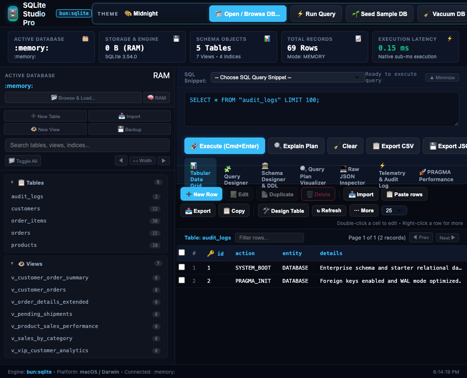

# 🗄️ Database Studio Pro -- Complete Production User Guide

```
Version: 2.4.0  •  Engine: Native bun:sqlite (WAL Mode)  •  Dependencies: 0  •  Offline: 100%
Launchers: [Desktop GUI: bun run app:database]  •  [Terminal CLI: bun run cli:database]
```

---

## 🌟 Executive Overview
**Database Studio Pro** is a high-performance, enterprise-grade SQLite query editor, schema browser, and diagnostic workbench engineered natively on Bun's C-level `bun:sqlite` subsystem. It delivers desktop database management speed comparable to Delphi and native desktop database clients—with **zero external software dependencies**, zero brew installations, and instant sub-second boot times.

Whether you are debugging a local application database, inspecting complex relational foreign keys, generating synthetic test data, or benchmarking query plans before deployment, Database Studio Pro gives you a tactile, visual cockpit.

---

## 🚀 Quick Start & Launch

### 1. Launch Desktop GUI Window
```bash
# Standard desktop launch (in-memory sandbox or active project DB)
bun run app:database

# Backwards-compatible shorthand alias
bun run app:sqlite
```

### 2. Launch Terminal CLI Query Mode
```bash
# Direct SQL query evaluation in terminal
bun run cli:database -f ./app.db "SELECT * FROM users LIMIT 10"

# Dump table schema directly in terminal
bun run cli:database -f ./app.db --schema
```

### 3. Launch Programmatically in TypeScript
```typescript
import { createDatabaseStudio } from "./applications/database_studio";

const studio = createDatabaseStudio("./production.sqlite", {
  fullscreen: false,
  width: 1400,
  height: 900
});
await studio.run();
```

---

## 🖼️ Visual Interface Tour

| High-Resolution Desktop (1400×920) | Responsive Viewport (960×760) |
| :---: | :---: |
|  |  |

---

## 🧭 Complete UI Tour & Element Guide

### 1. Window Header & Command Bar
- **Theme Selector**: Dynamic live switcher across all 63 studio themes (including Codefreelance, Sonoma Emerald, Cupertino Blue, Midnight, and Cyberpunk).
- **💾 Save State**: Immediately saves the current window coordinates, dimensions, active database path, and last query to local disk.
- **Center Window**: Re-centers the desktop application onto your active monitor screen.
- **⛶ Fullscreen**: Toggles distraction-free borderless fullscreen workstation mode.

### 2. Connection & Database Management Panel
- **Database File Path Input**: Accepts `:memory:` (for temporary in-ram experiments) or absolute/relative file paths (e.g. `./data/production.sqlite`).
- **🔌 Connect / Switch DB Button**: Safely disconnects the current handle and mounts the target database file with `PRAGMA journal_mode = WAL` enabled.
- **🌱 Seed 50 Test Records Button**: Instantly provisions a mock schema (`users` and `transactions` tables) and populates 50 realistic relational rows for testing.
- **📋 DDL Schema Button**: Scans `sqlite_master` and renders complete, syntax-highlighted `CREATE TABLE` and `CREATE INDEX` statements.

### 3. SQL Query Editor & Diagnostic Bar
- **Multi-line SQL Editor**: Textarea with monospace font, automatic indentation, and support for multi-statement scripts, CTEs (`WITH ...`), and window functions.
- **⚡ Execute SQL (Ctrl/Cmd + Enter)**: Executes the query with microsecond resolution timer.
- **🔍 Explain Plan Button**: Runs `EXPLAIN QUERY PLAN` and generates a step-by-step breakdown of table scans vs index lookups.
- **🧹 Clear Button**: Resets query editor and data output console.

### 4. Results Grid & Telemetry Panel
- **Execution Telemetry Pill**: Displays exact row count returned and execution latency down to fractional milliseconds (e.g., `42 rows • 0.38ms`).
- **Dynamic Table Grid**: Interactive data grid displaying column headers, numeric alignment, null indicator badges, and scrollable rows.
- **Error Diagnostic Banner**: Displays descriptive SQLite error codes, line numbers, and constraint explanations if a query fails.

### 5. Enterprise Data Export Suite
> The grid toolbar's **📤 Export** dialog (CSV, TSV, JSON, JSON Lines, SQL, Markdown — whole table, copy or save) supersedes these buttons; see *Visual Data Management* below.
- **📊 Export CSV**: Converts the active result grid into standardized comma-separated values for spreadsheet analysis.
- **📋 Export JSON**: Formats and copies the active result rows as clean JSON objects.
- **💾 Export SQL Inserts**: Generates a reproducible sequence of `INSERT INTO ... VALUES (...);` migration statements.

---

## 🖱️ Visual Data Management (Full GUI CRUD — No SQL Required)

SQLite Studio Pro works like Microsoft Access: you can create tables, add/edit/delete rows, import and export data entirely with buttons and dialogs. SQL is optional.

### Editing Rows (toolbar above the data grid)
| Button | What it does |
| :--- | :--- |
| **➕ New Row** | Opens a form with one field per column (PK / required / foreign-key badges, "default" checkboxes, **Now** button for dates, value suggestions for foreign keys). `Cmd/Ctrl+Enter` saves. **Save & add another** keeps the form open. |
| **📝 Edit / 📄 Duplicate** | Edit or copy the single ticked row in the form dialog. |
| **🗑️ Delete** | Deletes every ticked row (confirmation first). Tick the header checkbox to select the whole page. |
| **📥 Import / 📋 Paste rows** | Opens the Import Wizard (see below), pre-targeted at the open table. |
| **📤 Export / 📋 Copy** | Export dialog / copy ticked (or all page) rows as tab-separated text for Excel or Sheets. |
| **🛠️ Design Table / ⋯ More** | Table designer, rename, empty, delete. |
| **Page size** | 25 / 50 / 100 / 250 / 500 rows per page. |

- **Inline editing**: double-click any cell, type, press **Enter** to save (**Esc** cancels).
- **Right-click a row** (or a cell) for: Edit cell, Set cell to NULL, Copy value, Edit row, Duplicate row, Copy row, Delete row.
- Works on tables with no primary key or composite keys (rows are addressed by SQLite `rowid`). Views and ad-hoc query results are read-only.

### Designing Tables Visually
- **➕ New Table** (header or sidebar) opens the **Table Designer**: name the table, add columns with a friendly type picker (INTEGER, TEXT, REAL, BOOLEAN, DATE, DATETIME, BLOB, JSON…), and set **PK**, **Auto #**, **Required**, **Unique**, a **Default value** (e.g. `0`, `CURRENT_TIMESTAMP`) and **Link to table** (foreign key with on-delete behaviour). Quick-add chips insert common columns (`id`, `created_at`…). A live **SQL preview** shows the generated `CREATE TABLE`.
- **🛠️ Design Table** on an existing table lets you rename it, rename/add/remove/reorder columns and change types or constraints. The table is rebuilt safely inside a transaction: data is copied, indexes and triggers are restored. Removed columns lose their data. *CHECK constraints, multi-column UNIQUE and multi-column foreign keys can't be represented and are dropped — the designer warns you first.*
- **Sidebar ⋯ menu** (hover a table, or right-click it): Open, Add row, Design, Add column, New index, Import into, Export, Copy name, Rename, Empty table, Delete.
- **👁️ New View**: save a SELECT as a view (pre-filled from the SQL editor).
- **Schema Designer & DDL tab** adds management cards: Manage table, **Indexes** (create/drop), **Relationships**, **Triggers**.

### Import Wizard (📥 Import)
1. **Choose data**: *Browse files…* (system dialog), drag & drop a file, **📋 Paste from clipboard**, or paste straight into the box (cells copied from Excel / Google Sheets / a web table work). Pressing `Cmd/Ctrl+V` on the grid also opens the wizard with the clipboard.
2. **Format** is auto-detected: **CSV** (delimiter auto: comma, semicolon, tab, pipe), **TSV**, **JSON** (array of objects/arrays, or an object containing an array), **JSON Lines**, **Markdown tables**, **SQL scripts**. Options: first row is header, trim spaces, empty cells → NULL.
3. **Preview** shows the first rows and the row × column count.
4. **Destination**: *Create a new table* (editable column names and types — types are inferred; optional auto-number `id` column; untick columns to skip) or *Add to an existing table* (column mapping with auto-matching by name; append or replace all rows; on duplicate: stop / skip / overwrite).
- Imports run in **one transaction**: any error rolls everything back and nothing is imported.
- **SQL scripts** (`.sql` dumps, pasted `INSERT`s) run all-or-nothing as a single transaction.
- Excel `.xlsx` files are not read directly — copy the cells, or *Save As → CSV*.

### Export & Backup
- **📤 Export** exports the *whole* open table (not only the visible page), or the current query result, as **CSV, TSV, JSON, JSON Lines, SQL INSERTs (optionally with `CREATE TABLE`) or Markdown**. Choose **Copy to clipboard** or **Save file**.
- Saved files are written to your **`~/Downloads`** folder (a numeric suffix is added if the name exists) and the full path is shown in a notification.
- **💾 Backup** (header or sidebar) writes a complete SQL dump (schema, indexes, views, triggers, data) that can be restored with *Import → SQL script*.

### GUI CRUD HTTP API (for scripting / the embedded server)
| Endpoint | Purpose |
| :--- | :--- |
| `POST /api/table/data` | Paged rows; now also returns `editable`, `isView`, `pkColumns` and each row's `__rowid__`. |
| `POST /api/table/mutate` | `insert` / `update` / `delete`. Payload supports `useRowid`, `rowId`, `rowIds` (bulk delete), `data`; an empty `data` inserts `DEFAULT VALUES`. |
| `POST /api/schema/create-table` · `redesign-table` · `rename-table` · `drop` · `create-index` · `create-view` · `details` | Schema designer operations. |
| `POST /api/import` | Bulk insert `{ table, create, createColumns, columns, rows, mode, onConflict }` in one transaction. |
| `POST /api/script` | Run a multi-statement SQL script transactionally. |
| `POST /api/table/all` · `/api/dump` | All rows of a table · full SQL dump. |
| `POST /api/pick-file` · `/api/export-file` | Native file chooser (returns text) · save text into `~/Downloads`. |

---

## 🛠️ Step-by-Step Practical Tutorials

### Tutorial 1: Inspecting an Existing Application SQLite Database
1. Open Database Studio Pro via `bun run app:database`.
2. In the **Database File Path** field, enter your database path: `./my_app.sqlite`.
3. Click **🔌 Connect / Switch DB**.
4. Click **📋 DDL Schema** to review all table schemas, primary keys, and foreign keys.
5. In the SQL Editor, type:
   ```sql
   SELECT name, type, sql FROM sqlite_master WHERE type IN ('table', 'index');
   ```
6. Press `Cmd+Enter` (or click **⚡ Execute SQL**). Inspect your tables in the grid.

### Tutorial 2: Diagnosing Slow Queries with EXPLAIN QUERY PLAN
1. Type a query involving joins or filters:
   ```sql
   SELECT u.name, count(t.id) as orders 
   FROM users u 
   LEFT JOIN transactions t ON u.id = t.user_id 
   WHERE t.status = 'COMPLETED' 
   GROUP BY u.name;
   ```
2. Click **🔍 Explain Plan**.
3. Look at the output:
   - If you see `SCAN TABLE users` or `SCAN TABLE transactions`, you are doing a full table scan.
   - Run `CREATE INDEX idx_transactions_user ON transactions(user_id, status);` to add an index.
   - Run **🔍 Explain Plan** again and verify that SQLite now reports `SEARCH TABLE transactions USING INDEX idx_transactions_user`.

### Tutorial 3: Exporting Test Data as SQL Migrations
1. Run your query filtering target rows:
   ```sql
   SELECT * FROM users WHERE role = 'admin';
   ```
2. Click **💾 Export SQL Inserts**.
3. The generated statements will populate the output ready to be copied into your migration files or shared with team members.

---

## ⌨️ Complete Keyboard Shortcuts Reference

| Shortcut | Context | Action |
| :--- | :--- | :--- |
| **Cmd + Enter** / **Ctrl + Enter** | SQL Editor | Execute active query |
| **Cmd + E** / **Ctrl + E** | SQL Editor | Run Explain Query Plan |
| **Cmd + L** / **Ctrl + L** | SQL Editor | Clear query input and results |
| **Cmd + S** / **Ctrl + S** | Window | Save workspace state & layout |
| **F11** or **F** | Global Window | Toggle fullscreen display mode |
| **Escape** | Dialogs / Overlays | Close active modal |
| **Cmd/Ctrl + Enter** | Row form | Save row |
| **Enter** / **Esc** | Inline cell editor | Save / cancel the edit |
| **Cmd/Ctrl + V** | Data grid (editable table) | Open Import Wizard with clipboard rows |

---

## 💡 Pro Tips & Enterprise Best Practices
- **Write-Ahead Logging (WAL)**: Database Studio Pro automatically activates `PRAGMA journal_mode = WAL;`. This allows concurrent readers to query the database while your application writes to it, eliminating `database is locked` errors.
- **In-Memory Sandbox Testing**: Use `:memory:` as the file path to test risky `ALTER TABLE` or destructive updates without touching production files on disk.
- **Safe Transaction Rollbacks**: Always wrap multi-statement migrations in `BEGIN TRANSACTION; ... COMMIT;`. If an error occurs midway, Database Studio Pro rolls back changes automatically to maintain ACID consistency.

---

## ❓ Troubleshooting & FAQs

| Issue | Cause | Solution |
| :--- | :--- | :--- |
| **"Database is locked"** | Another process is holding an exclusive write lock without WAL. | Run `PRAGMA journal_mode = WAL;` or close other active SQLite CLI tools. |
| **"No such table"** | Database file connected is empty or path was mistyped. | Verify absolute file path using `ls -la` and click **DDL Schema** to confirm table presence. |
| **Large result set sluggish** | Query returned over 100,000 rows at once. | Add a `LIMIT 1000` clause to your query to paginate results efficiently. |

---

## 📐 Technical Architecture & Offline Resilience
- **Runtime Subsystem**: Pure `bun:sqlite` binary bindings directly linked into Bun's engine.
- **UI Architecture**: High-speed macOS WKWebView with hardware-accelerated CSS and virtual table DOM.
- **Zero Third-Party Binaries**: Zero requirement for `sqlite3` CLI, Homebrew, or external drivers. 100% offline self-contained.
