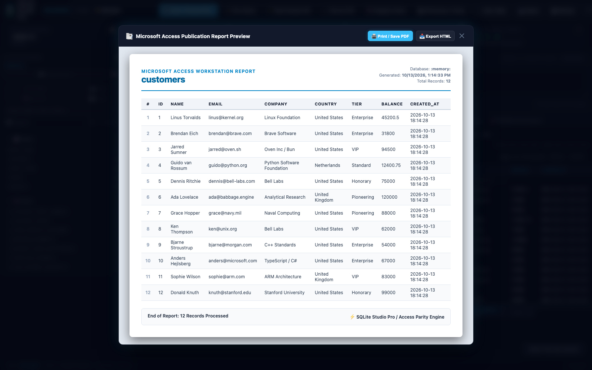
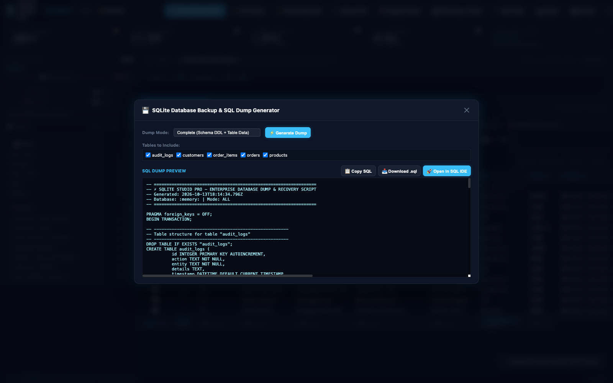
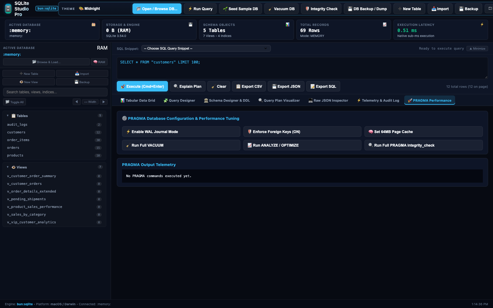
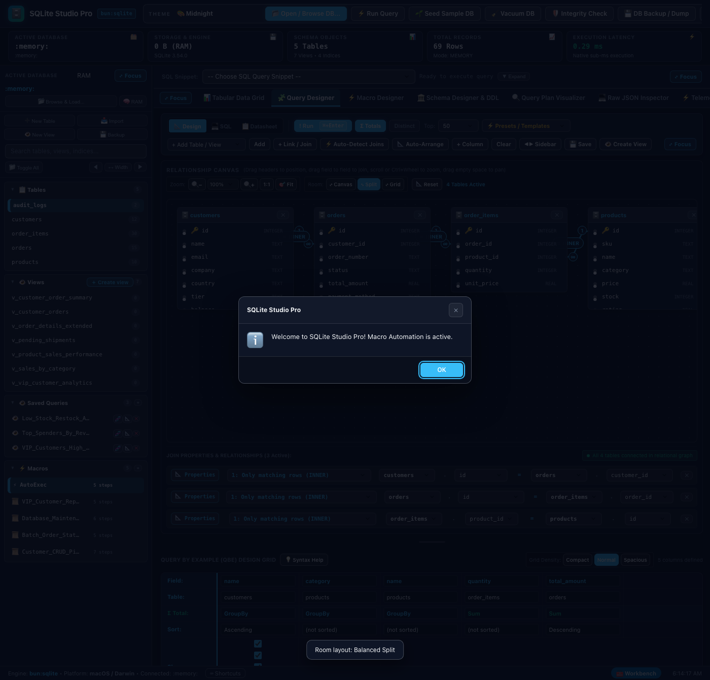
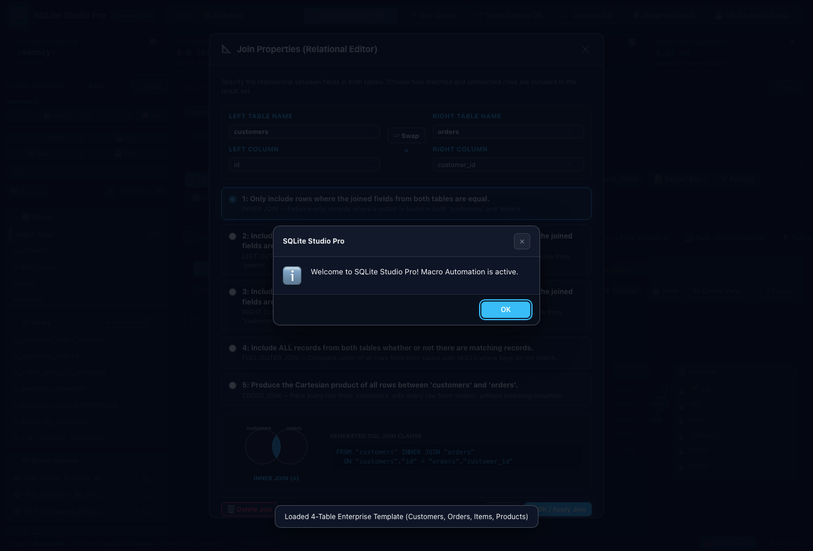
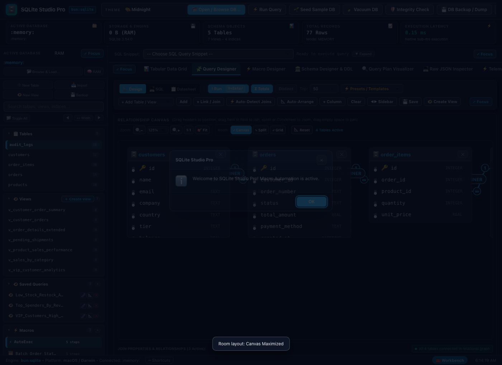

# 🗄️ SQLite Studio Pro -- Complete Production User Guide

```
Version: 2.4.0  •  Engine: Native bun:sqlite (WAL Mode)  •  Dependencies: 0  •  Offline: 100%
Launchers: [Desktop GUI: bun run app:sqlite (or bun run app:database)]  •  [Terminal CLI: bun run cli:sqlite]
```

> **Open it from the File Manager.** SQLite Studio can also be opened inside the Codecaine File Manager: a real SQLite file in the File Manager gets **Open in SQLite Studio** in its right-click menu, and the Databases tool can keep it as a connection. A saved connection replaces environment variables ([how](43_file_manager.md#databases-databases-tab), [order of precedence](../databases/index.md#connection-settings-and-environment-variables)).

---

## 🌟 Executive Overview
**SQLite Studio Pro** is a high-performance, enterprise-grade SQLite query editor, schema browser, and diagnostic workbench engineered natively on Bun's C-level `bun:sqlite` subsystem. It delivers desktop database management speed comparable to Delphi and native desktop database clients—with **zero external software dependencies**, zero brew installations, and instant sub-second boot times.

Whether you are debugging a local application database, inspecting complex relational foreign keys, generating synthetic test data, or benchmarking query plans before deployment, SQLite Studio Pro gives you a tactile, visual cockpit.

---

## 🚀 Quick Start & Launch

### 1. Launch Desktop GUI Window
```bash
# Standard desktop launch (in-memory sandbox or active project DB)
bun run app:sqlite

# Shorthand alias
bun run app:database
```

### 2. Launch Terminal CLI Query Mode
```bash
# Direct SQL query evaluation in terminal
bun run cli:sqlite -f ./app.db "SELECT * FROM users LIMIT 10"

# Dump table schema directly in terminal
bun run cli:sqlite -f ./app.db --schema
```

### 3. Launch Programmatically in TypeScript
```typescript
import { createSqliteStudio } from "./applications/sqlite_studio";

const studio = createSqliteStudio({
  initialDbPath: "./production.sqlite",
  fullscreen: false,
  width: 1400,
  height: 900
});
await studio.run();
```

---

## 🖼️ Verified Visual Interface Tour

| Microsoft Access Totals Row & Quick Filter Bar Active |
| :---: |
|  |

| Access Publication Report Generator Modal | 1-Click Database Backup & SQL Dump Generator |
| :---: | :---: |
|  |  |

| Visual Query Designer (4-Table Relational with Cardinality Badges) | PRAGMA Performance & WAL Workstation Tab |
| :---: | :---: |
|  |  |

| Microsoft Access Relational Canvas & Multi-Table Joins | Access-Style Join Properties Modal (Venn Diagrams) |
| :---: | :---: |
|  |  |

---

## 🧭 Complete UI Tour & Element Guide

### 1. Window Header & Command Bar
- **Theme Selector**: Dynamic live switcher across all 63 studio themes (including Codefreelance, Sonoma Emerald, Cupertino Blue, Midnight, and Cyberpunk).
- **💾 Save State**: Immediately saves the current window coordinates, dimensions, active database path, and last query to local disk.
- **Center Window**: Re-centers the desktop application onto your active monitor screen.
- **⛶ Fullscreen**: Toggles distraction-free borderless fullscreen workstation mode.

### 2. Connection & Database Management Panel
- **Database File Path Input**: Accepts `:memory:` (for temporary in-ram experiments) or absolute/relative file paths (e.g. `./data/production.sqlite`).
- **🔌 Connect / Switch DB Button**: Safely disconnects the current handle and mounts the target database file with `PRAGMA journal_mode = WAL` enabled.
- **🌱 Seed Sample DB Button**: Opens **Sample databases**, a catalog of eleven production-style synthetic databases (Medicare Part D formulary builder, hospital, claims, banking ledger, e-commerce and more). Each is created as a **new `.sqlite` file** (an existing file is never overwritten) or added to the open database when no name clashes, with a progress bar, then **Open it**. The **Example queries** panel lets you pick one read-only query (or all) and put it in the SQL editor or run it in the dialog. See [Sample databases](../databases/sample-datasets.md).
- **📋 DDL Schema Button**: Scans `sqlite_master` and renders complete, syntax-highlighted `CREATE TABLE` and `CREATE INDEX` statements.

### 3. SQL Query Editor & Diagnostic Bar
- **Multi-line SQL Editor**: Textarea with monospace font, automatic indentation, and support for multi-statement scripts, CTEs (`WITH ...`), and window functions.
- **⚡ Execute SQL (Ctrl/Cmd + Enter)**: Executes the query with microsecond resolution timer.
- **🔍 Explain Plan Button**: Runs `EXPLAIN QUERY PLAN` and generates a step-by-step breakdown of table scans vs index lookups.
- **🧹 Clear Button**: Resets query editor and data output console.

### 4. Results Grid & Telemetry Panel
- **Execution Telemetry Pill**: Displays exact row count returned and execution latency down to fractional milliseconds (e.g., `42 rows • 0.38ms`).
- **Dynamic Table Grid**: Interactive data grid displaying column headers, numeric alignment, null indicator badges, and scrollable rows.
- **Error Diagnostic Banner**: Displays descriptive SQLite error codes, line numbers, and constraint explanations if a query fails.

#### The datasheet works like Microsoft Access

Every data grid (a table opened from the sidebar, and query results) behaves like an Access datasheet, the same way in the three studios. Everything below is remembered **per table** (or per result shape for queries) in this browser, together with the hidden columns, and **Reset to default** in the *Hide / Unhide Fields* list forgets it all.

| What | How |
| :--- | :--- |
| **Hide / Unhide Fields** | The **Columns** button (badge `9 of 14`), the **▾** on a header, a right-click on a header, or the strip *N hidden columns · Show all · Unhide Fields…* open one checklist: a checkbox per field (type and PK/FK/IDX marks, alias and real name), a filter box, **Select all**, **Clear**, **Only keys**. At least one field always stays visible. Ctrl/Cmd+click and Shift+click on headers select several columns; **Hide Fields (n selected)** hides them together. |
| **Column width** | Drag the right edge of a header (cursor `col-resize`, a guide line follows, 48–900 px, mouse, touch and pen). **Double-click** the edge to fit the content (header plus the first 150 rows, capped at 480 px). Keyboard: focus a header and press **Alt+←/→** (10 px, Shift = 40 px), or **Field Width…** in the header menu (number box, **Standard Width**, **Best Fit**). **Fit all columns** and **Reset widths** are in the header menu and in *Datasheet layout*. The header, filter bar, totals row and body share one column grid, so they stay aligned. |
| **Column alias (caption)** | **Rename Field…** (header menu or the ✎ in the field list) gives a column a *display name*: it shows in the header (dotted underline, tooltip = real name), in the Hide / Unhide list (alias and real name) and can be cleared with **Use real name**. It never touches the database, SQL, sorting or the generated statements, which always use the real name. *Use display names (aliases) in copy/export* (off by default, shown in the list) puts the aliases in the header of copied/exported data. |
| **Reorder** | Drag a header onto another one (a bar shows where it lands), or **Move left / Move right** in the header menu. Copy and export follow the grid order. |
| **Freeze columns** | **Freeze columns up to here** keeps that column and everything left of it (plus the checkbox and `#` gutter) in place while you scroll sideways; **Unfreeze all columns** releases them. |
| **Filter** | **Filter…** in the header menu: a condition (equals, contains, begins/ends with, greater/less than, between, is empty, is not empty) or a checklist of the distinct values with a search box. It filters the rows of the page that is showing (the database query is not changed); a header mark and the strip *N filters: x of y rows on this page* show it, **Clear all filters** removes them. *Filter by selection* (right-click a cell) and the **Filter Bar** keep working as before. |
| **Sort** | **Sort A → Z / Z → A / Clear sort** in the header menu (as before, a plain click on a header sorts; SQLite and MySQL sort on the server, the PostgreSQL grid has no header sort). |
| **Formatting** | *Datasheet layout* in the field list: **Row height** (compact / normal / spacious), **Font size**, **Alternate row colour**. **Reset layout** returns widths, order, frozen columns and formatting to default and keeps hidden columns and display names. |

Not like Access: the per-column totals functions (Sum, Avg, Count, Min, Max) are not in this release (the **Totals** row keeps its existing behaviour), filters work on the loaded page rather than on the whole table, *Save as SQL alias* is not offered, and a plain click on a header still sorts (Access selects the column) so Ctrl/Cmd+click and Shift+click select columns.

#### Focus mode: use the whole window for one section

Every major section has a **⤢ Focus** button in its header: the tab bar (acts on the current tab), the sidebar object tree, the SQL editor, the data grid toolbar, the Visual Query Designer ribbon, and the header of each other tab (schema, macros, plan, audit and so on). **Alt+Enter** (Option+Enter on a Mac) focuses the section under the cursor and leaves focus mode again; a double-click on a section's header toggles it too. In focus mode the application header, KPI strip, tab bar, sidebar and footer are hidden and the section fills the window. A slim bar stays at the top with the section name, an **Editor / Both / Results** switch (where a section has an editor and a result: the SQL editor, the data grid) and an **✕ Exit focus** button that is always there.

Focus only hides the other regions: the grid's columns, widths, scroll position and selection and the editor's unsaved text are untouched, and grids, the designer canvas and diagrams re-fit to the larger area. Each tab remembers its own last focus state (also after a reload). It never uses the browser full-screen API (the window's own full-screen toggle is the separate **F11** / **Ctrl+Cmd+F**), and **Esc is not used**, because it belongs to open dialogs, menus and popovers. The shortcut appears in the **⌨ Shortcuts** list.

#### Showing and hiding columns

Every data grid (a table opened from the sidebar, and the result of a query) has a **Columns** button in its toolbar. It shows how many columns are visible (`9 of 14` when some are hidden, the plain count when all are shown).

- **Pick columns**: click **Columns** (or focus it and press Enter / ↓). A popover lists every column with its type and **PK** / **FK** / **IDX** marks. Tick or untick a column to show or hide it at once. Tables with more than 8 columns get a filter box. **Show all**, **Hide all**, **Only keys** (primary key, foreign key and indexed columns) and **Reset to default** act on the whole list, or only on the matches while a filter is typed. One column always stays visible (the primary key, otherwise the first column).
- **Hide from the header**: each column header has a ▾ button; right-click the header (or press Shift+F10 / the Menu key on a focused header) for the same menu: **Sort ascending / descending**, **Hide column**, **Hide other columns**, **Show all columns**, **Choose columns…**.
- **Nothing is lost silently**: while columns are hidden a strip above the grid says `N hidden columns`, lists the first ones as chips (click a chip to bring that column back), and offers **Show all** and **Choose columns…**. It also warns when a quick filter or the sort order uses a column you have hidden.
- **Remembered**: the choice is saved in this browser per database and table (query results: per set of result columns) and comes back after a reload. **Reset to default** forgets it. Hidden columns only change what is drawn; sorting, filtering, selection, inline editing, **Add / Edit row** (which always lists every column) and keyboard use are unaffected.
- **Copy and export follow what you see**: **Copy**, **Export** (grid dialog and the Export CSV / JSON / SQL buttons) and **Report** use the visible columns only; the buttons' tooltips and the Export dialog say so. Tick **Include hidden columns when copying or exporting** in the Columns popover to include every column. The JSON Inspector tab always shows the raw rows.
- **Keyboard**: Tab to **Columns**; in the popover ↑ / ↓ / Home / End move between columns, Space toggles, Tab stays inside, **Esc closes only the popover** and returns focus to the button.

### 5. Enterprise Data Export Suite
> The grid toolbar's **📤 Export** dialog (CSV, TSV, JSON, JSON Lines, SQL, Markdown — whole table, copy or save) supersedes these buttons; see *Visual Data Management* below.
- **📊 Export CSV**: Converts the active result grid into standardized comma-separated values for spreadsheet analysis.
- **📋 Export JSON**: Formats and copies the active result rows as clean JSON objects.
- **💾 Export SQL Inserts**: Generates a reproducible sequence of `INSERT INTO ... VALUES (...);` migration statements.

---

---

## 📐 Visual Query Designer & Microsoft Access Relational Canvas

SQLite Studio Pro incorporates a complete, full-featured visual query design studio modeled after Microsoft Access. It enables anyone—from non-technical analysts to veteran database administrators—to construct sophisticated multi-table relational queries visually with drag-and-drop ease, full join control, and zero manual SQL required.


### 1. Graphical Relational Canvas
- **Draggable Entity Cards**: Tables appear as movable cards displaying their full schema, primary keys (`🔑`), foreign keys (`🔗`), and column data types. Drag card headers to arrange your workspace freely.
- **Visual Drag-and-Drop Joining**: Click and drag any field name from one table card directly onto a field in another table card. The system connects them with a smooth, hardware-accelerated cubic Bézier SVG line.
- **Directional Line Arrows**:
  - **INNER JOIN**: Solid balanced line connecting matching fields.
  - **LEFT OUTER JOIN**: Directional arrow pointing right (`▶`) toward the right table, visually demonstrating that all records from the left table are preserved while non-matching right records fill with `NULL`.
  - **RIGHT OUTER JOIN**: Directional arrow pointing left (`◀`) toward the left table, preserving all right-hand rows.
  - **FULL OUTER JOIN**: Double-headed directional arrows (`◀▶`) indicating complete set union with `NULL` preservation across both tables.
  - **CROSS JOIN**: Distinctive Cartesian cross indicator (`⨯`).
- **Interactive Join Badges**: Click or double-click the join pill (`= INNER`, `⇥ LEFT`, `⇤ RIGHT`, `↔ FULL`, `⨯ CROSS`) embedded on any relationship line to immediately launch the **Join Properties** modal dialog.
- **⚡ Auto-Detect Joins**: Click **Auto-Detect Joins** to have the relational engine inspect foreign key metadata and naming conventions (e.g., `customer_id` ➔ `customers.id`, `order_id` ➔ `orders.id`). It constructs a spanning tree across all active canvas tables automatically.
- **Relational Topology Validation**: A live status indicator confirms whether your tables form a fully connected graph (`● All 4 tables connected in relational graph`) or warns if disconnected islands exist.

---

### 2. Microsoft Access Join Properties Modal Dialog
Double-clicking any relationship line or clicking its **Properties** button opens the authentic **Microsoft Access Join Properties** dialog:

| Join Properties Dialog (Venn Diagram & Directional Choices) |
| :---: |
|  |

#### The 5 Join Directives
The dialog offers the exact five relational options familiar from Microsoft Access and relational set theory:

1. **Option 1 (INNER JOIN)**:
   > *"Only include rows where the joined fields from both tables are equal."*
   > Returns only records where a key match is present in both tables (intersection).
2. **Option 2 (LEFT OUTER JOIN)**:
   > *"Include ALL records from '&lt;Left Table&gt;' and only those records from '&lt;Right Table&gt;' where the joined fields are equal."*
   > Preserves all rows from the primary table, filling in `NULL` for missing right-table attributes.
3. **Option 3 (RIGHT OUTER JOIN)**:
   > *"Include ALL records from '&lt;Right Table&gt;' and only those records from '&lt;Left Table&gt;' where the joined fields are equal."*
   > Preserves all rows from the secondary table. In SQLite (which natively supports `RIGHT JOIN` starting in SQLite 3.39+), this executes directly or generates equivalent set unions.
4. **Option 4 (FULL OUTER JOIN)**:
   > *"Include ALL records from both tables whether or not there are matching records."*
   > Produces the complete union of all records from both sources.
5. **Option 5 (CROSS JOIN)**:
   > *"Produce the Cartesian product of all rows between '&lt;Left Table&gt;' and '&lt;Right Table&gt;'."*
   > Generates all possible permutations without a join predicate condition.

#### Dynamic Venn Diagram Visualizer
Below the options, an interactive mathematical Venn diagram renders dynamically:
- Overlapping circle intersections illuminate in bright cyan when selecting **INNER JOIN**.
- The entire left circle and intersection glow when choosing **LEFT OUTER JOIN**.
- The entire right circle and intersection glow when selecting **RIGHT OUTER JOIN**.
- Both complete circles glow under **FULL OUTER JOIN**.
- A Cartesian grid matrix renders under **CROSS JOIN**.

#### Additional Modal Controls
- **⇄ Swap Tables**: Flips left and right tables with one click to reverse join orientation.
- **Live SQL Join Preview**: Displays the exact `FROM "t1" [TYPE] JOIN "t2" ON "t1"."c1" = "t2"."c2"` syntax in real-time as you tweak options.
- **🗑️ Delete Join**: Removes the join connection cleanly from the canvas.

---

### 3. Deep Canvas Zooming & Navigation (40% to 250%)

| Deep Zoom (125%) & Expansive Room Mode |
| :---: |
|  |

Managing complex enterprise databases with dozens of related tables requires extensive visual space:

| Control | Action | Keyboard / Shortcut |
| :--- | :--- | :--- |
| **🔍− Zoom Out** | Decreases canvas zoom level by 15% (down to 40% / 0.4x macro scale). | `Ctrl + Wheel Down` or `Cmd + Wheel Down` |
| **🔍+ Zoom In** | Increases canvas zoom level by 15% (up to 250% / 2.5x high-magnification scale). | `Ctrl + Wheel Up` or `Cmd + Wheel Up` |
| **Zoom Dropdown** | Instantly pick common scales: `50%`, `75%`, `90%`, `100%`, `125%`, `150%`, `200%`. | Direct dropdown select |
| **1:1** | Resets canvas scale to 100% (1.0x native desktop scale). | Click `1:1` |
| **🎯 Fit All** | Calculates the bounding box of all active table cards and centers & scales them into the viewport. | Click `🎯 Fit` |
| **Canvas Panning** | Smoothly pan around expansive relational schemas. | Drag anywhere on empty canvas background |

---

### 4. Expansive Room Modes & Draggable Resizer Splitter

To accommodate both expansive visual table mapping and detailed criteria editing, SQLite Studio Pro provides dynamic room modes:

- **⤢ Canvas (Maximize Canvas)**: Expands the canvas viewport up to 750px (or 70vh), collapsing the lower grid into a compact strip. Ideal when mapping out large multi-table relationships.
- **⤡ Split (Balanced 50/50)**: Standard split providing equal space for the visual canvas and the lower QBE design matrix.
- **⤢ Grid (Maximize Grid)**: Expands the lower criteria matrix, minimizing the canvas. Perfect when fine-tuning column aliases, aggregate totals, sorting, and multi-line criteria.
- **Interactive Draggable Resizer Splitter (`#qbeResizerBar`)**:
  - Grab the splitter bar separating the canvas and lower grid.
  - Drag up or down smoothly to customize the canvas height anywhere between **180px and 1200px** with instant visual feedback.

---

### 5. Section Ease of Use & Ergonomic Enhancements

#### QBE Grid Density Toggles
Above the Query by Example criteria matrix, select your preferred information density:
- **Compact**: Tightly spaced cells; displays 10+ columns simultaneously without horizontal paging.
- **Normal**: Standard balanced padding for general design work.
- **Spacious**: Touch-friendly, high-contrast cell rows for comfortable editing on large monitors.

#### Fullscreen Workspace Toggle (`◀▶ Sidebar`)
Click the **◀▶ Sidebar** button on the toolbar (or press shortcut) to collapse the entire left-hand database tree. The Visual Query Designer, SQL IDE, or Data Grid immediately expands to fill **100% of your screen width**.

#### SQL Query IDE Ergonomics
- **Font Scaling (`A−` / `A+`)**: Dynamically adjust the SQL editor font size from **10px to 22px** for enhanced readability.
- **Height Resizing (`↕ Resize Editor`)**: Toggles the SQL editor between **Compact (160px)**, **Medium (320px)**, and **Expansive (580px)**.
- **Editor Collapse (`▲ Minimize` / `▼ Expand`)**: Minimize the SQL editor down to a compact single-line toolbar when working strictly in the Visual Designer or Datasheet grid.

#### Tabular Data Grid & Datasheet Ergonomics
- **Row Density Modes**: Toggle between Compact, Normal, and Spacious row heights in the data grid.
- **Datasheet Tab**: View live query output directly beside the design canvas with 1-click execution.

---

## 🖱️ Visual Data Management (Full GUI CRUD — No SQL Required)

SQLite Studio Pro works like Microsoft Access: you can create tables, add/edit/delete rows, import and export data entirely with buttons and dialogs. SQL is optional.

### Editing Rows (toolbar above the data grid)
| Button | What it does |
| :--- | :--- |
| **➕ New Row** | Opens a form with one field per column (PK / required / foreign-key badges, "default" checkboxes, **Now** button for dates, value suggestions for foreign keys). `Cmd/Ctrl+Enter` saves. **Save & add another** keeps the form open. |
| **📝 Edit / 📄 Duplicate** | Edit or copy the single ticked row in the form dialog. |
| **🗑️ Delete** | Deletes every ticked row (confirmation first). Tick the header checkbox to select the whole page. |
| **📥 Import / 📋 Paste rows** | Opens the Import Wizard (see below), pre-targeted at the open table. |
| **📤 Export / 📋 Copy** | Export dialog / copy ticked (or all page) rows as tab-separated text for Excel or Sheets. |
| **🛠️ Design Table / ⋯ More** | Table designer, rename, empty, delete. |
| **Page size** | 25 / 50 / 100 / 250 / 500 rows per page. |

- **Inline editing**: double-click any cell, type, press **Enter** to save (**Esc** cancels).
- **Right-click a row** (or a cell) for: Edit cell, Set cell to NULL, Copy value, Edit row, Duplicate row, Copy row, Delete row.
- Works on tables with no primary key or composite keys (rows are addressed by SQLite `rowid`). Views and ad-hoc query results are read-only.

### Designing Tables Visually
- **➕ New Table** (header or sidebar) opens the **Table Designer**: name the table, add columns with a friendly type picker (INTEGER, TEXT, REAL, BOOLEAN, DATE, DATETIME, BLOB, JSON…), and set **PK**, **Auto #**, **Required**, **Unique**, a **Default value** (e.g. `0`, `CURRENT_TIMESTAMP`) and **Link to table** (foreign key with on-delete behaviour). Quick-add chips insert common columns (`id`, `created_at`…). A live **SQL preview** shows the generated `CREATE TABLE`.
- **🛠️ Design Table** on an existing table lets you rename it, rename/add/remove/reorder columns and change types or constraints. The table is rebuilt safely inside a transaction: data is copied, indexes and triggers are restored. Removed columns lose their data. *CHECK constraints, multi-column UNIQUE and multi-column foreign keys can't be represented and are dropped — the designer warns you first.*
- **Sidebar ⋯ menu** (hover a table, or right-click it): Open, Add row, Design, Add column, New index, Import into, Export, Copy name, Rename, Empty table, Delete.
- **👁️ New View** and **＋ Create view**: open the Create view dialog (see below).
- **Schema Designer & DDL tab** adds management cards: Manage table, **Indexes** (create/drop), **Relationships**, **Triggers**.

#### Creating, editing and dropping views

Four entry points open the same dialog: the **＋ Create view** button on the sidebar **Views** header, **🧱 Create view** beside the SQL editor (it takes the selected text, or the whole editor), **Save as View** in the Visual Query Designer, and **👁️ New View**. The dialog has a name (checked as you type), the `SELECT` query (editable), an optional column list, **Replace if it exists** (SQLite has no `CREATE OR REPLACE VIEW`, so this is a drop and create in one transaction that is rolled back if the new query is refused), **Only if it does not exist yet** (`IF NOT EXISTS`), and a read-only **DDL preview** with the name quoted for SQLite. **Check query** runs the statement inside a transaction that is always rolled back and explains problems in plain words, so nothing is created. Errors stay inside the dialog. On success the tree refreshes, the new view opens and the action is written to the audit log. Right-click a view for **Edit view definition…** (the same dialog, filled from the stored definition) or **Drop view…** (asks first). Only one `SELECT`/`WITH`/`VALUES` statement is accepted, so a name or query cannot smuggle in a second statement.

All the studios' prompts and confirmations (save query name, delete record, macro prompts and so on) now use in-page dialogs: the browser's native `prompt()`/`confirm()`/`alert()` do nothing in the desktop window, so they were silently dead before. Enter confirms, Esc closes only the dialog, Tab stays inside it.

### Import Wizard (📥 Import)
1. **Choose data**: *Browse files…* (system dialog), drag & drop a file, **📋 Paste from clipboard**, or paste straight into the box (cells copied from Excel / Google Sheets / a web table work). Pressing `Cmd/Ctrl+V` on the grid also opens the wizard with the clipboard.
2. **Format** is auto-detected: **CSV** (delimiter auto: comma, semicolon, tab, pipe), **TSV**, **JSON** (array of objects/arrays, or an object containing an array), **JSON Lines**, **Markdown tables**, **SQL scripts**. Options: first row is header, trim spaces, empty cells → NULL.
3. **Preview** shows the first rows and the row × column count.
4. **Destination**: *Create a new table* (editable column names and types — types are inferred; optional auto-number `id` column; untick columns to skip) or *Add to an existing table* (column mapping with auto-matching by name; append or replace all rows; on duplicate: stop / skip / overwrite).
- Imports run in **one transaction**: any error rolls everything back and nothing is imported.
- **SQL scripts** (`.sql` dumps, pasted `INSERT`s) run all-or-nothing as a single transaction.
- Excel `.xlsx` files are not read directly — copy the cells, or *Save As → CSV*.

### Import with staging

**📥 Import with staging** (button in the header) is the careful way to bring incoming records into a SQLite database: the rows are copied into a **staging table** first, checked there, and only then **promoted** into your real table in one transaction — with an **Undo this import** button. It is a five-step wizard (*Source → Map → Load to staging → Check → Review & promote*) with plain-words messages and one main button per step.

- **Source:** drop or pick a CSV, TSV, semicolon/pipe-separated text, JSON list or JSON Lines file (or paste text). Encoding (UTF-8, UTF-16, Latin-1), separator, quotes and header row are detected and editable, with a live preview. Excel files are not read (use *Save As → CSV UTF-8*). Big files are streamed, never loaded whole (limits: 2 GB, 5,000,000 rows).
- **Map:** pick the target table (or **Create a new table from this data**); columns are matched by name and synonym, with suggested clean-ups (trim, empty → NULL, dates, numbers like `1.234,56`, yes/no) and your own checks. The mapping is remembered per table.
- **Load to staging:** the staging table is `stg_<table>_<yyyymmdd>_<hhmm>` in the same database file (use **Staging area** to list and drop them), all columns `TEXT` plus `_stg_*` bookkeeping columns. Your table is not touched. Cancel rolls everything back.
- **Check:** types, sizes, required columns, repeats in the file, rows that already exist (new / same / changed), foreign keys, unique collisions, your own rules and the table's own CHECK rules. Fix a cell in place, skip rows, clean a whole column, download the rejects as CSV, check again.
- **Review & promote:** add new only, upsert, update only, add everything, or append; a dry run with exact counts, a before/after sample, the exact SQL and a test run that is rolled back; then one transaction. On the studio's own in-memory demo database a cancelled load drops the new staging table instead of rolling back.

Full guide, naming convention, safety notes and limitations: [Import with staging](../databases/staging-import.md). The File Manager can open this wizard for a connection or for a data file ([File Manager: Databases](43_file_manager.md#databases-databases-tab)).

### Export & 1-Click Database Backup
- **📤 Export** exports the *whole* open table (not only the visible page), or the current query result, as **CSV, TSV, JSON, JSON Lines, SQL INSERTs (optionally with `CREATE TABLE`) or Markdown**. Choose **Copy to clipboard** or **Save file**.
- **💾 1-Click Database Backup & SQL Dump Generator (`💾 DB Backup / Dump`)**: Located prominently in the primary workstation header. Opens an enterprise modal supporting:
  - **Complete Backup**: Full DDL schema (`CREATE TABLE`, `CREATE INDEX`, `CREATE VIEW`) plus table data `INSERT` statements wrapped in a safe transaction.
  - **Schema Only (DDL)**: DDL definitions for recreating database objects without data.
  - **Data Only (INSERTs)**: Clean table row data migrations.
  - **Table Multi-Selection**: Select or deselect individual tables to tailor the backup.
  - **Live Syntax-Highlighted Preview**: Instant preview of generated SQL with `Copy SQL`, `Download .sql`, and `Open in SQL IDE` actions.

---

## 🧮 Microsoft Access Workstation Workflow Parity

SQLite Studio Pro delivers 100% workflow parity with classic desktop databases like Microsoft Access, eliminating the need for ad-hoc SQL for daily operations:

### 1. Pinned Totals Row (`[ 🧮 Totals ]`)
- Click **[ 🧮 Totals ]** on the data grid toolbar to activate a pinned table footer row.
- Calculates live aggregates across all table records:
  - Leftmost summary badge displays `Total: <count>`.
  - Numeric columns compute both Sum (`Σ <sum>`) and Arithmetic Mean (`x̄ <avg>`).
  - Text and metadata columns compute non-null record count (`Count: <n>`).
- Powered by high-speed SQLite server aggregation (`/api/table/aggregates`) and reactive in-memory calculation.

### 2. Access Quick Filter Bar (`[ ⚡ Filter Bar ]`)
- Click **[ ⚡ Filter Bar ]** to toggle an instantaneous filter row directly beneath the table column headers.
- Type into any column filter input to filter records reactively on keystroke.
- Supports multi-column compound filtering (e.g., filtering `country = United States` and `tier = Enterprise` simultaneously).
- Cell Right-Click Context Menu: Right-click any cell in the data grid and select **Filter by Selection** (`🔍 Filter by '<value>'`) to immediately isolate matching rows.

### 3. Publication-Ready Report Generator (`🖨️ Report`)
- Click **[ 🖨️ Report ]** to generate a publication-ready executive datasheet report preview.
- Includes official report header, database metadata, generation timestamp, column definitions, and clean alternating table rows.
- Features tailored `@media print` styling that hides surrounding UI, formats page margins, and ensures clean pagination.
- **Print / Save PDF**: Launches native print dialog to save as PDF or send directly to physical printers.
- **Export HTML**: Downloads a standalone, self-contained HTML publication report.

### 4. Visual Query Designer Cardinality Badges (`1` and `∞`)
- When designing multi-table queries on the Visual Query Designer canvas, relationship lines automatically render classic Microsoft Access cardinality badges at line endpoints:
  - `1`: Denotes the unique / primary key side of the relationship.
  - `∞`: Denotes the foreign key / many side of the relationship.
- Central join pill (`= INNER`, `⇥ LEFT`, `⇤ RIGHT`, `↔ FULL`, `⨯ CROSS`) launches the interactive Venn diagram join properties modal.

### 5. Microsoft Access Macro Automation (`⚡ Macro Designer`)
- **Visual Macro Designer & Action Matrix**: Create, configure, and reorder automated action sequences with step numbers and priority toggles (▲ / ▼).
- **Microsoft Access Action Catalog**: Right-side drawer providing 24+ categorized actions with instant `+ Add` buttons and parameter guides:
  - **CRUD & Action Queries**:
    - `InsertRecord` (Access Append Query): Inserts new rows into target tables via field-value definitions or JSON objects.
    - `UpdateRecord` (Access Update Query): Performs bulk updates with custom SET expressions and WHERE filter clauses.
    - `DeleteRecord` (Access Delete Query): Safely purges matching records from target tables.
    - `MakeTable` (Access Make-Table Query): Creates a new table dynamically from any SQL query or saved named query (`CREATE TABLE ... AS SELECT ...`).
    - `EmptyTable` (Access Truncate Table): Rapidly clears all records from a table without dropping schema.
  - **Record Operations & Navigation**:
    - `GoToRecord`: Moves active selection to `First`, `Last`, `Next`, `Previous`, `New`, or specific record offset.
    - `FindRecord`: Searches active dataset for text or regex matches.
    - `ShowAllRecords`: Clears temporary filters to display the full dataset.
    - `SetValue`: Updates a specific field/variable value.
    - `SaveRecord`: Commits pending in-memory cell edits to database storage.
    - `SetWarnings`: Toggles confirmation prompts (useful for suppressing warnings during bulk action query executions).
  - **Database Objects**: `OpenTable` (Datasheet/Design, Edit/ReadOnly/Add), `OpenQuery` (runs saved named queries or raw SQL), `OpenReport` (Publication report), `CloseObject`, `Requery`.
  - **Data Operations**: `RunSQL` (transactional DDL/DML), `ApplyFilter` (dynamic WHERE clause), `ExportData` (CSV/JSON/SQL), `ImportData`.
  - **System & Maintenance**: `MessageBox` (Access-style dialog with Information, Warning, Critical, or Success icon), `VacuumDatabase` (with optional `PRAGMA optimize`), `BackupDatabase` (full, schema, or data modes), `Beep` (synthesized chime via Web Audio API).
  - **Flow & Logic**: `SetVariable` (TempVars session state), `RunMacro` (sub-routine macros), `StopMacro` (early termination), `Comment` (green italic remark rows).
- **Saved Named Queries (Access Queries Integration)**:
  - In the **Visual Query Designer**, clicking **💾 Save** prompts for a query name and description, saving the query definition and QBE visual graph state directly into the database (`_studio_queries`).
  - Saved named queries appear in the left sidebar object tree under **👁️ Saved Queries** with 1-click **Run in Datasheet (`▶`)**, **Open in Visual Query Designer (`📐`)**, and **Delete (`✕`)** actions.
  - Macros can execute any saved query by name via the **`OpenQuery`** action (selecting from a live dropdown of saved queries) or use it as a data source in **`MakeTable`** queries!
- **Conditional Execution (`If [condition]`)**: Each action supports conditional evaluation before execution (e.g. `[totalRows] > 0`, `[tier] == 'VIP'`, `[balance] > 1000`). If condition evaluates to false, action is skipped and logged.
- **Single Step Debugger (`⏯️ Single Step`)**: Classic Microsoft Access step-by-step interactive debugger. When active, execution pauses before each action to display macro name, condition, action name, and arguments, with `Step ▶`, `Continue ⏩`, and `Halt ⏹️` controls.
- **Error Handling**: Macros stop at the first failing step (like Access). Set **On error: Continue** on the macro, or tick **On Err ⏭** on a single step, to keep going. A condition that cannot be evaluated now fails the step instead of silently running it.
- **Safe Execution**: **🧪 Dry Run** runs the data steps on the server and rolls everything back; **🔒 Atomic** commits only if every step succeeds. A pre-flight check blocks missing arguments and warns on `UPDATE`/`DELETE` without a `WHERE`.
- **Parameter Prompts**: Use `[Enter Start Date]`-style placeholders in `RunSQL`, `OpenQuery`, or `MakeTable` SQL; you're prompted once per run and values are inserted as safely quoted literals.
- **Sub-Macros**: `RunMacro` now really runs the target macro (with a recursion guard) in both the designer and the server engine.
- **Duplicate & Export**: **📑 Duplicate** clones a macro; **📤 Export** (JSON), **📜 SQL** (plain script), and **🧾 VBA** (Access module) export it.
- **🧬 Code Generation (Python · Bun · V)**: translate a macro, a saved query, or the SQL in the editor into a standalone program that uses the **native SQLite driver** of your language, then **Copy to Clipboard** (or Download) for RAD work. Open it from **🧬 Code** in the SQL editor bar or Macro ribbon, or the 🧬 button on a saved query / macro in the sidebar.
  - **Python** → `sqlite3` (stdlib): parameterized queries, `with conn:` transaction, `argparse`, type hints.
  - **Bun** → `bun:sqlite`: prepared statements, `db.transaction()`, WAL + `foreign_keys`, `parseArgs`.
  - **V** → `db.sqlite`: `!` error propagation, `begin`/`commit`/`rollback`, `flag` module (V binds parameters as text, so numbers/NULLs are inlined and user text is bound).
  - The whole macro runs in **one transaction** (rolled back on error; `continueOnError` steps are caught). `VACUUM`/backup steps run after the commit. `[Enter ...]` prompts become `?` placeholders filled from command-line flags, `RunMacro` becomes a function call, and `[var]` conditions become native `if`s. UI-only actions (dialogs, navigation, reports) are skipped and listed as warnings.
- **AutoExec Startup Macro**: Macros named `AutoExec` or flagged with `AutoExec` automatically trigger upon opening or switching databases.
- **Navigation Pane Integration**: All saved macros and queries appear in the left sidebar under `👁️ Saved Queries` and `⚡ Macros` with step counts and 1-click run buttons.
- **Database-Backed Persistence**: Both macros and saved queries are stored directly inside the SQLite database (`_studio_macros` and `_studio_queries`), ensuring they travel with the database file just like Microsoft Access `.accdb` macros and queries. Internal tables are filtered so they never pollute regular business tables or KPI counts.

---

### Workstation HTTP API (for Scripting, Automation & Embedded Workstations)
| Method | Endpoint | Purpose | Payload / Parameters |
| :--- | :--- | :--- | :--- |
| `GET` | `/api/kpis` | Real-time database telemetry, storage size, and table counts | — |
| `GET` | `/api/schema` | Complete schema reflection (tables, views, indexes, foreign keys) | — |
| `POST` | `/api/table/data` | Paginated, filtered, sorted records with editability metadata | `{ table, page, pageSize, sortCol, sortDir, filter }` |
| `POST` | `/api/table/aggregates` | Microsoft Access Totals Row aggregations (Sum, Avg, Count, Min, Max) | `{ table: string }` |
| `POST` | `/api/table/mutate` | Insert, update, or delete records (`useRowid` supported) | `{ table, action, rowId, rowIds, data }` |
| `POST` | `/api/database/dump` | 1-Click Database Dump & Backup (all, schema, or data modes) | `{ mode: 'all'\|'schema'\|'data', tables?: string[] }` |
| `POST` | `/api/dump` | Database SQL dump generation (mode-aware) | `{ mode?, tables? }` |
| `GET` | `/api/sqlite/attached` | List all attached SQLite databases (`PRAGMA database_list`) | — |
| `GET` | `/api/sqlite/virtual-tables` | Discovers virtual tables (FTS3/4/5, R*Tree) | — |
| `POST` | `/api/rows/insert` | Insert row convenience API | `{ table: string, row: Record<string, any> }` |
| `POST` | `/api/rows/update` | Update row convenience API | `{ table: string, id: any, values: Record<string, any> }` |
| `POST` | `/api/rows/delete` | Delete row convenience API | `{ table: string, id: any }` |
| `POST` | `/api/rows/import-batch` | Transactional multi-row batch insert | `{ table: string, rows: Record<string, any>[] }` |
| `POST` | `/api/table/truncate` | Fast atomic table truncate | `{ table: string }` |
| `POST` | `/api/schema/drop-table` | Safe table drop | `{ table: string }` |
| `POST` | `/api/pragma` | Read and configure runtime PRAGMAs | `{ pragma: string, value?: string }` |
| `GET`/`POST` | `/api/macros/list` | List all saved Microsoft Access macros | — |
| `POST` | `/api/macros/save` | Create or update a macro definition | `{ macro: MacroDefinition }` |
| `POST` | `/api/macros/delete` | Delete a macro by ID or name | `{ id?: string, name?: string }` |
| `POST` | `/api/macros/run` | Execute macro actions with telemetry trace | `{ macro?: MacroDefinition, id?: string, variables?: Record<string, any>, transaction?: boolean, dryRun?: boolean, params?: Record<string, any> }` |
| `POST` | `/api/macros/validate` | Pre-flight check for a macro | `{ macro: MacroDefinition }` |
| `POST` | `/api/macros/export` | Export as `json`, `sql`, or `vba` | `{ macro?: MacroDefinition, id?: string, format?: "json" \| "sql" \| "vba" }` |
| `POST` | `/api/codegen` | Translate a macro or SQL to native-SQLite code | `{ kind: "macro"\|"sql", target: "python"\|"bun"\|"vlang", macro?, id?, sql?, name? }` |

---

## 🧪 Comprehensive Automated Test Suites

SQLite Studio Pro is rigorously tested with **100% test pass rate** across enterprise test suites:

1. **`tests/sqlite_studio_macros.test.ts` (8 Microsoft Access Macro Tests)**:
   - Workstation HTML shell contains Macro Designer tab, matrix, and ribbon toolbar.
   - Zero syntax errors in client-side macro runtime scripts.
   - Seeded default Access sample macros (`AutoExec`, `VIP_Customer_Report`, `Database_Maintenance_Routine`).
   - Schema & KPI isolation: internal `_studio_macros` table never pollutes user tables or counts.
   - Macro CRUD lifecycle: `/api/macros/save`, `/api/macros/delete`.
   - Sequential execution engine (`/api/macros/run`) with conditions and step telemetry.
   - `StopMacro` early termination and error handling.
2. **`tests/sqlite_studio_e2e.test.ts` (20 End-to-End Workstation Tests)**:
   - Workstation HTML shell and 8 navigation panes.
   - Microsoft Access Totals Row & Quick Filter Bar elements.
   - Access Publication Report modal and `@media print` CSS.
   - 1-Click Database Backup & SQL Dump Generator in all 3 modes (`all`, `schema`, `data`).
   - Visual Query Designer with Zoom, Presets, Venn preview, and Cardinality Badges (`1` and `∞`).
   - CRUD lifecycle (`insert`, `update`, `delete`), batch import, truncate, drop table.
   - PRAGMA configuration and integrity checks.
3. **`tests/sqlite_studio_pro.test.ts` (19 Core Workstation Tests)**:
   - Live KPI telemetry and schema reflection.
   - Parameterized query execution, timing, and EXPLAIN query plan analysis.
   - Multi-table topological joins, spanning tree, and relational join views.
   - SQL injection prevention and security boundaries.
   - Multi-format data export (CSV, JSON, SQL).

```bash
bun test tests/sqlite_studio_macros.test.ts tests/sqlite_studio_e2e.test.ts tests/sqlite_studio_pro.test.ts
# 47 pass, 0 fail, 457 assertions
```

---

## 🛠️ Step-by-Step Practical Tutorials

### Tutorial 1: Inspecting an Existing Application SQLite Database
1. Open SQLite Studio Pro via `bun run app:sqlite`.
2. In the **Database File Path** field, enter your database path: `./my_app.sqlite`.
3. Click **🔌 Connect / Switch DB**.
4. Click **📋 DDL Schema** to review all table schemas, primary keys, and foreign keys.
5. In the SQL Editor, type:
   ```sql
   SELECT name, type, sql FROM sqlite_master WHERE type IN ('table', 'index');
   ```
6. Press `Cmd+Enter` (or click **⚡ Execute SQL**). Inspect your tables in the grid.

### Tutorial 2: Diagnosing Slow Queries with EXPLAIN QUERY PLAN
1. Type a query involving joins or filters:
   ```sql
   SELECT u.name, count(t.id) as orders 
   FROM users u 
   LEFT JOIN transactions t ON u.id = t.user_id 
   WHERE t.status = 'COMPLETED' 
   GROUP BY u.name;
   ```
2. Click **🔍 Explain Plan**.
3. Look at the output:
   - If you see `SCAN TABLE users` or `SCAN TABLE transactions`, you are doing a full table scan.
   - Run `CREATE INDEX idx_transactions_user ON transactions(user_id, status);` to add an index.
   - Run **🔍 Explain Plan** again and verify that SQLite now reports `SEARCH TABLE transactions USING INDEX idx_transactions_user`.

### Tutorial 3: Exporting Test Data as SQL Migrations
1. Run your query filtering target rows:
   ```sql
   SELECT * FROM users WHERE role = 'admin';
   ```
2. Click **💾 Export SQL Inserts**.
3. The generated statements will populate the output ready to be copied into your migration files or shared with team members.

---

## ⌨️ Complete Keyboard Shortcuts Reference

| Shortcut | Context | Action |
| :--- | :--- | :--- |
| **Cmd + Enter** / **Ctrl + Enter** | SQL Editor | Execute active query |
| **Cmd/Ctrl + Enter** or **F5** | Visual Query Designer (also inside its fields) | Run the query: Design/Datasheet view runs the query, SQL view runs the SQL as written. The page does not reload, and the SQL console's own run does not fire. The **! Run** button shows the shortcut. (Ctrl/Cmd+R is not used: it reloads the page.) |
| **Alt + Enter** (Option+Enter on a Mac) | Anywhere in a section | Focus that section so it fills the window / leave focus mode (Esc is not used; **F11** is the window's own full-screen toggle) |
| **Cmd/Ctrl + /** or **F1** | Everywhere | Open the **⌨ Shortcuts** list (also the **⌨ Shortcuts** button in the header and footer) |
| **Cmd + E** / **Ctrl + E** | SQL Editor | Run Explain Query Plan |
| **Cmd + L** / **Ctrl + L** | SQL Editor | Clear query input and results |
| **Cmd + S** / **Ctrl + S** | Window | Save workspace state & layout |
| **F11** or **F** | Global Window | Toggle fullscreen display mode |
| **Escape** | Dialogs / Overlays | Close active modal |
| **Cmd/Ctrl + Enter** | Row form | Save row |
| **Enter** / **Esc** | Inline cell editor | Save / cancel the edit |
| **Cmd/Ctrl + V** | Data grid (editable table) | Open Import Wizard with clipboard rows |

---

## 💡 Pro Tips & Enterprise Best Practices
- **Write-Ahead Logging (WAL)**: SQLite Studio Pro automatically activates `PRAGMA journal_mode = WAL;`. This allows concurrent readers to query the database while your application writes to it, eliminating `database is locked` errors.
- **In-Memory Sandbox Testing**: Use `:memory:` as the file path to test risky `ALTER TABLE` or destructive updates without touching production files on disk.
- **Safe Transaction Rollbacks**: Always wrap multi-statement migrations in `BEGIN TRANSACTION; ... COMMIT;`. If an error occurs midway, SQLite Studio Pro rolls back changes automatically to maintain ACID consistency.

---

## ❓ Troubleshooting & FAQs

| Issue | Cause | Solution |
| :--- | :--- | :--- |
| **"Database is locked"** | Another process is holding an exclusive write lock without WAL. | Run `PRAGMA journal_mode = WAL;` or close other active SQLite CLI tools. |
| **"No such table"** | Database file connected is empty or path was mistyped. | Verify absolute file path using `ls -la` and click **DDL Schema** to confirm table presence. |
| **Large result set sluggish** | Query returned over 100,000 rows at once. | Add a `LIMIT 1000` clause to your query to paginate results efficiently. |

---

## 📐 Technical Architecture & Offline Resilience
- **Runtime Subsystem**: Pure `bun:sqlite` binary bindings directly linked into Bun's engine.
- **UI Architecture**: High-speed macOS WKWebView with hardware-accelerated CSS and virtual table DOM.
- **Zero Third-Party Binaries**: Zero requirement for `sqlite3` CLI, Homebrew, or external drivers. 100% offline self-contained.
