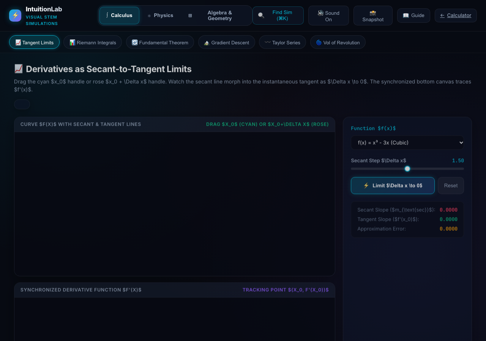

# 🧮 Universal Calculator & STEM IntuitionLab -- Complete Production User Guide

```
Version: 2.4.0  •  Engine: Multi-Domain Computing Engine & 6 STEM Physics Simulators  •  Dependencies: 0  •  Offline: 100%
Launchers: [Desktop GUI: bun run app:calculator]  •  [Terminal CLI: bun run cli:calculator]
```

---

## 🌟 Executive Overview
**Universal Calculator & Computing Studio** is an Apple-grade multi-domain scientific calculation, unit conversion, visual data analytics, low-level bitwise manipulation, financial planning, calculus graphing, and interactive STEM physics laboratory built natively for Bun RAD Studio.

Combining 10+ specialized computing workspaces into a single zero-dependency, 100% offline desktop application with Web Audio sound synthesis, keyboard shortcuts, and interactive canvas graphics, it now includes the full **6-engine STEM IntuitionLab**—allowing engineers and students to simulate projectile aerodynamics, orbital gravity, wave superpositions, thermodynamic gas laws, DC/AC circuits, and optical refraction in real time.

---

## 🚀 Quick Start & Launch

### 1. Launch Desktop GUI Window
```bash
# Standard desktop launch
bun run app:calculator

# Shorthand alias
bun run app:calc
```

### 2. Launch Terminal CLI Expression Evaluator
```bash
# Direct mathematical evaluation
bun run cli:calculator "sin(pi / 2) + sqrt(144)"

# Complex expression
bun run cli:calculator "12 * (45 - 18) / 3"
```

### 3. Launch Headless Web Server
```bash
bun run applications/calculator_studio.ts --server
```

---

## 🖼️ Visual Interface Tour

| Scientific & Computing Studio (1400×920) | STEM IntuitionLab Physics Simulator |
| :---: | :---: |
|  |  |

---

## 🧭 The 11 Core Computing Workspaces

### 1. 🔬 STEM IntuitionLab (6 Physics Engines)
Accessible via the **IntuitionLab** workspace tab, this interactive sandbox provides real-time mathematical visualizations:
- **1. Projectile Motion Engine**: Simulates launching angles ($0^circ$ to $90^circ$), muzzle velocities, planetary gravity ($g = 9.81$ Earth, $1.62$ Moon, $3.71$ Mars), and atmospheric drag coefficients with live trajectory traces.
- **2. Orbital Gravity Simulator**: Visualizes Keplerian two-body and multi-body orbits, gravitational pull, escape velocities, and orbital decay.
- **3. Wave Mechanics & Interference**: Demonstrates harmonic wave propagation, frequency beats, constructive/destructive superposition, and standing waves.
- **4. Ideal Gas Law & Thermodynamics ($PV = nRT$)**: Simulates pressure-volume-temperature relationships inside an interactive piston with colliding molecular particles.
- **5. Circuit Laboratory (Ohm's & Kirchhoff's Laws)**: Interactive breadboard with resistors, capacitors, inductors, DC voltages, and AC sinusoidal frequencies.
- **6. Optics & Snell's Law**: Renders light ray refraction across refractive index boundaries ($n_1 sin 	heta_1 = n_2 sin 	heta_2$) with total internal reflection.

### 2. ƒx Scientific Calculator Studio
- Supports complex parentheses nesting, trigonometric functions (`sin`, `cos`, `tan`), inverse trig (`asin`, `acos`, `atan`), hyperbolic functions, logarithms (`ln`, `log10`), roots (`sqrt`, `cbrt`), and exponents (`x^y`).
- One-click angle toggles: **DEG** (Degrees) and **RAD** (Radians).
- Memory Registers: Dedicated `mc` (Clear), `m+` (Add), `m−` (Subtract), and `mr` (Recall).
- Physical Constants Bar: One-click chips for $pi$, $e$, speed of light $c$, Planck's $h$, gravitational constant $G$, Boltzmann $k_B$, and Avogadro $N_A$.

### 3. ⇄ Unit & Currency Converter (17 Physical Dimensions)
- Dimensions: Length, Temperature, Area, Volume, Weight/Mass, Time, Speed, Pressure, Energy, Power, Data Storage, Character/ASCII, Angles, Frequency, Force, Torque, and Fuel Economy.
- Dynamic Visual Magnitude Ratio Bar showing relative scale between units in real time.

### 4. 01 Programmer & Bitwise Laboratory
- **64-bit Interactive Bit-Flipper**: Click any bit (63..0) with tactile audio blips to toggle states.
- **Synchronous Multi-Radix Card**: Live simultaneous display and bidirectional editing across HEX, DEC, OCT, BIN, and ASCII.
- **ALU Diagnostics**: Population count (Hamming weight), Leading Zeros (CLZ), Trailing Zeros (CTZ), Power-of-2 detection, parity check, and signed two's/one's complement.
- **IEEE-754 Floating Point Dissector**: Visual bit breakdown of Float32 and Float64 into Sign, Biased Exponent, and Normalized Mantissa.
- **IPv4 & Subnet Inspector**: Dotted quad breakdown, interactive CIDR prefix slider (/0 to /32), netmask, network ID, broadcast, and host range.

### 5. 📈 Graphic Charts & Time-Series Studio
- Visualization Modes: Area Spline, Pill Bar Chart, Activity Ring, and Stepped Cumulative views.
- Statistical Regression Models: Linear ($y = mx + b$), Exponential, and 2nd-degree Polynomial curves with live $R^2$ goodness-of-fit indicator.
- Interactive Scrubber Tooltip: Displays daily values, percentage deltas vs previous day, and deviations from dataset average.

### 6. ∫ Calculus & Multi-Mode Grapher
- Cartesian ($f(x)$), Dual Curves ($f(x)$ & $g(x)$), Polar ($r(	heta)$), and Parametric ($[x(t), y(t)]$).
- Definite Integrals ($int_a^b f(x)dx$) evaluated with Simpson's 1/3 rule and visual area shading.
- Numerical Derivatives ($f'(x_0)$) calculating tangent slopes with animated contact bead.

### 7. ⊞ Matrix & Linear Algebra Laboratory
- $2 	imes 2$, $3 	imes 3$, and $4 	imes 4$ matrices.
- Addition, Subtraction, Matrix Multiplication ($A 	imes B$), Transpose, Determinant ($det(A)$), Inverse ($A^{-1}$), and Gaussian elimination solver ($A cdot x = b$).

### 8. △ Geometry & Triangles Studio
- Triangle solver by 3 Sides (SSS), 2 Sides + Angle (SAS), or 2 Angles + Side (ASA).
- Scale canvas rendering with angle arcs, side measurement pill badges, vertex indicators, and inscribed incircles.

### 9. 💎 Wealth & FIRE Planner
- Retirement nest egg trajectory with customizable savings, monthly contributions, expected returns, and annual spending.
- 4% Rule FIRE Target calculator determining exact age of financial independence.
- US Inflation Time Machine (1913–2026) using historical CPI data.

---

## ⌨️ Complete Keyboard Shortcuts Reference

| Shortcut | Context | Action |
| :--- | :--- | :--- |
| **0 .. 9** | Any Calculator | Enter numeric digits |
| **+ , - , * , /** | Scientific | Arithmetic operator entry |
| **Enter** or **=** | Scientific | Evaluate expression |
| **Backspace** | Any Input | Delete last character |
| **C** or **Escape** | Calculator | Clear display / reset |
| **Cmd + 1 .. 9** | Workspace | Switch directly between the computing studios |
| **F11** or **F** | Global | Toggle borderless fullscreen |
