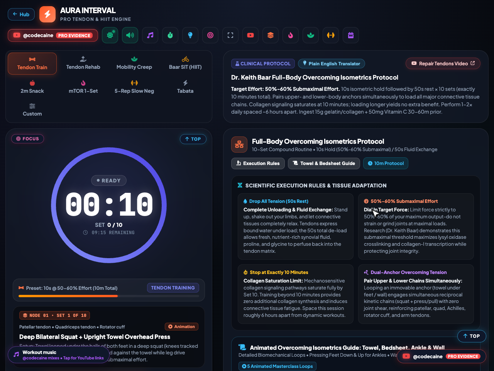
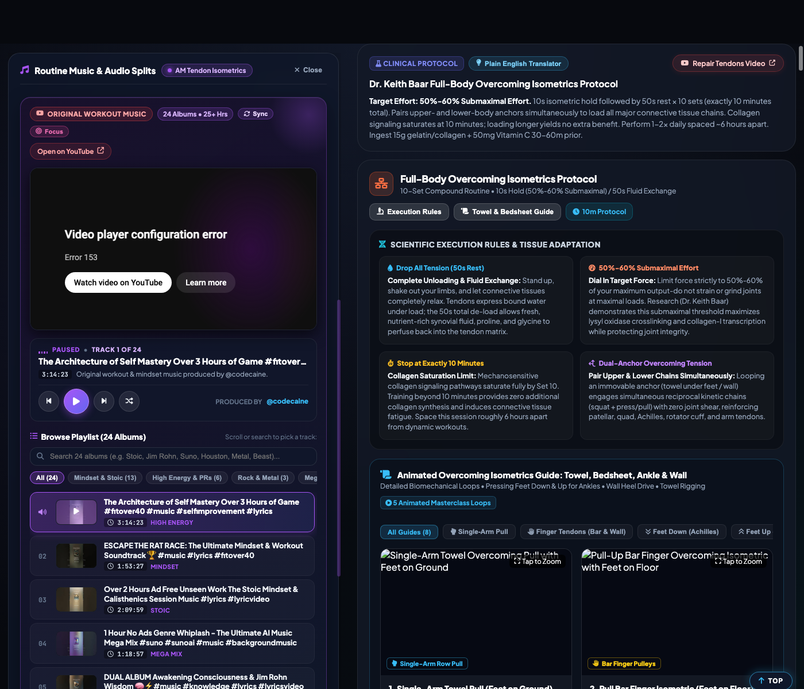

# ⚡ Interval Timer & Calisthenics Suite -- Complete Production User Guide

```
Version: 2.4.0  •  Engine: Native Audio/Tone.js, music links to YouTube (no embedded player)  •  Dependencies: 0  •  Works offline except the music links, Tone.js and fonts, which need the internet
Launchers: [Desktop GUI: bun run app:interval_timer]  •  [Headless Server: bun run applications/interval_timer_studio.ts --server]
```

---

## 🌟 Executive Overview
**Interval Timer & Calisthenics Suite** is a high-performance, clinical-grade interval timer, isometric tendon remodeling system, and motivational soundtrack workstation built natively for Bun RAD Studio.

Designed around the peer-reviewed connective tissue research of **Dr. Keith Baar (UC Davis)**, this suite guides athletes and fitness practitioners through submaximal overcoming isometrics that stimulate collagen synthesis, crosslink tendon fibrils, and bulletproof joints without inducing muscular or central nervous system fatigue.

It includes a list of **Codecaine workout music links** (24 curated albums with category filtering and live playlist sync; each opens on YouTube in your browser) and a **Timer Toolkit** with a stopwatch, countdown, Pomodoro, EMOM, rounds (Tabata, boxing, HIIT), AMRAP, kitchen timers and a chess clock.

---

## 🚀 Quick Start & Launch

```bash
# Standard desktop launch
bun run app:interval_timer

# Launch background server mode
bun run applications/interval_timer_studio.ts --server
```

---

## 🖼️ Visual Interface Tour

| Main Circular Timer & Tendon Protocols | Codecaine 24-Album Music Deck & Drawer |
| :---: | :---: |
|  |  |

---

## 🧭 Core Protocols & Scientific Engineering

### 1. Dr. Keith Baar Overcoming Isometrics Protocol
- **Target Effort**: 50%–60% Submaximal Effort. Pushing at 100% maximal strain grinds joints and fatigues CNS; 50%–60% tension maximizes lysyl oxidase crosslinking and collagen-I transcription while preserving joint integrity.
- **Time Structure**: **10s Work Hold / 50s Complete Unloading Rest** across 10 sets (exactly 10 minutes total).
- **The 10-Minute Collagen Saturation Limit**: Research demonstrates mechanosensitive collagen signaling saturation occurs at 10 minutes. Training longer provides zero additional collagen synthesis and induces fatigue.
- **Complete Fluid Exchange**: The 50s rest is crucial; tendons express bound water under load. The 50s total de-load allows nutrient-rich synovial fluid, proline, and glycine to perfuse back into the tendon matrix.

### 2. Base64-Inlined Biomechanical Motion Guides
All exercise diagrams are base64-inlined directly into the application for 100% offline playback with zero network latency:
- Single-Arm Towel Overcoming Pull (Feet on Ground)
- Pull-Up Bar Finger Isometric (Feet on Floor)
- Ankle Wall Heel Drive & Plantarflexion Hold
- Towel & Bedsheet Rigging Masterclass Loops
- Tap-to-Zoom interactive visual inspector

### 3. Workout Music Links (YouTube opens in your browser)
YouTube does not play inside the app window, and a hidden video player costs memory and battery, so the timer **no longer embeds a YouTube player**. The music panel is a list of links: each album opens on YouTube in your web browser, and **Random mix** opens one for you. Start the music there, then come back and start your workout. The panel loads no YouTube scripts, frames or playback code; the only YouTube pictures left are the lazily loaded thumbnails in the Masterclass Video Hub.
- **24 Curated Albums (25+ Hours of Audio)**: Produced by @codecaine for high-dopamine training.
- **Dynamic Category Filtering**:
  - `All (24)`: Complete masterclass discography.
  - `Mindset & Stoic (13)`: Stoic philosophy, Jim Rohn wisdom, sovereign logic, and mental calibration.
  - `High Energy & PRs (6)`: Compounding drive, 1% daily discipline, 808s, and PR energy.
  - `Rock & Metal (3)`: Gritty guitars, Houston grit, and aggressive overdrive.
  - `Megamixes (2)`: 3-hour non-stop marathons for long endurance sessions.
- **Search Bar**: Real-time keyword filter across all 24 albums.
- **Live Sync Button**: Auto-syncs playlist with YouTube playlist via local server endpoint.

### 4. Timer Toolkit (stopwatch, countdown, Pomodoro and more)
Open it with the stopwatch button in the header, or press **T**. It is separate from the interval timer above, so you can use either. Several timers can run at once (a dot on a tab shows which are running), and closing the panel does not stop them; the window title shows the one that is running.

| Timer | What it does |
| :--- | :--- |
| **Stopwatch** | Counts up to hundredths of a second. **Lap** records splits, marks the fastest and slowest, and copies them as CSV. |
| **Countdown** | Hours, minutes and seconds with an optional label. **Bell every N minutes** makes it a meditation or study timer. |
| **Pomodoro** | Focus, short break and long break, with a long break after every Nth focus session. Quick setups: 25/5, 15/3, 50/10, 52/17. |
| **EMOM** | A new round every N seconds (every minute, every 2 minutes, every 90 seconds). |
| **Rounds** | Get ready, work, rest, rounds, sets, rest between sets and cool down. Quick setups for Tabata, boxing (3:00/1:00 x 12), HIIT, sprints and yoga holds. |
| **AMRAP** | A countdown with a round counter (**L** adds one). The rounds are saved with the log entry. |
| **Kitchen / multi** | Any number of named timers at the same time (tea, eggs, pasta, laundry), each announcing itself when it is done. |
| **Chess clock** | Two clocks with an increment per move. Press your own side after you move; a flag fall ends the game. |

**Settings** has beeps, a volume slider, spoken step names, vibration (where the device has it), keeping the screen awake while a timer runs, and how many final seconds beep. **My saved setups** keep your own numbers for each timer. The **activity log** lists finished timers (today's total in its heading) and copies as CSV.

**Keys while the toolkit is open:** Space start or pause, R reset, N next step, P back, L lap (or add an AMRAP round), **1 to 8** switch timer, Esc closes. While it is open the main page's own keys (Space, R, S, F) are switched off so they cannot fire by accident. The tabs work with the arrow keys, Home and End.

**How it keeps time, and what it does not do.** Each timer works from the clock's time stamps rather than counting ticks, so a busy or hidden window does not make it drift or lose steps; after a long stall it jumps to the right step and sounds one cue. Settings, saved setups and the log are kept in this app's own browser storage and nothing is sent anywhere. Timers do not survive closing the app or reloading the page, there are no system notifications when the window is closed, and sound, speech, vibration and screen-awake depend on what the computer and window allow (each fails quietly). Tested: the timing logic has automated tests (`tests/interval_timer_toolkit.test.ts`), and the panel was driven in a real browser (opening, keys, countdown to the end, laps, escaped names, chess clock); it has not been tried on every operating system or on a phone.

---

## ⌨️ Complete Keyboard Shortcuts Reference

| Shortcut | Context | Action |
| :--- | :--- | :--- |
| **Space** | Timer | Start / Pause Active Interval Cycle |
| **R** | Timer | Reset Current Protocol |
| **N** | Timer | Skip to Next Exercise Node |
| **M** | Music Deck | Open Routine Music & Audio Splits Panel |
| **F** / **F11** | Global | Toggle Borderless Fullscreen |
