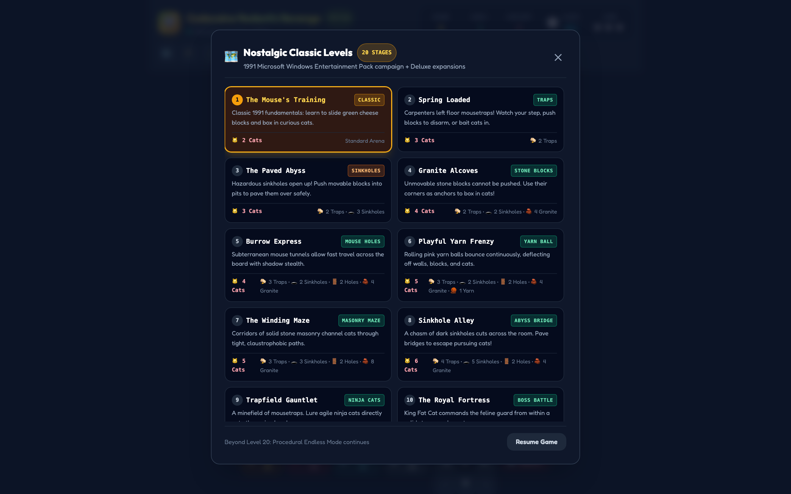

# 🐭 Rodent's Revenge Deluxe -- Complete Production User Guide

```
Version: 2.5.0  •  Engine: Native HTML5 Canvas & Retro Sound Synthesis  •  Dependencies: 0  •  Offline: 100%
Launchers: [Desktop GUI: bun run app:rodents_revenge]  •  [Headless Server: bun run applications/rodents_revenge_studio.ts --server]
```

---

## 🌟 Executive Overview
**Rodent's Revenge Deluxe** is a high-DPI modern arcade revival and faithful expansion of the legendary 1991 Microsoft Windows Entertainment Pack classic, built natively with zero external dependencies for Bun RAD Studio. You control an intrepid mouse trapped in a labyrinthine grid crawling with hungry feline predators.

By maneuvering through the room, burrowing through underground tunnels, baiting cats into mousetraps, and pushing blocks to enclose them, you transform dangerous cats into delicious wedges of score-multiplying cheese!

---

## 🖼️ Visual Interface Tour

| High-Resolution Desktop Arena (1920×988) | 20-Stage Nostalgic Levels Campaign Modal |
| :---: | :---: |
|  |  |

---

## 🕹️ Authentic Classic 1991 & Deluxe Mechanics

### 🪤 Mousetraps (Floor Traps & Pocket Traps)
- **Classic Hazard & Tactical Weapon**: Stepping directly onto an armed mousetrap without protection snaps the trap and costs a life.
- **Luring Cats**: Clever mice can bait cats into walking over armed mousetraps! The trap snaps shut (`SNAPPED`), instantly trapping the feline and turning it into fresh cheese while awarding 200 bonus points.
- **Disarming Traps**: Push any movable green block over an active mousetrap to safely trigger and disarm it (`SPRUNG_TRAP`).
- **Pocket Traps (NEW)**: Mice carry portable pocket mousetraps! Press `T` or click the **Trap** toolbar button to plant a live mousetrap on the tile behind you to snare pursuing cats.

### 🕳️ Sinkholes & Floor Paving
- **Bottomless Pits**: Dangerous dark pits scattered across the floor.
- **Mouse Struggle Mechanic**: If the mouse falls into a sinkhole, they become stuck! An alert banner appears (`STUCK IN SINKHOLE! TAP MOVE KEYS`) requiring 4 rapid direction keystrokes to squirm out before cats catch up.
- **Paving Sinkholes**: Push any movable block into a sinkhole to permanently pave over the pit, converting it into a safe empty floor tile (`EMPTY`) and unlocking the *Sinkhole Paved* achievement!
- **Cat Hazard**: Hostile cats that wander into unpaved sinkholes fall straight into the abyss and are removed from the board.

### 🕳️ Mouse Holes (Burrows & Subterranean Tunnels)
- **Secret Escape Routes**: Connected pairs of underground mouse holes appear on the board.
- **Subterranean Teleportation**: Step into one mouse hole to instantly emerge out of its connected twin across the board, playing a subterranean whoosh effect.
- **Shadow Stealth Aura**: Emerging from a mouse hole cloaks the mouse in subterranean stealth for 1.8 seconds, preventing cats from hunting or attacking you.

### 🧱 Solid Blocks (Unmovable Stone Masonry)
- **Unyielding Obstacles**: Authentic heavy stone masonry blocks that cannot be pushed by either mouse or cat.
- **Tactical Geometry**: Use unmovable stone blocks as corner anchors to trap cats with fewer movable green blocks!

### ⏰ Ticking Reinforcement Clock
- **Countdown Pressure**: Just like the original 1991 game, a timer ticks down on the HUD.
- **Feline Reinforcements**: If the mouse takes too long to clear the level, a warning chime sounds and a reinforcement cat spawns from the corner to increase the pressure.

---

## 🧀 Cheese Varieties & Power Effects

Whenever a cat is trapped or snared, it turns into a wedge of cheese with an active countdown timer. Collect it before it spoils!

| Cheese Variety | Points | Visual Identity | Special Power Effect |
| :--- | :--- | :--- | :--- |
| **Classic Cheddar** | +100 pts | Golden Orange with Swiss holes | Classic score boost |
| **Golden Swiss** | +500 pts | Radiant Golden aura with star sparkles | Massive point multiplier |
| **Spicy Pepper Jack** | +250 pts | Orange-red with jalapeño chili flecks | **Spicy Dash**: 6 seconds of double move speed |
| **Stinky Limburger** | +250 pts | Pale green with rising aroma waves | **Cat Repellent**: 5 seconds of cats fleeing in terror |

---

## ⚡ Speed Mode Toggling

Toggle gameplay pacing at any time by pressing the top-bar speed button (`#btn-speed`):
- **⚡ Normal Mode**: Balanced classic speed with responsive physics.
- **🚀 Turbo Mode**: 2× accelerated feline and movement speeds for adrenaline-fueled veteran play.
- **🐢 Casual Mode**: Relaxed timing and gentle feline pacing for thoughtful puzzle-solving.

---

## ⌨️ Controls Reference

| Action | Primary Key | Secondary Key | Virtual UI |
| :--- | :--- | :--- | :--- |
| **Move Up / Down / Left / Right** | Arrow Keys | `W`, `S`, `A`, `D` | Virtual 8-Way D-Pad |
| **Move Diagonally (8-Way)** | `Q`, `E`, `Z`, `C` | Numpad `7`, `9`, `1`, `3` | Diagonal D-Pad corners |
| **Deploy Pocket Mousetrap** | `T` | — | 🪤 `Trap` button |
| **Demolish Block (Bomb)** | `B` | — | 🧨 `Bomb` button |
| **Freeze Cats (5s)** | `F` | — | ❄️ `Freeze` button |
| **Undo Last Move** | `U` | — | ↩️ `Undo` button |
| **Pause / Resume** | `P` | `Space` | ⏸️ `Pause` button |
| **Quick Restart Level** | `R` | — | 🔄 `Restart` button |
| **Toggle Music** | `M` | — | 🎵 `Music` button |
| **Toggle Theme (Modern / Win95)** | — | — | 🎨 `Theme` button |
| **View Achievements** | — | — | 🏆 `Trophies` button |
| **How to Play** | — | — | ❓ `Help` button |

---

## 🗺️ The 20 Nostalgic Classic Levels Campaign

Rodent's Revenge Deluxe features **20 handcrafted nostalgic stages** recreating authentic 1991 Microsoft Windows Entertainment Pack level designs, hazards, and feline encounters, alongside modern tactical expansions.

You can select any level at any time by clicking the **🗺️ Levels button** in the top navigation bar or clicking the **Level indicator** in the HUD.

| Level | Title | Theme Badge | Cats & Hazards | Stage Overview |
| :---: | :--- | :--- | :--- | :--- |
| **1** | **The Mouse's Training** | `Classic` | 🐱 1 Cat | Original 1991 fundamentals: sliding green cheese blocks and inquisitive cats. |
| **2** | **Spring Loaded** | `Traps` | 🐱 2 Cats • 🪤 3 Traps | Floor mousetraps appear! Lure cats into them or disarm them with movable blocks. |
| **3** | **The Paved Abyss** | `Sinkholes` | 🐱 3 Cats • 🕳️ 4 Sinkholes | Dark sinkholes dot the arena corners. Push blocks into the abyss to pave safe paths! |
| **4** | **Granite Alcoves** | `Tactical` | 🐱 3 Cats • 🧱 8 Granite | Heavy unmovable stone blocks create natural corner choke points for easy trapping. |
| **5** | **Burrow Express** | `Burrows` | 🐱 4 Cats • 🚪 2 Mouse Holes | Connected underground mouse holes! Teleport across the board to shake feline pursuers. |
| **6** | **Playful Yarn Frenzy** | `Yarn` | 🐱 4 Cats • 🧶 1 Yarn | Bouncing balls of yarn roll across the floor, distracting inquisitive cats. |
| **7** | **The Winding Maze** | `Tactical` | 🐱 4 Cats • 🧱 14 Granite | Unmovable stone walls divide the arena into twisting corridors and ambush alleys. |
| **8** | **Sinkhole Alley** | `Sinkholes` | 🐱 4 Cats • 🕳️ 4 Sinkholes • 🧱 4 Granite | A central corridor of sinkholes separates the feline spawn dens from safety. |
| **9** | **Trapfield Gauntlet** | `Traps` | 🐱 5 Cats • 🪤 5 Traps | A minefield of hair-trigger mousetraps! One false step means a swift snap. |
| **10** | **The Royal Fortress** | `Boss` | 🐱 1 King Fat Cat + 3 Cats | Boss fight! King Fat Cat requires two block hits or a mousetrap snap to capture. |
| **11** | **Subterranean Warren** | `Burrows` | 🐱 5 Cats • 🚪 4 Mouse Holes | Four connected corner burrows turn the board into an underground rodent network. |
| **12** | **The Great Library** | `Tactical` | 🐱 5 Cats • 🧱 12 Granite | Parallel unmovable stone shelves create narrow book corridors for funneling felines. |
| **13** | **Labyrinth of Whispers** | `Tactical` | 🐱 5 Cats • 🧱 8 Granite • 🪤 3 Traps | Checkerboard stone pillars with armed traps scattered between the shadows. |
| **14** | **Twin Chambers** | `Tactical` | 🐱 5 Cats • 🧱 10 Granite • 🚪 2 Mouse Holes | A solid stone divider separates two mirrored wings connected only by burrows. |
| **15** | **Cavern of the King** | `Boss` | 🐱 1 King Fat Cat + 4 Cats • 🧶 2 Yarn | The King returns accompanied by twin yarn balls bouncing unpredictably. |
| **16** | **The Cheese Vault** | `Bonus` | 🐱 5 Cats • 🧱 8 Granite • 🕳️ 2 Sinkholes | A fortified central chamber packed with rare Golden Swiss and Spicy Pepper Jack! |
| **17** | **Four Quadrants** | `Tactical` | 🐱 6 Cats • 🧱 12 Granite • 🪤 4 Traps | A cross of unmovable blocks segments the arena into four feline combat zones. |
| **18** | **Chaos Crucible** | `Hazardous` | 🐱 6 Cats • 🪤 4 Traps • 🕳️ 4 Sinkholes • 🧱 8 Granite | Every classic hazard combined: traps, sinkholes, and solid blocks in full intensity! |
| **19** | **The Feline Vanguard** | `Swarm` | 🐱 7 Fast Cats • 🧱 8 Granite • 🚪 2 Mouse Holes | A relentless swarm of aggressive cats rushing through perimeter corridors. |
| **20** | **1991 Final Stand** | `Boss` | 🐱 2 King Fat Cats + 6 Cats • Grand Arena | The ultimate championship finale! Prove yourself as the Master Rodent of 1991. |

> **Endless Scaling Mode**: Surviving past Stage 20 triggers continuous procedural generation with dynamically scaled cat populations, hazard densities, and reinforcement countdowns.

---

## 🏆 Achievements System

- 🪤 **Trap Master**: Lure a pursuing cat directly into an armed mousetrap.
- 🕳️ **Subterranean Express**: Use a mouse hole burrow to teleport across the board.
- 🧱 **Civil Engineer**: Pave over a dangerous sinkhole by pushing a block into it.
- 🛠️ **Demolitions Expert**: Disarm a mousetrap by pushing a green block on top of it.
- 🚀 **Turbo Champion**: Complete any level while playing in Turbo speed mode.
- 🧀 **Fromage Connoisseur**: Sample all 4 cheese varieties (Cheddar, Gold, Pepper Jack, and Stinky).
- 🏆 **Cheese Tycoon**: Accumulate over 10,000 points in a single run.
