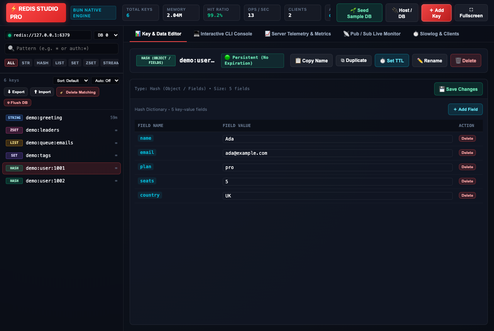
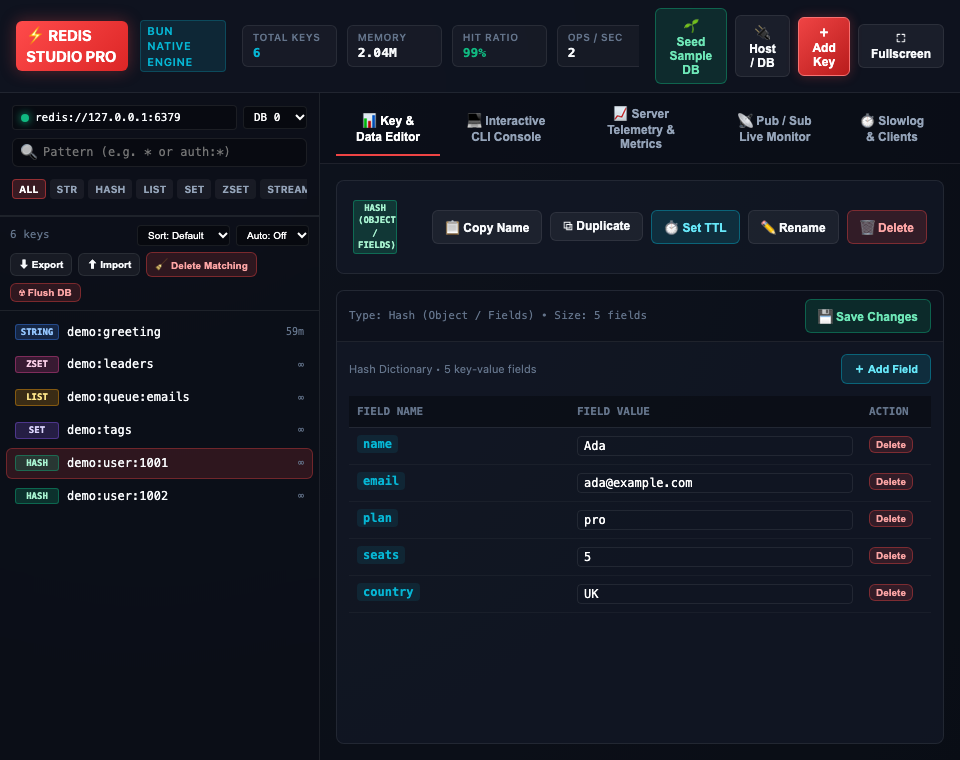

# ⚡ Redis Studio Pro -- Complete Production User Guide

```
Engine: Bun native Redis client  •  Dependencies: 0  •  Requires: a reachable Redis server (default redis://127.0.0.1:6379)
Launch: [Desktop GUI: bun run applications/redis_studio.ts [redis-url]]
```

> **Open it from the File Manager.** Redis Studio can also be opened inside the Codecaine File Manager: the File Manager's **Databases** tool can keep Redis connections (the password in the keychain) and open this studio for one. A saved connection replaces environment variables ([how](43_file_manager.md#databases-databases-tab), [order of precedence](../databases/index.md#connection-settings-and-environment-variables)).

---

## 🌟 Overview
**Redis Studio Pro** is a desktop workstation for browsing, editing and monitoring a Redis server: a key browser with type filters, typed editors (String, Hash, List, Set, Sorted Set, Stream, HyperLogLog, Bitmap), an interactive CLI console, live telemetry, a Pub/Sub monitor and slowlog / client inspection.

> Redis Studio connects to an existing Redis server; it does not bundle one. Use **🔌 Host / DB** to point it at any `redis://` URL and database (0-15).

## 🖼️ Visual Interface Tour

| High-Resolution Desktop | Responsive Viewport |
| :---: | :---: |
|  |  |

---

## 🧭 Element Guide

### 1. Key Browser (left sidebar)
- **Search pattern**: Redis glob (`*`, `auth:*`, `user:?`) — the list updates as you type.
- **Type pills**: ALL / STR / HASH / LIST / SET / ZSET / STREAM / HLL / BIT.
- **Key count**: shows "N keys" or "N of M keys" when a type filter is active.
- **Sort**: Default, Name A→Z / Z→A, Type, or TTL (soonest expiry first).
- **Auto refresh**: Off / 5s / 10s / 30s re-scan of the key list.

### 2. Key Editor
- Select a key to view or edit it with the editor that matches its type. **💾 Save Changes** writes edits.
- **📋 Copy Name** copies the key name; **⧉ Duplicate** copies the key (value and TTL) to a new name and refuses to overwrite an existing key.
- **⏱️ Set TTL**, **✏️ Rename**, **🗑️ Delete** as before.

### 3. Bulk Operations & Backup
- **⬇ Export**: Saves every key matching the current search pattern (or all keys when the box is empty) to `~/Downloads/redis_export_db<N>_<timestamp>.json`. Supports String, Hash, List, Set and Sorted Set keys with their TTLs; Streams, HyperLogLogs, bitmaps/binary values and other types are skipped and counted in the confirmation message.
- **⬆ Import**: Choose an export file or paste its JSON. Existing keys are skipped unless **Overwrite keys that already exist** is ticked. Invalid files are rejected with a clear message.
- **🧹 Delete Matching**: Deletes all keys that match the search pattern. You must type the pattern again to confirm; an empty pattern is refused.
- **☢ Flush DB**: Deletes every key in the selected database after you type `FLUSH`.

### 4. Interactive CLI Console
- Run any Redis command; preset buttons cover common ones.
- **↑ / ↓** recall your previous commands (last 100 this session).
- Destructive or server-changing commands (`FLUSHALL`, `FLUSHDB`, `SHUTDOWN`, `DEBUG`, `CONFIG SET/REWRITE/RESETSTAT`, `ACL`, `MODULE`, `REPLICAOF`/`SLAVEOF`, `BGREWRITEAOF`) ask for confirmation first.

### 5. Telemetry, Pub/Sub, Slowlog & Clients
- Live KPIs (keys, memory, hit ratio, ops/sec, clients, active DB), a Pub/Sub publisher and live subscriber feed, plus slowlog and connected-client tables.

> Seeding: **🌱 Seed Sample DB** creates demo keys across the supported types so you can explore the editors.

## 🔒 Safety Notes
- The server only accepts requests from the local machine.
- Bulk delete, flush and dangerous CLI commands always require an explicit in-app confirmation.
