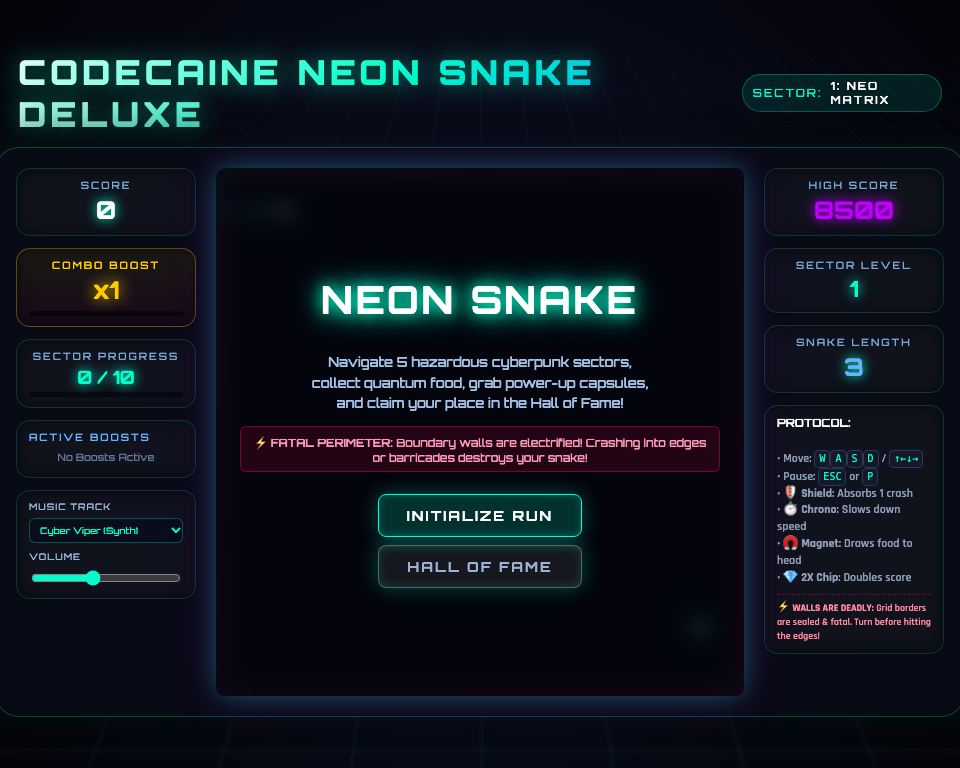

# 🐍 Codecaine Neon Snake Deluxe -- Complete Production User Guide

```
Version: 2.5.0  •  Engine: High-Speed Cyber Grid Engine, Combo Multipliers & Game Master FX (Alt+G)  •  Dependencies: 0  •  Offline: 100%
Launchers: [Desktop GUI: bun run app:snake]  •  [Headless Server: bun run applications/snake_studio.ts --server]
```

---

## 🌟 Executive Overview
**Codecaine Neon Snake Deluxe** is a high-speed glowing cyber-serpent arcade studio built natively for Bun RAD Studio. Featuring wrap-around and walled arena modes, rapid-pickup combo multipliers, bonus energy nodes, speed overdrive tiers, Web Audio synth cues, and the **Codecaine Game Master FX & Post-Processing Engine (`Alt+G`)**.

---

## 🚀 Quick Start & Launch

```bash
# Standard desktop launch
bun run app:snake

# Launch headless server
bun run applications/snake_studio.ts --server
```

---

## 🖼️ Visual Interface Tour

| High-Resolution Desktop (1280×850) | Responsive Viewport (960×720) |
| :---: | :---: |
|  |  |

---

## 🕹️ Gameplay Mechanics
- **Combo Multipliers**: Chain consecutive energy pickups within the combo window to multiply your score.
- **Wall Modes**: Toggle between lethal perimeter walls and toroidal wrap-around portals.
- **High-DPI Neon Trail**: Smooth segment interpolation with glowing head and tail particles.

---

## ⌨️ Controls Reference
- **Steer**: `Arrow Keys` or `W`, `A`, `S`, `D`
- **Pause / Restart**: `P` / `R`
- **Game Master FX HUD**: `Alt + G`
- **Fullscreen**: `F` / `F11`

---

## 🐧 Slow Linux Machines — Brave & Chrome Browser Performance Tip
- On slower Linux machines, integrated GPUs, or virtual machines where the native `libwebkitgtk-6.0-4` window uses software rendering, **Brave**, **Google Chrome**, and other Chromium-based browsers run Canvas 2D graphics, particle effects, and Web Audio synthesizers significantly faster.
- Launch with `--server` (or start Codecaine File Manager with `bun run app:files --server`) and open the printed `http://127.0.0.1:<port>` URL in **Brave** or **Chrome** for smooth 60fps gameplay.
- Press **`Alt+G`** at any time to open the **Game Master FX HUD** and toggle off **CRT Scanlines** or **Cabinet Glow** to further reduce GPU/CPU compositing overhead on older hardware.
