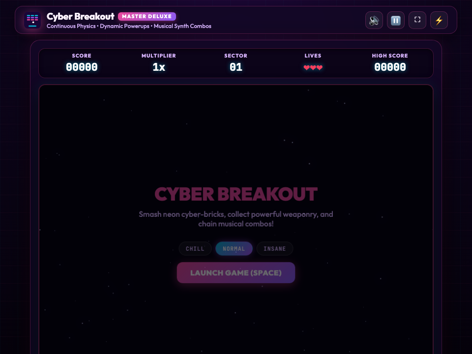

# 🧱 Codecaine CyberBrick Breaker Deluxe -- Complete Production User Guide

```
Version: 2.5.0  •  Engine: Continuous Swept Collision Physics, 8 Powerups & Game Master FX (Alt+G)  •  Dependencies: 0  •  Offline: 100%
Launchers: [Desktop GUI: bun run app:breakout]  •  [Headless Server: bun run applications/breakout_studio.ts --server]
```

---

## 🌟 Executive Overview
**Codecaine CyberBrick Breaker Deluxe** is a high-energy brick-shattering arcade studio built natively for Bun RAD Studio. Featuring continuous swept ball collision physics, 8 collectible capsule power-ups (Multi-Ball, Laser Turrets, Fireball Pierce, Magnet Catch, Wide Paddle, Slow-Mo, Shield Floor, Extra Life), TNT chain-reaction bricks with expanding shockwave rings, combo fever rim glow, pentatonic Web Audio melodies, and the **Codecaine Game Master FX & Post-Processing Engine (`Alt+G`)**.

---

## 🚀 Quick Start & Launch

```bash
# Standard desktop launch
bun run app:breakout
bun run app:arkanoid

# Launch headless server
bun run applications/breakout_studio.ts --server
```

---

## 🖼️ Visual Interface Tour

| High-Resolution Desktop (1280×850) | Responsive Viewport (960×720) |
| :---: | :---: |
|  |  |

---

## 🕹️ Core Mechanics & Power-Ups
- **8 Power-Up Capsules**: Multi-Ball split, twin plasma lasers, piercing fireball, magnetic catch, wide paddle, slow time, bottom energy shield, and extra life.
- **Shockwave & Fever Visuals**: Every shattered brick emits an expanding neon shockwave ring, while high combo streaks ignite a glowing golden/magenta fever rim around the arena.

---

## ⌨️ Controls Reference
- **Move Paddle**: `Mouse` or `←` / `→` (`A` / `D`)
- **Launch Ball / Fire Lasers**: `Space` or `Left Click`
- **Pause / Restart**: `P` / `R`
- **Game Master FX HUD**: `Alt + G`

---

## 🐧 Slow Linux Machines — Brave & Chrome Browser Performance Tip
- On slower Linux machines, integrated GPUs, or virtual machines where the native `libwebkitgtk-6.0-4` window uses software rendering, **Brave**, **Google Chrome**, and other Chromium-based browsers run Canvas 2D graphics, particle effects, and Web Audio synthesizers significantly faster.
- Launch with `--server` (or start Codecaine File Manager with `bun run app:files --server`) and open the printed `http://127.0.0.1:<port>` URL in **Brave** or **Chrome** for smooth 60fps gameplay.
- Press **`Alt+G`** at any time to open the **Game Master FX HUD** and toggle off **CRT Scanlines** or **Cabinet Glow** to further reduce GPU/CPU compositing overhead on older hardware.
