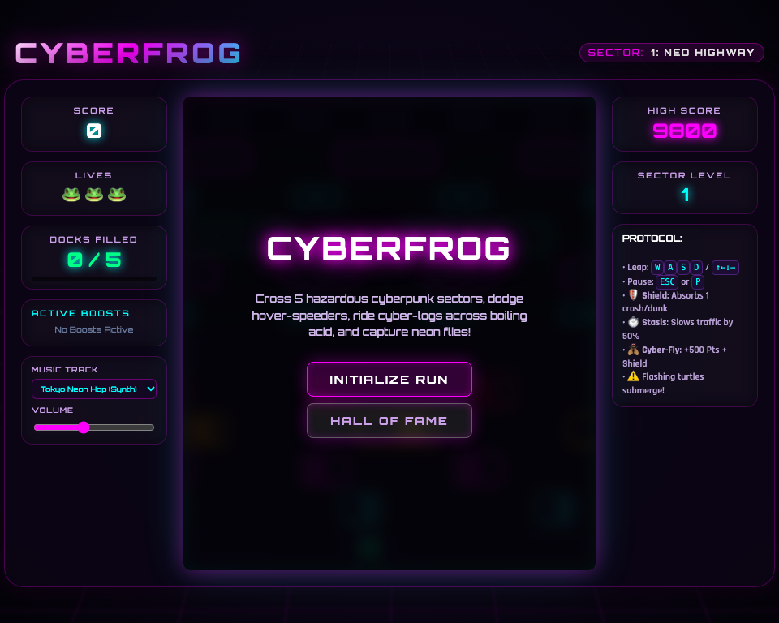

# 🐸 Codecaine CyberFrog Deluxe -- Complete Production User Guide

```
Version: 2.5.0  •  Engine: Fluid Lane Interpolation Physics, Synth Audio & Game Master FX (Alt+G)  •  Dependencies: 0  •  Offline: 100%
Launchers: [Desktop GUI: bun run app:frogger]  •  [Headless Server: bun run applications/frogger_studio.ts --server]
```

---

## 🌟 Executive Overview
**Codecaine CyberFrog Deluxe** is a kinetic lane-crossing arcade game built natively for Bun RAD Studio. Guide your cyber-amphibian across a multi-lane neon superhighway of turbo cruisers and an acid data-river of drifting logs and diving cyber-turtles to dock safely in all 5 home bays, enhanced with the **Codecaine Game Master FX & Post-Processing Engine (`Alt+G`)**.

---

## 🚀 Quick Start & Launch

```bash
# Standard desktop launch
bun run app:frogger

# Launch headless server
bun run applications/frogger_studio.ts --server
```

---

## 🖼️ Visual Interface Tour

| High-Resolution Desktop (1280×850) | Responsive Viewport (960×720) |
| :---: | :---: |
|  |  |

---

## 🕹️ Gameplay & Controls
- **Hop**: `Arrow Keys` or `W`, `A`, `S`, `D`
- **Objective**: Fill all 5 upper docking bays before the timer runs out to advance to faster traffic and river currents.
- **Game Master FX HUD**: `Alt + G`

---

## 🐧 Slow Linux Machines — Brave & Chrome Browser Performance Tip
- On slower Linux machines, integrated GPUs, or virtual machines where the native `libwebkitgtk-6.0-4` window uses software rendering, **Brave**, **Google Chrome**, and other Chromium-based browsers run Canvas 2D graphics, particle effects, and Web Audio synthesizers significantly faster.
- Launch with `--server` (or start Codecaine File Manager with `bun run app:files --server`) and open the printed `http://127.0.0.1:<port>` URL in **Brave** or **Chrome** for smooth 60fps gameplay.
- Press **`Alt+G`** at any time to open the **Game Master FX HUD** and toggle off **CRT Scanlines** or **Cabinet Glow** to further reduce GPU/CPU compositing overhead on older hardware.
