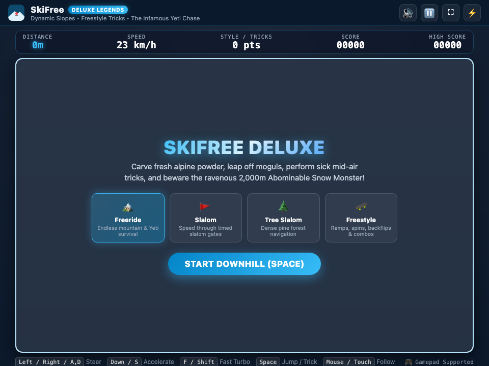

# ⛷️ Codecaine CyberSki Deluxe -- Complete Production User Guide

```
Version: 2.5.0  •  Engine: Downhill Alpine Physics, Freestyle Tricks & Game Master FX (Alt+G)  •  Dependencies: 0  •  Offline: 100%
Launchers: [Desktop GUI: bun run app:skifree]  •  [Headless Server: bun run applications/skifree_studio.ts --server]
```

---

## 🌟 Executive Overview
**Codecaine CyberSki Deluxe** is a high-speed downhill alpine skiing arcade studio built natively for Bun RAD Studio. Carve down endless snowfields, weave through slalom gates, launch off rainbow ramps for mid-air freestyle tricks, and ignite turbo boost to outrun the ravenous Abominable Cyber-Yeti past 2,000 meters, complete with the **Codecaine Game Master FX & Post-Processing Engine (`Alt+G`)**.

---

## 🚀 Quick Start & Launch

```bash
# Standard desktop launch
bun run app:skifree
bun run app:ski

# Launch headless server
bun run applications/skifree_studio.ts --server
```

---

## 🖼️ Visual Interface Tour

| High-Resolution Desktop (1280×850) | Responsive Viewport (960×720) |
| :---: | :---: |
|  |  |

---

## 🕹️ Controls Reference
- **Carve Left / Right / Straight**: `←` / `→` / `↓` (`A` / `D` / `S`) or `Mouse`
- **Jump / Freestyle Trick**: `Space` or `T`
- **Turbo Boost**: `F` or `Shift`
- **Game Master FX HUD**: `Alt + G`

---

## 🐧 Slow Linux Machines — Brave & Chrome Browser Performance Tip
- On slower Linux machines, integrated GPUs, or virtual machines where the native `libwebkitgtk-6.0-4` window uses software rendering, **Brave**, **Google Chrome**, and other Chromium-based browsers run Canvas 2D graphics, particle effects, and Web Audio synthesizers significantly faster.
- Launch with `--server` (or start Codecaine File Manager with `bun run app:files --server`) and open the printed `http://127.0.0.1:<port>` URL in **Brave** or **Chrome** for smooth 60fps gameplay.
- Press **`Alt+G`** at any time to open the **Game Master FX HUD** and toggle off **CRT Scanlines** or **Cabinet Glow** to further reduce GPU/CPU compositing overhead on older hardware.
