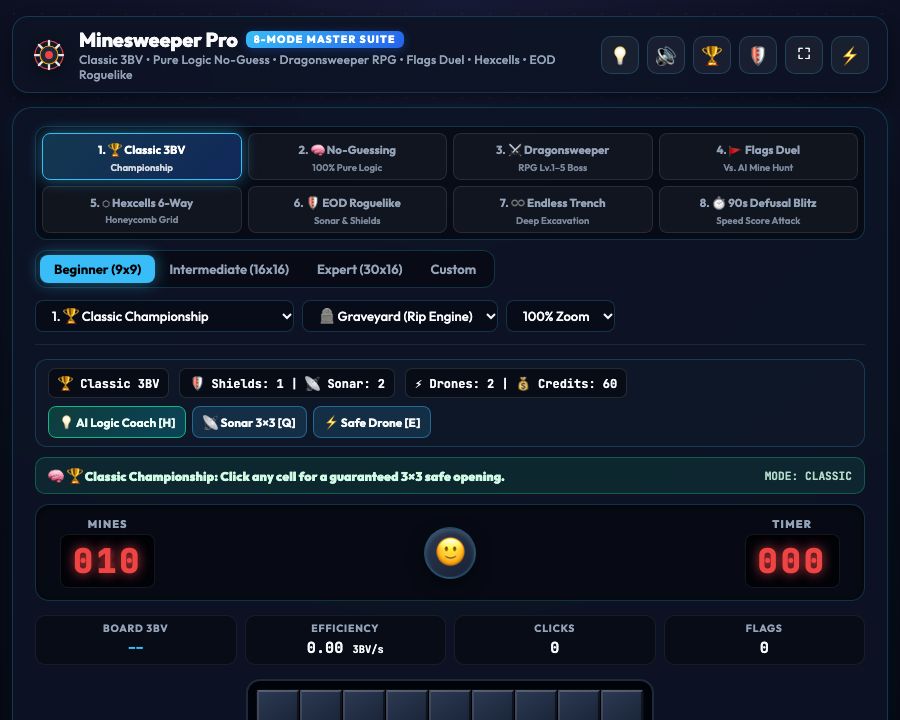

# 💣 Codecaine Minesweeper Pro Championship -- Complete Production User Guide

```
Version: 2.5.0  •  Engine: Championship 3BV Board Engine, 8-Mode Modern Suite, AI Logic Coach & Game Master FX (Alt+G)  •  Dependencies: 0  •  Offline: 100%
Launchers: [Desktop GUI: bun run app:minesweeper]  •  [Headless Server: bun run applications/minesweeper_studio.ts --server]
```

---

## 🌟 Executive Overview
**Codecaine Minesweeper Pro Championship** is an 8-mode tactical logic puzzle studio built natively for Bun RAD Studio. Featuring guaranteed safe first-click opening, chord clearing, live Bechtel's Board Benchmark Value (3BV & 3BV/s) efficiency telemetry, an interactive **AI Logic Deduction Coach (`[H]`)**, Beginner/Intermediate/Expert/Custom boards, multi-theme visual styles, and the **8-Mode Modern Minesweeper Suite** (`[1]`–`[8]`).

---

## 🎮 The 8 Playable Game Modes (`#gameModeSelect` / Keys `1`–`8`)

1. **`classic` — 1. 🏆 Classic Championship (Beginner / Intermediate / Expert / Custom)**:
   - Traditional Championship Minesweeper with guaranteed 3×3 safe first-click opening, Chord Clearing, 3BV & 3BV/s efficiency telemetry, and Hall of Fame best times.
2. **`no_guess` — 2. 🧠 Pure Logic No-Guessing (`100% Deterministic`)**:
   - Eliminates frustrating 50/50 coin-flip guesses! Uses a live constraint-set and subset subtraction solver (`1-1`, `1-2-1`, coupled pigeonhole, and safe-move relocation) plus the **`💡 AI LOGIC COACH [H]`** button that highlights a provably safe or provably mine cell and displays the exact deduction rule in the live coach banner.
3. **`dragonsweeper` — 3. ⚔️ Cyber-Dungeon RPG (`Monster Sweeper Lv.1–Lv.5`)**:
   - Inspired by *Dragonsweeper* & *Mamono Sweeper*!
   - Hidden hazards are **Cyber-Monsters of Levels `1` through `5`** (`🦠 Lv.1 Glitch Bug`, `🤖 Lv.2 Patrol Drone`, `🦂 Lv.3 Mech-Scorpion`, `👾 Lv.4 Void Sentinel`, `🐉 Lv.5 Cyber-Dragon Boss`), and each safe tile's number equals the **SUM of adjacent monster levels**.
   - Start at **Hero Level 1 (`⚔️ LV.1`)**. Clicking any monster with `monsterLevel <= heroLevel` **slays it cleanly for XP (`Level Up!`)** without taking HP damage! Slay weaker monsters to level up to `Lv.5` and defeat the **Cyber-Dragon Boss**.
4. **`flags_duel` — 4. 🚩 Minesweeper Flags Duel (`Vs. Dr. Sweep AI`)**:
   - Inspired by *MSN Messenger Minesweeper Flags*!
   - Reverse competitive mode: **CLICK DIRECTLY ON HIDDEN MINES!**
   - Clicking a hidden mine claims it with your flag (`🔵 P1` vs `🔴 Dr. Sweep AI`), scores `+1 Mine`, and grants a **Bonus Extra Turn (`🔥 CHAIN TURN!`)**. Clicking a safe cell reveals the clue and passes the turn to your opponent.
5. **`hex_grid` — 5. ⬡ Hexagonal Honeycomb Sweeper (`6-Neighbor Hexcells`)**:
   - *Hexcells*-inspired staggered hexagonal honeycomb layout where every cell has **6 adjacent neighbors (`0–6`)** instead of 8, complete with 6-neighbor flood-fill and 6-neighbor Chord Clearing.
6. **`roguelike` — 6. 🛡️ EOD Bomb Squad Roguelike (`Sonar, Shields & Drones`)**:
   - Multi-sector EOD campaign where clearing tiles awards **EOD Credits (`💰`)** to trigger tactical gadgets in the HUD:
     - `📡 Sonar 3×3 Pulse [Q]` (reveals safe cells in a 3×3 zone and auto-flags any mines inside!)
     - `🛡️ Kevlar Blast Shield` (absorbs an accidental mine detonation and auto-defuses it!)
     - `⚡ Safe-Path Drone [E]` (reveals a guaranteed safe opening or frontier cell!)
7. **`trench_endless` — 7. ♾️ Endless Depth Trench (`Deep Minefield Excavation`)**:
   - Clear horizontal strata downward to advance deeper (`10m → 500m+`) with row-clear EOD bonuses and persistent depth progression.
8. **`blitz_90s` — 8. ⏱️ 90-Second Defusal Blitz (`Speed Score Attack`)**:
   - High-speed 90-second countdown where every safe reveal and chord scores combo points and clearing a board immediately spawns the next wave with `+12s Bonus Time`!

---

## 🚀 Quick Start & Launch

```bash
# Standard desktop launch
bun run app:minesweeper
bun run app:mines

# Launch headless server
bun run applications/minesweeper_studio.ts --server
```

---

## 🖼️ Visual Interface Tour

| High-Resolution Desktop (1280×850) | Responsive Viewport (960×720) |
| :---: | :---: |
|  |  |

---

## 🕹️ Controls Reference
- **Reveal Cell / Slay Monster / Claim Mine**: `Left Click` or `Space` / `Enter`
- **Flag / Question Cell**: `Right Click` or `F`
- **Chord Reveal Neighbors**: `Double Click`, `Middle Click`, or `C` on a satisfied clue number
- **AI Logic Deduction Coach**: `H` (or click `💡 AI Logic Coach [H]`)
- **EOD 3×3 Sonar Pulse**: `Q` (or click `📡 Sonar 3×3 [Q]`)
- **EOD Safe-Path Drone**: `E` (or click `⚡ Safe Drone [E]`)
- **Switch 8 Game Modes**: Keys `1` – `8` or `#gameModeSelect`
- **Practice Undo**: `U`
- **Restart Board**: `R`
- **Game Master FX HUD**: `Alt + G`

---

## 🐧 Slow Linux Machines — Brave & Chrome Browser Performance Tip
- On slower Linux machines, integrated GPUs, or virtual machines where the native `libwebkitgtk-6.0-4` window uses software rendering, **Brave**, **Google Chrome**, and other Chromium-based browsers run Canvas 2D graphics, particle effects, and Web Audio synthesizers significantly faster.
- Launch with `--server` (or start Codecaine File Manager with `bun run app:files --server`) and open the printed `http://127.0.0.1:<port>` URL in **Brave** or **Chrome** for smooth 60fps gameplay.
- Press **`Alt+G`** at any time to open the **Game Master FX HUD** and toggle off **CRT Scanlines** or **Cabinet Glow** to further reduce GPU/CPU compositing overhead on older hardware.
