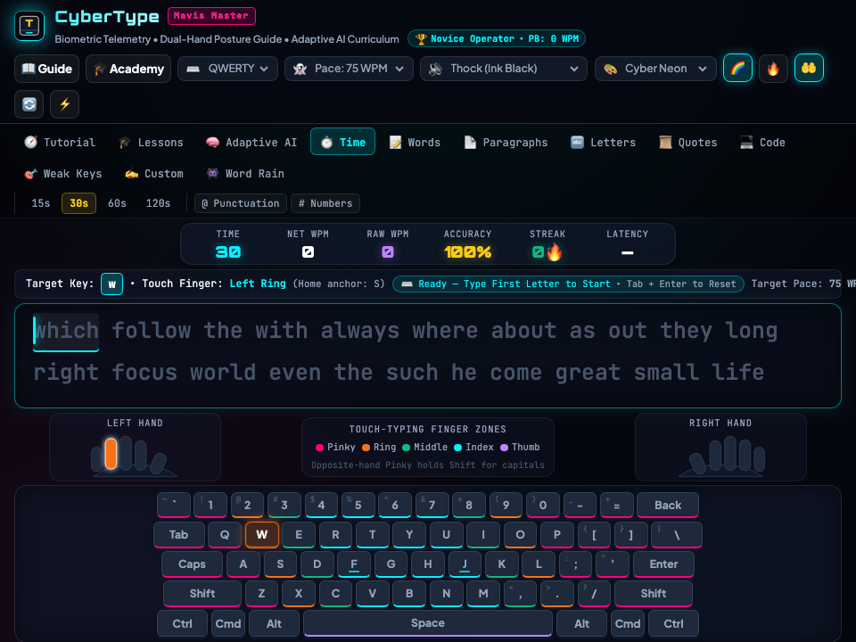

# ⌨️ Codecaine CyberType Deluxe -- Complete Production User Guide

```
Version: 2.5.0  •  Engine: Adaptive Touch-Typing Academy, Mechanical Key Switch Audio & Game Master FX (Alt+G)  •  Dependencies: 0  •  Offline: 100%
Launchers: [Desktop GUI: bun run app:typing]  •  [Headless Server: bun run applications/typing_studio.ts --server]
```

---

## 🌟 Executive Overview
**Codecaine CyberType Deluxe** is a modern touch-typing academy and speed workstation built natively for Bun RAD Studio. Featuring a 10-step guided interactive tutorial, an 18-lesson finger-placement curriculum, Codecaine Adaptive AI weak-key drills, QWERTY/Dvorak/Colemak/Workman virtual keyboards with finger color zones, synthesized mechanical key-switch acoustics, WPM/Accuracy telemetry, and the **Codecaine Game Master FX & Post-Processing Engine (`Alt+G`)**.

---

## 🚀 Quick Start & Launch

```bash
# Standard desktop launch
bun run app:typing
bun run app:type

# Launch headless server
bun run applications/typing_studio.ts --server
```

---

## 🖼️ Visual Interface Tour

| High-Resolution Desktop (1280×850) | Responsive Viewport (960×720) |
| :---: | :---: |
|  |  |

---

## 🕹️ Controls Reference
- **Type Prompt**: Standard keyboard input with live WPM, accuracy, and error heatmaps
- **Restart Drill**: `Tab + Enter` or `Esc`
- **Game Master FX HUD**: `Alt + G`

---

## 🐧 Slow Linux Machines — Brave & Chrome Browser Performance Tip
- On slower Linux machines, integrated GPUs, or virtual machines where the native `libwebkitgtk-6.0-4` window uses software rendering, **Brave**, **Google Chrome**, and other Chromium-based browsers run Canvas 2D graphics, particle effects, and Web Audio synthesizers significantly faster.
- Launch with `--server` (or start Codecaine File Manager with `bun run app:files --server`) and open the printed `http://127.0.0.1:<port>` URL in **Brave** or **Chrome** for smooth 60fps gameplay.
- Press **`Alt+G`** at any time to open the **Game Master FX HUD** and toggle off **CRT Scanlines** or **Cabinet Glow** to further reduce GPU/CPU compositing overhead on older hardware.
