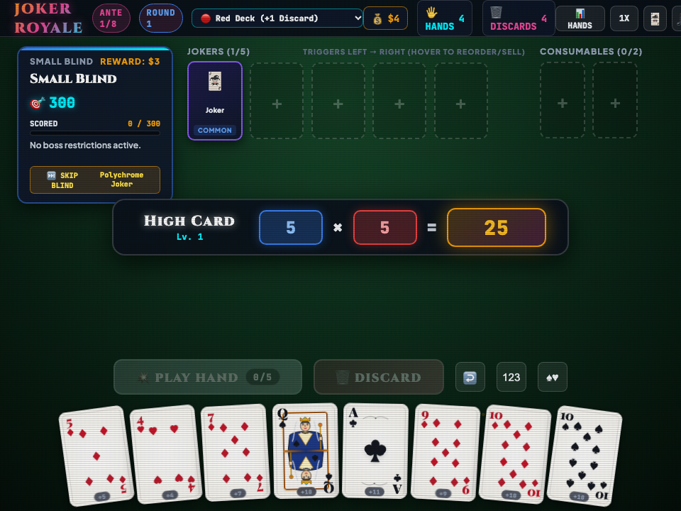

# 🃏 Codecaine Joker Royale Deluxe -- Complete Production User Guide

```
Version: 2.5.0  •  Engine: Roguelike Poker Deckbuilder, 3D Card Tilt Physics & Game Master FX (Alt+G)  •  Dependencies: 0  •  Offline: 100%
Launchers: [Desktop GUI: bun run app:balatro]  •  [Headless Server: bun run applications/balatro_studio.ts --server]
```

---

## 🌟 Executive Overview
**Codecaine Joker Royale Deluxe** is a roguelike poker deckbuilder studio built natively for Bun RAD Studio. Construct synergistic poker hands across escalating Antes and Small/Big/Boss Blinds, collect 30+ Multiplier and Chip-boosting Jokers, upgrade hand tiers in the between-round Cyber Shop, and enjoy 3D card tilt physics, Web Audio synth fanfares, and the **Codecaine Game Master FX & Post-Processing Engine (`Alt+G`)**.

---

## 🚀 Quick Start & Launch

```bash
# Standard desktop launch
bun run app:balatro
bun run app:joker

# Launch headless server
bun run applications/balatro_studio.ts --server
```

---

## 🖼️ Visual Interface Tour

| High-Resolution Desktop (1280×850) | Responsive Viewport (960×720) |
| :---: | :---: |
|  |  |

---

## 🕹️ Controls Reference
- **Select / Deselect Cards (up to 5)**: `Left Click`
- **Play Hand / Discard Selected**: Click **Play Hand** or **Discard**
- **Sort Hand by Rank / Suit**: Click **Rank** or **Suit**
- **Game Master FX HUD**: `Alt + G`

---

## 🐧 Slow Linux Machines — Brave & Chrome Browser Performance Tip
- On slower Linux machines, integrated GPUs, or virtual machines where the native `libwebkitgtk-6.0-4` window uses software rendering, **Brave**, **Google Chrome**, and other Chromium-based browsers run Canvas 2D graphics, particle effects, and Web Audio synthesizers significantly faster.
- Launch with `--server` (or start Codecaine File Manager with `bun run app:files --server`) and open the printed `http://127.0.0.1:<port>` URL in **Brave** or **Chrome** for smooth 60fps gameplay.
- Press **`Alt+G`** at any time to open the **Game Master FX HUD** and toggle off **CRT Scanlines** or **Cabinet Glow** to further reduce GPU/CPU compositing overhead on older hardware.
