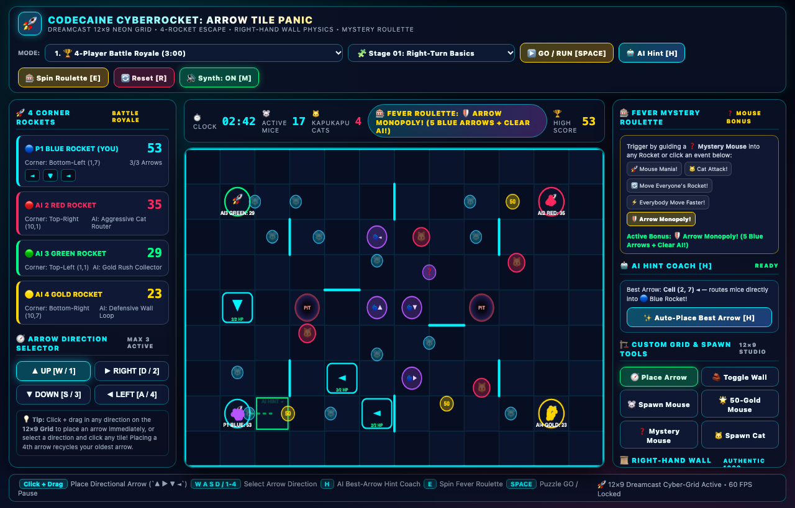

# 🚀 Codecaine CyberRocket: Arrow Tile Panic



**Port**: `3269`  
**Studio Launcher ID**: `chuchu_rocket`  
**Server Entrypoint**: `applications/chuchu_rocket_studio.ts`  
**Interactive Frontend**: `resources/chuchu_rocket/index.html`

---

## 1. Overview & 1999 Dreamcast Cult-Classic Heritage

**Codecaine CyberRocket: Arrow Tile Panic** is a 60fps HTML5 Canvas tribute and modern cyberpunk expansion of Sonic Team's legendary 1999 Sega Dreamcast puzzle-action classic ***ChuChu Rocket!***.

Command the **12 × 9 Neon Cyber-Grid** where hundreds of scurrying **Cyber-Mice (`🐭 ChuChus`)**, **50-Point Bonus Gold Mice (`50`)**, and **Mystery Roulette Mice (`❓`)** pour out of vortex portals toward **4 Corner Escape Rockets**:
- **🔵 Player 1 Blue Rocket** *(Bottom-Left, `(1, 7)`)*
- **🔴 AI 2 Red Rocket** *(Top-Right, `(10, 1)`)*
- **🟢 AI 3 Green Rocket** *(Top-Left, `(1, 1)`)*
- **🟡 AI 4 Gold Rocket** *(Bottom-Right, `(10, 7)`)*

---

## 2. Quick Start & Launch Commands

```bash
# Launch Desktop Native Window (Bun + Webview)
bun run app:chuchu_rocket

# Launch Headless HTTP Server on Port 3269
bun run applications/chuchu_rocket_studio.ts --server
```

---

## 3. Authentic 12 × 9 Grid Rules & Arrow Tile Physics

### 3.1 Right-Hand Wall-Turn Rule
Every **ChuChu Mouse (`🐭`)** and **KapuKapu Cyber-Cat (`🐱`)** marches strictly according to the classic 1999 **Right-Hand Wall Rule**:
1. When stepping onto an **Arrow Tile (`▲`, `►`, `▼`, `◄`)**, the entity immediately turns to match the arrow's direction.
2. When blocked by a neon wall straight ahead, the entity checks if it can turn **90° Right** (`(dir + 1) % 4`).
3. If the right side is also walled off, it turns **90° Left** (`(dir + 3) % 4`).
4. If boxed into a 3-wall cul-de-sac, it reverses **180°** (`(dir + 2) % 4`).

### 3.2 3-Arrow FIFO Limit & 2-HP Cat Durability
- Each player can maintain up to **3 active Arrow Tiles** on the `12 × 9` board simultaneously. Placing a 4th arrow automatically recycles your oldest arrow (`FIFO`).
- Every Arrow Tile has **`2 HP`** against **KapuKapu Cats (`🐱`)**: the first cat collision redirects the cat and cracks the arrow down to `1/2 HP`, and a second cat impact destroys the arrow tile.

### 3.3 KapuKapu Cat Sabotage & Mystery Fever Roulette
- **🐱 KapuKapu Rocket Sabotage**: Guiding a rival Cyber-Cat into an opponent's rocket **slashes their total score by `1/3`** and triggers a seismic shockwave!
- **❓ Mystery Mouse Fever Roulette**: Guiding a `❓` mouse into any rocket spins the **Fever Roulette Wheel**:
  - **🚀 Mouse Mania!**: Unleashes a 50-mouse stampede across all 4 vortex portals.
  - **🐱 Cat Attack!**: Spawns predatory KapuKapu cats outside rival rockets.
  - **🔄 Move Everyone's Rocket!**: Rotates all 4 corner rockets clockwise around the arena.
  - **⚡ Everybody Move Faster!**: Boosts global board speed to `2.0×` overdrive.
  - **🛡️ Arrow Monopoly!**: Wipes rival AI arrows and grants Blue Rocket a 5-arrow cap.

---

## 4. All 8 Playable Game Modes (`#rocketModeSelect`)

1. **🏆 4-Player Battle Royale (`battle_royale`)**: Classic 3-minute 4-corner free-for-all panic against 3 tactical AI rivals.
2. **🧩 25-Stage Puzzle Mode (`puzzle_25`)**: Place limited directional arrows across 25 handcrafted logic stages before pressing **GO (`[SPACE]`)**.
3. **🐱 Cat Mania Survival (`cat_mania`)**: High-density KapuKapu cat swarms test your defensive deflection reflexes.
4. **🐭 Mouse Frenzy 500-Rush (`mouse_frenzy`)**: Overclocked vortex portals in a high-score sprint to 500 rescued ChuChus.
5. **🤝 2v2 Team Rocket Alliance (`team_2v2`)**: **🔵 Blue + 🟢 Green Alliance** vs. **🔴 Red + 🟡 Gold Syndicate** combined team scoreboard.
6. **🌀 Stage Challenge (`stage_challenge`)**: High-pressure 30-second micro-objectives.
7. **🏗️ Custom Puzzle Editor (`custom_editor`)**: Paint interior walls, spawn portals, mice, 50-Gold mice, and cats directly onto the `12 × 9` grid.
8. **🤖 AI Best-Arrow Hint Coach (`ai_coach`)**: Forward-simulates all `12 × 9 × 4` arrow placements and renders the highest-EV trajectory path in real time (`[H]`).

---

## 5. Controls & Keyboard Shortcuts

| Key / Input | Action |
| :--- | :--- |
| `Click + Drag` on Grid | Place Directional Arrow (`▲`, `►`, `▼`, `◄`) in drag direction |
| `W / A / S / D` or `1`–`4` | Select Active Arrow Direction (`▲ UP`, `► RIGHT`, `▼ DOWN`, `◄ LEFT`) |
| `H` | Trigger **AI Best-Arrow Hint Coach** (auto-places optimal arrow) |
| `E` | Spin **Fever Mystery Roulette Wheel** |
| `SPACE` | Start / Pause **25-Stage Puzzle Mode** simulation |
| `R` | Reset current match or puzzle stage |
| `M` | Toggle Dreamcast-style WebAudio Synthesizer BGM & SFX |
| `Alt + G` | Toggle Codecaine Game Master FX Post-Processing HUD |
