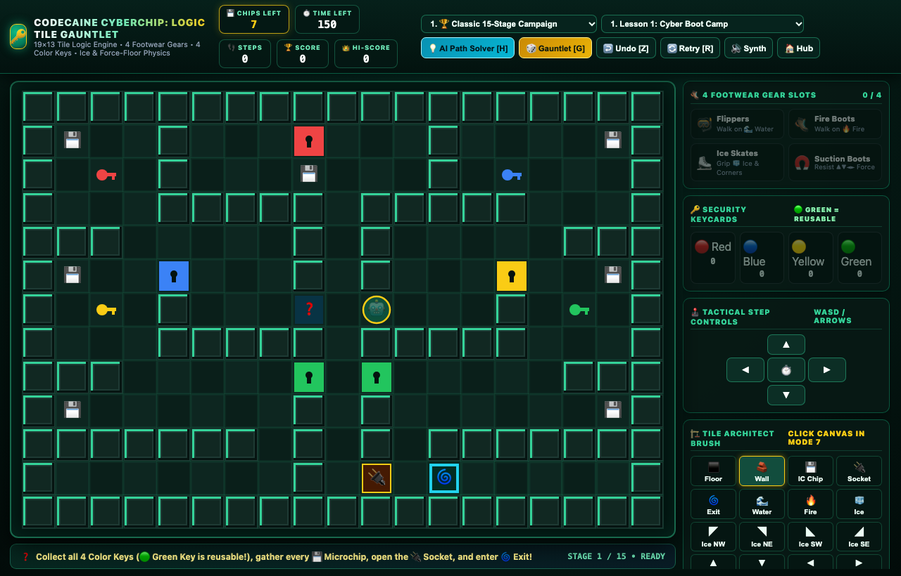

# 🔑 Codecaine CyberChip: Logic Tile Gauntlet -- Complete Production User Guide



```
Version: 2.5.0  •  Engine: 19×13 Tile Logic Engine, 4 Footwear Gears, 4 Color Keys, 8 Game Modes & AI Path Solver + Game Master FX (Alt+G)  •  Dependencies: 0  •  Offline: 100%
Launchers: [Desktop GUI: bun run app:chips_challenge]  •  [Headless Server: bun run applications/chips_challenge_studio.ts --server]
```

---

## 🌟 Executive Overview
**Codecaine CyberChip: Logic Tile Gauntlet** is an authentic homage to Chuck Sommerville's 1989 Epyx / Windows Entertainment Pack puzzle classic *Chip's Challenge*. Navigate a crisp `19 × 13` 3D-beveled logic grid to collect every **IC Microchip (`💾`)**, unlock the **Microchip Socket (`🔌`)**, and step into the **Exit Portal (`🌀`)** while mastering **4 Footwear Inventory Gears**, **4 Color Security Keys**, **Sokoban Dirt-Bridge Water Filling**, **Ice & Corner Ricochet Slides**, **Force Floors**, **Toggle Doors**, **Teleporters**, and **Patrolling Enemies**.

---

## 🚀 Quick Start & Launch

```bash
# Standard desktop launch
bun run app:chips_challenge

# Launch headless server on Port 3273
bun run applications/chips_challenge_studio.ts --server
```

---

## 🥾 4 Footwear Inventory Slots & 4 Color Keys

| Gear / Key | Icon | Tactical Mechanics |
| :--- | :---: | :--- |
| **Flippers** | `🤿` | Swim safely across `🌊 Water` tiles without drowning |
| **Fire Boots** | `🥾` | Walk across `🔥 Fire` tiles without getting scorched |
| **Ice Skates** | `⛸️` | Walk normally across `🧊 Ice` & `◤◥◣◢ Ice Corners` without sliding |
| **Suction Boots** | `🧲` | Walk freely against `▲▼◄► Force Floors` without being pushed |
| **Red / Blue / Yellow Keys** | `🔴 🔵 🟡` | Single-use security keys consumed upon opening matching doors |
| **Green Key** | `🟢` | **Reusable Master Key** — unlocks every `🟩 Green Door` on the stage |
| **Thief Tile** | `🕵️` | Confiscates all 4 Footwear Gears immediately when stepped on |

---

## 🎮 8 Playable Game Modes (`#chipModeSelect`)

1. **🏆 Classic 15-Stage Campaign**: Progress from *Lesson 1: Cyber Boot Camp* through *Lesson 15: Grandmaster Chip Gauntlet*.
2. **🧊 Ice & Corner Slide Lab**: Master momentum physics and 90-degree ricochets off `◤◥◣◢` angled ice bumpers.
3. **📦 Sokoban Dirt-Bridge Puzzles**: Push `📦 Dirt Blocks` into `🌊 Water` to create mud bridges or detonate `💣 Bombs`.
4. **🔥 Footwear & Thief Vault**: Sequence your elemental rooms carefully before crossing mandatory `🕵️ Thief` checkpoints.
5. **⚡ Force-Floor & Teleport Maze**: Ride high-speed `▲▼◄►` conveyor belts and cycle through linked `🌌 Teleport Pads`.
6. **🐸 Teeth & Bug Evasion**: Outsmart `🐞 Bugs` (left-wall followers), `🔥 Fireballs` (right-turners), `🛸 Gliders` (water flyers), and `🐸 Teeth` chasers.
7. **🏗️ Custom Level Editor**: Paint any of the 36 tile types directly onto the `19 × 13` canvas and playtest immediately.
8. **🎲 Procedural Winnable Gauntlet (`[G]`)**: Generates fresh winnable microchip gauntlets on demand.

---

## 🕹️ Keyboard & Mouse Controls Reference

| Key / Action | Command Description |
| :--- | :--- |
| `W / A / S / D` or `Arrow Keys` | Step North, West, South, or East (or push `📦 Dirt Blocks`) |
| `Mouse Click on Arena` | Step toward clicked tile (or paint tiles in Mode 7 / `Shift+Click`) |
| `H` | **AI BFS Path Solver** — highlights optimal path to next Chip / Key / Exit |
| `G` | Generate a new **Procedural Winnable Gauntlet** |
| `Z` | **Undo Last Move** (up to 40 steps of full state history) |
| `R` | Instant Restart Current Stage |
| `M` | Mute / Unmute Nostalgic MIDI Synth Audio Engine |
| `Alt + G` | Toggle Codecaine Game Master FX Post-Processing HUD |
