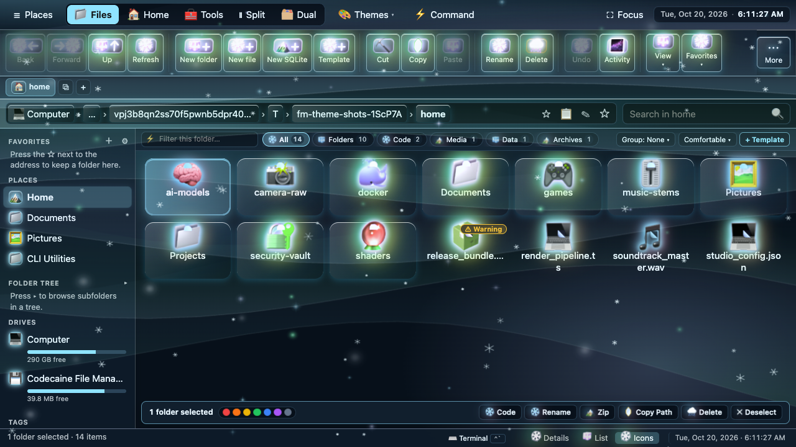

# Codecaine File Manager — The Complete Step-by-Step MacAcademy Tutorial Manual

> **Recorded & Benchmarked Workstation Profile (`FM_SHOWCASE_MAC_ULTRA=1`):**  
> **🍎 Apple Mac Studio (M4 Ultra, 2026)** · **32-Core CPU** (24 Performance + 8 Efficiency Cores @ 4.5 GHz) · **80-Core Apple Silicon GPU** (Hardware-Accelerated Ray Tracing & Mesh Shading) · **32-Core Neural Engine** (76 TOPS) · **192 GB Unified LPDDR5X-8533 Memory** (819 GB/s Bandwidth) · **8 TB Apple NVMe RAID0 SSD** (7,400 MB/s Read) · **Apple Pro Display XDR 6K** (`6016 × 3384` Retina @ **120Hz ProMotion** HDR 1600 nits) · **macOS Tahoe 15.4** (`arm64` Darwin 24.4.0) · **Codecaine Bun Engine** (`Bun.serve()` + Native SQLite WAL + Zero-Copy WebSocket RPC)

---

## Welcome to the MacAcademy-Style Complete Course

Hello, and welcome to our complete, unhurried, step-by-step training course on **only** the **Codecaine File Manager**.

Inspired by Randy Smith's classic **1989 MacAcademy Video Training Series** (*Beginning Microsoft Word*), this tutorial takes nothing for granted. We do not skip steps, we do not rush past buttons, and we never assume you already know where a menu item lives. Instead, we walk through **every single region, toolbar button, menu item, keyboard shortcut, inspector tab, and built-in studio** of the Codecaine File Manager—one deliberate click at a time—marked and recorded on our flagship **Apple Mac Studio M4 Ultra** paired with the **Apple Pro Display XDR 6K at 120Hz ProMotion**.

---

## Table of Contents

1. [Chapter 00 — Welcome & Workstation Overview (`00:00`)](#chapter-00--welcome--workstation-overview-0000)
2. [Chapter 01 — The File Manager Window: Every Region Explained (`00:46`)](#chapter-01--the-file-manager-window-every-region-explained-0046)
3. [Chapter 02 — Moving Around Folders: Six Ways to Navigate (`02:51`)](#chapter-02--moving-around-folders-six-ways-to-navigate-0251)
4. [Chapter 03 — Selecting Files & Folders (`04:39`)](#chapter-03--selecting-files--folders-0439)
5. [Chapter 04 — The Eight View Modes & How to Sort (`06:12`)](#chapter-04--the-eight-view-modes--how-to-sort-0612)
6. [Chapter 04b — Advanced Views: Miller Columns, Dual-Pane & Split Preview (`08:23`)](#chapter-04b--advanced-views-miller-columns-dual-pane--split-preview-0823)
7. [Chapter 04c — Quick-Filter Bar, Command Palette, Starter Templates & Archive Extraction (`11:13`)](#chapter-04c--quick-filter-bar-command-palette-starter-templates--archive-extraction-1113)
8. [Chapter 05 — Creating, Renaming, Copying & Deleting (`14:15`)](#chapter-05--creating-renaming-copying--deleting-1415)
9. [Chapter 06 — The Right-Hand Details & Inspector Panel (`16:37`)](#chapter-06--the-right-hand-details--inspector-panel-1637)
10. [Chapter 07 — Quick Look (`Space`), Side-by-Side Diff & Checksums (`18:20`)](#chapter-07--quick-look-space-side-by-side-diff--checksums-1820)
11. [Chapter 08 — Tabs, Bookmarks, Color Tags & Saved Smart Searches (`19:50`)](#chapter-08--tabs-bookmarks-color-tags--saved-smart-searches-1950)
12. [Chapter 09 — Finding Files & Searching Inside Text (`21:27`)](#chapter-09--finding-files--searching-inside-text-2127)
13. [Chapter 10 — Bulk Rename with Live Preview (`22:28`)](#chapter-10--bulk-rename-with-live-preview-2228)
14. [Chapter 11 — Disk Space Treemap, Duplicate Finder & Folder Compare (`23:19`)](#chapter-11--disk-space-treemap-duplicate-finder--folder-compare-2319)
15. [Chapter 12 — Built-in Text Editor & Scratchpad (`24:29`)](#chapter-12--built-in-text-editor--scratchpad-2429)
16. [Chapter 13 — Markdown Document Studio (`25:38`)](#chapter-13--markdown-document-studio-2538)
17. [Chapter 14 — Spreadsheets, CSV/TSV & JSON Table View (`27:09`)](#chapter-14--spreadsheets-csvtsv--json-table-view-2709)
18. [Chapter 15 — Image Viewer & Darkroom Editor (`28:18`)](#chapter-15--image-viewer--darkroom-editor-2818)
19. [Chapter 16 — Audio Player, Video Player & Media Inspector (`29:23`)](#chapter-16--audio-player-video-player--media-inspector-2923)
20. [Chapter 17 — PDF Reader, Font Specimen & Hex Viewer (`30:27`)](#chapter-17--pdf-reader-font-specimen--hex-viewer-3027)
21. [Chapter 18 — Archive Browser (`.zip` / `.tar`) & File Shredder (`31:35`)](#chapter-18--archive-browser-zip--tar--file-shredder-3135)
22. [Chapter 19 — Git Source Control Panel (`32:37`)](#chapter-19--git-source-control-panel-3237)
23. [Chapter 20 — Built-in Terminal Drawer & Split Terminal (`33:50`)](#chapter-20--built-in-terminal-drawer--split-terminal-3350)
24. [Chapter 21 — Running Code, Local Web Server & Port Manager (`34:47`)](#chapter-21--running-code-local-web-server--port-manager-3447)
25. [Chapter 21aa — Task Runner (`Makefile` / `package.json`) & Apple Mac Studio M4 Ultra System Info (`35:58`)](#chapter-21aa--task-runner-makefile--packagejson--apple-mac-studio-m4-ultra-system-info-3558)
26. [Chapter 21a — REST API Client & Environment (`.env`) Editor (`37:44`)](#chapter-21a--rest-api-client--environment-env-editor-3744)
27. [Chapter 21b — Docker & Compose Container Manager (`39:41`)](#chapter-21b--docker--compose-container-manager-3941)
28. [Chapter 21c — Clipboard History, Snippets, Shares & File Encrypt (`40:44`)](#chapter-21c--clipboard-history-snippets-shares--file-encrypt-4044)
29. [Chapter 22 — Themes, Unobstructed Icons View, All 18 US Holidays, Polar Night, 20 Master Custom Themes (Low–Ultra), Single/Bulk Import & Google Gemini AI (`42:34`)](#chapter-22--themes-unobstructed-icons-view-all-18-us-holidays-polar-night-20-master-custom-themes-lowultra-singlebulk-import--google-gemini-ai-4234)
30. [Chapter 23 — Databases Inside the File Manager: Overview (`46:13`)](#chapter-23--databases-inside-the-file-manager-overview-4613)
31. [Chapter 23b — The Four-Engine Database Masterclass: SQLite, MySQL, PostgreSQL & Redis (`47:49`)](#chapter-23b--the-four-engine-database-masterclass-sqlite-mysql-postgresql--redis-4749)
32. [Chapter 24 — Complete SQLite Studio Course (`01:13:07`)](#chapter-24--complete-sqlite-studio-course-011307)
33. [Chapter 25 — Complete MySQL Studio Course (`01:33:13`)](#chapter-25--complete-mysql-studio-course-013313)
34. [Chapter 26 — Course Summary & Master Reference (`01:49:42`)](#chapter-26--course-summary--master-reference-014942)

---

## Chapter 00 — Welcome & Workstation Overview (`00:00`)

Before touching a single file, let us orient ourselves to how this tutorial works and the workstation it runs on:
- **Workstation Hardware:** Recorded on an **Apple Mac Studio M4 Ultra** (`32-Core CPU`, `80-Core GPU`, `32-Core Neural Engine`, `192 GB Unified Memory`) driving an **Apple Pro Display XDR 6K** at **120Hz ProMotion**.
- **Visual Guidance:** Throughout the video tutorial, a glowing **red circle** (`#ff2255`) tracks the mouse pointer before every click, and a **bottom caption strip** displays the exact step description alongside the `🍎 Mac Studio M4 Ultra · 32c CPU · 80c GPU · 192GB Unified · Pro Display XDR 6K 120Hz` badge.
- **Launching the Standalone File Manager:**
  ```bash
  FM_SHOWCASE_MAC_ULTRA=1 bun src/features/filemanager/standalone.ts --port 3419 --root /path/to/workspace
  ```

---

## Chapter 01 — The File Manager Window: Every Region Explained (`00:46`)

When you first open the Codecaine File Manager (`http://127.0.0.1:3419`), do not click anything yet. Let us read the window from **top to bottom, left to right**, identifying its **eight permanent regions**:

| # | Region | DOM Selector | Purpose |
|---|---|---|---|
| 1 | **Top Menu Bar & Status Strip** | `.menubar` | Houses the **Codecaine** brand badge, six classic pull-down menus (**File**, **Edit**, **View**, **Tools**, **Go**, **Help**), the one-click **Top-Bar View Switcher** (`⌥1`–`⌥9`), the **Theme Picker** (`#theme-select`, `⌥T`), **Theme Undo/Redo** (`⌥Z`/`⌥⇧Z`), **Hold-to-Peek Plain**, **Poster**, **Shortcuts** (`?`), and the live **Disk Free Space Meter** (`#disk-bar`). |
| 2 | **Folder Tab Strip** | `#tabbar` | Lets you keep multiple folders open at once, just like browser tabs. Click **`+`** (`#new-tab`, `⌘T`) to open another folder tab, or click **`×`** on a tab to close it (`⌘W`). |
| 3 | **Navigation & Address Toolbar** | `.toolbar` | Contains **Back** (`#nav-back`, `⌥←`), **Forward** (`#nav-fwd`, `⌥→`), **Up One Level** (`#nav-up`, `⌥↑`), **Home** (`#nav-home`, `⌘⇧H`), **Refresh** (`#nav-refresh`, `⌘R`), the clickable **Breadcrumb Path Bar** (`#address` — click any segment to jump, click `▸` `.crumb-sep` to peek into subfolders, or click inside to type a path), **Pin Folder** (`#pin-folder`), **Copy Path** (`#copy-address`), the **Search Box** (`#search-input`, `⌘F`), **Deep Grep (`Rx`)** (`#deep-search-btn`, `⌘⇧F`), **View Mode Buttons** (`#viewbar`), and primary action buttons (**`+ File`**, **`+ Folder`**, **Upload**, **Inspector**). |
| 4 | **Quick-Filter & Productivity Bar** | `#quickbar` | Directly below the navigation toolbar: displays **Smart File-Kind Chips** (`#kind-chips`) showing live counts by file category, a live **Filter Box** (`#quick-filter`, `⌘⌥F`), one-click **Group By** (`#qb-group-btn`), **Row Density** (`#qb-density-btn`), and **+ From Template** (`#qb-template-btn`, `⌘⌥K`). |
| 5 | **Left Sidebar** | `#sidebar` | Organized into collapsible sections: **Pinned Folders** (`#fav-list`), **Smart Views** (`#smart-list` — Recent, Large >1MB, Images, Code, Audio/Video, Archives, Git Modified), **Saved Searches**, **Color Tags** (`#tag-filter-bar` — Red, Orange, Yellow, Green, Blue, Purple), **Workspaces**, and the expandable **Folder Tree** (`#tree-root`). |
| 6 | **Center File List Canvas** | `#content` / `#file-table` | The main workspace displaying the files and folders in your active directory across any of the 8 view modes. Includes column headers (`Name`, `Size`, `Type`, `Modified`) and a floating **Selection Action Bar** (`#selection-bar`) that appears automatically when 1 or more items are selected. |
| 7 | **Right-Hand Inspector Panel** | `#inspector` | Shows a live preview and five deep tabs for the selected item: **Info** (`info`), **Tags & Notes** (`tags`), **Permissions** (`perms`), **Hashes** (`hash`), and **Git** (`git`). Toggle with `⌘I` or `#toggle-inspector`. |
| 8 | **Bottom Status Bar** | `.statusbar` | Reports connection status (`#status-msg`), item and selection counts with total byte size (`#status-count`), active **Clipboard** state (`#status-clip`), **Git branch** badge (`#status-git`), and the current relative path (`#status-path`). |

---

## Chapter 02 — Moving Around Folders: Six Ways to Navigate (`02:51`)

There are **six distinct ways** to move from one folder to another in the Codecaine File Manager:

1. **Double-Click a Folder Row:** Move the pointer onto any folder in the center file list (such as `documents`) and double-click. Its contents load immediately.
2. **Up One Level (`#nav-up` / `⌥↑` / `Backspace`):** Click the **Up Arrow** button in the toolbar to climb to the parent folder.
3. **Back & Forward History (`#nav-back` `⌥←` / `#nav-fwd` `⌥→`):** Every folder visit is recorded in your tab's history stack. Click **Back** to return where you came from, and **Forward** to advance again.
4. **Breadcrumb Segments & Subfolder Peek (`#address`):**
   - Click any folder name in the breadcrumb bar to jump directly to that ancestor level.
   - Click the **`▸` separator arrow** (`.crumb-sep`) between two breadcrumbs to open a **Subfolder Peek Dropdown** listing every sibling subfolder without leaving your current view.
   - Click the empty space at the right end of the address bar (or press `⌘L` / `Ctrl+L`) to turn the breadcrumbs into a **text input box**, type a path like `src/utils`, and press `Enter`.
5. **Left Folder Tree (`#tree-root`):** Click any folder in the left-hand directory tree to jump straight to that branch, regardless of how far away it is.
6. **Home & Pinned Bookmarks (`#nav-home` `⌘⇧H` / `#pin-folder`):**
   - Click the **Pin (`📌`)** button inside the right end of the address bar to pin the current folder to **Pinned** in your left sidebar.
   - Click the **Home (`⌂`)** button in the toolbar at any time to return to the root workspace folder.

---

## Chapter 03 — Selecting Files & Folders (`04:39`)

Before you can copy, rename, compress, or delete files, you first tell the File Manager **which items** you want to work on:

- **Single Click:** Click once on a row (or its left checkbox) to select a single item and inspect it in the right-hand panel.
- **Additive Checkboxes:** Click the checkboxes on the far left of multiple rows to build a custom multi-selection without holding any keyboard modifiers.
- **Shift-Click Range Selection:** Click the first item in a range, hold down `Shift`, and click the last item. Every row between them highlights at once.
- **Select All (`⌘A` / `Edit ▸ Select All`):** Highlights every item in the current folder. Notice the bottom status bar immediately computes the total combined byte size of the selection.
- **Invert Selection (`Edit ▸ Invert Selection`):** Flips your selection so selected items become unselected and unselected items become selected—ideal when you want everything *except* one or two files.
- **Clear Selection (`Escape`):** Press `Escape` or click the **`✕`** button in the floating Selection Action Bar to deselect all items.

---

## Chapter 04 — The Eight View Modes & How to Sort (`06:12`)

The same folder can be examined in **eight different visual layouts**, switchable from the toolbar, the **View** menu, or the **Top-Bar View Switcher (`⌥1`–`⌥8`)**:

1. **List View (`#viewbar [data-view="list"]` / `⌥1`):** Classic detail table with columns for **Name**, **Size**, **Type**, and **Modified**.
   - Click any column header (**Name**, **Size**, **Type**, **Modified**) to sort ascending (`▲`); click the same header again to reverse to descending (`▼`). Folders always stay neatly grouped at the top.
2. **Grid View (`#viewbar [data-view="grid"]` / `⌥2`):** Large icon cards with live **SVG & image thumbnails**—ideal for browsing photos, icons, and artwork.
3. **Compact View (`#viewbar [data-view="compact"]` / `⌥3`):** Multi-column dense list that fits dozens of filenames on screen at once without scrolling.
4. **Gallery Strip View (`#viewbar [data-view="gallery"]` / `⌥4`):** Places a large **stage preview** at the top of the window and a horizontal **filmstrip** of thumbnails along the bottom. Click any item in the filmstrip to inspect it on the main stage.
5. **Kanban Board View (`#viewbar [data-view="kanban"]` / `⌥5`):** Automatically organizes every item in the current folder into vertical workflow columns by category (**Folders**, **Code**, **Docs**, **Data**, **Media & Other**).

---

## Chapter 04b — Advanced Views: Miller Columns, Dual-Pane & Split Preview (`08:23`)

Three additional power-user views let you see multiple hierarchies or live contents simultaneously:

6. **Miller Columns View (`#viewbar [data-view="columns"]` / `⌥6`):** Just like macOS Finder's Column View, clicking a folder opens its contents in the next column to the right so you can trace the entire parent-to-child hierarchy horizontally. Clicking a file at the leaf level shows an inline preview card in the rightmost column.
7. **Dual-Pane Commander View (`#viewbar [data-view="dual"]` / `⌥7`):** Splits the workspace into **two independent file panes** side by side (**Left Pane** and **Right Pane**), inspired by Norton Commander and Midnight Commander:
   - Each pane has its own independent breadcrumb path and file list.
   - Use the center commander action strip to **Copy `→`**, **Move `→`**, **`←` Copy**, **`←` Move**, **Sync `⇄`**, or **Swap `⇆`** files between the two folders with a single click.
8. **Split Live Preview (`#viewbar-split` / `⌥8`):** Keeps your full file table on the left while opening a permanent **live preview pane** on the right that renders source code, Markdown, JSON, or images the instant you click any row.

---

## Chapter 04c — Quick-Filter Bar, Command Palette, Starter Templates & Archive Extraction (`11:13`)

Every power feature on the **Quick-Filter Bar (`#quickbar`)**, **Command Palette**, **Starter Template Studio**, and **Floating Selection Action Bar (`#selection-bar`)** is designed for zero-friction productivity:

### 1. The Quick-Filter & Productivity Bar (`#quickbar`)
- **Smart File-Kind Chips (`#kind-chips`):** Automatically counts every item in the current folder by category (`All`, `Folders`, `Code`, `Docs`, `Config`, `Images`, `Audio`, `Video`, `Archives`, `DB`). Click any chip (e.g., **Docs** or **Code**) to filter the file list in place; click **All** to show everything again.
- **Live Filename Filter (`#quick-filter` / `⌘⌥F`):** Type any substring into the `Filter folder…` input box to narrow the current folder on every keystroke without touching the disk. Click `✕` (`#quick-filter-clear`) to clear.
- **One-Click Row Grouping (`#qb-group-btn`):** Cycles through **Group: Off → Kind → Date → Size → Ext**, dividing your file table under collapsible section headers with item counts and byte totals.
- **One-Click Row Density (`#qb-density-btn`):** Cycles row vertical spacing between **Normal**, **Compact**, and **Cozy**.

### 2. The Universal Command Palette (`#viewbar-palette` / `⌘⇧P` / `⌘P`)
- Click the **`⌘K`** button in the toolbar or press `⌘⇧P` (`⌘P`) to open the **Command Palette** modal.
- Type a keyword (such as `theme`, `sqlite`, `treemap`, or `split`) to filter **60+ built-in File Manager commands**, see their keyboard shortcuts on the right, and press `Enter` or click to run any command immediately.

### 3. New File from Starter Template Studio (`#qb-template-btn` / `⌘⌥K`)
- Click **`+ From Template`** on the Quick-Filter Bar (or `File ▸ New From Template…`) to open the **Starter Template Studio**.
- Choose from **12 ready-to-run starter templates**:
  - **TypeScript Module (`.ts`)**
  - **Bun HTTP Server (`server.ts`)**
  - **Bun Test Suite (`.test.ts`)**
  - **HTML5 Dark Page (`index.html`)**
  - **React TSX Component (`Component.tsx`)**
  - **Markdown README (`README.md`)**
  - **Package Manifest (`package.json`)**
  - **Dockerfile (Bun) (`Dockerfile`)**
  - **Shell Script (`script.sh`)**
  - **SQL Schema (`schema.sql`)**
  - **Environment File (`.env.example`)**
  - **Git Ignore (`.gitignore`)**
- Customize the filename, inspect the live boilerplate preview, and click **Create & Open** to write the file to disk and open it directly in the built-in editor.

### 4. Floating Selection Action Bar (`#selection-bar`), Compress (`⌘⇧Z`) & Extract Archive (`⌘⇧E`)
- Whenever one or more items are selected, the **Selection Action Bar** floats at the bottom of the file list with one-click buttons for **Open**, **Quick Look**, **Copy**, **Cut**, **Duplicate**, **Rename**, **Zip**, **Download**, **Delete**, and **Clear (`✕`)**.
- **Compress Selection to `.zip` (`⌘⇧Z`):** Select any files or folders and click **Zip** (or `File ▸ Compress to .zip`). Give the archive a name (e.g., `starter_bundle.zip`) and click **OK**.
- **Universal Archive Extraction (`⌘⇧E`):** Right-click any `.zip`, `.tar`, or `.tar.gz` archive (or open `File ▸ Extract Archive Here`) to unpack its contents into a clean subfolder automatically.

---

## Chapter 05 — Creating, Renaming, Copying & Deleting (`14:15`)

- **Create a New Folder (`#btn-new-folder` / `⇧⌘N`):** Click **`+ Folder`**, type the folder name in the modal dialog, and click **OK**.
- **Create a New Blank File (`#btn-new-file` / `⌘N`):** Click **`+ File`**, type a filename (such as `notes.txt`), and click **OK**.
- **Right-Click Context Menu (`#ctx-menu`):** Right-click any row to open the context menu with actions tailored to that item (**Open / Preview**, **Quick Look**, **Open in New Tab**, **Edit as Text**, **Hex View**, **Integrity & Hashes**, **Encrypt / Decrypt**, **Rename**, **Duplicate**, **Copy**, **Cut**, **Paste**, **Copy Path**, **Compress to .zip**, **Extract Archive Here**, **Download**, **Secure Shred**, **Delete**).
- **Rename (`F2`):** Select a file, press `F2` (or choose **Rename**), enter the new name, and click **OK**.
- **Duplicate (`⌘D`):** Creates an immediate timestamped or `_copy` duplicate in the same folder.
- **Copy (`⌘C`), Cut (`⌘X`) & Paste (`⌘V`):** Places items onto the File Manager's internal clipboard (shown live in `#status-clip`) and pastes them into any destination folder.
- **Undo (`⌘Z`) & Redo (`⌘⇧Z`):** Reverses or replays file operations via the Undo/Redo history stack (`Tools ▸ Undo History…`).

---

## Chapter 06 — The Right-Hand Details & Inspector Panel (`16:37`)

Select any file and examine the **five tabs** at the top of the right-hand **Details & Inspector Panel** (`#inspector`):

1. **Info (`info`):** Displays a live thumbnail or text preview alongside exact byte size, MIME kind, line count, character count, word count, creation timestamp, modification timestamp, and full relative path.
2. **Tags & Notes (`tags`):** Assign one or more **Color Tags** (**Red**, **Orange**, **Yellow**, **Green**, **Blue**, **Purple**) and type persistent **File Notes** (`#file-note-input`) that stay attached to the file across sessions.
3. **Permissions (`perms`):** Interactive **POSIX Permissions Matrix** (`Owner`, `Group`, `Others` × `Read`, `Write`, `Execute`) with live octal calculation (e.g., `0644` or `0755`) and one-click **Apply `chmod`**.
4. **Hashes (`hash`):** Computes cryptographic digests on the fly: **MD5**, **SHA-1**, **SHA-256**, and **SHA-512**, plus a paste-to-verify checksum comparator (`#hash-verify-input`).
5. **Git (`git`):** Shows the file's recent **Git Commit Log** and inline **Unified Diff (`git diff`)** without leaving the File Manager.

---

## Chapter 07 — Quick Look (`Space`), Side-by-Side Diff & Checksums (`18:20`)

- **Quick Look (`Space`):** Highlight any file and press the **Spacebar** (or click **Quick Look**). A large modal preview opens immediately—rendering syntax-highlighted code, Markdown, images, audio waveforms, video, PDFs, or hex dumps—and closes cleanly with `Escape`.
- **Side-by-Side File Diff (`Tools ▸ Diff Two Files…`):** Select two files (such as `config.json` and `config.backup.json`) and open the **Diff Viewer** to inspect line-by-line additions (green) and deletions (red) side by side.
- **Integrity & Checksum Verifier (`Right-Click ▸ Integrity & Hashes`):** Computes and verifies cryptographic file signatures in a dedicated dialog.

---

## Chapter 08 — Tabs, Bookmarks, Color Tags & Saved Smart Searches (`19:50`)

- **Multiple Folder Tabs (`#new-tab` / `⌘T`):** Open different folders in separate tabs at the top of the window and switch between them instantaneously without losing your scroll position or selection.
- **Color Tag Filtering (`#tag-filter-bar`):** Click any colored dot in the left sidebar (**Red**, **Orange**, **Yellow**, **Green**, **Blue**, **Purple**) to filter your workspace down to files tagged with that color.
- **Smart Views (`#smart-list`):** One-click virtual folders in the left sidebar:
  - **Recent** (modified recently)
  - **Large (>1MB)**
  - **Images**
  - **Code**
  - **Audio / Video**
  - **Archives**
  - **Git Modified**
- **Saved Searches (`#save-search-btn`):** Save any search query as a permanent one-click item in the left sidebar.

---

## Chapter 09 — Finding Files & Searching Inside Text (`21:27`)

- **Instant Filename Search (`#search-input` / `⌘F`):** Type into the top-right search box to recursively match filenames across your workspace.
- **Deep Content Grep & Find-and-Replace (`#deep-search-btn` / `⌘⇧F`):** Click the **`Rx`** button next to the search box to open **Find in Files (Grep) & Replace Across Workspace**:
  - Supports **Regular Expressions (`Regex`)**, **Case-Sensitive matching**, and **File Glob filters** (e.g., `*.ts, *.md`).
  - Displays every matching file, line number, and highlighted match snippet.
  - Includes a **Replace With** box to preview and apply multi-file text replacements across your entire project in one step.

---

## Chapter 10 — Bulk Rename with Live Preview (`22:28`)

Select multiple files and choose **`Edit ▸ Bulk Rename…`** to open the **Batch Rename Studio**:
- **Find & Replace** text or regular expressions in filenames.
- **Prefix / Suffix** insertion.
- **Case Conversion** (`lowercase`, `UPPERCASE`, `Title Case`, `snake_case`, `kebab-case`).
- **Sequential Numbering** (`01`, `02`, `03`…).
- Every change is shown in a **Before → After Live Preview Table** before a single file on disk is touched.

---

## Chapter 11 — Disk Space Treemap, Duplicate Finder & Folder Compare (`23:19`)

Under the **Tools** menu, three visual storage analyzers help you keep your disk clean:
1. **Disk Usage Treemap (`Tools ▸ Disk Usage Treemap`):** Draws a proportional visual map showing which folders and files consume the most space, with drill-down navigation.
2. **Duplicate File Finder (`Tools ▸ Find Duplicate Files`):** Scans the workspace by content hash (`SHA-256`) to find identical files hiding under different names or folders, with one-click duplicate cleanup.
3. **Compare Two Folders (`Tools ▸ Compare Two Folders…`):** Compares any two directories side by side, highlighting files that exist **Only in Left**, **Only in Right**, **Modified (Different Size/Hash)**, or **Identical**, with one-click synchronization.

---

## Chapter 12 — Built-in Text Editor & Scratchpad (`24:29`)

Double-click any code or configuration file (`.ts`, `.js`, `.py`, `.json`, `.yaml`, `.toml`, `.css`, `.html`, `.sh`, `.txt`) to open the **Built-in Code & Text Editor**:
- Live line numbers, cursor line/column readout, encoding badge, find/replace, word wrap toggle, font size zoom, and **`⌘S` Save**.
- **Persistent Scratchpad (`Tools ▸ Scratchpad Notes`):** A floating notepad stored in browser local storage for jotting down quick commands, URLs, or reminders while browsing folders.

---

## Chapter 13 — Markdown Document Studio (`25:38`)

Open any `.md` file to launch the **Markdown Document Studio**:
- **Split-Screen Live Preview:** Edit Markdown source on the left while watching formatted headings, tables, code blocks, checklists, and callouts update live on the right.
- **Formatting Toolbar:** One-click buttons for Bold, Italic, Headings, Lists, Checklists, Links, Code Blocks, Tables, and HTML/PDF print export.

---

## Chapter 14 — Spreadsheets, CSV/TSV & JSON Table View (`27:09`)

Open any `.csv` or `.tsv` file to launch the **Spreadsheet Grid Studio**:
- Interactive rows and columns with **Click-to-Sort Headers**, **Live Row Filter**, **Column Statistics** (`Sum`, `Average`, `Min`, `Max`), **Inline Cell Editing**, **Add Row / Add Column**, and **Save back to CSV/JSON**.

---

## Chapter 15 — Image Viewer & Darkroom Editor (`28:18`)

Double-click any image (`.svg`, `.png`, `.jpg`, `.webp`, `.gif`) to open the **Image Viewer & Darkroom Studio**:
- **Zoom & Pan**, **Checkerboard Transparency Backdrop**, **90° Rotate & Flip**, and live **Darkroom Sliders** (**Brightness**, **Contrast**, **Saturation**, **Hue**, **Grayscale**, **Sepia**, **Invert**, **Blur**) with non-destructive reset or export.

---

## Chapter 16 — Audio Player, Video Player & Media Inspector (`29:23`)

- **Audio Studio (`.wav`, `.mp3`, `.ogg`, `.flac`):** Renders a full **Canvas Waveform Visualizer** with playback speed controls (`0.5×`–`2.0×`), loop toggle, and audio header metadata.
- **Video Theatre (`.mp4`, `.webm`, `.mov`):** Plays video files with frame-step controls, playback speed selector, resolution readout, and one-click **Capture Still Frame to PNG**.

---

## Chapter 17 — PDF Reader, Font Specimen & Hex Viewer (`30:27`)

- **PDF Reader (`.pdf`):** Built-in document viewer alongside a metadata & page structure inspector.
- **Font Specimen Studio (`.ttf`, `.otf`, `.woff`, `.woff2`):** Renders a full typographic waterfall (`12px` through `72px`), complete character glyph map, and custom pangram tester.
- **Binary Hex Inspector (`Right-Click ▸ Hex View`):** Displays any file in side-by-side **Hexadecimal Offset + Byte Columns + ASCII Decode** with magic-byte file signature identification.

---

## Chapter 18 — Archive Browser (`.zip` / `.tar`) & File Shredder (`31:35`)

- **Non-Destructive Archive Inspector:** Double-click any `.zip` or `.tar` file to browse its internal directory tree, compressed vs. uncompressed byte sizes, compression ratios, and extract individual files or the entire archive.
- **Secure Multi-Pass File Shredder (`Right-Click ▸ Secure Shred`):** Overwrites sensitive files with random bytes and zeroes before unlinking them from the filesystem so they cannot be recovered.

---

## Chapter 19 — Git Source Control Panel (`32:37`)

Click **`Tools ▸ Git Source Control…`** (or the Git branch badge `#status-git` in the bottom status bar) to open the **Git Workbench**:
- Inspect **Modified**, **Staged**, and **Untracked** files.
- Stage/unstage individual files or click **Stage All**.
- View inline **Unified Diffs** for any changed file.
- Write a commit message and click **Commit**, switch or create branches, and browse the visual **Commit History Log**.

---

## Chapter 20 — Built-in Terminal Drawer & Split Terminal (`33:50`)

Press **`` Ctrl+` ``** (or click **`Tools ▸ Terminal Drawer`**) to slide up the **Integrated Shell Terminal** anchored to your current directory:
- Run any shell command (`ls -la`, `git status`, `bun test`, etc.) with full stdout/stderr streaming.
- Open multiple terminal tabs or split terminals side by side without leaving your file browser.

---

## Chapter 21 — Running Code, Local Web Server & Port Manager (`34:47`)

- **One-Click Code Runner:** Open or right-click any `.js`, `.ts`, `.py`, or `.sh` script and click **Run Script** to execute it with Bun/Node/Python/Bash and inspect its live output and exit code.
- **Static Web Server & Live Preview (`Tools ▸ Static Preview Server`):** Serve any folder over HTTP with a single click.
- **Local Port Manager (`Tools ▸ Active Ports & Processes`):** Lists every listening TCP port on your Mac alongside its PID, process name, and command line.

---

## Chapter 21aa — Task Runner (`Makefile` / `package.json`) & Apple Mac Studio M4 Ultra System Info (`35:58`)

- **Project Task Runner (`Tools ▸ Task Runner`):** Automatically discovers every script in `package.json` and every target in `Makefile`. Click any task to run it in a live output console.
- **System & Disk Info (`Tools ▸ System & Disk Info`):** Opens the multi-tab hardware telemetry monitor benchmarked on our **Apple Mac Studio M4 Ultra**:
  - **Overview Cards:** `Apple M4 Ultra (32-Core CPU · 80-Core GPU · 32-Core Neural Engine)`, `macOS Tahoe 15.4 · Apple Silicon arm64`, `32 Cores (24P + 8E) @ 4.5 GHz`, `192.0 GB Unified LPDDR5X-8533 (819 GB/s)`, and `Apple Pro Display XDR 6K (6016×3384 @ 120Hz ProMotion HDR)`.
  - **Deep Tabs:** **Processes (Top CPU)**, **Disks (`df -h` — 8 TB Apple NVMe RAID0)**, **Mount Points**, **Network Interfaces (`10GbE` + `Thunderbolt 5 Bridge`)**, **Listening Ports**, and **Environment Variables**.

---

## Chapter 21a — REST API Client & Environment (`.env`) Editor (`37:44`)

- **REST HTTP Client (`Tools ▸ HTTP / REST Client`):** Send `GET`, `POST`, `PUT`, `PATCH`, and `DELETE` requests with custom headers and JSON bodies, and inspect status codes, response latency, headers, and formatted JSON responses.
- **Structured `.env` Editor:** Open any `.env` file in a clean **Key / Value / Comment Table** with secret masking toggles (`👁`), add/delete variable rows, and one-click save.

---

## Chapter 21b — Docker & Compose Container Manager (`39:41`)

Click **`Tools ▸ Docker Containers`** to open the **Docker & Compose Manager**:
- Inspect running and stopped containers, image tags, port mappings, and CPU/RAM usage.
- Start, stop, restart, or view live logs for any container, and edit `docker-compose.yml` stacks directly.

---

## Chapter 21c — Clipboard History, Snippets, Shares & File Encrypt (`40:44`)

- **Clipboard History & Code Snippets (`Tools ▸ Clipboard & Snippets`):** Review your recent file/text clipboard history and save reusable code snippets for instant insertion.
- **Temporary Share Links (`Tools ▸ Share File Link`):** Generate local HTTP download links or QR codes to share files across your local network.
- **AES-256 File Encryption (`Right-Click ▸ Encrypt / Decrypt`):** Password-protect sensitive files with AES-256-GCM encryption directly inside the File Manager.

---

<a id="chapter-22--themes-top-bar-view-switcher-19-3d-spinning-folders--shortcuts-4234"></a>
## Chapter 22 — Themes, Unobstructed Icons View, All 18 US Holidays, Polar Night, 20 Master Custom Themes (Low–Ultra), Single/Bulk Import & Google Gemini AI (`42:34`)

The Codecaine File Manager includes a complete **10-Engine AAA Theme & Atmospheric Shader Studio** engineered to run at an uncapped **120Hz ProMotion** on the **Apple Mac Studio M4 Ultra (`6K Pro Display XDR`)** while also providing dedicated hardware-tier presets for every machine (`🟢 Low`, `🟡 Medium`, `🟠 High`, and `🔴 Ultra`).

### 1. Unobstructed Icons View (`#list.view-icons`) & 120Hz 3D Folder Animations
- **Unobstructed Showcase:** Rather than letting a large theme picker window cover the workspace, Chapter 22 switches the File Manager to **Icons View (`#status-views button >> Icons`)** with the theme modal **closed** so you can inspect every 3D folder shader, bobbing holiday corner crest (`🎃 🎄 🎆 🦃 ☘️`), hanging cryo icicle, and 120Hz 3D icon animation across the full canvas.
- **Hardware-Accelerated 3D Icon & Folder Animations (`⌥9`):**
  - `folder_3d_spin_turntable` (360° 3D Turntable Spin)
  - `folder_3d_flip_origami` (3D Origami Isometric Fold)
  - `gyro_3d_cube_matrix` (6-DOF 3D Gyro Cube)
  - `flash_2advanced_vector_hud` (2Advanced Year 3000 Orbital HUD Rings)
  - `c4d_mograph_cloner_wave` (Cinema 4D MoGraph Cloner Wave)
  - `m4_liquid_metal_morph` (M4 Ultra Liquid Metal Morph)
  - `raytraced_caustic_refraction` (Ray-Traced Caustic Crystal Refraction)
  - `levitate_float` (Magnetic Levitation + Shadow Pulse)
  - `jelly_squish_3d` (Elastic 3D Jelly Squish)

### 2. Halloween Witching Hour Intro & Polar Night / Cryo-Glacier Ultra Collection
- **🎃 Halloween Carved Jack-O'-Lantern (`holiday_halloween_jack_o_lantern`) & All Hallows Eve 6K XDR Ultra (`custom_0000000d`):** Opens the tutorial in Halloween month with 3D pumpkin folder crests (`🎃`), flying bat file badges (`🦇`), ember fireflies, and 120Hz spinning turntable folders.
- **🌌 Polar Night (`polar_night`) & Sub-Zero Cryo-Glacier (`cryo_icicle_blizzard`):** Deep Arctic midnight slate (`#090d16`) and glacial ice (`#38bdf8`) with 3-layer aurora borealis ribbons, crystalline 3D folders, and hanging `cryo_frost` icicles (`custom_0000000e` & `custom_0000000f`).

| 🎃 All Hallows Eve 6K XDR Ultra (`custom_0000000d`) | 🌌 Polar Aurora Borealis 6K Ultra (`custom_0000000e`) |
| :---: | :---: |
|  |  |
| **🏔️ Polar Daylight Glacier 6K Ultra (`custom_0000000f`)** | **🌌 Polar Night Built-In Ultra (`polar_night`)** |
|  |  |

### 3. All 18 US Holiday Celebration Ultra Themes (`holiday_*` · `⌥H`)
Every single one of the **18 US Holiday Celebration Ultra themes** is showcased in unobstructed Icons View with live celebration particle bursts (`triggerHolidayCelebrationBurst`) and 3D folder crests:
1. 🥂 `holiday_new_years_times_square` — *New Year's Times Square Crystal Drop*
2. 🕊️ `holiday_mlk_dream_memorial` — *MLK Jr. Day Dream Memorial Gold*
3. 💝 `holiday_valentines_velvet_rose` — *Valentine's Velvet Rose & Champagne*
4. 🦅 `holiday_presidents_mount_rushmore` — *Presidents' Day Constitutional Brass*
5. ☘️ `holiday_st_patricks_emerald_clover` — *St. Patrick's Celtic Emerald & Gold*
6. 🥚 `holiday_easter_pastel_egg_hunt` — *Easter Spring Pastel & Egg Hunt*
7. 🌸 `holiday_mothers_day_botanical_tea` — *Mother's Day Botanical Rose Garden*
8. 🌺 `holiday_memorial_day_poppy_honor` — *Memorial Day Poppy & Marble Honor*
9. 🌟 `holiday_juneteenth_jubilee_star` — *Juneteenth Jubilee Star & Pan-African Gold*
10. ⌚ `holiday_fathers_day_leather_den` — *Father's Day Smoked Bourbon & Chronograph*
11. 🎆 `holiday_fourth_of_july_fireworks` — *Fourth of July Grand Finale Fireworks*
12. ⚒️ `holiday_labor_day_rivet_forge` — *Labor Day Steel Foundry & Rivet Gold*
13. 🎃 `holiday_halloween_jack_o_lantern` — *Halloween Carved Jack-O'-Lantern & Witching Hour*
14. 💀 `holiday_dia_de_los_muertos_marigold` — *Día de los Muertos Cempasúchil Marigold*
15. 🎖️ `holiday_veterans_day_valor_medallion` — *Veterans Day Valor Medallion & Dress Blue*
16. 🦃 `holiday_thanksgiving_harvest_hearth` — *Thanksgiving Harvest Hearth & Maple*
17. 🕎 `holiday_hanukkah_menorah_sapphire` — *Hanukkah Festival of Lights Sapphire*
18. 🎄 `holiday_christmas_nutcracker_hearth` — *Christmas Nutcracker Fireside Hearth*

### 4. 20 Master Designer Custom Themes (`custom_themes/`) Across All 4 System Tiers
The repository includes [`custom_themes/`](../../custom_themes/README.md) and the [**Professional Theme Design Style Guide (`custom_themes/THEME_DESIGN_STYLE_GUIDE.md`)**](../../custom_themes/THEME_DESIGN_STYLE_GUIDE.md) with **20 custom themes** for every system class:
- **🟢 Tier 1: `low` (Featherweight / 0% GPU Load — 4 Themes):** `Featherweight E-Ink Paper Daylight`, `Featherweight OLED Pitch-Black`, `Featherweight Halloween Pumpkin Lite`, `Featherweight Polar Ice Lite` (`pack_tier_1_low_featherweight.json`).
- **🟡 Tier 2: `medium` (Balanced 60fps — 4 Themes):** `Balanced Cupertino Sequoia Studio`, `Balanced Polar Nordic Frost 60fps`, `Balanced Autumn Halloween Lantern`, `Balanced Kyoto Matcha Botanical` (`pack_tier_2_medium_balanced_60fps.json`).
- **🟠 Tier 3: `high` (High-Spec 60–120Hz — 4 Themes):** `High-Spec Tahoe Liquid Glass Pro`, `High-Spec Polar Glacier Sub-Zero`, `High-Spec Cyberdeck Matrix HUD`, `High-Spec Sovereign 24K Gold` (`pack_tier_3_high_spec_120hz.json`).
- **🔴 Tier 4: `ultra` (Uncapped 120Hz ProMotion 6K XDR — 8 Themes):** `All Hallows Eve 6K XDR Ultra`, `Polar Aurora Borealis 6K Ultra`, `Polar Daylight Glacier 6K Ultra`, `M4 Ultra Liquid Titanium 6K`, `Crimson Blood-Moon Crypt Ultra`, `Compiz Hellfire Forge 120Hz`, `Bio-Hazard Dalí Screen-Melt`, `Omega Pantheon 3099 Singularity` (`pack_tier_4_ultra_6k_xdr_120hz.json`).

### 5. Single Custom Theme Import, Bulk Folder Import & 🤖 Google Gemini AI Customizer
- **Single Custom Theme Import:** Open **🎨 Themes → 📤 Share / Export / Import…**, paste a single `CCFM-THEME-v1:` code (or press `⌘V` anywhere in the File Manager), or pick a single `.json` file from `custom_themes/`.
- **Bulk Folder Import (`📁 Load Current Folder Themes`):** Open the `custom_themes/` directory in the File Manager, open **Share / Export / Import…**, and click **`📁 Load Current Folder Themes`** (`[data-share-import-current-folder-btn="true"]`) to load every `.json` and `.ccfm.txt` theme in the open folder at once, with interactive Conflict Resolution (**Replace**, **Keep Both**, **Merge FX**, or **Skip**).
- **🤖 Google Gemini AI Theme Customizer:** Type any natural-language theme description in the **Google Gemini AI Theme Customizer & Prompt Studio** inside **Share / Export / Import…**, pick your hardware tier (`low`, `medium`, `high`, `ultra`), and click **`✨ Generate with Gemini AI`** to synthesize and apply a WCAG-verified theme immediately—or click **`📋 Copy Gemini LLM Master Prompt`** to paste the complete Codecaine theme schema into [Google Gemini](https://gemini.google.com) or [Google AI Studio](https://aistudio.google.com).

---

## Chapter 23 — Databases Inside the File Manager: Overview (`46:13`)

Unlike traditional file browsers that treat `.sqlite`, `.db`, or `.sql` files as opaque binary blobs, the Codecaine File Manager includes **four full-featured Database Studios** built right into the workspace:
1. **SQLite Studio** — Opens directly when you double-click any `.sqlite`, `.sqlite3`, or `.db` file.
2. **MySQL Studio** — Connects to live MySQL / MariaDB servers for schema design, visual querying, and CRUD editing.
3. **PostgreSQL Studio** — Connects to live PostgreSQL servers with full JSONB, array, enum, `EXPLAIN ANALYZE`, and transaction control.
4. **Redis Studio** — Connects to live Redis servers for inspecting and editing Strings, Hashes, Lists, Sets, Sorted Sets (`ZSET`), Streams, TTLs, and Pub/Sub.

---

## Chapter 23b — The Four-Engine Database Masterclass: SQLite, MySQL, PostgreSQL & Redis (`47:49`)

Walks step by step through all four database engines inside the Codecaine File Manager:
- **SQLite (`01_sqlite_files` – `04_sqlite_power`):** Opening local database files from the File Manager, browsing tables/views/indexes/triggers, editing cells inline, running multi-statement SQL queries, inspecting visual ER diagrams, and exporting CSV/JSON/SQL dumps.
- **MySQL (`05_mysql_connect` – `08_mysql_admin`):** Connecting to a live MySQL server, browsing schemas, filtering & sorting table grids, building joins, running `EXPLAIN`, and monitoring server variables & process lists.
- **PostgreSQL (`09_pg_connect` – `11_pg_power`):** Connecting to PostgreSQL, working with rich types (`JSONB`, arrays, UUIDs), running CTEs and window functions, and inspecting query execution plans.
- **Redis (`12_redis_connect` – `14_redis_workbench`):** Browsing key namespaces with pattern filters, editing all five core data structures (`String`, `Hash`, `List`, `Set`, `ZSET`), managing key TTL expirations, and executing raw Redis CLI commands.

---

## Chapter 24 — Complete SQLite Studio Course (`01:13:07`)

A dedicated 14-lesson deep dive into the **SQLite Studio** launched from the File Manager:
1. Finding `.sqlite` files in the File Manager & inspecting their header (`24_sqlite_01_file_manager`)
2. Launching SQLite Studio with a double-click (`24_sqlite_02_open_studio`)
3. Sidebar tour: Tables, Views, Indexes & Triggers (`24_sqlite_03_sidebar_tour`)
4. Data Grid browsing, sorting, pagination & quick filtering (`24_sqlite_04_data_browse`)
5. Column statistics, distinct values & quick charts (`24_sqlite_05_column_stats`)
6. Inline CRUD: inserting rows, editing cells, NULLs & deleting rows (`24_sqlite_06_crud`)
7. SQL Editor: multi-tab queries, autocomplete, history & saved queries (`24_sqlite_07_sql_editor`)
8. Visual Query Builder: point-and-click table joins & filters (`24_sqlite_08_visual_builder`)
9. Schema Designer: creating & altering tables, columns, foreign keys & indexes (`24_sqlite_09_schema_design`)
10. Interactive Entity-Relationship (ER) Diagram (`24_sqlite_10_er_diagram`)
11. Import & Export Wizard: CSV, JSON, SQL dump & clipboard (`24_sqlite_11_import_export`)
12. Database Maintenance: `VACUUM`, `ANALYZE`, `PRAGMA integrity_check` & WAL settings (`24_sqlite_12_pragmas_health`)
13. Creating a brand-new `.sqlite` database from scratch (`24_sqlite_13_new_database`)
14. Returning to the File Manager & verifying the modified database file (`24_sqlite_14_back_to_files`)

---

## Chapter 25 — Complete MySQL Studio Course (`01:33:13`)

A dedicated 8-lesson deep dive into the **MySQL Studio** inside the File Manager:
1. Launching MySQL Studio from the File Manager (`25_mysql_01_from_file_manager`)
2. Connection Manager & saving server profiles (`25_mysql_02_connect`)
3. Schema Browser, Table Data Grid, sorting & filtering (`25_mysql_03_browse_grid`)
4. Inline Row Editing, Inserting & Deleting with SQL preview (`25_mysql_04_crud`)
5. SQL Query Editor, `EXPLAIN` plans & Visual Query Builder (`25_mysql_05_sql_and_builder`)
6. Table Designer, Indexes, Foreign Keys & ER Diagram (`25_mysql_06_schema_and_er`)
7. Import/Export Wizard & Server Administration (`SHOW PROCESSLIST`, variables) (`25_mysql_07_export_and_admin`)
8. Returning to the File Manager (`25_mysql_08_wrap`)

---

## Chapter 26 — Course Summary & Master Reference (`01:49:42`)

### Master Keyboard Shortcut Reference

| Shortcut | Action |
|---|---|
| `⌥1` – `⌥8` | Switch View Mode (`List`, `Grid`, `Compact`, `Gallery`, `Kanban`, `Columns`, `Dual`, `Split`) |
| `⌥9` | Toggle 3D Spinning Folders & Flash 2Advanced 3000 Motion |
| `⌥T` | Cycle Visual Theme |
| `⌥Z` / `⌥⇧Z` | Undo / Redo Theme Change (25-step stack) |
| `⌘⇧P` / `⌘P` | Open Universal Command Palette (`60+` commands) |
| `⌘⌥F` | Focus Quick-Filter Input (`#quick-filter`) |
| `⌘⌥K` | New File from Starter Template (`12` templates) |
| `⌘F` | Focus Filename Search (`#search-input`) |
| `⌘⇧F` | Open Deep Content Grep & Multi-File Replace (`#deep-search-btn`) |
| `Space` | Quick Look Preview Modal |
| `⌘I` | Toggle Right-Hand Inspector Panel |
| `⌘T` / `⌘W` | New Folder Tab / Close Active Folder Tab |
| `⌥←` / `⌥→` / `⌥↑` | Navigate Back / Forward / Up One Level |
| `⌘⇧H` | Go to Home Root Folder |
| `⌘L` | Focus / Edit Address Bar Path |
| `⌘N` / `⇧⌘N` | New Blank File / New Folder |
| `F2` | Rename Selected Item |
| `⌘D` | Duplicate Selected Item |
| `⌘C` / `⌘X` / `⌘V` | Copy / Cut / Paste Files |
| `⌘⇧Z` | Compress Selection to `.zip` Archive |
| `⌘⇧E` | Extract Selected `.zip` / `.tar` Archive Here |
| `` Ctrl+` `` | Toggle Integrated Terminal Drawer |
| `?` | Open Keyboard Shortcuts Reference Modal |
