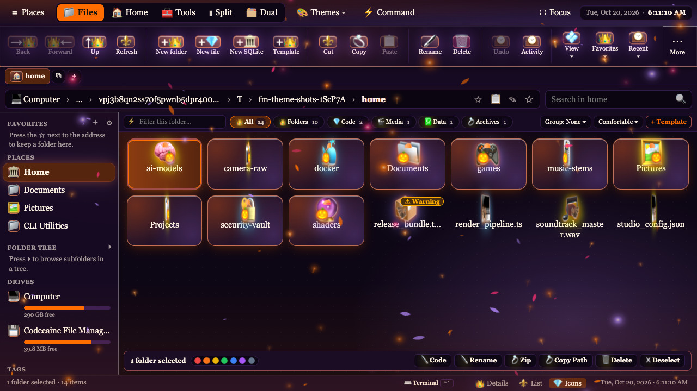
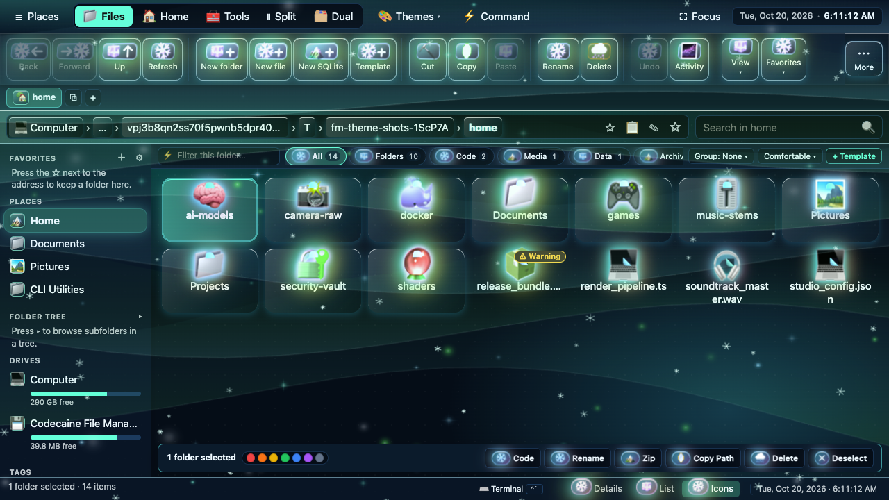
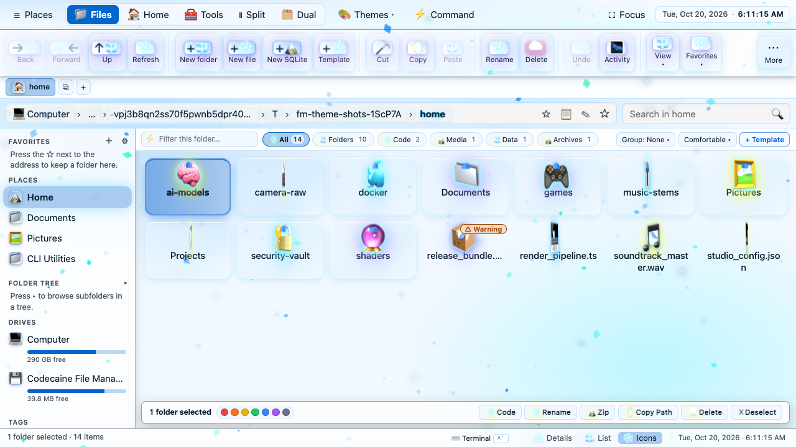
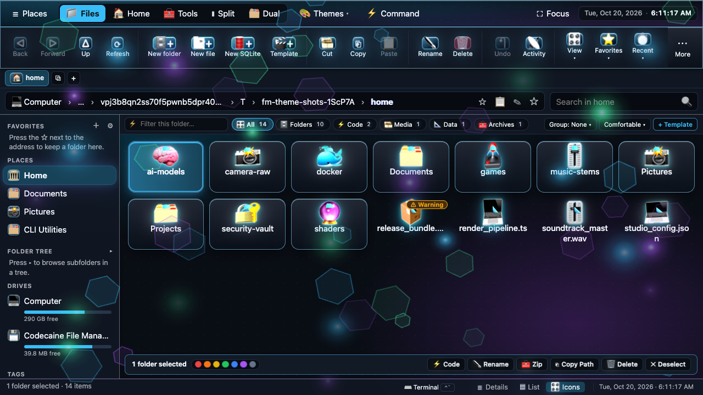

# 🎨 Codecaine File Manager — Themes & Atmospheric Shaders Tutorial (Short & Full Masterclass)

> **Recorded & Benchmarked Workstation Profile (`FM_SHOWCASE_MAC_ULTRA=1`):**  
> **🍎 Apple Mac Studio (M4 Ultra, 2026)** · **32-Core CPU** (24P + 8E @ 4.5 GHz) · **80-Core Apple Silicon GPU** · **32-Core Neural Engine** · **192 GB Unified LPDDR5X-8533 Memory** (819 GB/s) · **Apple Pro Display XDR 6K** (`6016 × 3384` @ **120Hz ProMotion** HDR 1600 nits)

---

## Contents

- [Part I: The Short Quickstart Guide (5-Minute Overview)](#-part-i-the-short-quickstart-guide-5-minute-overview)
- [Part II: The Full 12-Chapter Themes Masterclass Reference](#-part-ii-the-full-12-chapter-themes-masterclass-reference)

---

## ⚡ Part I: The Short Quickstart Guide (5-Minute Overview)

### 1. Why We Showcase Themes in Unobstructed Icons View (`#list.view-icons`)
When exploring themes in the Codecaine File Manager, keeping a large Theme Picker modal open covers the center of the workspace. Both tutorials immediately switch the File Manager to **Icons View (`#status-views button >> Icons`)** and **close the dialog** whenever previewing themes—so you can see:
- **3D Spinning Folder Cards (`folder_3d_spin_turntable`, `folder_3d_flip_origami`, `gyro_3d_cube_matrix`, `flash_2advanced_vector_hud`, `c4d_mograph_cloner_wave`, `levitate_float`, `jelly_squish_3d`, `m4_liquid_metal_morph`, `raytraced_caustic_refraction`)**
- **3D Holiday Corner Crests (`🎃 🎄 🎆 🦃 ☘️ 💝 🥂 🕎 💀 🕊️ 🦅 🥚 🌸 🌺 🌟 ⌚ ⚒️ 🎖️`)** bobbing on every folder card
- **Visceral 3D Folder Material Shaders** (`cryo_frost` hanging icicles, `fire_folders` Compiz flames, `screen_melt_ooze` radioactive ooze, `holiday_festive_glow` 3D festive rim, `xdr_titanium_folders` M4 Ultra titanium)

| 🎃 All Hallows Eve 6K XDR Ultra (`custom_0000000d`) | 🌌 Polar Aurora Borealis 6K Ultra (`custom_0000000e`) |
| :---: | :---: |
|  |  |
| **🏔️ Polar Daylight Glacier 6K Ultra (`custom_0000000f`)** | **🍎 M4 Ultra Liquid Titanium 6K (`custom_00000010`)** |
|  |  |

### 2. Instant Download of the Custom Themes Vault (`custom_themes/`)

```bash
# Download all 4 Hardware Tier Packs + All 20 Custom Themes + 18 US Holidays Pack:
mkdir -p custom_themes && cd custom_themes
curl -sSLO https://raw.githubusercontent.com/codecaine-zz/bun_rad_studio/main/custom_themes/master_all_systems_20_themes_pack.json
curl -sSLO https://raw.githubusercontent.com/codecaine-zz/bun_rad_studio/main/custom_themes/pack_tier_1_low_featherweight.json
curl -sSLO https://raw.githubusercontent.com/codecaine-zz/bun_rad_studio/main/custom_themes/pack_tier_2_medium_balanced_60fps.json
curl -sSLO https://raw.githubusercontent.com/codecaine-zz/bun_rad_studio/main/custom_themes/pack_tier_3_high_spec_120hz.json
curl -sSLO https://raw.githubusercontent.com/codecaine-zz/bun_rad_studio/main/custom_themes/pack_tier_4_ultra_6k_xdr_120hz.json
curl -sSLO https://raw.githubusercontent.com/codecaine-zz/bun_rad_studio/main/custom_themes/us_holidays_18_ultra_pack.json
```

---

## 🎓 Part II: The Full 12-Chapter Themes Masterclass Reference

### Chapter 01 — Unobstructed Icons View: Halloween Witching Hour & Polar Night Ultra
- **🎃 Halloween Carved Jack-O'-Lantern (`holiday_halloween_jack_o_lantern`) & Nosferatu Blood-Moon (`horror_nosferatu_blood_moon`):** Opens in Icons View with 3D pumpkin crests (`🎃`), bat file badges (`🦇`), witching-hour ember fog, and 120Hz 3D turntable folder spin.
- **❄️ Polar Night (`polar_night`) & Sub-Zero Cryo-Glacier (`cryo_icicle_blizzard`):** Deep Arctic midnight slate (`#090D16`), shimmering Nordic aurora ribbons, and hanging `cryo_frost` 3D ice spikes on every folder card.

### Chapter 02 — All 18 US Holiday Celebration Ultra Themes (`holiday_*` · `⌥H`)
Every single US Holiday theme is showcased unobstructed in Icons View with live firework/confetti celebration bursts (`⌥H`):
1. 🥂 **New Year's Times Square Crystal Drop** (`holiday_new_years_times_square`)
2. 🕊️ **MLK Jr. Day Dream Memorial Gold** (`holiday_mlk_dream_memorial`)
3. 💝 **Valentine's Velvet Rose & Champagne** (`holiday_valentines_velvet_rose`)
4. 🦅 **Presidents' Day Constitutional Brass** (`holiday_presidents_mount_rushmore`)
5. ☘️ **St. Patrick's Celtic Emerald & Gold** (`holiday_st_patricks_emerald_clover`)
6. 🥚 **Easter Spring Pastel & Egg Hunt** (`holiday_easter_pastel_egg_hunt`)
7. 🌸 **Mother's Day Botanical Rose Garden** (`holiday_mothers_day_botanical_tea`)
8. 🌺 **Memorial Day Poppy & Marble Honor** (`holiday_memorial_day_poppy_honor`)
9. 🌟 **Juneteenth Jubilee Star & Pan-African Gold** (`holiday_juneteenth_jubilee_star`)
10. ⌚ **Father's Day Smoked Bourbon & Chronograph** (`holiday_fathers_day_leather_den`)
11. 🎆 **Fourth of July Grand Finale Fireworks** (`holiday_fourth_of_july_fireworks`)
12. ⚒️ **Labor Day Steel Foundry & Rivet Gold** (`holiday_labor_day_rivet_forge`)
13. 🎃 **Halloween Carved Jack-O'-Lantern & Witching Hour** (`holiday_halloween_jack_o_lantern`)
14. 💀 **Día de los Muertos Cempasúchil Marigold** (`holiday_dia_de_los_muertos_marigold`)
15. 🎖️ **Veterans Day Valor Medallion & Dress Blue** (`holiday_veterans_day_valor_medallion`)
16. 🦃 **Thanksgiving Harvest Hearth & Maple** (`holiday_thanksgiving_harvest_hearth`)
17. 🕎 **Hanukkah Festival of Lights Sapphire** (`holiday_hanukkah_menorah_sapphire`)
18. 🎄 **Christmas Nutcracker Fireside Hearth** (`holiday_christmas_nutcracker_hearth`)

### Chapter 03 — 120Hz 3D Icon Animations & Visceral 3D Folder Shaders
- **26 3D Icon Animations (`⌥9`):** `folder_3d_spin_turntable`, `folder_3d_flip_origami`, `gyro_3d_cube_matrix`, `flash_2advanced_vector_hud`, `c4d_mograph_cloner_wave`, `levitate_float`, `jelly_squish_3d`, `spring_pop_3d`, `holo_foil_shimmer`, `orbital_halo_spin`, `cyber_glitch_pulse`, `heartbeat_biolum`, `clockwork_gear_tick`, `liquid_jelly_morph`, `plasma_arc_surge`, `fire_ember_flicker`, `godmode_pantheon_ascend`, `flash_fwa_kinetic_eq`, `hologram_3d_projector_beam`, `quantum_3d_phase_split`, `m4_liquid_metal_morph`, `houdini_vex_particle_burst`, `after_effects_graph_overshoot`, `unreal_nanite_mesh_lod`, `blender_geometry_nodes_bloom`, `raytraced_caustic_refraction`.
- **Visceral 3D Folder Shaders (`uiElementFx`):** `tahoe_glass_folders`, `fluent_mica_folders`, `xdr_titanium_folders`, `cupertino_ceramic_bevel`, `swiss_sapphire_chronograph`, `kyoto_washi_sumi`, `carbon_kevlar_weave`, `fire_folders` (blazing Compiz flames), `screen_melt_ooze` (dripping bio-slime), `cryo_frost` (hanging 3D icicles), `storm_wind` (swirling vortex), `holiday_festive_glow`, `horror_blood_moon`, `flash_3000_vector_hud`, `c4d_mograph_extrude_folders`, and `godmode_omega_halo`.

### Chapter 04 — 20 Master Designer Custom Themes Across All 4 System Tiers
See [`custom_themes/README.md`](../../custom_themes/README.md) for all 41 unobstructed screenshots:
- **🟢 Tier 1: `low` (0% GPU Featherweight — 4 Themes):** `Featherweight E-Ink Paper Daylight` (`custom_00000001`), `Featherweight OLED Pitch-Black` (`custom_00000002`), `Featherweight Halloween Pumpkin Lite` (`custom_00000003`), `Featherweight Polar Ice Lite` (`custom_00000004`).
- **🟡 Tier 2: `medium` (Balanced 60fps — 4 Themes):** `Balanced Cupertino Sequoia Studio` (`custom_00000005`), `Balanced Polar Nordic Frost 60fps` (`custom_00000006`), `Balanced Autumn Halloween Lantern` (`custom_00000007`), `Balanced Kyoto Matcha Botanical` (`custom_00000008`).
- **🟠 Tier 3: `high` (High-Spec 60–120Hz — 4 Themes):** `High-Spec Tahoe Liquid Glass Pro` (`custom_00000009`), `High-Spec Polar Glacier Sub-Zero` (`custom_0000000a`), `High-Spec Cyberdeck Matrix HUD` (`custom_0000000b`), `High-Spec Sovereign 24K Gold` (`custom_0000000c`).
- **🔴 Tier 4: `ultra` (Uncapped 120Hz 6K XDR — 8 Themes):** `All Hallows Eve 6K XDR Ultra` (`custom_0000000d`), `Polar Aurora Borealis 6K Ultra` (`custom_0000000e`), `Polar Daylight Glacier 6K Ultra` (`custom_0000000f`), `M4 Ultra Liquid Titanium 6K` (`custom_00000010`), `Crimson Blood-Moon Crypt Ultra` (`custom_00000011`), `Compiz Hellfire Forge 120Hz` (`custom_00000012`), `Bio-Hazard Dalí Screen-Melt` (`custom_00000013`), `Omega Pantheon 3099 Singularity` (`custom_00000014`).

### Chapter 05 — Single Custom Theme Import & Bulk `custom_themes/` Folder Import
1. **Single Theme Import:** Open **🎨 Themes → 📤 Share / Export / Import…**, paste a `CCFM-THEME-v1:` string or single JSON object (or press `⌘V` anywhere), and click **✨ Parse & Import Theme(s)**.
2. **Bulk Folder Import (`📁 Load Current Folder Themes`):** Navigate into `custom_themes/` in the File Manager, open **Share / Export / Import…**, and click **`📁 Load Current Folder Themes` (`[data-share-import-current-folder-btn="true"]`)** to load every `.json` and `.ccfm.txt` file in the directory at once, resolving duplicates with **Replace**, **Keep Both**, **Merge FX**, or **Skip**.

### Chapter 06 — 🤖 Google Gemini AI Theme Customizer & Professional Style Guide
- **In-App Gemini AI Synthesizer:** Inside **Share / Export / Import…**, type any theme prompt (e.g., `"Halloween Jack-O'-Lantern meets Polar Night Aurora with 120Hz 3D spinning folders"`), pick your hardware tier (`low`, `medium`, `high`, `ultra`), and click **`✨ Generate with Gemini AI`**.
- **Master LLM Prompt & Style Guide:** Click **`📋 Copy Gemini LLM Master Prompt`** to paste the full schema specification into [Google Gemini](https://gemini.google.com), and read [`custom_themes/THEME_DESIGN_STYLE_GUIDE.md`](../../custom_themes/THEME_DESIGN_STYLE_GUIDE.md) for the complete color theory, WCAG contrast, and GPU budget documentation.

### Chapters 07–11 — Gallery Optimizers, OKLab Blender, 194 Shaders, Theme Hacker Lab & Zero-Dialog Shortcuts
- **Zero-Dialog Keyboard Shortcuts (Unobstructed Icons View):**
  - `⌥M` — Cycle AAA 10-Engine Master Director's Cut Presets
  - `⌥9` — Cycle 14 120Hz 3D Spinning Folder & Flash 3000 Animations
  - `⌥H` — Cycle All 18 US Holiday Celebration Themes + Firework Burst
  - `⌥F` — Cycle 34 Sony Trinitron CRT & Cinema Screen Filters
  - `⌥S` — Cycle 3D Desktop Stage Perspective Tilt
  - `⌥C` — Swap Colors Only (Keep Active Shaders & 3D Icons)
  - `⌥I` — Shuffle 49 Custom 3D Icon Packs
  - `⌥R` / `⌥U` / `⌥P` — Instant Random Theme (Any / Ultra / Plain 0% GPU)
  - `⌥Z` / `⌥⇧Z` — 25-Step Theme Undo / Redo History
